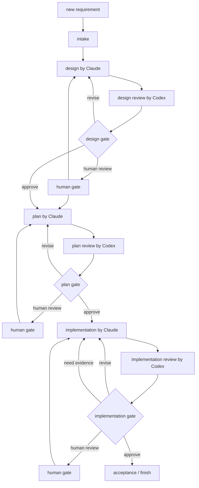
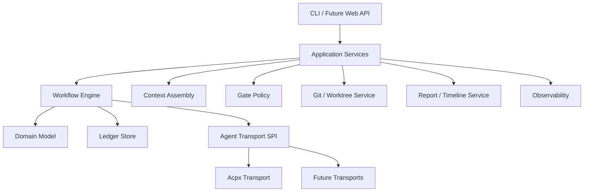
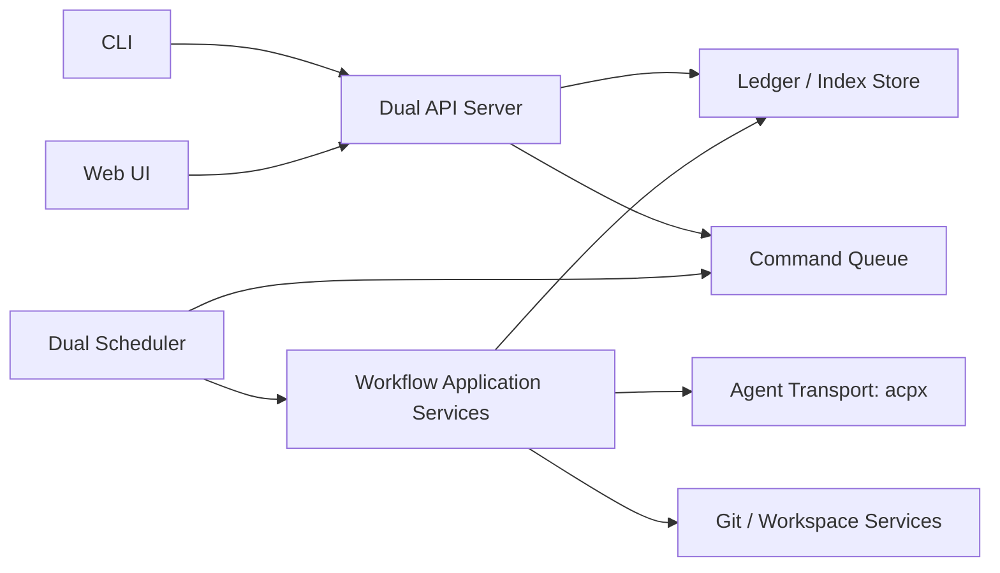

# Dual 生命周期编排器架构设计

## 1. 背景

当前开发流程中，Claude Code 和 Codex 已经形成了清晰分工：

- Claude Code 是主开发 Agent，负责需求澄清、设计、计划、实现、自测和阶段总结。
- Codex 是外部审视者，负责从产品经理、架构师和最终用户视角审视产出物，给出反馈、验收结论和下一阶段提示词。
- 人负责提出需求、做关键判断，并在必要的 review gate 上批准或调整方向。

这套协作方式已经有效，但中间存在大量人工搬运：

1. 把用户需求发给 Claude Code。
2. 把 Claude 的 summary、spec、plan、实现报告复制给 Codex。
3. 把 Codex 的 review、Must Fix、下一阶段提示词再复制回 Claude。
4. Claude 修订后重复上述动作。

人工在这个循环里承担了太多“通讯中继”工作。只要人离开控制台，流程就停住。

现有 `dual-agent-runner` 已经验证了一批重要基础能力：

- 通过 `acpx` 统一调用 Claude 和 Codex。
- 默认 worktree 隔离。
- `.agent/runs/<run_id>/` run ledger。
- prompts、outputs、events、Git diff、验证证据、final report。
- PR、notification、dry-run、continue 等基础运行能力。

但旧 runner 的核心模型仍然更接近一次固定流水线：

```text
Claude PRD/Architecture
  -> Codex Design Review
  -> Claude Implementation
  -> Codex Final Acceptance
```

这个模型适合验证最小双 Agent 流程，不足以托管一个需求从设计到交付的完整生命周期。真实工作会出现：

- 设计阶段多轮 Claude/Codex 往返。
- 计划阶段的外部 review。
- 实现批次之间的阶段验收。
- 人工 review 卡点。
- Claude Code session 上下文爆掉。
- Agent 额度不足，需要过一段时间或换 session 继续。
- 已有 worktree 和已有产物需要 handoff 后继续，而不是重跑。

下一代 dual 需要从“单次 runner”升级为“生命周期编排器”。

## 2. 设计结论

### 2.1 产品定位

dual 是一个基于 Agent transport 的双 Agent 开发生命周期编排器。

它不替代 Claude Code 的开发方法，也不把 Codex 变成第二个实现者。它托管跨 Agent 的协作过程：

- 选择当前阶段应该由谁工作。
- 自动把上游产出物装配成下游输入。
- 维护阶段状态、多轮 review、暂停和恢复。
- 保存可复盘的 ledger、证据和决策。
- 在关键节点让人 review，而不是让人一直 copy/paste。

### 2.2 技术方向

下一代系统建议新建 Java/Spring Boot 项目。

原因：

- 生命周期状态机、checkpoint、resume、gate policy 已经超过大 Bash 脚本的舒适区。
- Java 更适合承载稳定领域模型、结构化文件读写、状态迁移测试和后续 API/UI。
- 用户本身熟悉 Java，可以降低长期维护成本。

现有 Shell runner 保留：

- 作为已经可用的 MVP runner。
- 作为新系统迁移过程中的行为参考。
- 必要时作为某些本地执行动作的验证原型。

### 2.3 Agent transport 方向

`acpx` 继续作为第一阶段默认 Agent transport。

```text
dual orchestrator
  -> AgentTransport
      -> AcpxTransport
          -> acpx claude ...
          -> acpx codex ...
```

transport 层必须可替换。未来可以增加：

- Cursor transport。
- 其他 coding agent transport。
- 直接模型 transport。

Spring AI 可以加入架构，但不替代 `acpx`：

- 可用于结构化输出、辅助摘要、router、context compaction、MCP 和观测。
- 不应在第一版把 Claude Code/Codex coding session 直接换成普通 ChatClient 请求。

## 3. 目标与非目标

### 3.1 目标

第一阶段架构必须支持：

1. 从一个用户需求创建长期 workstream。
2. 让 Claude 和 Codex 自动交换阶段产物。
3. 支持设计、计划、实现、验收之间的多轮往返。
4. 支持人配置 review gate。
5. 支持 context window、quota、进程失败后的 checkpoint 和 resume。
6. 保存 run、artifact、decision、evidence、handoff、human review 的完整记录。
7. 默认在安全 worktree 中执行会修改代码的工作，并允许长期 workstream 在后续阶段扩展到多个 workspace。
8. 让未来 UI 能根据 ledger 画出 timeline，而不是依赖运行时内存。
9. 保持 Agent transport 可替换，默认优先适配 `acpx`。

### 3.2 非目标

第一版不做：

1. 通用 AI coding IDE。
2. 自动 merge。
3. 把 Claude Code 内部 Superpowers 每一个子步骤脚本化。
4. 为每种外部工具写专用通知 API。
5. 无边界的完全自治产品经理。
6. 一开始就做完整 Web UI。
7. 依赖数据库作为唯一事实源。
8. 因为 Java 化而废弃当前可用的 Shell runner。

## 4. 角色边界

### 4.1 Claude Code

Claude 是主开发 Agent。

职责：

- 需求澄清。
- 使用 Superpowers 或仓库已有工作流完成设计。
- 编写 spec、plan、实现、自测报告。
- 根据 Codex Must Fix 修订。
- 产出阶段 summary 和 handoff。

约束：

- Claude 是默认唯一允许修改业务代码的 Agent。
- 不因为 Codex 提了建议就盲改，必须结合仓库和用户约束判断。
- 每个阶段结束时输出可交接产物。

### 4.2 Codex

Codex 是外部审视 Agent。

职责：

- 审视需求和设计是否完整。
- 审视计划是否可执行、是否越界。
- 审视实现报告、自测报告、Git 证据和用户验收面。
- 给出结构化 decision、Must Fix、风险和下一步 handoff 建议。
- 在阶段通过时生成下一阶段给 Claude 的提示词。

约束：

- Codex 默认不修改业务代码。
- Codex 不替代 Claude 的实现自测。
- Codex 关注外部审视和 gate，不把 review 变成无止境重设计。

### 4.3 Human

Human 是需求所有者和关键 gate reviewer。

职责：

- 提供初始目标和硬约束。
- 在配置的 human gate 上批准、修订或终止。
- 在 Agent 出现冲突、风险过高、目标变化时做裁决。

约束：

- 人不应再负责在 Agent 之间手动搬运产出物。
- 系统必须把需要人判断的材料收成一个可 review package。

## 5. 与 Superpowers 的关系

Superpowers 主要约束 Claude Code 侧的开发方法。

它已经提供：

- `brainstorming` 的设计门禁。
- `writing-plans` 的实现计划编写。
- `executing-plans` 或 `subagent-driven-development` 的执行方式。
- `verification-before-completion` 的证据要求。
- `finishing-a-development-branch` 的收尾选择。

dual 不重写这套内部方法。dual 只在阶段边界上托管交接：

| 阶段边界 | Claude 侧产出 | Codex 侧动作 |
| --- | --- | --- |
| 设计草案完成 | design summary / spec / open questions | design review |
| 计划完成 | implementation plan | plan review |
| 实现批次完成 | change summary / self-test report / evidence | implementation review |
| 阶段待交付 | acceptance package | acceptance decision / next-stage prompt |

给 Claude 的提示词应声明当前阶段和边界，例如：

```text
Current stage: design.
Use the repository's Superpowers workflow when applicable.
Do not implement code in this stage.
Produce a handoff artifact for external review when this stage step completes.
```

## 6. 核心领域模型

### 6.1 Workstream

`Workstream` 表示一个需求、产品子目标或长期开发主题。

示例：

```text
treatment-event-chain-redesign
```

核心字段：

```text
workstream_id
title
original_requirement_path
repository
original_workdir
effective_workdir
branch
status
current_stage
current_iteration
primary_workspace_id
created_at
updated_at
```

### 6.2 Workspace

`Workspace` 表示 workstream 当前可执行或可审视的工作空间。

第一版默认行为：

- 一个 workstream 创建一个 active worktree。
- 设计、计划和首批实现默认复用这个 active workspace。
- Stage 和 Run 都记录自己实际使用的 workspace。

领域模型不把 workstream 和 worktree 写死为一对一。长期需求可能拆成多个交付批次、分支或 PR，因此应保留：

```text
Workstream 1 --- N Workspace
```

Workspace 可以表示：

- 原始仓库。
- Git worktree。
- 未来接入的远端或其他 Agent workspace。

核心字段：

```text
workspace_id
workstream_id
kind
original_workdir
effective_workdir
branch
base_branch
base_commit
status
is_primary
created_at
```

保留一对多的好处：

- 大需求后续可以按批次拆分 implementation workspace 和 PR。
- resume 能明确绑定到当前 active workspace。
- 未来 transport 不必假定所有 Agent 都在同一种本地目录里工作。

MVP 仍坚持单 active worktree，避免一开始引入跨 worktree 状态分叉。

第二个 workspace 代表新的执行交付线，不是普通 revise 或 resume 的默认出口。允许创建的典型场景：

- 一个 workstream 被 human 批准拆成多个独立交付批次。
- 当前交付线已经进入 PR 或保留状态，需要新的 follow-up 线。
- 有明确基于主干或 release 基线的 hotfix 线。
- human 明确要求保留两个实验实现作比较。

普通 Codex Must Fix、补证据、自测补充和 context window 爆掉后的恢复都继续使用当前 workspace。  
Claude 或 Codex 可以建议新 workspace，但 MVP 默认要求 human 显式批准创建。

Workspace purpose 建议先保留：

```text
primary
delivery_batch
follow_up
hotfix
experiment
```

### 6.3 Stage

`Stage` 表示生命周期中的工作阶段。

默认阶段类型：

```text
intake
design
plan
implementation
acceptance
handoff
finish
```

阶段是可扩展集合，不应把每个用户任务都强塞成一模一样的固定图。

核心字段：

```text
stage_id
workstream_id
type
status
entry_reason
input_artifacts
output_artifacts
workspace_id
gate_policy
started_at
finished_at
```

### 6.4 Iteration

`Iteration` 表示一个阶段中的一次 Claude/Codex 往返。

例如：

```text
design iteration 1
design iteration 2
implementation review iteration 1
```

核心字段：

```text
iteration_id
stage_id
number
objective
status
claude_run_id
codex_run_id
decision
handoff_artifact
started_at
finished_at
```

### 6.5 Run

`Run` 表示一次真实执行记录。

它可以是：

- 一次 Claude design run。
- 一次 Codex design review run。
- 一次 Claude implementation run。
- 一次 resume run。
- 一次 evidence collection run。

当前 `.agent/runs/<run_id>/` 模型继续保留。

### 6.6 Artifact

`Artifact` 是阶段间交接的事实载体。

常见 artifact：

```text
user_requirement
design_spec
design_summary
plan
claude_self_test_report
git_evidence
codex_review
codex_acceptance
human_review_note
handoff_prompt
checkpoint
final_report
```

关键 artifact 采用双产物契约：

- Markdown 是阅读面，给 human、Claude 和 Codex 看。
- JSON metadata 是控制面，给 orchestrator、resume、timeline 和未来 UI 看。

示例：

```text
claude-handoff.md
claude-handoff.json
codex-review.md
codex-review.json
```

这样不会把结构化状态寄托在 Markdown parser 上，也不会把完整解释压缩成难读的裸 JSON。

### 6.7 Decision

`Decision` 是 gate 结果。

建议先统一为系统级枚举，再保留阶段原始 decision：

```text
approve
revise
blocked
reject
pause_for_human
pause_for_resume
```

例如 Codex 原始输出：

```text
Decision: NEEDS_REVISION
```

可以映射为：

```text
system_decision = revise
```

## 7. 生命周期模型

### 7.1 默认生命周期



### 7.2 状态迁移

建议第一版使用显式状态迁移，不先引入重型 workflow engine。

Workstream 级状态示例：

```text
new
running
waiting_for_agent
waiting_for_human
paused_quota
paused_context_limit
blocked
rejected
completed
failed
```

Stage 级状态示例：

```text
pending
in_progress
review_pending
revision_pending
human_review_pending
approved
blocked
completed
```

每次迁移都必须写 event：

```text
from_status
to_status
reason
actor
related_run_id
related_artifact_id
```

## 8. Handoff 协议

### 8.1 原则

Agent session 不是事实源。

事实源是 ledger 中的 artifact、decision、checkpoint 和 events。

因此每次 Agent 交接必须生成 handoff，而不是指望下游 Agent 自动继承上游 session 记忆。

Handoff 与 checkpoint 分工不同：

- `semantic handoff` 帮下一个 Agent 理解已经完成的工作、风险和下一步。
- `runtime checkpoint` 保证 orchestrator 在 Agent rate limit、context window 满、进程挂掉或 session 切换后仍能恢复。

不能把 resume 依赖在 Agent 成功写出 handoff 上。

### 8.2 Claude Handoff

Claude handoff 第一版采用 Markdown + JSON metadata。

Markdown 产物至少包含：

```text
stage
objective
completed_work
artifacts_produced
files_changed
self_test_or_validation
open_questions
known_risks
recommended_next_action
```

不同阶段增加专属内容：

- design 阶段增加 design/spec 路径、未决产品问题。
- plan 阶段增加 plan 路径、任务拆分风险。
- implementation 阶段增加 diff 摘要、自测证据、未覆盖项。

JSON metadata 至少包含：

```text
artifact_type
stage
iteration
status
markdown_path
produced_artifacts
files_changed
validation_refs
open_questions
risks
recommended_next_action
```

Claude 可以按 prompt contract 直接输出结构化块，也可以先写 Markdown，再由 orchestrator 生成和校验 metadata。ledger 层必须最终拿到 JSON metadata。

职责分层：

- orchestrator 永远生成 runtime metadata 和 checkpoint，例如 run id、stage、exit code、stdout/stderr、Git evidence reference、failure kind。
- Claude 成功完成阶段工作时，优先生成 semantic handoff，例如 completed work、open questions、risks、recommended next action。
- 如果 Claude 已产出主要 Markdown，但 JSON semantic metadata 缺失或格式坏，orchestrator 可以触发有限格式修复或 metadata 抽取。
- 如果 Claude 在主要工作完成前就被 rate limit、context limit 或进程失败中断，orchestrator 只记录 partial/failure checkpoint，不伪造“阶段已完成”的 semantic handoff。

### 8.3 Codex Handoff

Codex review 第一版也采用 Markdown + JSON control artifact。

Markdown 负责完整审视说明，至少覆盖：

```text
stage
decision
summary
must_fix
should_fix
risks
acceptance_criteria
next_prompt_for_claude
human_review_recommendation
```

`next_prompt_for_claude` 是解决 copy/paste 痛点的关键产物之一。

JSON control artifact 必须让状态机无需解析长篇 Markdown 即可推进：

```text
artifact_type
stage
iteration
decision
system_decision
must_fix
risks
recommended_next_action
requires_human_review
next_prompt_ref
markdown_path
```

当 `acpx` 返回的结构化块无法通过 schema validation 时，orchestrator 必须记录格式失败，并选择一次格式修复请求或暂停，而不是默默猜测 gate 结果。

结构化控制面采用 fail-fast 策略：

1. 先校验 schema。
2. 校验失败时最多触发一次 repair prompt，只修 JSON 控制面，不重跑完整 review。
3. repair 仍失败时保留原始 Markdown 和 invalid JSON，写入失败 event，进入 human intervention。

repair prompt 必须带上原始结构化块、schema errors 和已完成 review 的引用，避免 Codex 因格式修复重新改变 review 判断。

### 8.4 Human Review Package

触发 human gate 时，系统应生成一个 review package：

```text
review_reason
current_stage
current_decision
what_changed_since_last_gate
artifacts_to_read
must_decide
recommended_options
resume_command
```

人批准后写入 human decision artifact，再继续状态迁移。

## 9. Context 分层装配

### 9.1 问题

如果每次 prompt 都包含所有历史，系统很快撞上 context window 限制。  
如果只靠 Agent session 记忆，quota、重启和新 session 又会让状态丢失。

### 9.2 分层模型

建议将上下文分为四层：

#### L0 原始需求层

- 用户最初需求。
- 人工补充约束。
- 仓库规则，如 `CLAUDE.md`、`AGENTS.md`。

#### L1 持久阶段产物层

- 当前有效 spec。
- 当前有效 plan。
- 最新 Codex review。
- 最新 Claude handoff。
- 当前阶段关键证据。

#### L2 当前工作包层

每次 Agent 调用实际注入的上下文：

- 当前 stage 和 objective。
- 当前轮输入 artifact。
- 必须遵守的约束。
- 上一轮 Must Fix。
- 要读的文件清单。
- 输出契约。
- token budget 下的摘要或引用。

#### L3 追溯历史层

- events。
- 原始 outputs。
- steps metadata。
- snapshots。
- 所有旧 iteration。

L3 默认不直接塞进 prompt，只用于复盘、resume 和按需引用。

### 9.3 Context Package

每次调用 Agent 前生成 `context package`：

```text
context_package_id
target_agent
stage
iteration
objective
artifact_refs
inline_context
read_before_work
do_not_load_by_default
token_budget_policy
```

Prompt renderer 只渲染 context package，不直接从整个 workstream 拼全文。

### 9.4 Token Budget Policy

第一版不需要做复杂 token 精算，但要有明确策略：

1. 优先引用文件路径而不是复制长文件全文。
2. 优先放当前有效产物，不放所有历史版本。
3. 对旧 review 保留 decision 和 Must Fix 摘要。
4. 对长日志保留命令、exit code、摘要和日志路径。
5. 在 context 超限风险出现时，生成 compaction artifact，再换新 session 继续。

## 10. 暂停、恢复与 session 续跑

### 10.1 暂停原因

第一版应识别：

```text
manual_pause
human_review_required
quota_exhausted
context_window_exceeded
agent_failed
transport_failed
blocked_decision
```

### 10.2 Checkpoint

每次稳定边界都生成 checkpoint。

稳定边界包括：

- Agent run 完成。
- Codex decision 完成。
- human gate 暂停。
- quota/context 失败已捕获。
- worktree 或 PR 等外部动作完成。

Checkpoint 至少包含：

```text
checkpoint_id
workstream_id
stage
iteration
last_completed_action
pending_action
resume_reason
required_artifacts
recommended_context_package
session_strategy
resume_command
created_at
```

Checkpoint 分两类状态：

- `stable`：上一个动作完整完成，可以按下一动作继续。
- `partial_or_failed`：Agent 未完成或 transport 中断，只能带 partial output 和失败事实恢复，不能把当前阶段标记为已完成。

### 10.3 Resume

`resume` 不尝试恢复 Agent 脑内状态。  
它读取 checkpoint，生成新的 handoff 和 context package，再选择：

- 复用现有 session。
- 新建同 Agent 新 session。
- 暂停等待额度。
- 要求人类决策。

### 10.4 Session Strategy

Agent session 作为 transport metadata 保存：

```text
agent
transport
session_id_or_name
workdir_binding
created_at
last_used_at
health_status
```

当 Claude Code context 爆掉时，推荐策略是：

1. 从最新 checkpoint 生成 resume package。
2. 新 session 读取当前有效 spec、plan、handoff、Must Fix。
3. 明确告诉新 session 不要无故重启已经通过的阶段。

## 11. Ledger 与目录结构

### 11.1 事实源

第一版继续 file-first。

文件 ledger 的优点：

- 能跟 worktree 一起保留。
- 能人工检查。
- 断电后仍可恢复。
- 方便 Git diff 和 artifact 追溯。

数据库可在可视化阶段作为索引或查询层加入，但不应一开始取代 ledger。

### 11.2 建议目录

```text
.agent/
  config.json
  workstreams/
    <workstream_id>/
      workstream.json
      requirement.md
      timeline.jsonl
      current/
        stage.json
        context-package.json
        checkpoint.json
      stages/
        01-design/
          stage.json
          iterations/
            001/
              iteration.json
              claude-handoff.md
              claude-handoff.json
              codex-review.md
              codex-review.json
              next-claude-prompt.md
        02-plan/
        03-implementation/
      artifacts/
        <artifact_id>.json
      checkpoints/
        <checkpoint_id>.json
      reports/
        workstream-report.md
  runs/
    <run_id>/
      run.json
      events.jsonl
      prompts/
      outputs/
      steps/
      snapshots/
      verification/
      final-report.md
```

### 11.3 Run 与 Workstream 的关系

```text
Workstream
  has many Stages
Stage
  has many Iterations
Iteration
  has many Runs
Run
  records one executable action group
```

一个 run 必须能反查：

```text
workstream_id
stage_id
iteration_id
actor
transport
```

## 12. Human Gate

### 12.1 Gate Policy

human gate 应可配置。

默认策略：

```json
{
  "human_gates": {
    "after_design_review_pass": true,
    "after_plan_review_pass": false,
    "before_pr": true,
    "on_blocked": true,
    "on_high_risk": true,
    "on_scope_change": true
  }
}
```

设计阶段默认需要人批准。Codex design review `PASS` 表示设计已经具备进入下一阶段的条件，不等于用户已经接受产品方向。  
当设计已经由人确认、Codex plan review 也通过且没有范围变化时，默认可以自动进入 implementation；更严格的仓库可以把 plan gate 也改成人审。

### 12.2 Gate 行为

触发 gate 时：

1. 停止自动推进。
2. 写入 timeline event。
3. 生成 review package。
4. 提供继续命令。
5. 等待 human decision artifact。

### 12.3 Human Decision

第一版可支持：

```text
approve
revise_with_feedback
change_scope
stop
```

## 13. Worktree、Git 与交付动作

### 13.1 安全执行环境

会修改代码的阶段默认使用 worktree。

只读 review 阶段可以：

- 在 worktree 中运行。
- 或读取已有 artifact，不进入写代码 Agent。

设计原则：

- 原始仓库不应被默认业务修改污染。
- workstream 和 workspace 要记录 original workdir、effective workdir、branch、base commit。
- resume 必须能 attach 到已有 worktree。
- MVP 中一个 workstream 默认只有一个 active worktree；后续多批交付可以为同一 workstream 增加 workspace，而不是重定义 workstream。

### 13.2 Git Evidence

实现与验收阶段要保留：

- base commit。
- branch。
- status before/after。
- diff stat。
- diff patch 或 patch reference。
- changed files。
- commit list。

### 13.3 PR 与通知

PR 和 notification 保持可选能力。

- PR 不是默认行为。
- notification 继续优先支持通用 command 或 adapter。
- 失败不得丢失 ledger。

## 14. 可观测性与可视化

### 14.1 现在就要记录的数据

UI 可以后做，但现在必须记下能画 UI 的数据：

- lifecycle transition。
- Agent run timeline。
- stage/iteration 关系。
- decision。
- artifact lineage。
- pause/resume。
- human gate。
- transport error。
- quota/context error。
- Git and verification evidence。

### 14.2 未来页面

未来可视化可以围绕 workstream 展开：

1. Workstream 列表。
2. 当前状态和等待对象。
3. 阶段 timeline。
4. 每轮 Claude/Codex 交接。
5. Must Fix 关闭情况。
6. 当前 checkpoint 和 resume 操作。
7. PR、branch、worktree、verification。

## 15. 技术架构

### 15.1 总体分层



目标 runtime 可进一步展开为：



### 15.2 第一版运行形态

第一版采用 CLI-first，不先引入常驻 daemon。

推荐命令形态：

```text
dual start
dual status
dual resume
dual review approve
dual review revise
```

每次 CLI 调用读取 ledger、推进到下一个稳定边界、写回 checkpoint 后退出。稳定边界可以是 human gate、quota/context pause、blocked 或阶段完成。

未来 daemon 是后台常驻 orchestrator：

- 可以在终端退出后继续调度 workstream。
- 可以为 Web UI 和队列提供 API。
- 也会引入锁、并发、后台进程恢复、任务队列和日志路由复杂度。

CLI-first 先验证生命周期模型和 handoff 协议，同时保持将来增加 daemon/API/UI 的分层空间。

#### Workstream Mutation Lock

CLI-first 仍需要最小同 workstream 并发保护。

- `resume`、`review approve`、`review revise` 和其他会推进状态的命令必须持有 workstream exclusive mutation lock。
- `status` 和只读 artifact 查看可以走只读访问。
- 锁冲突时提示已有 dual 进程正在推进该 workstream，而不是并行写 ledger。

第一版只需要本地文件锁语义，不引入分布式锁。

#### Future API Server and Scheduler

远期 runtime 明确拆成两个逻辑组件，即使早期可以运行在同一个 Spring Boot 进程中：

- API Server 负责 command、query、artifact/timeline 访问和 human review API。
- Scheduler 负责 ready workstream 调度、retry timing、quota backoff、后台 resume 和通知触发。

CLI 后续可以作为 API client，也可以在本地模式继续直接调用 Application Services。

### 15.3 建议模块

如果单仓库新建 Java 项目，建议先保持模块克制：

```text
dual-orchestrator/
  dual-core/
    domain
    workflow
    context
    ledger
  dual-adapter-acpx/
    process invocation
    session metadata
    stdout/stderr capture
  dual-adapter-git/
    worktree
    evidence
    pr hooks later
  dual-cli/
    commands
    human review commands
    resume commands
  dual-spring-ai/
    optional structured model helpers
    optional compaction/router helpers
```

第一版也可以先做成一个 Spring Boot 工程内的 package 分层，等边界稳定再拆 Maven/Gradle module。

### 15.4 关键接口

#### AgentTransport

```java
interface AgentTransport {
    AgentRunResult run(AgentRunRequest request);
    TransportHealth health(AgentTarget target, Workdir workdir);
}
```

默认实现：

```text
AcpxAgentTransport
```

#### WorkflowEngine

```java
interface WorkflowEngine {
    Workstream create(CreateWorkstreamCommand command);
    TransitionResult advance(WorkstreamId id);
    TransitionResult resume(ResumeCommand command);
    TransitionResult applyHumanDecision(HumanDecisionCommand command);
}
```

#### ContextAssembler

```java
interface ContextAssembler {
    ContextPackage build(ContextRequest request);
}
```

#### LedgerStore

```java
interface LedgerStore {
    void appendEvent(LifecycleEvent event);
    void saveArtifact(Artifact artifact);
    void saveCheckpoint(Checkpoint checkpoint);
    WorkstreamSnapshot load(WorkstreamId id);
}
```

## 16. Spring AI 的使用边界

### 16.1 适合引入的能力

Spring AI 可优先用于：

- 结构化 output mapping。
- 非 coding agent 的摘要和 compaction。
- router 或 evaluator 的实验性实现。
- 未来 MCP 能力。
- AI 调用观测。

### 16.2 不应依赖的能力

第一版不应把以下能力建在 Spring AI chat memory 上：

- workstream 状态。
- checkpoint。
- artifact lineage。
- human gate。
- resume 语义。

这些必须属于 dual 自己的领域层和 ledger。

### 16.3 与 acpx 的关系

Spring AI 是 AI 应用能力库。  
`acpx` 是第一阶段 coding Agent transport。

两者不是二选一：

```text
acpx handles coding-agent communication
Spring AI may help structured AI helpers
dual owns lifecycle state
```

## 17. MVP 建议

### 17.1 MVP 目标

第一版新 orchestrator 不追求跑完整产品生命周期全部分支。  
它要先证明新的模型能解决最痛的 copy/paste 回路，并且不会再把状态塞进 Bash 变量。

### 17.2 MVP 范围

建议先实现一个设计回路：

```text
requirement
  -> Claude design
  -> Codex design review
  -> Claude revise
  -> repeat until gate
  -> default human approval after Codex PASS
```

MVP 必须包含：

1. 新建 workstream。
2. 单 active worktree workspace 准备。
3. Acpx Claude/Codex transport。
4. Stage/Iteration/Run ledger。
5. Claude Markdown handoff + JSON metadata artifact。
6. Codex Markdown review + JSON control artifact。
7. `revise` loop。
8. human gate。
9. checkpoint/resume。
10. runtime checkpoint 与 semantic handoff 分离。
11. Codex structured control artifact 一次 repair 后 fail-fast。
12. 同 workstream exclusive mutation lock。
13. CLI-first 的 timeline/status/resume/review。

### 17.3 MVP 后续顺序

建议顺序：

1. Design loop。
2. Plan loop。
3. Implementation batch loop。
4. Acceptance/PR handoff。
5. Notification and web timeline。

## 18. 迁移策略

### 18.1 旧 runner

现有 Shell runner 保留，不阻塞新架构实验。

建议明确标记：

- `dual-agent-runner` 是 run-oriented Bash MVP。
- `dual-orchestrator` 是 workstream-oriented next generation。

### 18.2 能复用的资产

可复用：

- Prompt 责任边界。
- run ledger 经验。
- acpx 调用约定。
- worktree 安全默认值。
- event schema、Git evidence、PR/notification 的失败保账原则。

需要重建：

- 生命周期状态机。
- 多轮迭代模型。
- handoff/checkpoint。
- context package。
- human gate。

## 19. 风险与后续问题

### 19.1 风险

1. 过早把生命周期设计成过度固定的流水线，会再次限制真实工作流。
2. 过早把 router 做成核心，会让文本分类掩盖真正的 stage/gate 模型。
3. 对 Claude session 记忆依赖过多，会让 context 爆掉后的 resume 失真。
4. Java 项目一开始做太多 UI、数据库、插件，会拖慢对核心 loop 的验证。
5. 如果 handoff contract 太弱，系统只是把 copy/paste 从人转移成了模糊 prompt 拼接。

### 19.2 后续问题

1. 第二 workspace 的 human approval 在 CLI 中采用独立命令，还是作为 gate review 的一个 approved option？
2. 需要 metadata repair 时，优先继续使用原 transport session，还是允许 orchestrator 选择更稳定的 extractor transport？
3. context compaction artifact 的第一版 schema 应只保存 resume 摘要，还是同时保存被丢弃上下文的引用清单？
4. API Server 和 Scheduler 进入下一阶段时，命令队列先使用 ledger-backed queue 还是独立持久队列？
5. file-first ledger 与后续查询索引如何做单向同步，避免 UI 索引被误当事实源？

## 20. 验收标准

这份架构进入实现前，应先满足：

1. 明确 dual 不替代 Superpowers，而是托管跨 Agent 生命周期。
2. 明确 `acpx` 是默认 transport 且可替换。
3. 明确旧 Shell runner 与新 orchestrator 的关系。
4. 明确 `Workstream / Stage / Iteration / Run` 模型。
5. 明确 `Workspace` 一对多模型与 MVP 单 active worktree 默认值。
6. 明确 handoff、context package、checkpoint 和 human gate。
7. 明确 design PASS 默认触发 human approval gate。
8. 明确 Claude handoff 和 Codex review 采用 Markdown + JSON 双产物契约。
9. 明确 runtime checkpoint 与 semantic handoff 分工，失败时不伪造完成状态。
10. 明确结构化输出一次 repair 后 fail-fast 进入 human intervention。
11. 明确 MVP 对同 workstream 变更操作使用 exclusive mutation lock。
12. 明确第一版 CLI-first，后续 API Server 与 Scheduler 作为两个逻辑组件演进。
13. 明确 token/context 问题靠 ledger 和 context 分层解决，不靠无限 session memory。
14. 明确 Java/Spring Boot 是下一代主实现方向，Spring AI 是选择性能力层。
