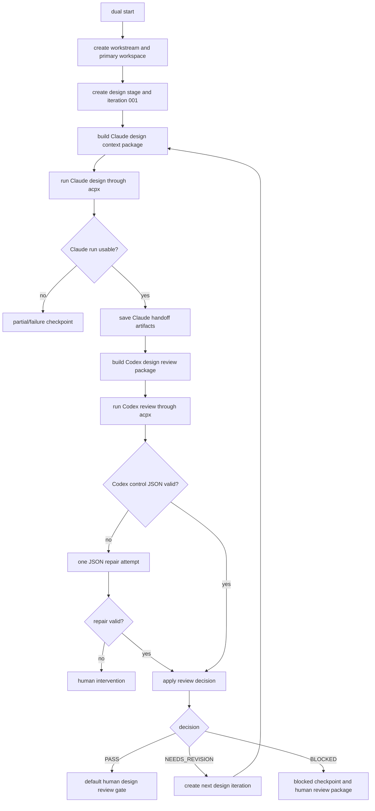

# Dual Orchestrator Design Loop MVP Spec

## 1. Purpose

This spec defines the first Java/Spring Boot MVP for the next-generation dual orchestrator.

The MVP automates the most frequent manual loop in the current workflow:

```text
user requirement
  -> Claude design work
  -> Codex external design review
  -> Claude revision when Codex requires it
  -> human review gate after Codex PASS
```

The MVP does not attempt to complete planning, implementation, acceptance, PR creation, web UI, or background scheduling. It proves the new lifecycle model before those phases are added.

## 2. Product Goal

Given a repository and a user requirement, dual should create an isolated workstream, let Claude and Codex exchange design artifacts through `acpx`, record the full design-review lifecycle in a durable ledger, and pause at a human review package once Codex says the design can proceed.

The human should not need to copy Claude output into Codex or copy Codex feedback back into Claude during this loop.

## 3. Decisions Inherited From Architecture

The MVP follows the architecture decisions in [Dual 生命周期编排器架构设计](./2026-05-22-dual-lifecycle-orchestrator-architecture.md):

1. `acpx` is the default Agent transport and remains replaceable.
2. The current Bash `dual-agent-runner` remains available; this MVP starts the Java orchestrator path.
3. Core lifecycle model is `Workstream -> Workspace -> Stage -> Iteration -> Run`.
4. The model allows one workstream to have multiple workspaces later; MVP creates one active primary worktree workspace.
5. Codex design `PASS` triggers a human approval gate by default.
6. Claude handoff and Codex review use Markdown plus JSON control metadata.
7. Runtime checkpoint and semantic handoff are separate.
8. Structured control artifact validation gets one repair attempt, then fails into human intervention.
9. Mutating commands use an exclusive same-workstream lock.
10. Runtime is CLI-first. API server and scheduler are target architecture, not MVP scope.
11. CLI implementation uses Picocli with Spring Boot application services.
12. Acpx sessions are auto-created by default when missing in the effective workspace, with configuration to disable the behavior.
13. Agent artifact delivery uses specified ledger file paths plus a small stdout marker manifest.
14. Workstream, workspace, and run IDs use a readable type prefix, UTC timestamp, and short unique suffix.
15. MVP always stops at the design human gate and does not expose a CLI override to skip it.
16. The Java CLI binary name is `dualctl` while the Bash runner keeps `dual`.
17. Initial implementation uses a multi-module Maven layout.
18. Missing stdout artifact manifest is a strict artifact protocol failure.
19. Workstream mutation lock uses local `FileChannel.tryLock()` plus owner metadata.
20. MVP smoke verification uses real `acpx` runs before adding transport fixtures.

## 4. Scope

### 4.1 In Scope

The MVP must support:

1. Creating a workstream from a requirement string or requirement file.
2. Creating one default Git worktree workspace for the workstream.
3. Creating a design stage and design iteration `001`.
4. Running Claude through `acpx` for design work only.
5. Running Codex through `acpx` for external design review only.
6. Passing Codex `NEEDS_REVISION` feedback back to Claude automatically.
7. Repeating design iterations until:
   - Codex returns `PASS`.
   - Codex returns `BLOCKED`.
   - Agent transport or structured output fails beyond recovery.
   - A pause condition is detected.
8. Pausing at the default human review gate after Codex `PASS`.
9. Saving workstream ledger, run ledger, timeline events, artifacts, checkpoints, and review package.
10. Resuming after a stable or partial checkpoint.
11. Showing status and artifact paths from the CLI.

### 4.2 Out of Scope

The MVP must not:

1. Advance into plan writing after human approval.
2. Implement code changes.
3. Run implementation tests or final acceptance.
4. Create PRs.
5. Send notifications.
6. Start a daemon, API server, scheduler, or Web UI.
7. Create a second workspace.
8. Automatically compact large context with a separate model.
9. Depend on a database.
10. Replace Claude Code or Codex coding sessions with direct Spring AI chat calls.

Human approval in the MVP should end the design loop with a clear next-phase handoff. A later plan-loop feature will consume that handoff.

## 5. User Experience

### 5.1 Start A Design Workstream

Requirement file:

```bash
dualctl start --task-file ./requirement.md
```

Inline requirement:

```bash
dualctl start "为治疗安排详情页设计 A6 添加检查/检验项流程"
```

Optional workdir:

```bash
dualctl start --workdir /path/to/repo --task-file ./requirement.md
```

Expected console summary:

```text
Dual workstream started
Workstream: ws-20260522-...
Stage: design
Mode: worktree
Original repo: /path/to/repo
Workspace: /path/to/repo-agent-runs/ws-...
Branch: ai/ws-...

Claude design iteration 001 completed.
Codex review decision: PASS

Waiting for human design review.
Review package: <path>
Status: dualctl status <workstream_id>
Approve: dualctl review approve <workstream_id>
Revise: dualctl review revise <workstream_id> --feedback-file <path>
```

When Codex returns `NEEDS_REVISION`, the command may continue automatically into the next design iteration until another terminal condition is reached.

### 5.2 Status

```bash
dualctl status <workstream_id>
```

Expected output must include:

```text
Workstream
Current workspace
Current stage
Current iteration
Current status
Last Codex decision
Pending human action or pending resume action
Latest checkpoint
Key artifact paths
```

### 5.3 Resume

```bash
dualctl resume <workstream_id>
```

`resume` must:

1. Acquire the workstream mutation lock.
2. Load current checkpoint.
3. Refuse to advance when a human decision is required.
4. Continue from pending action when checkpoint is stable.
5. Create a recovery context package when checkpoint is partial or failed.
6. Write a new timeline event for the resume attempt.

### 5.4 Human Review

Approve current design:

```bash
dualctl review approve <workstream_id>
```

Request another design revision:

```bash
dualctl review revise <workstream_id> --feedback-file ./human-feedback.md
```

MVP behavior:

- `approve` writes a human decision artifact and marks the design stage approved.
- `approve` does not invoke Claude plan work yet.
- `revise` writes human feedback, opens the next design iteration, and may continue into Claude design revision.

## 6. Default Flow



## 7. Lifecycle State Machine

### 7.1 Workstream Statuses

MVP workstream statuses:

```text
created
running
waiting_for_human
paused_resume_required
blocked
failed
design_approved
```

Meaning:

| Status | Meaning |
| --- | --- |
| `created` | Workstream ledger and workspace exist, no Agent work completed yet. |
| `running` | A mutating command is actively advancing the design loop. |
| `waiting_for_human` | Design PASS or unrecoverable control failure requires human action. |
| `paused_resume_required` | Agent or transport failure captured a checkpoint that can be resumed. |
| `blocked` | Codex decision or fatal precondition blocks autonomous advance. |
| `failed` | Workstream could not create required workspace or ledger safely. |
| `design_approved` | Human approved the design gate; plan loop is not yet implemented. |

### 7.2 Design Stage Statuses

```text
pending
in_progress
review_pending
revision_pending
human_review_pending
blocked
approved
```

### 7.3 Design Iteration Statuses

```text
created
claude_running
claude_completed
codex_review_running
needs_revision
passed
blocked
partial_or_failed
```

### 7.4 Required Transitions

| From | Event | To |
| --- | --- | --- |
| Workstream `created` | Claude design started | `running` |
| Iteration `created` | Claude design started | `claude_running` |
| Iteration `claude_running` | Claude usable output saved | `claude_completed` |
| Iteration `claude_completed` | Codex review started | `codex_review_running` |
| Iteration `codex_review_running` | Codex `NEEDS_REVISION` | `needs_revision` |
| Iteration `needs_revision` | Next iteration created | next iteration `created` |
| Iteration `codex_review_running` | Codex `PASS` | `passed` |
| Stage `review_pending` | Codex `PASS` | `human_review_pending` |
| Workstream `running` | Default design human gate | `waiting_for_human` |
| Workstream `waiting_for_human` | Human approve | `design_approved` |
| Workstream `waiting_for_human` | Human revise | `running` |
| Any active iteration | Agent/transport interruption | `partial_or_failed` |
| Workstream `running` | Resumable interruption | `paused_resume_required` |
| Workstream `running` | Codex `BLOCKED` | `blocked` with human review package |

Every transition must append a timeline event.

## 8. CLI Contract

### 8.1 Commands

MVP commands:

```text
dualctl start
dualctl status
dualctl resume
dualctl review approve
dualctl review revise
```

### 8.2 `dualctl start`

Required input:

- Current directory or `--workdir` must be a Git repository.
- Requirement must come from exactly one of:
  - trailing task text
  - `--task-file <path>`

MVP options:

```text
--workdir <path>
--task-file <path>
--branch <branch>
--worktree-dir <path>
--claude-session <name>
--codex-session <name>
```

Defaults:

```text
branch = ai/<workstream_id-slug>
worktree_dir = <repo-parent>/<repo-name>-agent-runs/<workstream_id-slug>
claude_session = config or claude-main
codex_session = config or codex-reviewer
```

MVP does not support `--in-place`. Design work may create docs in the workspace and should stay isolated from the original repository.
MVP also does not expose a CLI override to skip the default human design gate.

### 8.3 `dualctl status`

`status` is read-only.

It must:

- Not call `acpx`.
- Not mutate checkpoints.
- Print pending action clearly.
- Return non-zero only when the workstream cannot be loaded.

### 8.4 `dualctl resume`

`resume` mutates workstream state.

It must:

- Acquire mutation lock.
- Refuse when status is `waiting_for_human` unless the pending action is a resume-only repair that does not bypass human approval.
- Continue from checkpoint pending action.
- Preserve failed/partial artifacts.

### 8.5 `dualctl review approve`

`approve` mutates state.

It must:

- Require current gate `design_human_review`.
- Save human approval artifact.
- Mark design stage `approved`.
- Mark workstream `design_approved`.
- Print next-phase handoff path.

### 8.6 `dualctl review revise`

`revise` mutates state.

It must:

- Require current gate `design_human_review` or blocked design review package.
- Save feedback text as human artifact.
- Open next design iteration with feedback as input.
- Continue or print resume command according to command execution mode.

## 9. Workspace Contract

### 9.1 Start Preconditions

MVP `start` requires:

1. Git repository.
2. `git worktree` available.
3. Target worktree directory absent.
4. Target branch absent unless explicit future attach support is implemented.
5. `acpx` exists before the first Agent run.

### 9.2 Default Worktree

Create:

```bash
git worktree add <worktree_dir> -b <branch>
```

Record:

```text
original_workdir
effective_workdir
workspace_id
workspace purpose = primary
branch
base_branch
base_commit
cleanup commands
```

### 9.3 Ledger Location

MVP ledger lives inside the effective workspace:

```text
<effective_workdir>/.agent/
```

The original repo should only receive Git worktree metadata, not workstream ledger or design artifacts.

## 10. Ledger Contract

### 10.1 Top-Level Layout

```text
.agent/
  config.json
  workstreams/
    <workstream_id>/
      workstream.json
      workspaces/
        <workspace_id>.json
      requirement.md
      timeline.jsonl
      current/
        stage.json
        iteration.json
        context-package.json
        checkpoint.json
        human-gate.json
      stages/
        01-design/
          stage.json
          iterations/
            001/
              iteration.json
              claude-handoff.md
              claude-handoff.json
              codex-review.md
              codex-review.json
              next-claude-prompt.md
              human-review-package.md
      artifacts/
        <artifact_id>.json
      checkpoints/
        <checkpoint_id>.json
      reports/
        design-loop-report.md
  runs/
    <run_id>/
      run.json
      events.jsonl
      prompts/
      outputs/
      steps/
      snapshots/
      final-report.md
```

### 10.2 Timeline Events

`timeline.jsonl` is workstream-level.

Every event must include:

```json
{
  "ts": "ISO-8601",
  "workstream_id": "ws-...",
  "workspace_id": "wsp-...",
  "stage_id": "stage-design",
  "iteration_id": "iter-001",
  "run_id": "run-...",
  "actor": "orchestrator|claude|codex|human",
  "event": "event_name",
  "from_status": "",
  "to_status": "",
  "reason": "",
  "artifact_refs": []
}
```

MVP event names must include:

```text
workstream_created
workspace_create_started
workspace_create_completed
design_stage_created
design_iteration_created
context_package_created
agent_run_started
agent_run_completed
agent_run_failed
claude_handoff_saved
codex_review_saved
codex_control_validation_failed
codex_control_repair_started
codex_control_repair_failed
codex_decision_applied
checkpoint_saved
human_gate_opened
human_decision_saved
workstream_lock_acquired
workstream_lock_rejected
resume_started
resume_completed
```

Run-level `events.jsonl` can keep a narrower event stream for the executable run. Workstream timeline is the lifecycle truth.

## 11. JSON Schema Contracts

The examples below define MVP shape. Implementation should validate required fields and enum values.

### 11.1 `workstream.json`

```json
{
  "schema_version": 1,
  "workstream_id": "ws-20260522-001",
  "title": "A6 design",
  "status": "waiting_for_human",
  "repository": {
    "original_workdir": "/repo",
    "git_root": "/repo"
  },
  "primary_workspace_id": "wsp-001",
  "current_stage_id": "stage-design",
  "current_iteration_id": "iter-002",
  "requirement_path": "requirement.md",
  "created_at": "2026-05-22T10:00:00Z",
  "updated_at": "2026-05-22T10:10:00Z"
}
```

### 11.2 `workspace.json`

```json
{
  "schema_version": 1,
  "workspace_id": "wsp-001",
  "workstream_id": "ws-20260522-001",
  "purpose": "primary",
  "kind": "git_worktree",
  "status": "active",
  "original_workdir": "/repo",
  "effective_workdir": "/repo-agent-runs/ws-20260522-001",
  "branch": "ai/ws-20260522-001",
  "base_branch": "main",
  "base_commit": "abc123",
  "cleanup_commands": [
    "git -C /repo worktree remove /repo-agent-runs/ws-20260522-001",
    "git -C /repo branch -D ai/ws-20260522-001"
  ]
}
```

### 11.3 `stage.json`

```json
{
  "schema_version": 1,
  "stage_id": "stage-design",
  "workstream_id": "ws-20260522-001",
  "workspace_id": "wsp-001",
  "type": "design",
  "status": "human_review_pending",
  "current_iteration_id": "iter-002",
  "input_artifact_refs": ["artifact-requirement"],
  "output_artifact_refs": ["artifact-codex-review-002"],
  "gate_policy": {
    "human_review_after_pass": true
  }
}
```

### 11.4 `iteration.json`

```json
{
  "schema_version": 1,
  "iteration_id": "iter-002",
  "stage_id": "stage-design",
  "number": 2,
  "status": "passed",
  "objective": "Revise design using Codex Must Fix from iteration 001.",
  "claude_run_id": "run-claude-002",
  "codex_run_id": "run-codex-002",
  "input_artifact_refs": ["artifact-codex-review-001"],
  "output_artifact_refs": [
    "artifact-claude-handoff-002",
    "artifact-codex-review-002"
  ]
}
```

### 11.5 `claude-handoff.json`

```json
{
  "schema_version": 1,
  "artifact_type": "claude_design_handoff",
  "artifact_id": "artifact-claude-handoff-002",
  "workstream_id": "ws-20260522-001",
  "stage_id": "stage-design",
  "iteration_id": "iter-002",
  "status": "ready_for_external_review",
  "markdown_path": "claude-handoff.md",
  "produced_artifacts": [
    "docs/superpowers/specs/2026-05-22-a6-design.md"
  ],
  "files_changed": [
    "docs/superpowers/specs/2026-05-22-a6-design.md"
  ],
  "validation_refs": [],
  "open_questions": [],
  "risks": [],
  "recommended_next_action": "codex_design_review"
}
```

### 11.6 `codex-review.json`

```json
{
  "schema_version": 1,
  "artifact_type": "codex_design_review",
  "artifact_id": "artifact-codex-review-002",
  "workstream_id": "ws-20260522-001",
  "stage_id": "stage-design",
  "iteration_id": "iter-002",
  "decision": "PASS",
  "system_decision": "pause_for_human",
  "markdown_path": "codex-review.md",
  "must_fix": [],
  "risks": [],
  "recommended_next_action": "human_design_review",
  "requires_human_review": true,
  "next_prompt_ref": "next-claude-prompt.md"
}
```

Allowed Codex design decisions:

```text
PASS
NEEDS_REVISION
BLOCKED
```

MVP system decision mapping:

| Codex Decision | System Decision |
| --- | --- |
| `PASS` | `pause_for_human` |
| `NEEDS_REVISION` | `revise` |
| `BLOCKED` | `blocked` |

### 11.7 `checkpoint.json`

```json
{
  "schema_version": 1,
  "checkpoint_id": "checkpoint-002",
  "workstream_id": "ws-20260522-001",
  "workspace_id": "wsp-001",
  "stage_id": "stage-design",
  "iteration_id": "iter-002",
  "kind": "stable",
  "last_completed_action": "codex_design_review",
  "pending_action": "human_design_review",
  "resume_reason": "default_human_gate",
  "required_artifact_refs": [
    "artifact-claude-handoff-002",
    "artifact-codex-review-002"
  ],
  "recommended_context_package_ref": "current/context-package.json",
  "session_strategy": "reuse_or_recreate_by_transport_health",
  "resume_command": "dualctl review approve ws-20260522-001",
  "created_at": "2026-05-22T10:10:00Z"
}
```

Checkpoint `kind`:

```text
stable
partial_or_failed
```

### 11.8 `human-gate.json`

```json
{
  "schema_version": 1,
  "gate_id": "gate-design-002",
  "type": "design_human_review",
  "status": "open",
  "workstream_id": "ws-20260522-001",
  "stage_id": "stage-design",
  "iteration_id": "iter-002",
  "review_package_path": "stages/01-design/iterations/002/human-review-package.md",
  "allowed_decisions": [
    "approve",
    "revise"
  ],
  "opened_at": "2026-05-22T10:10:00Z"
}
```

## 12. Agent Transport Contract

### 12.1 Transport SPI

The default implementation uses an adapter around `acpx`.

The workflow layer must not know the concrete command layout beyond the transport request/result contract.

Minimal request:

```text
target_agent
session_name
effective_workdir
prompt_file
run_id
timeout_policy
```

Minimal result:

```text
exit_code
stdout_path
stderr_path
started_at
finished_at
failure_kind
transport_metadata
```

### 12.2 Acpx Invocation

Claude:

```bash
acpx claude -s <claude_session> -f <prompt_file>
```

Codex:

```bash
acpx codex -s <codex_session> -f <prompt_file>
```

All commands run in the effective workspace.

### 12.3 Session Handling

MVP:

- Reads configured session names.
- Records session names and workdir binding in run metadata.
- Auto-creates missing configured sessions in the effective workspace by default.
- Allows repository config to disable automatic session creation for stricter environments.
- Fails clearly when session health cannot be established and transport cannot create or use the configured session.

MVP should keep transport session creation behind the adapter because `acpx` directory binding is a transport concern.

Recommended config shape:

```json
{
  "transports": {
    "acpx": {
      "claude_session": "claude-main",
      "codex_session": "codex-reviewer",
      "auto_create_sessions": true
    }
  }
}
```

Session check and creation must be recorded in run metadata and timeline events.

## 13. Artifact Delivery Contract

### 13.1 File-First Artifact Paths

Agent prompts receive exact writable ledger paths for their artifacts.

Claude design handoff paths:

```text
<iteration_dir>/claude-handoff.md
<iteration_dir>/claude-handoff.json
```

Codex design review paths:

```text
<iteration_dir>/codex-review.md
<iteration_dir>/codex-review.json
<iteration_dir>/next-claude-prompt.md
```

Long Markdown should be read from these files, not reconstructed from arbitrary stdout fragments.

### 13.2 Stdout Artifact Manifest

Agent stdout must end with a small marker-delimited manifest so the orchestrator can verify what the Agent claims to have produced even when `acpx` emits other stdout text.

Manifest marker:

```text
<<<DUAL_ARTIFACT_MANIFEST>>>
{
  "status": "ready",
  "artifacts": [
    {
      "type": "codex_design_review_markdown",
      "path": "<iteration_dir>/codex-review.md"
    },
    {
      "type": "codex_design_review_control",
      "path": "<iteration_dir>/codex-review.json"
    }
  ]
}
<<<END_DUAL_ARTIFACT_MANIFEST>>>
```

Rules:

1. File existence and JSON schema validation remain authoritative.
2. Invalid or missing manifest is recorded as transport/artifact protocol evidence.
3. Missing or invalid manifest is a strict MVP artifact protocol failure even if required files exist and validate.
4. If required files are missing, the handoff or review artifact is unusable.

## 14. Prompt And Context Package Contract

### 14.1 Claude Design Prompt

Claude design package must include:

1. User requirement artifact.
2. Current stage and iteration objective.
3. Current workspace path.
4. Repository rules file references when present.
5. Superpowers instruction:
   - use design workflow when applicable
   - do not implement code
   - produce design artifact and handoff
6. Previous Codex Must Fix and human feedback for revision iterations.
7. Required handoff output contract.

Claude design package must not inject:

- Full old run logs.
- All previous iteration Markdown in full by default.
- Implementation or PR instructions.

### 14.2 Codex Design Review Prompt

Codex review package must include:

1. User requirement artifact.
2. Claude current design handoff.
3. Current design artifact refs.
4. Previous review summary only when useful for closure checking.
5. Required Markdown review sections.
6. Required JSON control schema.
7. Instruction not to modify business code.

### 14.3 Revision Prompt

When Codex decision is `NEEDS_REVISION`, next Claude context package must include:

- Previous current design artifact refs.
- Codex Must Fix.
- Codex risks and acceptance concerns.
- Any human feedback already attached.
- Instruction to revise design, not implement.

## 15. Failure Handling

### 15.1 Failure Kinds

MVP must classify when recognizable:

```text
workspace_create_failed
acpx_missing
session_unavailable
quota_exhausted
context_window_exceeded
agent_exit_nonzero
transport_failed
structured_control_invalid
structured_control_repair_failed
ledger_write_failed
workstream_locked
```

Unknown non-zero Agent exit becomes `agent_exit_nonzero` with stderr reference.

### 15.2 Agent Interrupted Before Semantic Handoff

When Claude run fails before usable handoff:

1. Save stdout/stderr and run metadata.
2. Save partial/failure checkpoint.
3. Mark iteration `partial_or_failed`.
4. Mark workstream `paused_resume_required` when recoverable.
5. Print resume guidance.

Do not create fake `claude-handoff.json` with completed status.

### 15.3 Codex Control JSON Invalid

When review Markdown exists but JSON control block fails schema:

1. Save invalid output.
2. Append validation failure event.
3. Run one repair prompt that only asks for corrected JSON control artifact.
4. If repair fails, open human intervention review package.

### 15.4 Codex BLOCKED

When Codex returns `BLOCKED`:

- Save Codex artifacts.
- Mark current iteration `blocked`.
- Mark stage `blocked`.
- Mark workstream `blocked`.
- Open human review package containing blocker, artifacts, and allowed choices.

## 16. Locking

### 16.1 Mutation Lock

Mutating commands must acquire a per-workstream exclusive local lock before loading and writing lifecycle state.

MVP lock implementation:

- Use JDK `FileChannel.tryLock()` on a workstream-local mutation lock file.
- Keep lock acquisition non-blocking for CLI commands; lock conflict returns a clear error.
- Hold the mutation lock for the full mutating command, including the Agent run it starts.
- Write owner metadata after lock acquisition so lock failures can explain the active command.

Lock files:

```text
<workstream_dir>/.mutation.lock
<workstream_dir>/.mutation-lock-owner.json
```

Owner metadata example:

```json
{
  "workstream_id": "ws-20260522T101500Z-7K3M",
  "pid": 12345,
  "hostname": "developer-host",
  "command": "resume",
  "acquired_at": "2026-05-22T10:20:00Z"
}
```

The OS file lock is authoritative. Stale owner metadata must not block a new lock holder after the OS lock is available.

Mutating commands:

```text
resume
review approve
review revise
future advance commands
```

`start` creates a new workstream and must guard workspace directory/branch creation against collision.

### 16.2 Lock Failure

If lock acquisition fails:

- Do not run Agents.
- Do not mutate ledger state.
- Print the workstream already has another active mutation.
- Append a lock rejection event only when safe to do so without violating the lock rule; otherwise rely on command stderr.

Ledger JSON writes performed under the mutation lock should use temp-file plus atomic replace semantics where the filesystem supports it. This prevents a crashed CLI process from leaving half-written state files.

## 17. Security And Safety

MVP safety rules:

1. Never run design loop in the original repository when a worktree is required.
2. Codex design review is read-only by role contract.
3. Claude design stage must not implement code.
4. Requirement files and artifact paths are stored as paths plus copied requirement content in ledger.
5. Shell/process invocation must use argument arrays rather than shell concatenation where Java APIs allow it.
6. Agent stdout/stderr are preserved for audit.

## 18. Reports

### 18.1 Human Review Package

When design `PASS` opens human gate, generate Markdown with:

```markdown
# Design Human Review Package

## Requirement

## Current Design Artifacts

## Claude Handoff Summary

## Codex Review Summary

## Codex Decision

## Must Decide

## Approve

## Request Revision
```

### 18.2 Design Loop Report

Generate or update `reports/design-loop-report.md` with:

- Workstream metadata.
- Workspace metadata.
- Iteration table.
- Claude and Codex artifact paths.
- Current checkpoint.
- Current human gate status.
- Next command.

## 19. Implementation Shape

The MVP uses Picocli for CLI commands and Spring Boot for configuration, dependency injection, and application service wiring. It starts with a multi-module Maven layout:

```text
dual-orchestrator/
  pom.xml
  dual-core/
    src/main/java/.../domain
    src/main/java/.../workflow
    src/main/java/.../context
  dual-ledger-file/
    src/main/java/.../ledger
  dual-adapter-acpx/
    src/main/java/.../transport/acpx
  dual-adapter-git/
    src/main/java/.../workspace/git
  dual-cli/
    src/main/java/.../cli
```

Core services:

```text
WorkstreamApplicationService
DesignLoopWorkflow
FileLedgerStore
ContextPackageAssembler
AcpxAgentTransport
GitWorktreeWorkspaceService
ArtifactValidator
WorkstreamLockService
HumanGateService
```

The `dual-cli` module packages the `dualctl` binary entrypoint. The existing Bash `dual` command remains separate during the MVP.

## 20. ID Contract

IDs should remain readable in files and terminals while retaining collision resistance.

MVP format:

```text
ws-<utc-timestamp>-<short-unique-suffix>
wsp-<utc-timestamp>-<short-unique-suffix>
run-<utc-timestamp>-<short-unique-suffix>
```

Example:

```text
ws-20260522T101500Z-7K3M
wsp-20260522T101500Z-4F8D
run-20260522T101612Z-9P2Q
```

Rules:

1. UTC timestamp preserves local ledger sortability.
2. Type prefix keeps CLI and artifact references readable.
3. MVP does not put user requirement title or Chinese task text into IDs or paths.

## 21. Acceptance Criteria

The MVP is acceptable when:

1. `dualctl start --task-file <file>` creates one workstream and one primary worktree workspace in a Git repo.
2. Claude and Codex exchange design artifacts through `acpx` without human copy/paste.
3. Codex `NEEDS_REVISION` creates another design iteration and feeds Must Fix back to Claude.
4. Codex `PASS` opens the default human design gate and does not enter plan work.
5. `dualctl review approve <id>` records a human decision and marks design stage approved.
6. `dualctl review revise <id> --feedback-file <file>` records feedback and opens another design iteration.
7. Workstream ledger and run ledger preserve prompts, outputs, artifacts, events, checkpoints, and status.
8. Agent interruption before handoff creates partial/failure checkpoint instead of fake completed handoff.
9. Invalid Codex JSON gets one repair attempt and then human intervention.
10. Mutating commands cannot concurrently advance the same workstream.
11. `dualctl status <id>` explains where the workstream stopped and what command can move it next.
12. Real `acpx` smoke verification proves Claude and Codex can write the required manifest and artifact files in an effective worktree.

## 22. Open Questions For Implementation Planning

1. Should the multi-module Maven MVP use Java records for file-backed schema DTOs or keep mutable Jackson-friendly POJOs at the ledger boundary?
2. Should `dual-ledger-file` own atomic JSON write utilities and lock owner metadata serialization, or should mutation lock utilities live in `dual-core` as a port plus file adapter?
3. Should real `acpx` smoke verification run as a manually documented acceptance command first, or as an opt-in Maven profile test that is disabled by default?
4. Which exact `acpx` health/session commands should `AcpxAgentTransport` use before auto-creating workspace-bound sessions?
5. Should the first prompt files live as classpath templates in `dual-core` or filesystem templates in `dual-cli` so they are easier to inspect during smoke runs?
