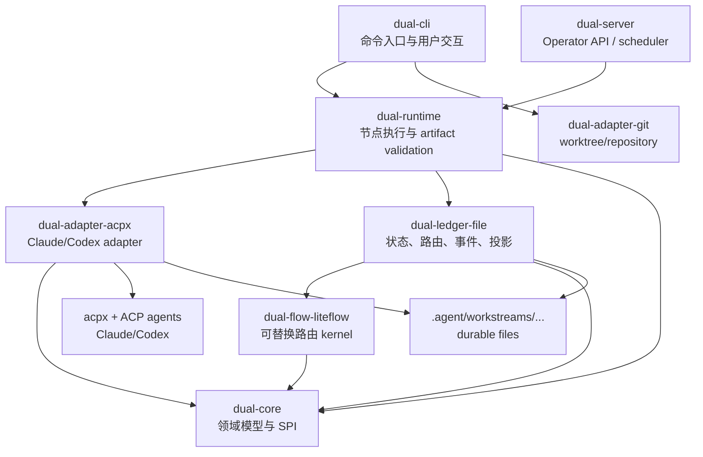
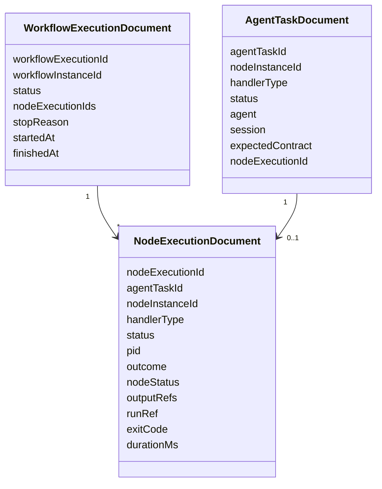
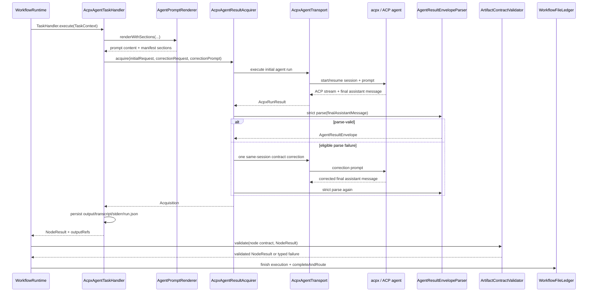

# Dual 从 CLI 到 Ledger 的逐步架构导读与 Direction B 路线

> 文档标记：`__REFERENCE__`
>
> 状态：当前实现导读 + Direction B 目标差距
>
> 基准日期：2026-07-24
>
> 目的：帮助维护者判断一次失败究竟来自 workflow、架构、实现、模型输出、
> ACP/provider，还是正常的人类门禁，而不是依赖猜测。

## 1. 先给结论

Dual 当前的核心不是 LiteFlow，也不是 ACPX，更不是一组 prompt。

它的核心是：

```text
WorkflowDefinition
        +
WorkflowInstance / NodeInstance
        +
WorkflowExecution / NodeExecution / AgentTask
        +
File Ledger
```

各部分的准确角色是：

| 概念 | 角色 |
| --- | --- |
| Workflow definition | 定义有哪些节点、边和路由条件 |
| Workflow instance | 一次 workstream 正在运行的 workflow 状态 |
| Node instance | 某个 definition node 在某一轮的实际实例 |
| Execution | 一次 `resume` 或一次节点执行尝试 |
| Handler | 执行某一种节点业务能力 |
| ACPX adapter | 调用 Claude/Codex，处理会话、进程、ACP 消息和 usage |
| Typed artifact | Agent 交给 workflow 的机器可验证结果 |
| Ledger | 保存权威状态、执行事实和 artifact 引用 |
| Projection | 从 ledger 生成 CLI、timeline、metrics、report 等读模型 |

需要特别纠正两个常见理解：

1. **LiteFlow 不是系统状态源。** `FlowOrchestrationKernel` 可以选择
   `liteflow` 或 `builtin`；它只根据 definition、当前 snapshot 和完成信号计算
   下一条 transition。
2. **节点间不是把所有 JSON 都塞进 node JSON。** 节点在 ledger 中保存
   `inputRefs`、`outputRefs` 和少量 result facts；完整 artifact 保存在 worktree
   的 `.agent/workstreams/<id>/...` 下，下游通过引用读取。

## 2. Direction B 是什么

本文采用 Direction B：

> `TaskContract.scope` 定义这次任务允许产生的代码变更，而不是定义 Agent
> 可以读取哪些文件。

其目标语义是：

```text
TaskContract.scope
        |
        | CREATE / MODIFY
        v
Declared Change Boundary
        |
        +------------------------------+
        |                              |
        v                              v
Agent 可自由读取项目              Agent 修改 worktree
读行为只做观测                       |
                                       v
                                  Git changed files
                                       |
                                       v
                              ChangeScopeEvaluator
                                       |
                         +-------------+-------------+
                         |                           |
                         v                           v
                       PASS                       VIOLATION
                         |                           |
                         v                           X
                 acceptance / delivery       阻止节点成功或交付
```

这不是“完全不治理”：

- 变更范围仍由 typed contract 明确声明；
- `CREATE`、`MODIFY` 仍需满足文件存在性和路径安全；
- 实际 Git 变更必须在 acceptance/delivery 前与 contract 比较；
- 读文件、token、cache、耗时继续记录，用于诊断和优化；
- 若未来有高安全环境，可增加独立的 sandbox execution profile，但不能让它
  再次成为默认 workflow 业务语义。

## 3. 模块关系



### 3.1 依赖方向的含义

- `dual-core` 不应知道文件 ledger、ACPX 或 CLI。
- `dual-ledger-file` 实现 core ledger 语义，并拥有 durable workflow state。
- `dual-runtime` 负责编排 handler、artifact contract validation 和路由提交。
- `dual-adapter-acpx` 只应把外部 Agent 协议转成 typed execution/artifact facts。
- CLI 和 server 只能调用 runtime 或投影 ledger，不应自己判断 workflow 状态。

任何能让 node 从成功变成失败的规则，如果隐藏在：

- prompt renderer；
- context report writer；
- ACP transport；
- CLI projection；

就构成架构风险。控制规则应该在显式的 contract validator、node acceptance
或 workflow decision 中。

## 4. 四组必须分开的模型

### 4.1 Definition：系统准备怎么走

`WorkflowDefinition` 包含：

- `workflowId`
- `version`
- `entryNodeId`
- `nodes`
- `edges`

内置 full lifecycle 从 classpath JSON 加载，并在启动时复制到：

```text
workflow/definition.json
```

复制后的 ledger definition 是该 workstream 的执行依据。后续代码升级不能悄悄
改变一个已经启动的 workstream。

### 4.2 Instance：当前走到了哪里

`WorkflowInstanceDocument` 描述整个实例。

`NodeInstanceDocument` 描述一个节点在某个 iteration 中的状态，关键字段包括：

```text
nodeInstanceId
nodeDefinitionId
kind
handlerType
status
stageId
iterationId
inputRefs
inputTransition
outputRefs
result
latestExecutionId
```

`WorkflowCurrentDocument` 是 current read model：

```text
status
activeNodeInstanceIds
openGateIds
lastEventId
updatedAt
```

它回答“现在在哪里”，不保存所有历史。

### 4.3 Execution：这一次尝试发生了什么

一次 `dualctl run` 中的 `WorkflowRuntime.resume()` 会创建
`WorkflowExecutionDocument`。

每个实际执行的 node 会创建：

- `AgentTaskDocument`
- `NodeExecutionDocument`

三者的关系：



区分它们是为了回答不同问题：

| 问题 | 查看对象 |
| --- | --- |
| 这次 `resume` 为什么停止？ | Workflow execution |
| 任务是否已排队、领取或完成？ | Agent task |
| 实际节点尝试的 PID、耗时和结果是什么？ | Node execution |
| 这个业务节点最终处于什么状态？ | Node instance |

### 4.4 Artifact：节点之间传递了什么

`NodeInstanceDocument.outputRefs` 保存 artifact 引用。路由到 successor 时，
`RoutingEngine.completeAndRoute()` 将这些 refs 写入新节点的 `inputRefs`。

因此节点数据传递的核心不是共享内存，而是：

```text
Producer node
  -> durable artifact file
  -> outputRefs
  -> routing
  -> successor inputRefs
  -> consumer resolves and validates artifact
```

Ledger 是共享存储和索引，但 artifact 文件本身也是 durable fact 的一部分。

## 5. 从 `dualctl start` 开始的真实调用链

### Step 1：CLI 解析

```text
DualCtlApplication.main()
  -> SpringApplication
  -> Picocli DualCtlCommand
  -> StartCommand.call()
```

`DualCtlCommand` 注册 `start`、`run`、review、recovery、trace、status 等命令。

### Step 2：读取需求和 workflow definition

`StartCommand.call()` 执行：

```text
readRequirement()
GitWorkspaceService.inspect(workdir)
WorkflowDefinitionLoader.loadOrDefault(workflowPath, workflowVariant)
validateHandlers(workflowDefinition)
```

这里分别确定：

- 用户要求；
- 原仓库、base branch、base commit；
- 本次 workstream 使用的 workflow definition；
- definition 中的 handler type 是否有实现。

### Step 3：创建隔离 worktree

`StartCommand.call()` 生成：

```text
workstreamId
workspaceId
branch
worktree path
```

然后调用：

```text
GitWorkspaceService.createWorktree(...)
```

业务代码修改发生在新 worktree，不直接污染原仓库。

### Step 4：初始化 workstream 元数据

`FileLedgerStore.initializeWorkstream()` 创建：

```text
workstream.json
settings.json
requirement.md
workspaces/<workspaceId>.json
current/stage.json
current/iteration.json
current/checkpoint.json
timeline.json
```

这一层描述 workstream 和 workspace，不负责初始化 workflow DAG。

### Step 5：初始化 workflow ledger

`CliLedgerFactory.create()` 创建 `WorkflowFileLedger`。

`FlowKernelProvider.create(configuredKernel)` 只选择：

```text
liteflow -> LiteFlowPrototypeKernel
builtin  -> BuiltInFlowOrchestrationKernel
```

随后：

```text
WorkflowFileLedger.initialize(paths, workflowInstanceId, definition)
```

写入：

```text
workflow/definition.json
workflow/instance.json
workflow/current.json
nodes/<entry-node-instance>.json
iterations/iter-001.json
events.jsonl: workflow_started
```

entry node 初始状态是 `READY`。

## 6. `dualctl run` 如何执行节点

### Step 1：进程锁

`RunCommand.call()` 创建 `WorkstreamPaths`，然后：

```text
WorkstreamLock.acquire(...)
  -> CliWorkflowLoop.run(...)
```

这是防止两个 CLI 同时推进同一个 workstream 的第一层保护。

### Step 2：循环 resume

`CliWorkflowLoop.run()`：

```text
CliWorkflowRuntimeFactory.create(dispatchMode)
  -> new WorkflowRuntime(
       CliLedgerFactory.create(),
       AcpxWorkflowHandlerRegistryFactory.create(),
       dispatchMode
     )

for each step:
  WorkflowRuntime.resume(command)
```

遇到以下状态停止：

```text
WAITING_FOR_HUMAN
WAITING_FOR_RECOVERY
BLOCKED
COMPLETED
FAILED
```

### Step 3：创建一次 workflow execution

`WorkflowRuntime.resume()`：

```text
ledger.loadDefinition(paths)
ledger.loadCurrent(paths)
terminal guard
reconcileActiveNodeAttempts(...)
ledger.startWorkflowExecution(...)
resumeWithinExecution(...)
finishWorkflowExecution(...)
```

重要语义：

- terminal workflow 的 `resume` 不产生副作用；
- 新执行前先 reconcile 可能遗留的 in-flight attempt；
- 一次 `resume` 有独立的 workflow execution 记录。

### Step 4：执行 active node

`WorkflowRuntime.executeActiveNode()`：

```text
ledger.loadNode(activeNodeId)
definition.node(nodeDefinitionId)

if GATE:
  GateHandler.openOrInspect(...)
  return WAITING_FOR_HUMAN

resolveNodeForExecution(...)

if WORKER dispatch:
  enqueueAgentTask(...)
else:
  executeAndRecordNode(...)
  emitDomainEvents(...)
  ledger.completeAndRoute(...)
```

默认 CLI 使用 `INLINE`。`WORKER` 模式会把 AgentTask durable 地入队，再由
`AgentWorker` 执行。

### Step 5：执行 handler 并记录尝试

`WorkflowRuntime.executeAndRecordNode()`：

```text
ledger.createAgentTask(...)
ledger.startNodeExecution(...)
ledger.markAgentTaskRunning(...)
ledger.markRunning(nodeInstanceId, pid)

executeNode(...)
ArtifactContractValidator.validate(...)
AgentRunMetadataFinalizer.finalizeNodeResult(...)

ledger.markAgentTaskFinished(...)
ledger.finishNodeExecution(...)
```

异常路径：

```text
ledger.markAgentTaskFailed(...)
ledger.failNodeExecution(...)
throw
```

### Step 6：根据 node kind 找 handler

`WorkflowRuntime.executeNode()`：

```text
TASK     -> TaskHandler.execute(TaskContext)
DECISION -> DecisionHandler.evaluate(DecisionContext)
GATE     -> 不进入此方法
```

`HandlerRegistry` 按 `handlerType` 精确索引 handler。

`AcpxWorkflowHandlerRegistryFactory.create()` 当前注册的主要 task handlers 包括：

```text
acpx.agent_run
artifact.validate
context.build_package
contract.compile
delivery.commit
failure.classify
delivery.prepare
delivery.create_pr
prompt.generate_next_stage
report.generate_final
```

它是 composition root，不是 workflow definition 的 source of truth。

## 7. Agent 节点如何调用 Claude/Codex

### 7.1 当前真实链路



### 7.2 ACPX 的职责

ACPX adapter 不是只执行一个 shell trigger。当前它还负责：

- session name 和 session scope；
- session compaction；
- prompt 文件和 prompt manifest；
- 启动/等待外部进程；
- ACP stream framing 和 provider failure；
- final assistant message；
- stdout/stderr/transcript；
- usage、cache、cost 等观测；
- 一次 bounded contract correction；
- `runs/<runId>/run.json`。

但它不应负责：

- workflow 路由；
- task contract 的业务含义；
- acceptance 决策；
- 代码变更是否超出 `TaskContract.scope`；
- 根据推荐文件决定 node 是否成功。

### 7.3 为什么仍可能“丢内容”

节点要求 LLM 最终返回纯 JSON，不代表 provider 一定完整交付：

```text
model generation
  -> ACP event stream
  -> acpx process
  -> transport collection
  -> final assistant message
  -> strict parser
```

任何一处 provider timeout、进程退出、stream framing 或消息截断都会使最终
assistant message 不完整。

正确处理不是从 Markdown 猜结果，而是：

1. ACP wire 在 adapter 边界解析一次；
2. `AgentResultEnvelopeParser` 严格解析最终 JSON；
3. 仅格式类失败允许一次同 session correction；
4. schema、lineage、业务语义失败不做格式 correction；
5. 失败以 typed outcome 进入 ledger。

## 8. Typed artifact 如何成为下游输入

### 8.1 Agent 输出只是候选结果

`AcpxAgentTaskHandler.execute()` 将最终 assistant message 写入：

```text
runs/<runId>/outputs/<promptTemplate>.json
```

并把该文件、transcript、stderr、run metadata 等放入 `NodeResult.outputRefs`。

### 8.2 Runtime 做 contract validation

`WorkflowRuntime.executeAndRecordNode()` 随后调用：

```text
ArtifactContractValidator.validate(...)
```

它只处理：

- handler type 为 `acpx.agent_run`；
- `ContractRegistry` 为该 node 声明了 contract；
- 不是 prepare-only。

它读取候选 JSON，严格解析 `AgentResultEnvelope`，再执行 schema、lineage 和
节点 contract validation。验证通过后，validated sidecar 才能作为可信输入。

### 8.3 路由复制引用

`WorkflowFileLedger.completeAndRoute()` 调用
`RoutingEngine.completeAndRoute()`：

```text
write finished NodeInstance
if node non-completed:
  stopOnNonCompletedNode
else:
  FlowOrchestrationKernel.advance(...)
  create successor NodeInstance
  successor.inputRefs = predecessor.outputRefs
  create GateDocument when successor is GATE
  update workflow/current.json
```

因此 typed lineage 的核心检查是：

```text
producer outputRef
  -> validated sidecar
  -> successor inputRef
  -> consumer required-subject resolver
```

任一环节缺失都属于实现或架构缺口，不是模型质量问题。

## 9. `contract.compile` 到底做什么

`ContractCompileHandler.execute()` 不调用 LLM。它负责把已经审批的
`task_contract_proposal` 编译成 canonical `TaskContract`。

真实步骤：

```text
确认 required_subject = approved_task_contract_proposal
读取 requirement.md
resolveApprovedProposal(context)
compileFromProposal(validated sidecar)
resolveContractNegotiation(...)
TaskContractValidator.validate(contract)
写 task-contract.json / task-contract.md / resolution artifacts
返回 outputRefs
```

它的职责类似编译器：

```text
Agent proposal
  -> human approval fact
  -> canonical typed TaskContract
```

它不应该：

- 从 Markdown 猜 proposal；
- 在 sidecar 缺失时静默 fallback；
- 根据文件扩展名猜语言；
- 自动批准 scope；
- 执行 Agent。

## 10. Ledger 目录逐项说明

典型目录：

```text
.agent/workstreams/<workstream-id>/
├── workstream.json
├── settings.json
├── requirement.md
├── workspaces/
│   └── <workspace-id>.json
├── workflow/
│   ├── definition.json
│   ├── instance.json
│   └── current.json
├── nodes/
│   └── <node-instance-id>.json
├── executions/
│   ├── workflow/
│   │   └── <workflow-execution-id>.json
│   └── nodes/
│       └── <node-execution-id>.json
├── queue/
│   └── agent-tasks/
│       └── <agent-task-id>.json
├── gates/
│   └── <gate-id>.json
├── iterations/
│   └── <iteration-id>.json
├── runs/
│   └── <run-id>/
│       ├── run.json
│       ├── prompts/
│       └── outputs/
├── artifacts/
│   ├── task-contract.json
│   ├── task-contract.md
│   └── git-evidence/
├── reviews/
├── recovery/
├── delivery/
├── metrics/
├── current/
├── events.jsonl
└── timeline.json
```

| 路径 | 权威含义 |
| --- | --- |
| `workflow/definition.json` | 本 workstream 固化后的 DAG |
| `workflow/instance.json` | 整个 workflow instance 的 durable 状态 |
| `workflow/current.json` | 当前 active nodes/open gates 的 read model |
| `nodes/*.json` | 每个 node instance 的输入、输出和最终状态 |
| `executions/workflow/*.json` | 每次 resume 的执行记录 |
| `executions/nodes/*.json` | 每次 node attempt 的执行记录 |
| `queue/agent-tasks/*.json` | Agent task dispatch/claim/completion 状态 |
| `runs/*/run.json` | ACPX run、usage、timeline、failure、artifact acquisition |
| `events.jsonl` | append-only workflow 审计事件 |
| `artifacts/*` | canonical/validated domain artifacts |
| `gates/*` | human/recovery gate durable state |
| `timeline.json` | 供人和 UI 阅读的投影，不是状态 owner |

## 11. Human gate 和 quality decision

Human gate 是 definition 中显式的 `GATE` node。

进入 gate 时，`RoutingEngine`：

```text
create NodeInstance(status=WAITING)
create GateDocument(status=open, allowedActions=...)
workflow.status = WAITING_FOR_HUMAN
workflow.openGateIds = [...]
```

`WorkflowRuntime.executeActiveNode()` 遇到 gate 后调用：

```text
GateHandler.openOrInspect(...)
```

然后停止，不会继续执行后续节点。

Codex review 通常是 Agent `TASK`，其 typed review result 再由 `DECISION`
节点路由。两者不是同一概念：

| 类型 | 作用 |
| --- | --- |
| Agent review | 产生结构化质量意见 |
| Decision node | 根据 typed result 选择 workflow edge |
| Human gate | 等待人明确 approve/revise/complete |

这种分层本身合理。复杂度主要来自额外的隐式策略同时修改 node outcome，而不是
来自这三类节点的存在。

## 12. 当前 scope 实现

### 12.1 当前路径

Agent 节点执行前：

```text
AcpxAgentTaskHandler.execute()
  -> AgentRunGovernanceContext.ensure(...)
  -> RepoScopeGovernance.build(...)
  -> ExplorationPlan
  -> allowedDirectReadFiles / expectedEditFiles
```

Agent 执行后：

```text
tool usage / transcript
  -> ContextGovernanceActualReportWriter
  -> ExplorationPolicyEvaluator
  -> exploration policy result
  -> AcpxAgentTaskHandler may return NodeStatus.FAILED
```

问题在于：这是一条隐藏在 `acpx.agent_run` handler 内的控制链。workflow JSON
看不到它，但它可以让任何 Agent node 失败。

### 12.2 当前已经具备的有用部分

- `TaskContract.scope` 是 typed entries；
- operation 已有 `CREATE`、`MODIFY`；
- proposal 和 canonical contract 有 schema validation；
- 路径可以做 project-neutral 安全校验；
- Agent 读写事实、Git changed files、usage 都有观测数据；
- `artifact.validate` 已能收集 Git status/diff/changed-files。

### 12.3 当前与 Direction B 冲突的部分

- `RepoScopeGovernance` 将 contract paths 投影成 direct-read authorization；
- `ExplorationPolicyEvaluator` 可因越界读取让 node 失败；
- 空 read scope 的 fail-closed 仍然是在强化“读授权”语义；
- scope expansion 主要围绕 read exception，而不是 contract revision；
- policy decision 隐藏在 ACPX handler；
- `TaskContract.ScopeOperation` 在 read projection 中被忽略；
- read recommendations、context guidance 和 authorization 曾经混合。

### 12.4 Direction B 最关键的缺口

`ArtifactValidateHandler.execute()` 当前只做：

```text
collect git evidence
write git-evidence.json
write changed-files.txt / diff.patch / diff.stat
return NodeResult.completed(...)
```

它没有做：

```text
TaskContract.scope
  versus
actual changed files
```

`ContextGovernanceActualReportWriter` 虽然写出 `outsideScopeWrites`，但该字段只是
报告事实，不是 acceptance/delivery 前的唯一强制边界。

所以 Direction B 当前成熟度是：

| 能力 | 状态 |
| --- | --- |
| Typed change intent | MODELED |
| Canonical TaskContract | VALIDATED |
| Git actual changes | OBSERVED |
| Contract vs actual typed evaluation | 未形成唯一 owner |
| Out-of-scope write blocks success | 未闭环 |
| Acceptance/promotion cannot bypass | 未证明 |

## 13. B1.4 / B1.5 在 Direction B 下如何处理

原先：

- B1.4：exploration plan 缺失或非法时 fail closed；
- B1.5：区分 scope expansion request 与 approved expansion。

它们都是在“contract 是读权限”前提下产生的后续复杂度。

选择 Direction B 后：

### B1.4

不应继续实现“缺 exploration plan 就阻止 Agent 读取”。

应替换为更简单的规则：

```text
缺 TaskContract
  -> 不能进入 implement

缺 read observation plan
  -> telemetry/context 退化或显式标记
  -> 不自动成为业务失败
```

### B1.5

不再做 read expansion approval。

如果实施中发现必须修改 contract 外文件，真正需要的是：

```text
Change Contract Revision Request
  -> typed requested path + operation + reason
  -> human/decision approval
  -> new TaskContract version
  -> resume implementation
```

这项能力只有 real-case 证明必要时再做。第一版可以直接让 out-of-scope change
失败并要求重新进入 contract/intake，不需要建立动态 expansion subsystem。

## 14. 当前 dirty B1 修改如何归类

当前未提交修改不能整体按旧 B1 目标直接接受或直接丢弃，应逐项归类：

| 修改语义 | Direction B 处理 |
| --- | --- |
| 删除文件扩展名 whitelist | 保留；属于 project-neutral contract validation |
| 路径 traversal/absolute/internal ledger 防护 | 保留 |
| recommendation 不得扩大 authority | 保留原则，但 authority 改为 change boundary |
| heuristic 不再进入 direct-read allow list | 若删除 read authority，则相关代码进一步删除 |
| empty read scope fail-closed | 不保留为业务阻断 |
| read violation 导致 Agent node FAILED | 删除或降级为 telemetry |
| exact read expansion | 不进入 Direction B 第一阶段 |

因此下一步不是在 dirty diff 上继续补 B1.4/B1.5，而是先做一次
**Direction B rebase assessment**：保留通用 contract/path 修复，删除或回退
read-authorization 强化。

## 15. Direction B 后续实施计划

计划强调做减法，不新建 Scope Engine、Capability Engine 或 Evidence Registry。

### Phase B0：决策固化和现状 rebase

目标：

- 明确 `TaskContract.scope = change boundary`；
- 标记 read governance 为 telemetry，不是 acceptance authority；
- 对当前 dirty B1 diff 做逐项 keep/drop；
- 固化现有行为 characterization。

验收：

```text
Declared by: 本文 + active plan
Owner: TaskContract
Proven by: contract schema/path tests
No production behavior claim yet
```

### Phase B1：删除 read-policy 对 node outcome 的影响

最小修改：

- `AcpxAgentTaskHandler` 不再因 exploration read policy 返回 FAILED；
- `ExplorationPolicyEvaluator` 不再成为 node acceptance owner；
- read files、rereads、budget、recommendations 保留为 observation；
- 删除空 read scope、read expansion 对业务成功的特殊语义；
- 不改变 ACP transport、usage 和 typed AgentResult。

Cannot-bypass tests：

```text
Agent reads a non-contract file
  -> observation records it
  -> node is not failed solely for that read

Agent returns invalid typed result
  -> still fails

Provider failure
  -> still fails
```

收益：

- 从每个 Agent node 删除隐藏控制路径；
- ACPX handler 变薄；
- 不再需要 B1.4 read-plan fail-closed；
- 不再需要 B1.5 read-expansion approval。

### Phase B2：建立唯一 ChangeScopeEvaluation

输入只允许两个：

```text
canonical TaskContract.scope
actual Git change evidence
```

建议使用一个小的 typed value/service，而不是 engine：

```text
ChangeScopeEvaluation
  status
  declaredEntries
  actualChanges
  unexpectedChanges
  missingDeclaredChanges
  operationMismatches
```

规则：

- `CREATE path`：最终 path 必须是新增；
- `MODIFY path`：最终 path 必须原先存在且被修改；
- contract 外 changed path：violation；
- `.agent/**` 等 orchestrator 内部文件不属于业务 Git change；
- rename/delete 未被当前 schema 表达时，明确拒绝，不猜测。

Owner 放置：

```text
dual-runtime 的 artifact/change validation 边界
```

不要放在：

```text
ACPX adapter
prompt renderer
CLI
report writer
```

### Phase B3：接入 acceptance/delivery 不能绕过

目标链：

```text
artifact.validate
  -> ChangeScopeEvaluation
  -> typed outputRef/result
  -> acceptance context
  -> delivery precondition
```

不能只生成 warning。至少有一个权威边界必须保证：

```text
ChangeScopeEvaluation.status != PASS
  -> artifact.validate 不能 COMPLETED
  -> acceptance/delivery 不可到达
```

Cannot-bypass tests：

1. Agent/provider exit 0，但修改 contract 外文件，node 失败；
2. LLM 自称 changed_files 合法，但 Git evidence 越界，仍失败；
3. report/sidecar 缺失不能绕过 Git evidence；
4. CREATE/MODIFY operation mismatch 失败；
5. valid changes 可进入 acceptance；
6. delivery 不能直接跳过该结果。

### Phase B4：删除旧 scope governance 代码

在 B2/B3 PROVEN 后删除：

- read authorization projection；
- read-scope expansion control；
- stage read-scope policy；
- 与 node failure 绑定的 exploration policy result；
- 只服务旧 read authorization 的 prompt/metadata 字段和测试。

保留：

- context recommendation；
- actual reads/writes telemetry；
- token/cache/cost metrics；
- generic path normalization；
- canonical change contract；
- Git evidence。

这一阶段才产生 handler 瘦身的主要收益。

### Phase B5：real-case 验证

顺序：

1. deterministic unit tests；
2. fake Agent / fixture integration；
3. README full workflow；
4. small bug；
5. simple API；
6. medium real-case。

每次 real-case 单独写 Verification Gate，不把 provider INVALID 当作代码 FAIL。

## 16. 选择 B 后的预期收益和成本

| 维度 | 当前 | Direction B 完成后 |
| --- | --- | --- |
| 读取 | recommendation + observation + policy 混合 | observation/context only |
| 变更 | 有 contract、有 Git evidence，但未唯一强制 | contract 与 Git diff 唯一比较 |
| Handler | ACPX handler 可因 read policy 改 node 状态 | ACPX 只处理 Agent execution |
| Scope expansion | 需要 request/approval/read exceptions | 第一版删除；必要时做 contract revision |
| 可解释性 | workflow JSON 看不到隐藏 read gate | acceptance boundary 显式 |
| 项目适配 | 曾依赖扩展名/文件名猜测 | project-neutral path + Git facts |
| 安全能力 | 事后 read rejection，不是物理隔离 | 不夸大；高安全另配 sandbox profile |

主要风险：

1. Agent 可以读取合同外源码，可能增加 token；这是有意 trade-off，用 telemetry 优化。
2. 若仓库包含敏感文件，Direction B 本身不是安全 sandbox；应通过 worktree 内容、
   OS/container 或 ACP capability profile解决。
3. Git rename/delete 暂无 typed operation，必须明确失败或先扩展 contract schema，
   不能靠字符串猜。
4. 删除旧 read policy 时要确认没有把 typed artifact、provider failure 和 output
   contract validation 一并放松。

## 17. 如何判断一次失败属于哪一层

### 17.1 正常暂停，不是失败

特征：

```text
workflow/current.status = WAITING_FOR_HUMAN
openGateIds 非空
active node kind = GATE
```

结论：正常 human gate。

### 17.2 Provider / model / ACP runtime 问题

证据：

- `runs/<runId>/run.json` 的 typed execution outcome；
- transcript/stderr 中的真实协议错误；
- exit code、stopReason、provider error；
- 0 token 或生成中断；
- 同样 prompt 的最小 provider probe。

典型：

```text
HTTP 429
model unavailable/mismatch
session/new failure
ACP runtime internal error
transport process timeout
```

不能只根据 Agent 正文出现 `quota` 或 `error` 判断。

### 17.3 模型输出协议问题

特征：

```text
process exit正常
final assistant message存在
strict AgentResultEnvelope parse/schema failure
```

若一次 bounded correction 后通过，是 serialization instability。

若 JSON 合法但 schema/lineage/semantic 不合法，是 Agent contract failure，不是
transport failure。

### 17.4 模型业务质量问题

特征：

```text
typed artifact valid
lineage valid
review decision = NEEDS_REVISION / REJECT
mustFix 有具体业务证据
```

这是 reviewer 或 quality gate 的正常结论，不应归类为 parser/runtime bug。

### 17.5 Workflow definition / routing 问题

特征：

- node 已 `COMPLETED`，却没有正确 successor；
- edge condition 与 typed outcome 不匹配；
- 错误节点被创建；
- revision loop 指向错误阶段；
- human action 与 definition allowed actions 不一致。

检查：

```text
workflow/definition.json
nodes/<node>.json result/outcome
events.jsonl node_routed
workflow/current.json
```

### 17.6 Typed lineage 实现问题

特征：

```text
producer output artifact存在且已验证
producer outputRefs包含它
successor inputRefs缺失
或 consumer resolver找不到 required subject
```

这属于代码实现或模型 owner 设计问题，不是 LLM 没有生成内容。

### 17.7 架构问题

满足任一项时优先按架构问题处理：

- 同一事实有两个 owner；
- observation 可以直接扩大 authority；
- projection 反向决定 domain state；
- adapter 根据自然语言改变 workflow outcome；
- workflow JSON 看不到一个实际可阻断流程的 gate；
- 多个模块重复解析同一外部协议；
- 一个字段同时表示“空集合”和“关闭治理”。

### 17.8 局部实现 bug

特征：

- owner 和目标语义明确；
- 单一路径设计正确；
- 某个方法写错比较、漏传 ref、大小写不一致或异常处理错误；
- deterministic test 可稳定复现。

此时才适合局部修复，而不是新增模型。

## 18. 一次故障的推荐排查顺序

```text
1. workflow/current.json
   确认是 RUNNING、WAITING、RECOVERY、FAILED 还是 COMPLETED

2. active nodes/*.json
   查看 handlerType、status、inputRefs、outputRefs、result

3. executions/nodes/<latest>.json
   查看这次 attempt 的 pid、duration、outcome、error、runRef

4. runs/<runId>/run.json
   查看 provider execution、typed outcome、usage、artifact acquisition

5. outputs/*.json + validated sidecar
   区分原始 assistant message 与验证后的 artifact

6. events.jsonl
   查看 node 是否完成、如何路由、是否创建 gate/iteration

7. workflow/definition.json
   核对实际固化 definition，而不是只看当前源码

8. recovery/current-failure.md 或 review packet
   作为人类说明使用，不把 Markdown 当 SoT
```

诊断时优先问：

```text
Declared by:
Proven by:
Consumed by:
Enforced before:
Failure route:
Cannot-bypass test:
Residual bypass:
```

## 19. 防止后续再次偏离 Direction B

任何 scope/context/handler 修改在开工前必须回答：

1. 本次修改影响的是 change authority、read observation，还是 context guidance？
2. 它是否会改变 node outcome？
3. 如果会，workflow 中哪个显式节点拥有该决定？
4. 是否直接消费 canonical `TaskContract` 和 Git fact？
5. 是否新增了第二个 scope owner？
6. 是否因为一个 real-case 症状新增 manager/engine/registry？
7. 能否通过删除旧控制路径解决？

固定原则：

```text
Recommendation can be smart.
Observation can be rich.
Authorization must be small and explicit.
Only validated authority may block acceptance or delivery.
```

## 20. 当前建议的下一步

不要继续 B1.4/B1.5。

下一步应是独立的 Direction B rebase assessment：

1. 审查当前 dirty B1 diff；
2. 保留扩展名 whitelist 删除和 project-neutral path validation；
3. 标出所有 read-policy-to-node-failure 接线；
4. 给出 keep/delete/rewrite 清单；
5. deterministic characterization 通过后，再实施 B1 subtraction；
6. B1 review PASS 后才实施 B2 change-scope evaluation。

在 B2/B3 完成前，不能声称：

```text
TaskContract.scope 已守住最终代码变更边界
```

当前只能准确声称：

```text
TaskContract change intent 已结构化；
Git change evidence 已可采集；
二者尚未形成不可绕过的 acceptance closure。
```
