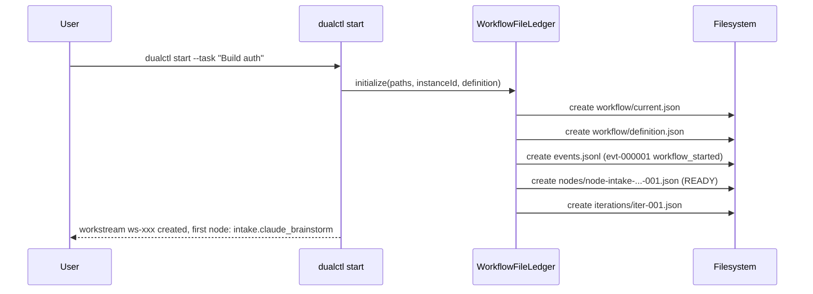
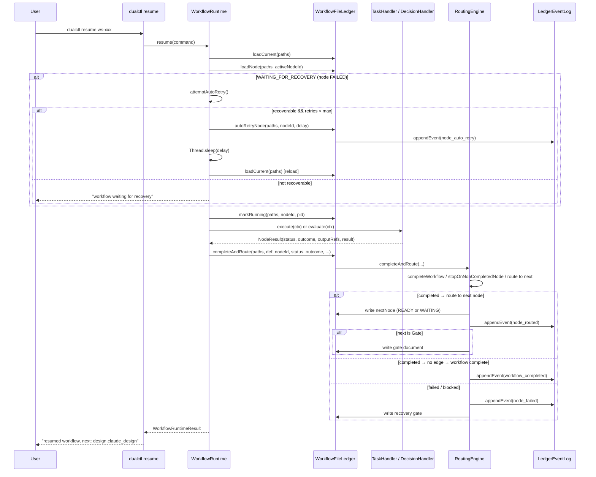
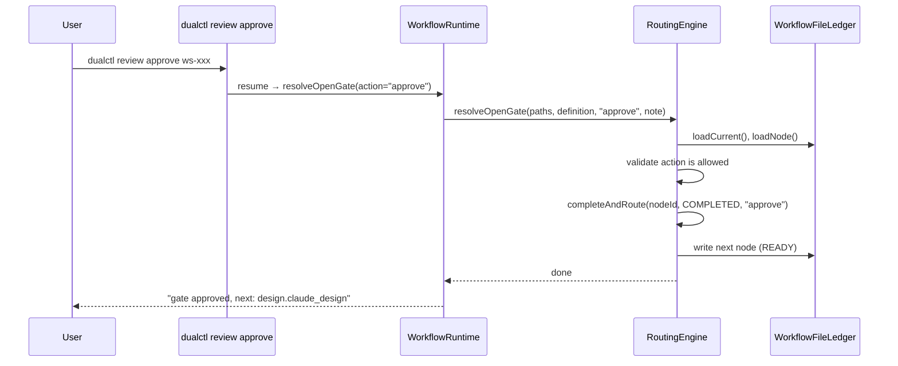
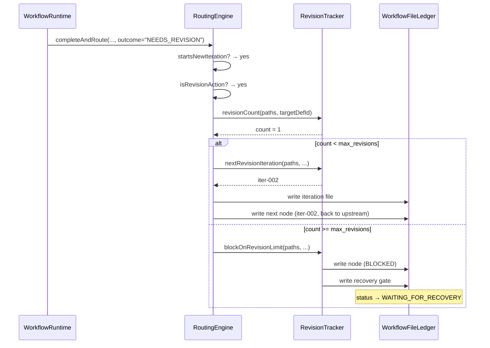
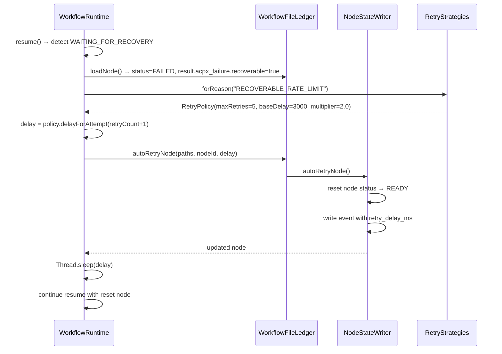
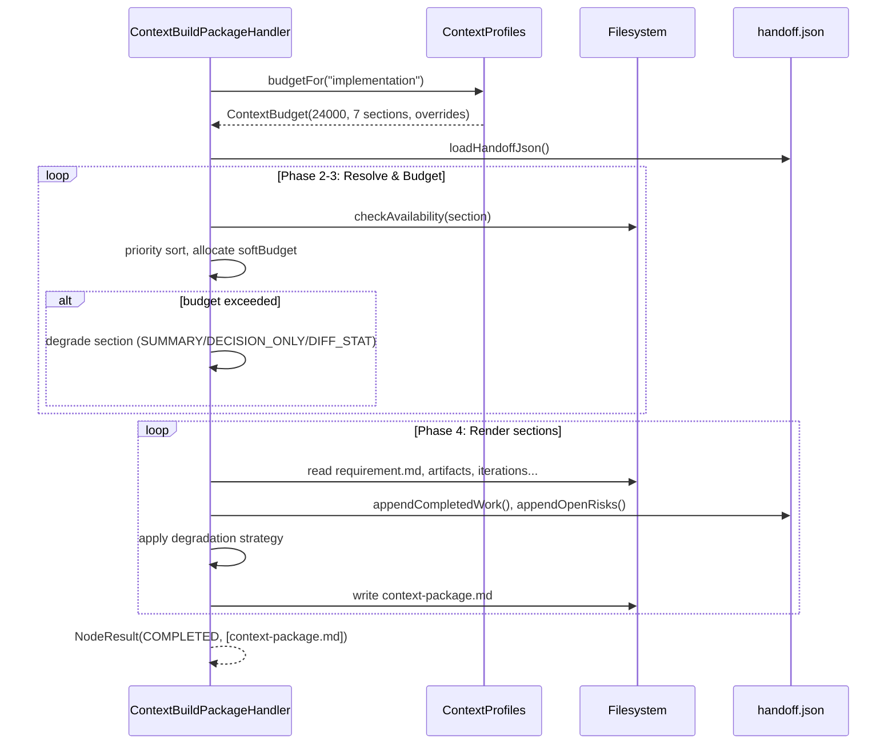

# dual-orchestrator 架构说明与执行流程

## 1. 项目定位

dual-orchestrator 是 Agent 生命周期编排器的 Java 实现。它不是一个单次命令脚本，而是一个 **workflow engine**——驱动多轮 Agent 交互，经过需求澄清、设计审视、人工卡点、计划、实现、自测、验收，最终生成下一阶段提示词。

## 2. 模块架构

```
┌─────────────────────────────────────────────────────────────────┐
│                        dual-cli (dualctl)                       │
│  start / status / resume / review approve / review revise /    │
│  retry / recovery abort / inspect / events / runs / delivery   │
└──────────────┬──────────────────────────────────────────────────┘
               │
┌──────────────▼──────────────────────────────────────────────────┐
│                      dual-runtime                               │
│  ┌─────────────┐  ┌──────────────┐  ┌──────────────────────┐  │
│  │WorkflowRuntime│  │HandlerRegistry│  │Context Governance   │  │
│  │  (resume)    │  │  (SPI)       │  │  (6 profiles)       │  │
│  └──────┬───────┘  └──────┬───────┘  └──────────────────────┘  │
│         │                 │                                     │
│  ┌──────▼─────────────────▼──────────────────────────────────┐  │
│  │Handlers: acpx.agent_run / context.build_package /         │  │
│  │  review.decision / artifact.validate / report.generate /  │  │
│  │  prompt.generate_next_stage / delivery.*                  │  │
│  └───────────────────────────────────────────────────────────┘  │
│                                                                 │
│  ┌──────────────────────────────────────────────────────────┐   │
│  │LifecycleWorkflowDefinitionFactory (thin mainline def)    │   │
│  └──────────────────────────────────────────────────────────┘   │
└──────────────┬──────────────────────┬───────────────────────────┘
               │                      │
┌──────────────▼──────────┐  ┌────────▼──────────────────────────┐
│   dual-adapter-acpx     │  │       dual-adapter-git            │
│  acpx transport         │  │  Git worktree / repo operations   │
│  Agent prompt templates │  │                                   │
└──────────────┬──────────┘  └───────────────────────────────────┘
               │
┌──────────────▼──────────────────────────────────────────────────┐
│                      dual-ledger-file                           │
│  ┌──────────────┐  ┌──────────────┐  ┌────────────────────┐   │
│  │RoutingEngine │  │NodeStateWriter│  │ RevisionTracker   │   │
│  │  completeAnd │  │  markRunning  │  │  nextRevision     │   │
│  │  Route       │  │  autoRetry    │  │  blockOnLimit     │   │
│  │  resolveGate │  │  retry / abort│  │  revisionCount    │   │
│  └──────┬───────┘  └──────┬───────┘  └──────┬─────────────┘   │
│         └─────────────────┼─────────────────┘                  │
│                    ┌──────▼───────┐                             │
│                    │LedgerEventLog│  ┌──────────────┐          │
│                    │ appendEvent  │  │ LedgerUtils  │          │
│                    │ writeInstance│  │ (12 statics) │          │
│                    └──────┬───────┘  └──────────────┘          │
│                           │                                     │
│                    ┌──────▼───────┐                             │
│                    │WorkflowFile  │                             │
│                    │Ledger (facade│                             │
│                    │  ~187 lines) │                             │
│                    └──────────────┘                             │
│                                                                 │
│  Storage: workflow/current.json, nodes/*.json, gates/*.json,   │
│           events.jsonl, iterations/*.json, definition.json      │
└──────────────┬──────────────────────────────────────────────────┘
               │
┌──────────────▼──────────────────────────────────────────────────┐
│                        dual-core                                │
│  NodeDefinition · NodeInstance · NodeKind · NodeStatus          │
│  WorkflowDefinition · EdgeDefinition · WorkflowStatus           │
│  NodeResult · DualId                                            │
└─────────────────────────────────────────────────────────────────┘
```

## 3. 三类节点

Runtime 只认识三种节点：

| Kind | 用途 | Handler 接口 | 典型实现 |
|------|------|-------------|---------|
| **Task** | 执行有副作用的工作 | `TaskHandler.execute()` | `acpx.agent_run`, `context.build_package`, `artifact.validate` |
| **Decision** | 读取结果，选择下一条 edge | `DecisionHandler.evaluate()` | `review.decision` |
| **Gate** | 暂停等待人审批 | `GateHandler.openOrInspect()` | `human.review` |

## 4. 生命周期 Workflow（thin mainline）

```
intake.claude_brainstorm
  → context.intake_codex_product_review
    → intake.codex_product_review
      → intake.decision
        → gate.human_requirement_review ──(approved)──→
design.claude_design
  → context.design_codex_arch_review
    → design.codex_arch_review
      → design.decision
        → gate.human_design_approval ──(approved)──→
plan.claude_plan
  → context.plan_codex_plan_review
    → plan.codex_plan_review
      → plan.decision
        → gate.human_plan_approval ──(approved)──→
context.implement_claude
  → implement.claude_implement
    → implement.claude_self_test_report
      → implement.artifact_validation
        → context.acceptance_codex_verifier_review
          → acceptance.codex_verifier_review
            → acceptance.decision ──(ACCEPT)──→
acceptance.generate_final_report
  → delivery.prepare_pr
    → gate.human_acceptance ──(approved)──→
stage.claude_handoff
  → stage.generate_next_prompt
    → gate.human_next_stage_approval ──(approved)──→
                                                      ↻ loop back to intake
```

每个 Decision 节点都有 `NEEDS_REVISION` / `REJECT` 分支，回到上游重新迭代。

## 5. 核心执行流程

### 5.1 `dualctl start` — 初始化 Workstream



### 5.2 `dualctl resume` — 推进单个节点

这是整个引擎的核心循环。每次 `resume` 执行一个节点。



### 5.3 `dualctl review approve` — 通过人工卡点



### 5.4 Revision Loop — 修订回路

当 Decision 节点返回 `NEEDS_REVISION` 或 Gate 返回 `revise` 时：



### 5.5 Auto-Retry — 可恢复失败自动重试



### 5.6 Context Build — 受治理的上下文装配

在关键 Agent 步骤前，`context.build_package` handler 装配上下文：



## 6. Ledger 文件结构

每个 workstream 在磁盘上的状态：

```
.agent/workstreams/ws-xxx/
├── workflow/
│   ├── current.json          ← 当前状态快照（status, activeNodes, openGates）
│   ├── definition.json       ← workflow 定义（nodes, edges）
│   └── instance.json         ← 实例元数据（workflowId, createdAt）
├── nodes/
│   ├── node-intake-...-001.json
│   ├── node-context-...-002.json
│   └── ...
├── gates/
│   ├── gate-node-...-003.json    ← 人工审批 gate
│   └── recovery-node-...-005.json ← 失败恢复 gate
├── iterations/
│   ├── iter-001.json        ← 初始迭代
│   └── iter-002.json        ← 修订迭代
├── events.jsonl             ← 审计事件流（append-only）
├── runs/                    ← Agent 运行记录
├── artifacts/
│   ├── git-evidence/        ← Git status, diff, changed files
│   └── next-stage/
│       └── handoff.json     ← 结构化 handoff 数据
└── stages/
    └── 01-design/
        └── iterations/001/
            ├── claude-handoff.md
            └── claude-handoff.json
```

## 7. Handler SPI

所有 handler 通过 `handlerType` 字符串注册和查找：

| handlerType | Kind | 说明 |
|---|---|---|
| `acpx.agent_run` | Task | 调用 Claude/Codex 执行 Agent 任务 |
| `context.build_package` | Task | 受治理的上下文装配 |
| `artifact.validate` | Task | 采集 Git evidence |
| `review.decision` | Decision | 解析 Agent 输出的 dual-control block，选择 outcome |
| `human.review` | Gate | 人工审批 |
| `report.generate_final` | Task | 生成最终验收报告 |
| `prompt.generate_next_stage` | Task | 生成下一阶段提示词 |
| `delivery.prepare_pr` | Task | 准备交付（PR） |

## 8. Context Governance 架构

6 个预定义 profile，每个拥有独立的 **token-level** budget、section 列表和降级策略：

| Profile | Token Budget | 典型用途 |
|---|---|---|
| `product_review` | 4k tokens | Codex 产品需求审视 |
| `architecture_review` | 5k tokens | Codex 架构审视 |
| `plan_review` | 5.5k tokens | Codex 计划审视 |
| `implementation` | 6k tokens | Claude 实现阶段 |
| `acceptance` | 6.5k tokens | Codex 验收审视 |
| `full` | 7.5k tokens | 全量上下文 |

Budget 基于 token 计算（通过 `TokenEstimator` 接口，默认 ~4 chars/token 估算，可替换为 tiktoken 等真实 tokenizer）。

每个 section 有 Priority（CRITICAL > HIGH > MEDIUM > LOW），budget 分配按优先级顺序。超出 budget 的低优先级 section 会降级：

| 降级策略 | 效果 |
|---|---|
| `ADAPTIVE` | 自动压缩到 token 预算内，保留前 N token 内容 + 压缩标记 |
| `SUMMARY` | 只显示文件名列表，不显示内容 |
| `DECISION_ONLY` | 只显示决策记录 |
| `DIFF_STAT` | 只显示 diff 统计 |
| `LATEST` | 只显示最近 N 条 |
| `POINTER_ONLY` | 只显示文件路径 |
