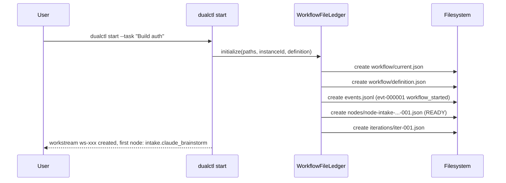
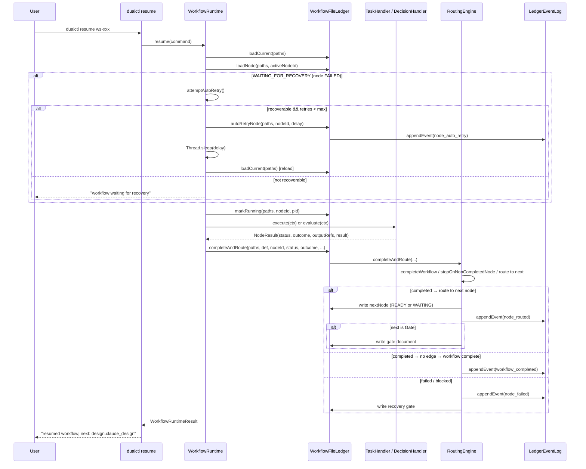
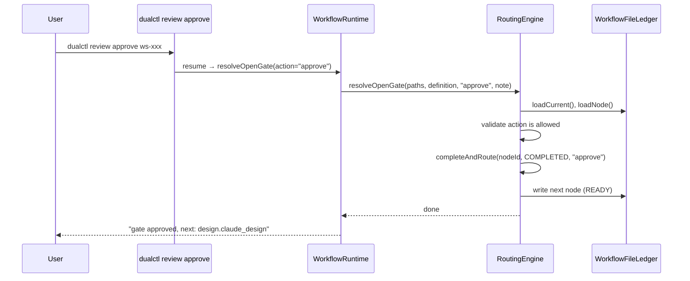
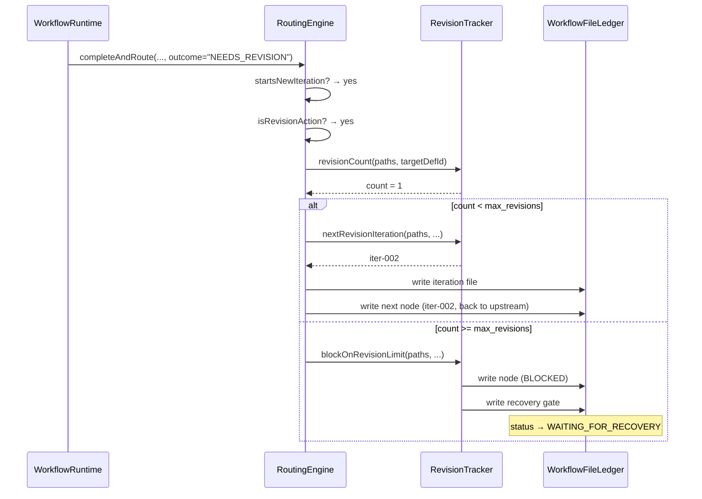
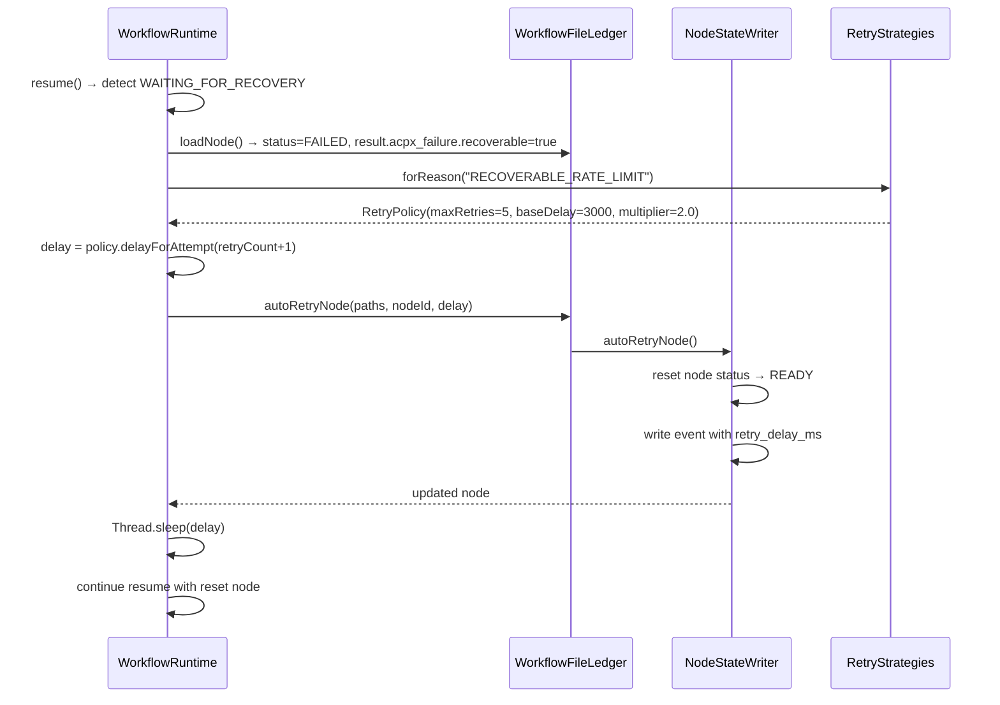
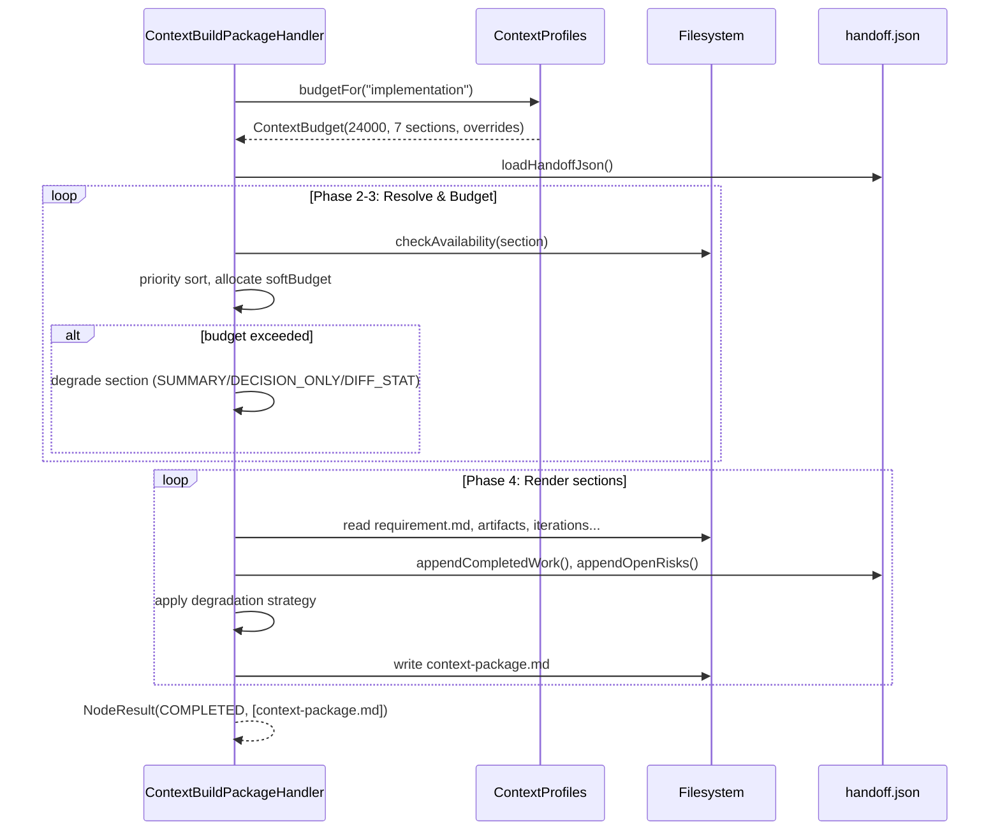

# dual-orchestrator 总体设计与执行流程

## 1. 这不是一个“双 Agent 脚本”

dual-orchestrator 最早从一个很朴素的问题开始：人夹在 Claude Code 和 Codex 之间来回复制粘贴，太累了。

但真正做下去以后，问题变得更清楚：我们缺的不是一个“同时调用两个 Agent 的脚本”，而是一个能把 AI 软件开发过程托住的 **engineering harness**。

它要解决的不是“模型会不会写代码”，而是：

- 需求是否被说清楚。
- 设计是否被独立审视。
- 实现是否有自测证据。
- 验收是否对照同一份契约。
- 失败时能不能知道是实现错、需求不清、上下文不够，还是工具失败。
- 多轮之后，系统能不能从失败里沉淀经验，而不是每次重新踩坑。

所以 dual-orchestrator 的定位是：

> 一个 contract-driven、可审计、可恢复、可逐步校准的 AI engineering harness。

Claude / Codex / acpx 都是其中的可替换部件。真正的核心是外层 harness：workflow、ledger、contract、context、review、failure arbiter、calibration。

## 2. 核心思想

### 2.1 Agent 分工

当前系统采用三方结构：

| 角色 | 职责 | 边界 |
|------|------|------|
| Claude | 主控 developer / architect，负责需求澄清、设计、计划、实现、自测、handoff | 可以修改业务代码 |
| Codex | 外部 reviewer / verifier，负责产品、架构、计划、验收视角审视 | 不直接修改业务代码 |
| Human | gate owner，负责关键节点审批、修订、阻断和最终判断 | 可以覆盖自动判断 |

这不是为了制造“两个模型互相聊天”的戏剧感，而是为了让实现者和验证者分离。Claude 像开发者，Codex 像审视者，人是最终责任人。

### 2.2 Contract first

早期版本是：

```text
自然语言需求 → Agent 设计 → Agent 实现 → Agent 验收
```

现在的方向是：

```text
自然语言需求
  → TaskContract
  → Contract Review
  → 实现
  → 自测证据
  → Codex 对照契约验收
  → FailureArbiter 分类失败
  → CalibrationCandidate 沉淀经验
```

TaskContract 的意义是给后续所有人一个共同锚点：目标是什么、范围是什么、非目标是什么、验收标准是什么、风险在哪里。

2026-06-03 的真实 benchmark 暴露出一个重要修正：TaskContract 不应该靠 Java 从 Agent 的自然语言 Markdown 里猜出来。新的方向是 artifact-driven contract negotiation：Claude 输出结构化 `task_contract_proposal`，系统只做 JSON/schema/path/metadata 等机械校验，Codex 按原则审议 proposal，通过后才生成 canonical TaskContract。Markdown 继续给人看，但不再作为状态机事实来源。

没有契约，review 很容易变成“各说各话”。有契约，失败才有可能被分类：到底是 Claude 没实现，还是契约没写清楚，还是 Codex 误判。

### 2.3 Ledger 是系统记忆

每个 workstream 都有自己的账本：

```text
.agent/workstreams/<workstream_id>/
```

里面记录：

- workflow 当前状态
- 每个 node 的输入、输出、开始和结束时间
- 每次 Agent run 的 prompt、stdout、stderr、metadata
- human gate 状态
- revision iteration
- events timeline
- reports / delivery artifacts

这不是为了“多存点日志”，而是为了让系统能复盘。没有 ledger，就没有恢复、审计、metrics、replay，也没有未来的 calibration。

### 2.4 Context 不是越多越好

Agent 很容易被上下文撑爆，也很容易因为上下文缺失而猜测。

dual-orchestrator 的 context governance 做了几件事：

- 按场景分 profile：product review、architecture review、implementation、acceptance 等。
- 每个 section 有优先级和 token budget。
- 超预算时按规则降级：摘要、只保留 decision、只保留 diff stat、只给 pointer。
- 缺失信息时区分 fail / placeholder / skip。

这让上下文装配从“把所有东西塞进去”变成“按目的装配证据”。

### 2.5 失败要被分类，而不是只重试

系统已经有 execution recovery：rate limit、session missing、context window、agent reconnect、dual-control 格式问题等。

但更重要的是 semantic failure：

- `IMPLEMENTATION_BUG`
- `CONTRACT_GAP`
- `CONTRACT_AMBIGUITY`
- `REVIEW_NOISE`
- `CONTEXT_INSUFFICIENT`
- `TOOL_LIMITATION`

执行失败可以重试；语义失败不能盲目重试。它应该进入 FailureArbiter，然后路由到修实现、改契约、问人、或生成 calibration candidate。

### 2.6 UI 重要，但不是最底层能力

人工 review 和进度可视化很重要，后续一定要做。

但 UI 不应该直接绑定 ledger 原始结构。更稳的路径是先沉淀稳定读模型：

- review packet
- timeline projection
- failure summary
- calibration candidate

CLI 和 UI 都消费这些读模型。这样 UI 不是临时页面，而是 harness 能力的外显。

## 3. 当前实现状态

当前 dual-orchestrator 已经实现：

- Java multi-module 项目结构。
- `dualctl start/status/resume/review/retry/recovery/events/runs/delivery` CLI。
- Git worktree 隔离执行。
- Workflow runtime：Task / Decision / Gate 三类节点。
- 文件账本：`workflow/current.json`、`nodes/*.json`、`gates/*.json`、`iterations/*.json`、`events.jsonl`。
- acpx adapter：统一调用 Claude / Codex session。
- prompt templates：覆盖 intake、design、plan、implementation、self-test、acceptance、handoff。
- Context governance：profile、budget、degradation、placeholder/skip/fail。
- TaskContract / ContractCompiler / ContractReviewGate。
- FailureArbiter MVP。
- CalibrationCandidate MVP：可校准的 failure classification 会生成 `calibration/candidates/<id>.json` 和 `.md`；`dualctl calibration list/show/decide` 可把候选变成人工可评估、可采纳/拒绝/延后的账本资产。
- Failure summary MVP：节点 `FAILED` / `BLOCKED` 或分类失败时会生成 `recovery/current-failure.md`。
- Review packet MVP：human gate 会生成 `reviews/<gate_node_instance_id>.md` / `.json`，`dualctl review show` 可展示当前卡点所需材料。
- Timeline projection MVP：ledger 自动生成 `timeline.json`，`dualctl timeline` 可展示 workflow / node 进度。
- Watch mode MVP：`dualctl watch` 基于 `timeline.json` 轮询展示当前进度。
- Local API Server MVP：`dual-server` 提供 HTTP API，可查询 workstream list、workflow status / timeline，并执行最小 action：resume、retry、review approve/revise。Scheduler tick MVP 已支持手动触发一次调度，只推进 `RUNNING` workstreams；当前仍不做后台自动扫描。
- Delivery prepare / commit / create-pr 基础管线。
- 多 workflow variant：thin / p5 / p6。
- 真实 acpx smoke：thin / p5 已通过；fixture p6 仍保留 `PASS-WARN` 语义，因为 Codex 是否拒绝不可控。
- 真实复杂仓库 p6 长 case：2026-06-02 在 `cancer-clinic` 跑通，workstream `ws-20260602T121712Z-V7WM`，最终 `COMPLETED`。这次 run 中 Codex acceptance 连续两次 `REJECT`，系统进入 failure classification，再路由回 Claude repair，第三次验收通过。

这个结果说明：主生命周期的基本目标已经达到。系统已经能在真实仓库里跑完“需求 → contract → review → gate → 实现 → 自测 → 验收 → reject repair → delivery → handoff”的闭环。

但这还不是完整产品。下一步不应该继续围绕边界 fixture 打转，而是把真实长 run 变得更可观察、更容易人工 review、更容易重复评估。

## 4. 下一步设计方向

结合 long-term-plan 和真实长 case 结果，下一步的目标是把“能跑通”推进到“能放心交给系统跑”。UI 很重要，但它应该建立在稳定读模型之上，而不是直接绑定 ledger 原始文件。

```text
real-case benchmark
  → review / failure / artifact read models
    → operator dashboard
      → background scheduler
```

### 4.1 近期优先级

| 优先级 | 工作 | 原因 |
|--------|------|------|
| Done | p6 real repair loop | `cancer-clinic` 真实长 case 已触发两轮 REJECT → classify → repair → ACCEPT |
| Tech Debt | deterministic p6 reject fixture | 只有 CI 需要可重复覆盖 reject 边界时再做 |
| Done | Status workflow-first | `dualctl status` 默认以 workflow current 为准，避免旧 checkpoint/stage 误导当前进度 |
| Done | Failure summary 扩展 | 普通 `FAILED` / `BLOCKED` 节点也会生成 `recovery/current-failure.md` |
| Done | Local API Server MVP | status / timeline + 最小 action API，先给 UI 和外部观察器一个稳定入口 |
| Done | Scheduler tick MVP | 手动触发一次调度，只推进 RUNNING workstreams，不绕过 human gate / recovery |
| P1 | Real-case benchmark loop | 用 2-3 个真实任务持续验证 p6，而不是只靠低复杂度 fixture |
| P1 | Operator-grade review UX | 围绕 review packet、artifact sidecar、failure summary 展示“为什么能 approve / 为什么要 revise” |
| P2 | Background scheduler | 在人工 gate 和 recovery 语义稳定后再做后台自动推进 |

### 4.2 长期路线

长期目标是通用 AI-native engineering harness：

- Workflow Template System：开发、review、bugfix、docs、SRE RCA 等不同工作流。
- Specialization Registry：不同领域注入专属 contract、checklist、context profile。
- Multi-role Review：产品、架构、安全、测试、发布多视角 review。
- Adversarial Test Agent：从契约生成反例和边界测试。
- Knowledge Registry：版本化 contract template、review checklist、regression scenarios。
- Metrics / Replay：统计 cycle time、failure class、review quality，并能 replay 历史 run 验证新规则。

### 4.3 当前路线取舍

现在不优先做三类事：

1. 不急着引入复杂规则引擎。当前选择是规则集中化，先让 contract / validator / workflow definition 保持可读、可测、可改。
2. 不急着补 schema migration。账本 schema 仍在演进，历史数据还少，正式迁移框架的短期收益不高。
3. 不急着堆多 Agent。Claude developer + Codex verifier + Human gate 已经能跑完整生命周期；多角色 review 和对抗 tester 等真实痛点出现后再加。

## 5. 模块架构

```
┌───────────────────────────────┐  ┌───────────────────────────────┐
│       dual-cli (dualctl)      │  │          dual-server          │
│ start / resume / review /     │  │ read-only HTTP API: status /  │
│ retry / delivery / status     │  │ timeline; action + tick API   │
└──────────────┬────────────────┘  └──────────────┬────────────────┘
               │                                  │
               └────────────────┬─────────────────┘
                                │
┌──────────────▼──────────────────────────────────────────────────┐
│                      dual-runtime                               │
│  ┌─────────────┐  ┌──────────────┐  ┌──────────────────────┐  │
│  │WorkflowRuntime│  │HandlerRegistry│  │Context Governance   │  │
│  │  (resume)    │  │  (SPI)       │  │  (6 profiles)       │  │
│  └──────┬───────┘  └──────┬───────┘  └──────────────────────┘  │
│         │                 │                                     │
│  ┌──────▼─────────────────▼──────────────────────────────────┐  │
│  │Handlers: acpx.agent_run / context.build_package /         │  │
│  │  review.decision / artifact.validate / report.generate /  │  │
│  │  prompt.generate_next_stage / delivery.*                  │  │
│  └───────────────────────────────────────────────────────────┘  │
│                                                                 │
│  ┌──────────────────────────────────────────────────────────┐   │
│  │LifecycleWorkflowDefinitionFactory (thin mainline def)    │   │
│  └──────────────────────────────────────────────────────────┘   │
└──────────────┬──────────────────────┬───────────────────────────┘
               │                      │
┌──────────────▼──────────┐  ┌────────▼──────────────────────────┐
│   dual-adapter-acpx     │  │       dual-adapter-git            │
│  acpx transport         │  │  Git worktree / repo operations   │
│  Agent prompt templates │  │                                   │
└──────────────┬──────────┘  └───────────────────────────────────┘
               │
┌──────────────▼──────────────────────────────────────────────────┐
│                      dual-ledger-file                           │
│  ┌──────────────┐  ┌──────────────┐  ┌────────────────────┐   │
│  │RoutingEngine │  │NodeStateWriter│  │ RevisionTracker   │   │
│  │  completeAnd │  │  markRunning  │  │  nextRevision     │   │
│  │  Route       │  │  autoRetry    │  │  blockOnLimit     │   │
│  │  resolveGate │  │  retry / abort│  │  revisionCount    │   │
│  └──────┬───────┘  └──────┬───────┘  └──────┬─────────────┘   │
│         └─────────────────┼─────────────────┘                  │
│                    ┌──────▼───────┐                             │
│                    │LedgerEventLog│  ┌──────────────┐          │
│                    │ appendEvent  │  │ LedgerUtils  │          │
│                    │ writeInstance│  │ (12 statics) │          │
│                    └──────┬───────┘  └──────────────┘          │
│                           │                                     │
│                    ┌──────▼───────┐                             │
│                    │WorkflowFile  │                             │
│                    │Ledger (facade│                             │
│                    │  ~187 lines) │                             │
│                    └──────────────┘                             │
│                                                                 │
│  Storage: workflow/current.json, nodes/*.json, gates/*.json,   │
│           events.jsonl, iterations/*.json, definition.json      │
└──────────────┬──────────────────────────────────────────────────┘
               │
┌──────────────▼──────────────────────────────────────────────────┐
│                        dual-core                                │
│  NodeDefinition · NodeInstance · NodeKind · NodeStatus          │
│  WorkflowDefinition · EdgeDefinition · WorkflowStatus           │
│  NodeResult · DualId                                            │
└─────────────────────────────────────────────────────────────────┘
```

说明：`dual-cli` 仍然是主要操作入口；`dual-server` 当前暴露 status / timeline 读模型，并把 resume、retry、review approve/revise 包装成最小 action API。Scheduler tick 只是一次性手动调度，不是后台常驻自动扫描。

## 6. 三类节点

Runtime 只认识三种节点：

| Kind | 用途 | Handler 接口 | 典型实现 |
|------|------|-------------|---------|
| **Task** | 执行有副作用的工作 | `TaskHandler.execute()` | `acpx.agent_run`, `context.build_package`, `artifact.validate` |
| **Decision** | 读取结果，选择下一条 edge | `DecisionHandler.evaluate()` | `review.decision` |
| **Gate** | 暂停等待人审批 | `GateHandler.openOrInspect()` | `human.review` |

## 7. 生命周期 Workflow（thin mainline）

```
intake.claude_brainstorm
  → context.intake_codex_product_review
    → intake.codex_product_review
      → intake.decision
        → gate.human_requirement_review ──(approved)──→
design.claude_design
  → context.design_codex_arch_review
    → design.codex_arch_review
      → design.decision
        → gate.human_design_approval ──(approved)──→
plan.claude_plan
  → context.plan_codex_plan_review
    → plan.codex_plan_review
      → plan.decision
        → gate.human_plan_approval ──(approved)──→
context.implement_claude
  → implement.claude_implement
    → implement.claude_self_test_report
      → implement.artifact_validation
        → context.acceptance_codex_verifier_review
          → acceptance.codex_verifier_review
            → acceptance.decision ──(ACCEPT)──→
acceptance.generate_final_report
  → delivery.prepare_pr
    → gate.human_acceptance ──(approved)──→
stage.claude_handoff
  → stage.generate_next_prompt
    → gate.human_next_stage_approval ──(approved)──→
                                                      ↻ loop back to intake
```

每个 Decision 节点都有 `NEEDS_REVISION` / `REJECT` 分支，回到上游重新迭代。

## 8. 核心执行流程

### 8.1 `dualctl start` — 初始化 Workstream



### 8.2 `dualctl resume` — 推进单个节点

这是整个引擎的核心循环。每次 `resume` 执行一个节点。



### 8.3 `dualctl review approve` — 通过人工卡点



### 8.4 Revision Loop — 修订回路

当 Decision 节点返回 `NEEDS_REVISION` 或 Gate 返回 `revise` 时：



### 8.5 Auto-Retry — 可恢复失败自动重试



### 8.6 Context Build — 受治理的上下文装配

在关键 Agent 步骤前，`context.build_package` handler 装配上下文：



## 9. Ledger 文件结构

每个 workstream 在磁盘上的状态：

```
.agent/workstreams/ws-xxx/
├── workflow/
│   ├── current.json          ← 当前状态快照（status, activeNodes, openGates）
│   ├── definition.json       ← workflow 定义（nodes, edges）
│   └── instance.json         ← 实例元数据（workflowId, createdAt）
├── nodes/
│   ├── node-intake-...-001.json
│   ├── node-context-...-002.json
│   └── ...
├── gates/
│   ├── gate-node-...-003.json    ← 人工审批 gate
│   └── recovery-node-...-005.json ← 失败恢复 gate
├── iterations/
│   ├── iter-001.json        ← 初始迭代
│   └── iter-002.json        ← 修订迭代
├── events.jsonl             ← 审计事件流（append-only）
├── runs/                    ← Agent 运行记录
├── artifacts/
│   ├── git-evidence/        ← Git status, diff, changed files
│   └── next-stage/
│       └── handoff.json     ← 结构化 handoff 数据
└── stages/
    └── 01-design/
        └── iterations/001/
            ├── claude-handoff.md
            └── claude-handoff.json
```

## 10. Handler SPI

所有 handler 通过 `handlerType` 字符串注册和查找：

| handlerType | Kind | 说明 |
|---|---|---|
| `acpx.agent_run` | Task | 调用 Claude/Codex 执行 Agent 任务 |
| `context.build_package` | Task | 受治理的上下文装配 |
| `artifact.validate` | Task | 采集 Git evidence |
| `review.decision` | Decision | 解析 Agent 输出的 dual-control block，选择 outcome |
| `human.review` | Gate | 人工审批 |
| `report.generate_final` | Task | 生成最终验收报告 |
| `prompt.generate_next_stage` | Task | 生成下一阶段提示词 |
| `delivery.prepare_pr` | Task | 准备交付（PR） |

## 11. Context Governance 架构

6 个预定义 profile，每个拥有独立的 **token-level** budget、section 列表和降级策略：

| Profile | Token Budget | 典型用途 |
|---|---|---|
| `product_review` | 4k tokens | Codex 产品需求审视 |
| `architecture_review` | 5k tokens | Codex 架构审视 |
| `plan_review` | 5.5k tokens | Codex 计划审视 |
| `implementation` | 6k tokens | Claude 实现阶段 |
| `acceptance` | 6.5k tokens | Codex 验收审视 |
| `full` | 7.5k tokens | 全量上下文 |

Budget 基于 token 计算（通过 `TokenEstimator` 接口，默认 ~4 chars/token 估算，可替换为 tiktoken 等真实 tokenizer）。

每个 section 有 Priority（CRITICAL > HIGH > MEDIUM > LOW），budget 分配按优先级顺序。超出 budget 的低优先级 section 会降级：

| 降级策略 | 效果 |
|---|---|
| `ADAPTIVE` | 自动压缩到 token 预算内，保留前 N token 内容 + 压缩标记 |
| `SUMMARY` | 只显示文件名列表，不显示内容 |
| `DECISION_ONLY` | 只显示决策记录 |
| `DIFF_STAT` | 只显示 diff 统计 |
| `LATEST` | 只显示最近 N 条 |
| `POINTER_ONLY` | 只显示文件路径 |

## 12. P4: 条件表达式 / 并行节点

### 12.1 条件 Edge Routing

EdgeDefinition 新增 `condition` 字段（`EdgeCondition` 接口），在 edge 匹配时求值：

```
EdgeDefinition(from, on, to, condition)
                    ↑         ↑        ↑
                 必须匹配   必须匹配   条件求值（可选）
```

**内置条件：**
- `EdgeCondition.unconditional()` — 默认，始终匹配
- `EdgeCondition.configEquals(key, value)` — context 中 `key == value` 时匹配

**序列化：** `EdgeConditionModule`（Jackson）处理多态序列化，无条件 edge 序列化为 `null`，`ConfigEqualsCondition` 序列化为 `{"type": "config_equals", "params": {"key": "...", "value": "..."}}`

**RoutingEngine 求值：** `completeAndRoute` 构建 routing context（outcome + result），调用 `definition.edgesFrom(nodeId, outcome, routingContext)` 过滤匹配条件。

### 12.2 并行节点（Fan-out）

当多个 edge 同时匹配时，RoutingEngine 激活所有目标节点：

```
Node A ──(DONE)──→ Node B   ← 同时激活
         ──(DONE)──→ Node C   ← 同时激活
```

**活跃节点管理：** `completeAndRoute` 从 `activeNodeInstanceIds` 中移除已完成节点，添加所有后继节点。仅当活跃列表为空时标记 workflow COMPLETED。

**顺序执行：** `WorkflowRuntime.resume` 遍历所有活跃节点快照，依次执行。每次执行后重新加载 current 状态。

## 13. Ledger schema migration 的当前立场

当前项目还在快速演进，ledger schema 没有到稳定发布阶段，因此不把“完整历史账本迁移”作为近期目标。

现在代码里有一个很小的 `LedgerMigrator` 雏形，主要用于探索 workflow definition 这类结构化文件的读时兼容。但它不代表整个 `.agent/workstreams/<id>/` 目录都已经具备正式迁移能力，也不承诺所有旧 workstream 都能自动升级。

近期原则：

- 新 workstream 按当前 schema 生成。
- 旧 workstream 如果是实验阶段产物，可以按需保留、归档或重新运行。
- 不为尚未稳定的内部 ledger 文件投入完整 migration 成本。
- 等 CalibrationCandidate、timeline projection、review packet 等读模型稳定后，再统一设计正式迁移策略。

这和项目总体方向不冲突。dual-orchestrator 当前最重要的是把 harness 闭环跑稳：contract、verification、failure classification、calibration。数据迁移应该服务这个目标，而不是过早成为一个独立负担。
