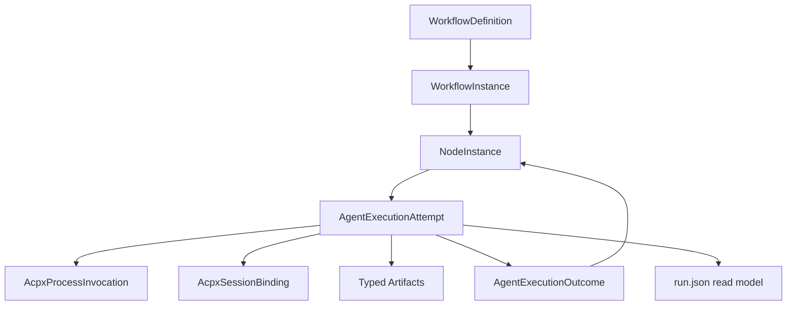
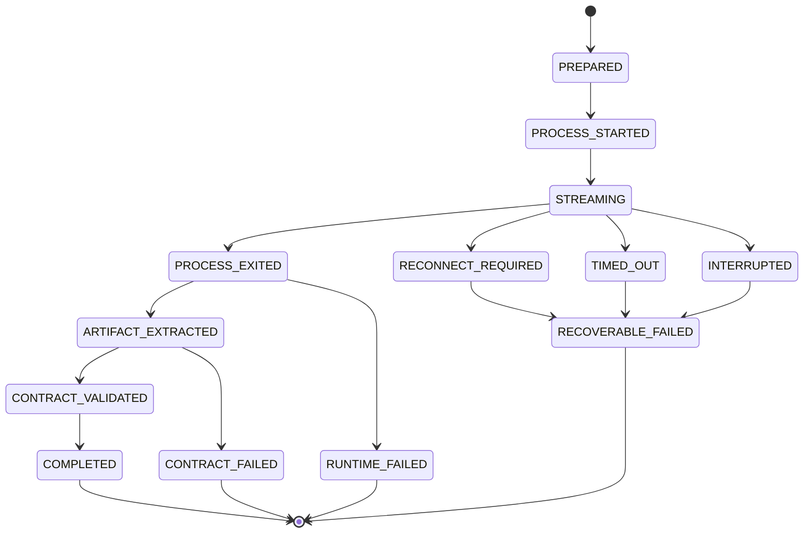
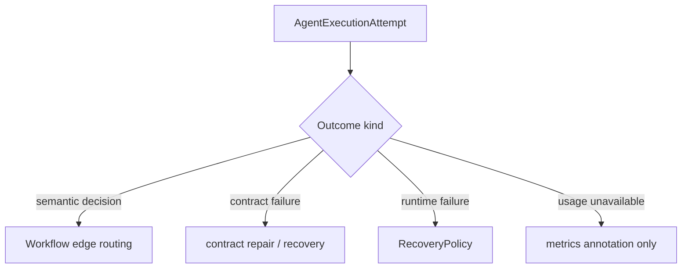
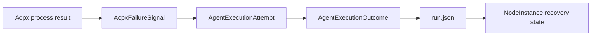

# AgentExecutionAttempt 运行时边界设计

## 1. 决策

直接引入 `AgentExecutionAttempt` 作为一次外部 Agent 调用的执行聚合根。`run.json` 保持稳定 read model，不被删除，也不替换成不兼容格式。

本设计解决的问题不是业务流程定义，而是外部 Agent runtime 没有完整收束造成的状态断裂：

- acpx 报 `agent needs reconnect` 后，节点可能停在 stale `RUNNING`。
- 没有 `run.json` 时，metrics / trace / UI / recovery 无法判断失败原因。
- provider usage 缺失时，系统只能看到 0 或 unknown，不能解释为什么不可归因。
- session keep-alive / compaction / rebuild 没有可依赖的执行事实模型。

结论：外部 Agent 执行必须先转成 typed `AgentExecutionAttempt` / `AgentExecutionOutcome`，再影响 workflow 节点状态。stderr、transcript、自然语言正文不能直接成为 workflow truth。

## 2. 模型边界

| 层 | 对象 | Source of Truth | 不负责 |
| --- | --- | --- | --- |
| Definition | `WorkflowDefinition` / `NodeDefinition` | workflow JSON / contract registry | pid、session、stderr、usage |
| Instance | `WorkflowInstance` / `NodeInstance` | ledger node/workflow state | 外部进程细节 |
| Execution | `AgentExecutionAttempt` | attempt/run durable record | 定义业务 graph |
| External Activity | `AcpxProcessInvocation` | process result + stderr/transcript refs | 业务判断 |
| External Context | `AcpxSessionBinding` | acpx session name/id/scope | workflow memory |
| Artifact | `agent_output_contract` / typed artifacts | structured artifact sidecar | runtime failure 分类 |
| Projection | `run.json` / metrics / trace / UI | read model | authoritative lifecycle mutation |

关系：



关键规则：

- `WorkflowDefinition` 定义业务流程，不记录外部进程事实。
- `NodeInstance` 表达节点状态，不直接解释 acpx stderr。
- `AgentExecutionAttempt` 记录一次外部 Agent 调用的全部运行事实。
- `AcpxSessionBinding` 是 runtime context/cache，不是 workflow memory 的 SoT。
- `run.json` 是 attempt 的稳定 read model，供 metrics / CLI / UI / memory updater 使用。

## 3. Attempt 生命周期



约束：

- 进程启动后必须有 durable attempt/read model。
- 所有 terminal attempt 都必须写出 `run.json`。
- 没有 final artifact 也必须写 `run.json`，并写明 runtime failure signal。
- reconnect / timeout / interrupted 是 runtime failure，不是 artifact contract failure。
- artifact validator 只在 process usable 且存在 artifact 时运行。

## 4. AgentExecutionAttempt read model

`run.json` 新增 additive `executionAttempt` block。旧字段继续保留。

```json
{
  "schemaVersion": 4,
  "runId": "run-...",
  "nodeId": "intake.claude_brainstorm",
  "agent": "claude",
  "status": "failed",
  "startedAt": "...",
  "finishedAt": "...",
  "executionAttempt": {
    "attemptId": "att-...",
    "status": "RECOVERABLE_FAILED",
    "processStatus": "RECONNECT_REQUIRED",
    "failureSignal": "AGENT_RECONNECT_REQUIRED",
    "recoverable": true,
    "retrySafe": false,
    "message": "acpx reported agent needs reconnect",
    "stderrPath": "outputs/intake-claude-brainstorm.stderr.log",
    "transcriptPath": "outputs/intake-claude-brainstorm.transcript.log",
    "sessionName": "claude-main-ws-...",
    "sessionId": "...",
    "sessionScope": "workstream",
    "sessionSegmentKey": "ws:..."
  },
  "usage": {
    "measurementType": "UNAVAILABLE",
    "source": "not_available",
    "unavailableReason": "AGENT_RECONNECT_REQUIRED"
  }
}
```

`run.json` 的语义升级为：一次 Agent execution attempt 的 read model。它不再只代表成功完成的 run。

## 5. Outcome 分类

| Outcome | 类别 | Recoverable | 说明 |
| --- | --- | --- | --- |
| `COMPLETED` | success | false | process usable，artifact valid |
| `CONTRACT_FAILED` | contract | depends | artifact present but invalid |
| `AGENT_RECONNECT_REQUIRED` | runtime | true | acpx/session 要求 reconnect |
| `PROCESS_TIMEOUT` | runtime | true | process 超时 |
| `PROCESS_INTERRUPTED` | runtime | true | user/system interrupt |
| `RATE_LIMITED` | provider | true | provider quota/rate |
| `ARTIFACT_MISSING` | contract/runtime | depends | process completed but required artifact missing |
| `USAGE_UNAVAILABLE` | observability | false | usage 不可归因，不单独驱动 workflow |

语义 outcome 和 runtime outcome 必须分开：



## 6. 与 WorkflowDefinition 的关系

第一阶段不改 workflow definition。

- semantic decision 才进入 workflow edge routing。
- runtime failure 进入 recovery policy。
- workflow graph 不为每种 process failure 新增节点。
- 如果未来要让 runtime recovery graph-native，再引入 `executionRecoveryPolicy`。

当前阶段目标是补齐：



## 7. 实现边界

### 需要改

- `dual-core`
  - `AgentExecutionAttempt`
  - attempt status / process status / failure signal model
- `dual-adapter-acpx`
  - `AcpxAgentTransport` 返回 typed process result
  - `AcpxAgentTaskHandler` always write attempt/read model
  - acpx stderr/session stream 进入 failure signal catalog
- `dual-ledger-file`
  - metrics/read model 识别 `executionAttempt`
- `dual-cli`
  - trace / recovery / status 展示 runtime failure 与 usage unavailable reason

### 不改

- workflow definition
- lifecycle graph
- session scope 默认策略
- persistent daemon / keep-alive worker
- provider-cache-aware 策略
- prompt contract
- UI 大改

## 8. 验收标准

1. `agent needs reconnect` 必须写出 `run.json`。
2. `run.json.executionAttempt.failureSignal = AGENT_RECONNECT_REQUIRED`。
3. 节点不允许 stale `RUNNING`。
4. workflow 进入明确 recoverable 状态。
5. `current-failure.md` / CLI recovery 能显示 reconnect 原因。
6. metrics 显示 usage unavailable reason，而不是误报为真实 0 token。
7. artifact validator 不把 reconnect 当 artifact contract failure。
8. retry/recovery action 能看到 sessionName/sessionId/session scope。
9. 中断脚本后，残留 RUNNING 能被 stale guard 识别或恢复。

## 9. 提交拆分

1. `docs(runtime): design agent execution attempt lifecycle`
2. `feat(core): model agent execution attempts`
3. `feat(acpx): classify process failures into execution attempts`
4. `feat(projection): surface agent execution attempts`

每个提交必须有测试；实现提交不得依赖 prompt discipline 证明边界。
