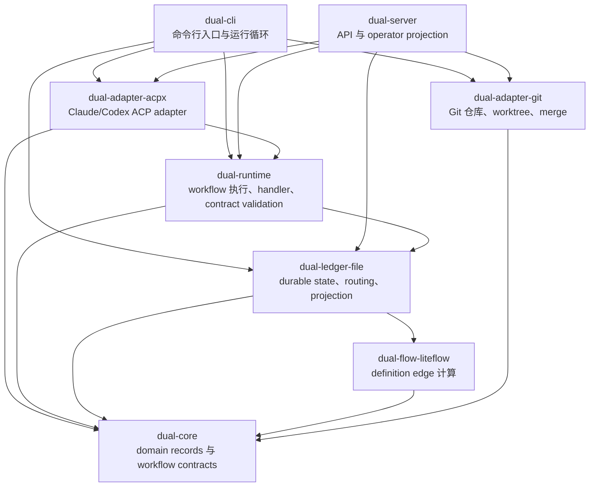
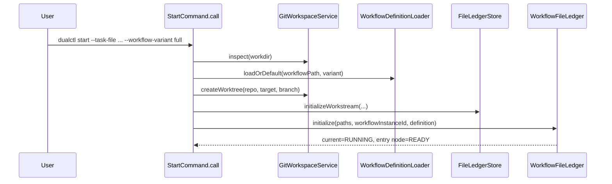
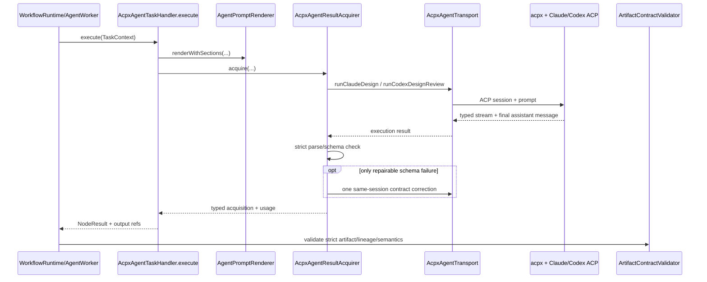

# Dual Orchestrator 当前架构

日期：2026-08-04
基线：`72ae925a`
状态：`CURRENT / PHASE A-D CLOSED / T6 FULL WORKFLOW PROVEN`

## 1. 文档目的

本文描述当前代码实际实现，不描述愿景平台，也不为未来能力预留抽象。

它回答五个问题：

1. `dualctl` 从命令行启动后实际调用哪些类和方法；
2. workflow definition、instance、execution、AgentTask、artifact、gate 和 ledger
   分别是什么；
3. Claude Code 与 Codex 如何通过 acpx 被触发，结构化结果如何进入 workflow；
4. 哪些事实是 source of truth，哪些文件只是 projection；
5. 当运行失败时，如何判断是模型、provider、架构还是实现问题。

本文同时锁定当前优化结论：

> Dual 的结构化控制主链已经基本稳定。当前最大的未完成目标不是继续建模，而是
> 证明最新组合版本可运行，并开始用现有 metrics 数据减少 Agent 调用、token、
> revision 和总耗时。

该结论不得被解释为允许建设新的 workflow engine、artifact graph、evidence
registry、policy engine、metrics platform 或 handler framework。

## 2. Dual 是什么

Dual 是一个以 workflow 和 ledger 为核心的 Claude Code / Codex 协作运行器。

它不是：

- LLM 自己决定下一步的 autonomous loop；
- 依赖 Markdown 或自然语言关键词驱动状态机的 prompt framework；
- ACP/MCP 权限平台；
- 通用 Agent OS；
- 通用 artifact graph 或 policy platform。

它的基本工作方式是：

```text
用户需求
  -> 固定 workflow definition
  -> node instance
  -> handler / Agent 执行
  -> strict typed artifact
  -> validator / domain decision
  -> ledger route
  -> human gate / recovery / next node
  -> acceptance / delivery
```

LLM 负责产生候选 artifact；workflow、validator、ledger 和 human gate 决定这些
artifact 是否可被接受和如何路由。

## 3. 模块地图



| 模块 | 当前职责 | 是否拥有状态 |
| --- | --- | --- |
| `dual-core` | workflow、node、execution outcome、TaskContract 等 typed model | 只定义模型，不持久化 |
| `dual-ledger-file` | workflow/node/execution/AgentTask/gate/event durable ledger 与 routing | 是，文件 ledger |
| `dual-flow-liteflow` | 根据 definition、signal 和 edge 计算 transition | 否 |
| `dual-runtime` | 驱动节点、调用 handler、artifact validation、recovery guard | 只产生执行事实，持久化委托 ledger |
| `dual-adapter-acpx` | ACP stream、Claude/Codex session、prompt、usage、typed result acquisition | 只拥有单次外部运行事实 |
| `dual-adapter-git` | Git repo/worktree/delivery merge 外部副作用 | Git 是实际变更事实来源 |
| `dual-cli` | 创建 workstream、运行、恢复、人工决策和只读命令 | 否 |
| `dual-server` | API、scheduler 和 operator projection | 否，不得自造状态 |

### 3.1 LiteFlow 的准确位置

默认 routing kernel 是 `LiteFlowPrototypeKernel`，但 runtime 和 ledger 不直接依赖
LiteFlow API：

```text
RoutingEngine
  -> FlowOrchestrationKernel
  -> FlowKernelProvider
       -> LiteFlowPrototypeKernel（默认）
       -> BuiltInFlowOrchestrationKernel（诊断/回退）
```

因此 Dual 的 authoritative workflow state 仍是 definition + ledger；LiteFlow 负责
计算 transition，不持久化 workflow truth。两个 kernel 必须遵守同一个
`FlowOrchestrationKernel` contract，不能各自演化出不同状态语义。

## 4. 核心状态模型

### 4.1 Definition

`WorkflowDefinition` 声明：

- node id；
- node kind；
- handler type；
- node config；
- edges 和 outcome；
- revision/branch/join metadata。

内置 definition 位于：

```text
dual-runtime/src/main/resources/dev/dual/runtime/lifecycle/
  agent-lifecycle.full.json
  agent-lifecycle.contract.json
```

`WorkflowDefinitionLoader.loadOrDefault()` 负责加载。Definition 是流程结构的
source of truth；handler registry 只是能力装配，不能重建第二份 workflow。

### 4.2 Instance

`WorkflowFileLedger.initialize()` 根据 definition 创建：

- `WorkflowInstanceDocument`；
- `WorkflowCurrentDocument`；
- 首个 `NodeInstanceDocument`；
- `iter-001`；
- `workflow_started` event。

Instance 表示“这个 workstream 中发生的这一次流程和节点”。它不是一次进程调用。

### 4.3 Execution

每次 `resume` 或 worker 执行都会创建：

- `WorkflowExecutionDocument`；
- `NodeExecutionDocument`；
- 对 Agent 节点还会创建 `AgentTaskDocument`。

Execution 拥有：

- pid；
- started/finished time；
- handler 运行结果；
- process status、exit code、failure signal；
- retry/recovery 所需的运行证据。

语义 revision 由 `WorkflowIterationDocument` 表达，不得用 process retry 代替。

### 4.4 Artifact

LLM 最终结果必须是 strict `AgentResultEnvelope` JSON。当前路径为：

```text
ACP assistant final message
  -> AcpxAgentResultAcquirer
  -> strict parser
  -> optional bounded schema correction（最多一次、同 session）
  -> AgentResultEnvelopeValidator
  -> output JSON
  -> agent_output_contract sidecar
  -> ArtifactContractValidator
  -> ledger publication / inputRefs
```

Markdown 只用于人类阅读，不参与 workflow routing。

### 4.5 Gate

Human gate 的 source of truth 是：

- workflow definition 中的 gate node 和 outgoing edges；
- `GateDocument.allowedActions`；
- `RoutingEngine.resolveOpenGate()` 写入的 canonical action。

`HumanReviewGateHandler` 只生成 review packet、evidence projection 和操作建议，
不能自行改变 workflow。

### 4.6 Projection

以下内容是 read model，不是状态 source of truth：

- `timeline.json/jsonl`；
- `metrics/workstream-metrics.json`；
- CLI `status/trace/summary`；
- server API 和 console；
- Markdown report；
- real-case `summary.json/report.md`。

Projection 可以解释事实，不能重新计算 lifecycle state。

## 5. 从 CLI 到 ledger 的真实调用链

### 5.1 `dualctl start`



真实入口：

- `StartCommand.call()`；
- `GitWorkspaceService.inspect/createWorktree()`；
- `WorkflowDefinitionLoader.loadOrDefault()`；
- `FileLedgerStore.initializeWorkstream()`；
- `WorkflowFileLedger.initialize()`。

`start` 只创建 durable workstream 和 worktree。使用 `--run` 时才继续进入
`CliWorkflowLoop.run()`。

### 5.2 `dualctl run` / `resume`

`RunCommand.call()` 和 `ResumeCommand.call()` 最终通过
`CliWorkflowRuntimeFactory.create()` 创建：

```java
new WorkflowRuntime(
    CliLedgerFactory.create(),
    AcpxWorkflowHandlerRegistryFactory.create(),
    dispatchMode
)
```

随后调用 `WorkflowRuntime.resume(WorkflowCommand)`。

### 5.3 Inline execution

```mermaid
sequenceDiagram
    participant Loop as CliWorkflowLoop
    participant Runtime as WorkflowRuntime.resume
    participant Ledger as WorkflowFileLedger
    participant Handler as Task/Decision Handler
    participant Validator as ArtifactContractValidator
    participant Router as RoutingEngine

    Loop->>Runtime: resume(command)
    Runtime->>Ledger: loadDefinition/loadCurrent
    Runtime->>Runtime: terminal + stale attempt guard
    Runtime->>Ledger: startWorkflowExecution
    Runtime->>Ledger: createAgentTask/startNodeExecution/markRunning
    Runtime->>Handler: execute/evaluate
    Handler-->>Runtime: NodeResult
    Runtime->>Validator: validate(...)
    Runtime->>Ledger: finish AgentTask/NodeExecution
    Runtime->>Ledger: completeAndRoute(...)
    Ledger->>Router: completeAndRoute(...)
    Router-->>Ledger: next node/gate/revision/terminal
    Runtime->>Ledger: finishWorkflowExecution
```

关键实现：

- `WorkflowRuntime.resume()`；
- `WorkflowRuntime.executeActiveNode()`；
- `WorkflowRuntime.executeAndRecordNode()`；
- `WorkflowRuntime.executeNode()`；
- `ArtifactContractValidator.validate()`；
- `WorkflowFileLedger.completeAndRoute()`；
- `RoutingEngine.completeAndRoute()`。

handler 返回 `NodeResult`，但 handler 不直接选择 edge。RoutingEngine 根据
definition、outcome 和 typed result 计算下一节点。

### 5.4 Worker dispatch

当 `dispatchMode=WORKER`：

```text
WorkflowRuntime
  -> create AgentTask
  -> mark node queued/running
  -> return

WorkerRunOnceCommand
  -> AgentWorker.runOne
  -> claim first queued AgentTask
  -> start workflow/node execution
  -> handler
  -> artifact validator
  -> completeAndRoute
```

`AgentTask` 是 dispatch contract，不是 workflow 的第二状态机。

### 5.5 Server 入口

`dual-server` 没有第二套 workflow runtime：

```text
API / scheduler
  -> WorkstreamActionService
  -> ServerWorkflowRuntimeFactory
  -> WorkflowRuntime
  -> ServerLedgerFactory
  -> WorkflowFileLedger
```

`WorkstreamQueryService` 读取 ledger 和 projection。CLI 与 server 共享
`WorkflowRuntime`、`AcpxWorkflowHandlerRegistryFactory` 和
`FlowOrchestrationKernel`；API 不得独立推导 lifecycle state。

## 6. Claude/Codex 与 acpx 边界



职责边界：

| 组件 | 负责 | 不负责 |
| --- | --- | --- |
| `AcpxAgentTransport` | ACP process/session/stream/exit | workflow routing、业务 decision |
| `AcpxAgentResultAcquirer` | 最终消息 strict parse、最多一次 bounded correction | 自动补字段、语义 retry |
| `AcpxAgentTaskHandler` | prompt/run/evidence/usage 编排 | artifact 最终准入、edge routing |
| `ArtifactContractValidator` | schema、lineage、semantic admission | provider transport |
| `WorkflowFileLedger/RoutingEngine` | durable state 和 transition | 解析 Agent 自然语言 |

## 7. 12 个 concrete handler

| Handler | 当前职责 | 主要 domain owner |
| --- | --- | --- |
| `AcpxAgentTaskHandler` | ACP Agent 执行编排 | execution facts 分别由 typed execution models 拥有 |
| `ArtifactValidateHandler` | Git evidence + change evaluation 编排 | `ChangeScopeEvaluator` |
| `ContextBuildPackageHandler` | bounded context package 编排 | ledger facts + `AgentEvidenceIndex` |
| `ContractCompileHandler` | approved proposal 编译为 TaskContract | typed proposal + gate resolution |
| `FailureClassifyHandler` | 收集 typed acceptance failure facts | `AgentEvidenceIndex` + `FailureArbiter` |
| `ReviewDecisionHandler` | routed decision handler | `AgentEvidenceIndex` |
| `HumanReviewGateHandler` | review packet 和 operator guidance | `StageOutcome` + ledger gate |
| `DeliveryPrepareHandler` | commit message/PR body | typed accepted artifacts |
| `DeliveryCommitHandler` | Git commit side effect | Git repository |
| `DeliveryPrCreateHandler` | PR creation side effect | external Git provider |
| `PromptGenerateNextStageHandler` | handoff/next prompt projection | validated routed artifacts |
| `ReportGenerateFinalHandler` | final report projection | ledger/read models |

Phase D 已删除四个已证明重复 owner。部分 handler 仍然较大，但“类较大”不等于
存在错误 owner；没有真实重复规则或性能证据时不得继续拆分。

## 8. Ledger 目录结构

一个 workstream 的主要结构：

```text
.agent/workstreams/<workstream-id>/
├── requirement.md
├── workstream.json
├── settings.json
├── workflow/
│   ├── definition.json
│   ├── instance.json
│   └── current.json
├── nodes/<node-instance-id>.json
├── iterations/<iteration-id>.json
├── gates/<gate-id>.json
├── executions/
│   ├── workflow/<workflow-execution-id>.json
│   └── nodes/<node-execution-id>.json
├── queue/agent-tasks/<agent-task-id>.json
├── runs/<run-id>/
│   ├── run.json
│   ├── prompts/
│   └── outputs/
├── artifacts/
│   ├── task-contract.json
│   ├── failure-classification.json
│   └── change-scope-evaluation.json
├── reviews/
├── delivery/
├── domain/
│   ├── goal-satisfaction.json
│   └── completion-audit.json
├── metrics/
│   ├── workstream-metrics.json
│   └── workstream-metrics.md
├── events.jsonl
├── timeline.jsonl
└── timeline.json
```

### 8.1 写入权限

| 文件 | Authoritative owner |
| --- | --- |
| `workflow/definition.json` | `WorkflowFileLedger.initialize` |
| `workflow/current.json` | `RoutingEngine` / node state boundary |
| `nodes/*.json` | `NodeStateWriter` / `RoutingEngine` |
| `executions/**/*.json` | `ExecutionLedgerWriter` |
| `queue/agent-tasks/*.json` | `AgentTaskLedgerWriter` |
| `gates/*.json` | `RoutingEngine` |
| `runs/*/run.json` | acpx adapter metadata writer/finalizer |
| strict sidecars | typed Agent result projection + lineage publication |
| `metrics/*` | `MetricsProjectionWriter` |
| CLI/API/report | 只读消费上述事实 |

## 9. Source of truth 与闭环

| 事实 | Declared/Produced by | Consumed by | Enforced before |
| --- | --- | --- | --- |
| workflow structure | `WorkflowDefinition` | flow kernel、runtime、registry tests | node creation/routing |
| current workflow status | `workflow/current.json` | runtime、CLI、server | resume/new execution |
| node state | `NodeInstanceDocument` | runtime、routing、projection | handler/retry/route |
| execution outcome | typed execution model + execution ledger | recovery、metrics、runtime | retry/recovery/node success |
| Agent decision | strict sidecar + lineage | decision/classification/gate/context | edge、gate、downstream Agent |
| task change intent | `TaskContract.scope` | change evaluator | artifact validation success |
| actual Git change | Git name-status evidence | `ChangeScopeEvaluator` | acceptance context |
| change conformity | `ChangeScopeEvaluation` | artifact handler/routing | acceptance activation |
| recovery action | `RecoveryAssessment` | CLI/server/scheduler | retry/resume |
| human action | open gate + `RoutingEngine.resolveOpenGate` | routing | next node |
| token/cache/cost | `run.json.usage` + provider identity | `MetricsProjectionWriter` | optimization analysis only |

## 10. Phase A-D 的当前含义

| Phase | 已关闭的目标 | 不代表 |
| --- | --- | --- |
| A | strict JSON、typed lineage、A1/A2/A3 full lifecycle | 所有模型输出永不失败 |
| B | read-governance subtraction、typed change boundary | OS sandbox / tool-call 前阻断 |
| C | ledger-routed typed context、无 filesystem 猜测 | 通用 artifact graph |
| D | 已证明 handler duplicate authority 收敛 | 所有 handler 都必须变小或合并 |

Phase closure 是局部边界证明，不自动证明最新组合 SHA 的完整集成，也不证明 token、
延迟和调用数量已经优化。

## 11. 当前可观测性

已有 source：

- 每个 `runs/<run-id>/run.json`：
  provider、model、billing mode、usage、cache、duration、execution outcome；
- `metrics/workstream-metrics.json`：
  run/node/provider 汇总、token totals、cached read/write、token attribution、
  longest nodes、tool metrics；
- `timeline.json/jsonl`：
  durable lifecycle projection；
- real-case `summary.json/report.md`：
  workflow/acceptance/gate/revision 的测试报告。

当前缺口不是缺少 metrics model，而是 real-case 报告没有把
`workstream-metrics.json` 的关键效率字段固定成跨运行可比较的 baseline。

因此后续优化必须复用现有 metrics read model。禁止新增第二套 usage schema、
telemetry store 或 analytics service。

## 12. 失败定位指南

| 现象 | 优先检查 | 归属 |
| --- | --- | --- |
| session/new、HTTP 4xx/5xx、quota、model mismatch | `run.json`、ACP stderr、typed adapter failure | provider/config/adapter |
| exit 0 但没有 strict result | final assistant message、acquisition document | 模型协议输出 |
| strict parse/schema failure | parser/validator typed error、bounded correction | output contract |
| sidecar 存在但下游看不到 | publication event、node/execution hash、inputRefs | lineage/context implementation |
| decision 正确但走错 edge | decision `NodeResult`、definition edges、routing event | workflow definition/routing |
| 修改了未声明文件 | TaskContract、Git evidence、change evaluation | model intent 或 implementation |
| node 状态与 CLI/API 不一致 | `workflow/current.json`、projection freshness | projection implementation |
| retry/resume 错误 | execution outcome、RecoveryAssessment | recovery owner |
| workflow 完成但业务不正确 | acceptance sidecar、goal satisfaction、target tests | Agent/contract/acceptance |

判定顺序：

```text
artifact freshness
  -> provider/config
  -> ACP execution
  -> strict output contract
  -> lineage/publication
  -> domain validation
  -> routing/ledger
  -> projection
```

不要从最终错误文案倒推根因，也不要在 handler 中补自然语言 `contains()`。

## 13. 当前真实不足

### 13.1 最新完整运行与当前精确 SHA

最新完整中等复杂度运行是 workstream `ws-20260804T092758Z-73XJ`：

| 结果 | 总时间 | Agent runs | Gate rounds | Revisions |
| --- | ---: | ---: | ---: | ---: |
| `COMPLETED / ACCEPT_WITH_NOTES` | 29m09s | 14 | 6 | 2 |

该运行证明 full workflow、strict sidecar/lineage、typed contract、change scope、execution
facts 和 delivery 主链能够完成。运行后 `72ae925a` 又删除了
`ACCEPT_WITH_NOTES -> failure classifier` 的矛盾路径，并通过 full reactor
`1182/0/0`；当前精确 SHA 的这项改动为 `ENFORCED`，没有为了重复证明确定性路由而
再次消耗 provider 样本。

### 13.2 效率只完成一个已证明优化

T4/T5 删除六个 active context profile 中重复的 requirement 投影，并在同一 A3
前后样本中观察到：estimated context 下降 10.18%、provider-reported total token
下降 7.64%、Agent duration 下降 13.88%。该结论只覆盖一个 A3 样本。

当前 full definition 仍有：

| 项目 | 数量 |
| --- | ---: |
| definition nodes | 32 |
| edges | 49 |
| Agent nodes | 10 |
| context-build nodes | 6 |
| human gates | 6 |

最新 T6 的 14 次 Agent 调用和 2 次 revision 说明整体效率尚未闭环。下一步必须从
ledger 和现有 metrics 逐次归因质量贡献与成本，只允许选择一个有证据的删除候选。

该归因已完成：4 个 revision runs 占 402,846 ms Agent duration 和 335,843
provider-reported total tokens。成本最高的 plan revision pair 实际阻止了三个会进入
实现的 contract-to-plan 偏差，intake revision 也补齐了最终实现依赖的业务义务。
因此本样本结论为 `NO_SAFE_SUBTRACTION`；不能把“有成本”直接解释为“应删除”。详见
`docs/plans/post-t6-v9-revision-value-attribution-20260804.zh-CN.md`。

### 13.3 中等复杂度已证明一次，跨任务泛化未证明

T6 已覆盖 Python backend、PostgreSQL、miniprogram frontend 与 5 个实际变更文件，
因此“只验证过 README/简单 API”不再成立。但一次 medium case 不能证明跨任务、
跨时段或跨 provider/model 的稳定收益。

### 13.4 部分 handler 仍需证据驱动审查

`ContextBuildPackageHandler`、`ContractCompileHandler`、
`PromptGenerateNextStageHandler`、`ReportGenerateFinalHandler` 与
`AcpxAgentTaskHandler` 仍有规模或专用读取复杂度，但没有证据证明存在第二控制 owner。
只有真实性能或重复规则证据才能重新打开删除式 slice。

## 14. 架构保护规则

任何后续任务必须满足：

1. 先写唯一可测目标，不以“继续优化”为目标；
2. 指定现有 source of truth；
3. 指定准备删除或减少的路径；
4. 不新增 module、engine、registry、graph、DSL、state machine 或 event store；
5. 不因 handler LOC 大而拆类；
6. 不放宽 strict parser，不补默认字段，不恢复 Markdown/prose routing；
7. 不把 metrics projection 升级成控制 authority；
8. 不使用一次不同 case 的结果宣称性能改善；
9. 同一 case 前后对比，质量和边界必须不退化；
10. real-case 必须先通过 Verification Gate，失败分为 PASS/FAIL/INVALID。

发现一个非主要问题时，默认动作是记录证据并继续主目标；只有它阻断当前
Verification Gate 或破坏 source of truth 时才允许修复。

## 15. 阅读一次真实运行的步骤

1. 读 `workflow/current.json`：整体状态和 active node；
2. 读 active/failed `nodes/*.json`：status、inputRefs、outputRefs、result；
3. 读 `executions/nodes/*.json`：具体执行是否完成；
4. Agent 节点读对应 `runs/*/run.json`：provider、usage、process、typed outcome；
5. 读 output JSON 和 `.contract.json`：strict result 与 lineage；
6. 读 `events.jsonl`：publication、routing、iteration；
7. 读 `artifacts/task-contract.json` 和 `change-scope-evaluation.json`；
8. 读 `metrics/workstream-metrics.json`：时间/token/cache/调用热点；
9. 最后读 CLI/report projection，核对它没有与 ledger 矛盾。

这个顺序能避免把 provider 故障误判为 Dual 缺陷，也能避免用报告文案替代
authoritative ledger。
