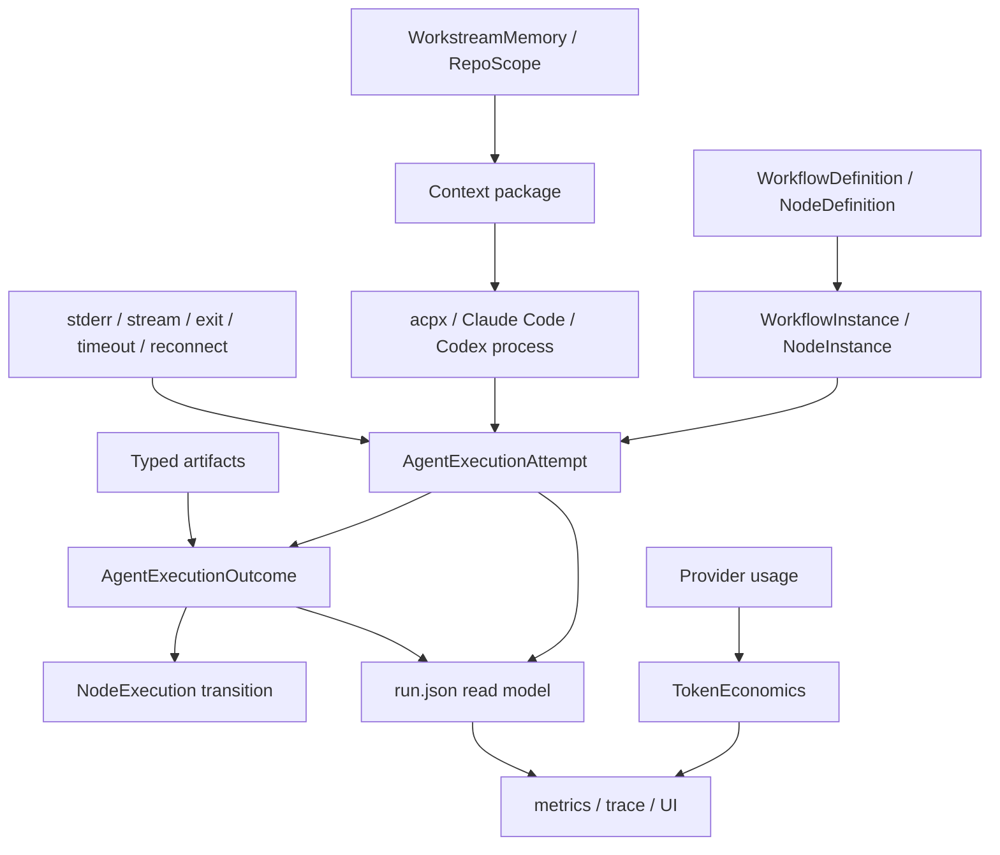

# 主线稳定性与 Token 治理总控计划

> 状态：设计总控文档。
> 更新日期：2026-06-30。
> 目的：把执行边界、token/cost 归因、repo scope 治理和 real-case 验证拆成可验收的主线，避免继续在真实 case 中边跑边补洞。

## 1. 当前结论

`intake` 探索治理已经完成：`intake.claude_brainstorm` 不再发布 direct read / shell 能力，且 bounded cancer-clinic run 已证明 `actualDirectReadFiles=[]`、`explorationPolicyResult.status=pass`。

但这不等于系统整体可稳定跑完整 real-case。当前仍有四条主线未闭环：

1. runtime 执行事实边界未完全收口；
2. provider/model/token/cost 经济模型未完全收口；
3. repo scope / read governance 只覆盖了 intake，后续阶段仍可自由探索；
4. full real-case 验证链路没有稳定的前置 gate 和 stop-loss。

因此，下一步不能直接用 complex real-case 证明整体能力。必须先把执行事实和成本归因做成可靠 source of truth，否则 real-case 结果会继续混杂：

```text
Agent 是否完成
acpx 是否返回
transport 是否等待
run.json 是否落盘
executionAttempt 是否 stale
provider token 是否可归因
session transcript 是否膨胀
```

## 2. Source of Truth 分层



| 层 | Source of Truth | 负责 | 不负责 |
| --- | --- | --- | --- |
| Definition | workflow JSON / contract registry | 节点、边、契约定义 | 外部进程事实 |
| Instance | workflow / node ledger | 流程状态 | acpx stderr、token 经济 |
| Execution | `AgentExecutionAttempt` | pid、command、stdout、stderr、exit、timeout、reconnect、stalled | 业务判断 |
| Outcome | `AgentExecutionOutcome` | 将 process facts + typed artifacts 合成唯一执行结果 | UI 展示 |
| Artifact | typed artifact sidecar | agent 语义输出 | runtime failure 分类 |
| Context Governance | repo scope / memory / exploration plan | 当前阶段该读什么、能改什么、如何越界 | workflow graph |
| Economics | provider/model/cost attribution | token、cache hit、价格、billing mode | 业务路由 |
| Projection | run.json / metrics / trace / UI | 展示统一 read model | 发明状态 |

核心规则：

- `NodeExecution` 只能消费 `AgentExecutionOutcome`。
- `run.json` 是 read model，不是第二套状态机。
- provider usage 缺失是 observability 状态，不允许伪装成 0 token。
- session / transcript 是 runtime cache，不是 workflow memory 的 source of truth。
- UI / CLI / API 只能投影统一 read model。

## 3. 未完成目标清单

| 目标 | 当前状态 | 缺口 | 优先级 |
| --- | --- | --- | --- |
| `AgentExecutionAttempt -> AgentExecutionOutcome` | 本地模型已覆盖，真实 replay 待做 | finalizer/resolver/projection 已覆盖 success/failure/stalled/timeout/interrupted 和历史冲突标记；仍缺 problematic workstream replay | P0 |
| acpx / CC / Codex 执行生命周期 | 本地 timeline read model 已补，真实慢点待复核 | executionTimeline 已投影为 executionLatency，metrics/trace 能显示 process wait / terminal / artifact / contract validation 阶段耗时；仍缺 problematic real-case 慢点复核 | P0 |
| stale RUNNING / PROCESS_STALLED | synthetic 覆盖，real replay 待做 | dead pid resume 会进入 recovery 并标记 node execution stale；仍缺历史 problematic workstream replay | P0 |
| provider/model/token attribution | 本地读模型和 CSV fixture 已覆盖，真实账单校准待做 | GLM token-only、DeepSeek、OpenAI/Codex token-only、Claude/Anthropic cache pricing 已进入统一 catalog + metrics projection；CSV parser/fixture 已覆盖 DeepSeek 账单公式；仍缺真实账单文件校准和真实复杂 case 复测 | P0.5 |
| provider-cache-aware | 本地决策矩阵已覆盖，真实触发待证 | 已有 token-only / priced / pricing unavailable / node applicability 的 policy 测试；仍缺 same real-case 下 active 触发、cachedRead 降低和质量不退化证明 | P1 |
| session transcript compaction | 部分实现 | 没有证明 same real-case 下 implement cachedRead 降低且质量不退化 | P1 |
| intake exploration governance | 已完成 | 只覆盖 intake，不代表整体 readCount/token 下降 | Done |
| design/plan/implement/review repo scope governance | 本地 projection 已覆盖，真实收益待证 | stage policy mapping、run-level ExplorationPolicyResult、metrics/trace WARN/FAIL 聚合已有测试；仍缺真实 case 下 readCount/token 下降证明 | P1 |
| memory loop / read reuse | 部分实现 | 对 token 收益有限；必须和 scope governance 结合 | P1 |
| artifact boundary | 大体完成 | `plan_artifact`、`stage_handoff`、`rereadPolicy` 已类型化，但缺完整 real-case 验证 | P1 |
| projection consistency | 部分完成 | CLI trace 已补；UI/API/operator 是否同源还未整体 sweep | P1 |
| full complex real-case | 未完成 | 只有 bounded run，没有完整端到端验收 | P2 |
| acpx 慢 / 每节点启动慢 | 本地拆分 read model 已补，真实结论待证 | metrics/trace 已能展示 execution latency top run 和 dominant phase；仍缺真实 case 下 provider 推理慢、transport 等待慢、session 操作慢、dual 落盘慢的分解样本 | P0/P1 |
| session keep-alive | 未来优化 | 需要在 execution attempt 模型稳定后做 | P3 |

## 4. P0：执行事实边界收口

### 4.1 目标

让系统能准确回答：

```text
agent 到底有没有完成？
如果没完成，卡在哪里？
如果 terminal 已经出现，为什么还继续等待？
如果 run.json 落盘晚，晚在哪里？
```

### 4.2 需要实现

1. 完整 `AgentExecutionAttempt` 生命周期：

```text
PREPARED
PROCESS_STARTED
STREAMING
TERMINAL_DETECTED
PROCESS_EXITED
ARTIFACT_EXTRACTED
CONTRACT_VALIDATED
COMPLETED | CONTRACT_FAILED | RECOVERABLE_FAILED | RUNTIME_FAILED | TIMED_OUT | STALLED
```

2. `AgentExecutionOutcomeResolver` 成为唯一合成点：

- process exit code；
- terminal control；
- required typed artifact；
- adapter signal；
- timeout / stalled；
- usage availability。

3. transport 分段记录：

- process started timestamp；
- first stdout/stderr timestamp；
- terminal detected timestamp；
- last progress timestamp；
- process exited timestamp；
- artifact extracted timestamp；
- contract validated timestamp。

4. 禁止状态冲突：

- 不允许 `executionOutcome.status=SUCCESS` 同时 `executionAttempt.status=RUNTIME_FAILED`；
- 不允许 `PROCESS_STALLED` 和成功 outcome 并存；
- 不允许 artifact validator 直接消费 raw stderr。

### 4.3 验收

- `agent needs reconnect` 必须写出 `run.json`。
- `run.json.executionAttempt.failureSignal=AGENT_RECONNECT_REQUIRED`。
- 节点不允许 stale `RUNNING`。
- workflow 进入明确 recoverable 状态。
- `current-failure.md` / CLI recovery 能显示 reconnect 原因。
- metrics 显示 usage unavailable reason，而不是误报真实 0 token。
- artifact validator 不把 reconnect 当 artifact contract failure。
- retry/recovery action 能看到 sessionName / sessionId / session scope。
- 中断脚本后，残留 RUNNING 能被 stale guard 识别或恢复。

### 4.4 当前实现缺口

当前代码里已经存在 `AgentExecutionAttempt`、`AgentExecutionOutcome`、
`AgentExecutionOutcomeResolver`、`AgentExecutionHealth` 和 run.json
`executionAttempt` / `executionOutcome` 投影。但它们还没有成为唯一执行事实边界。

| 缺口 | 表现 | 根因 | 修复方向 |
| --- | --- | --- | --- |
| attempt/outcome 可冲突 | `executionOutcome=SUCCESS` 但 `executionAttempt=RUNTIME_FAILED/PROCESS_STALLED` | attempt 与 outcome 不是同一个 resolver 原子生成 | 引入单一 `AgentExecutionFinalizer`，一次性生成 terminal attempt、outcome 和 legacy run fields |
| terminal detected 后等待不可解释 | terminal 已出现，但 transport 继续等 293s/380s | 只有最终状态，没有阶段 timestamp / event segment | 已补 typed `executionTimeline[].details`，仍需真实/回放案例验证具体慢点 |
| transport 仍偏串行黑盒 | run.json 落盘依赖 handler 收到完整 transport 结果 | process streaming 事件没有持久化 read model | 增加 attempt event log 或 run.json `executionTimeline[]` |
| `PROCESS_STALLED` 可污染成功 | stdout 已完整，仍因 watchdog/stalled 写 runtime failed | process usability 和 artifact validity 没有统一裁决 | outcome resolver 输入必须包含 `ProcessUsability + TerminalControlResult + ArtifactContractResults` |
| artifact validator 仍能参与 outcome 写入 | validator 会刷新 `executionOutcome` | outcome ownership 分散 | validator 只返回 `ArtifactContractResult`，不直接决定 runtime outcome |
| stale RUNNING 证明不足 | 可显示 stale，但不一定能恢复一致状态 | terminal attempt 未必 always written | 无论成功、失败、timeout、interrupted，都必须写 terminal attempt |

2026-06-30 进展：

- 已引入 `AgentRunMetadataFinalizer`，把 `run.json` 的 `executionAttempt` / `executionOutcome`
  终态写入从 `ArtifactContractValidator` 中抽出；validator 只提供 terminal/artifact contract facts。
- `AgentExecutionFinalizer` 已成为 terminal attempt、outcome 和 legacy run fields 的统一合成点。
- `AgentExecutionAttemptStatus` 已补齐 `TIMED_OUT`、`STALLED`、`INTERRUPTED` 三个终态；
  adapter 初始 run metadata 和 finalizer 终态 metadata 均使用同一语义。
- 已有 projection contradiction 检测：`MetricsProjectionWriter.executionConsistency` 会标记
  `attempt_outcome_conflict` / `legacy_outcome_conflict`。
- `executionTimeline` 事件名已收敛到 core-level `AgentExecutionTimelineEventKind`；
  adapter 只能写 typed event kind，`run.json` 仍输出兼容的 wire string。
- `executionTimeline` 已补充 typed `details`：`process_wait_completed` / `process_exited`
  写入 `exitCode`，`terminal_control_detected` 写入 `graceMs`，
  `terminal_control_grace_elapsed` 写入 `waitMode=terminal_control_grace`、
  `action=terminate_process_tree`、`exitCode` 和 `graceMs`。因此 run.json 可以区分
  “进程自然退出”和“terminal contract 完整后 adapter 主动结束等待”，不用再靠日志或耗时猜测。
- `MetricsProjectionWriter.tokenAttribution.perRun[].executionLatency` 已把
  `executionTimeline` 投影为 read model：`processWaitCompletedMs`、
  `terminalDetectedMs`、`artifactExtractedMs`、`contractValidatedMs`、
  `terminalToContractMs` 和 `dominantPhase`。`dualctl trace` 的 Token Attribution
  也会显示最长 execution latency run，用于定位 provider/process wait、terminal grace
  或 post-process/contract validation 慢点。
- 已补离线 projection replay 入口：`dualctl projections refresh --workdir <workspace> <workstreamId>`
  会从现有 ledger / run.json 重新生成 `timeline.json` 和
  `metrics/workstream-metrics.json`，用于历史 problematic workstream 的 P0/P0.5
  证明链。该命令只刷新 read model，不启动 provider，不改变 workflow/node/run source of truth。
  `ProjectionsRefreshCommandTest.refreshesTimelineAndMetricsFromExistingLedger` 已断言 refresh 后
  `workflow/current.json`、`nodes/*.json` 和 `runs/*/run.json` 字节不变，防止 replay 入口
  变成隐式状态迁移。
- refresh 入口已补充 execution consistency warning 输出：当历史 ledger replay 后的 metrics
  中存在 `stale_legacy_running` / `attempt_outcome_conflict` 等非 `consistent` 计数时，
  CLI 会从 `metrics/workstream-metrics.json.providerMetrics.executionConsistencyCounts`
  投影出 `Execution consistency: ...`。该输出仍是 read model 消费，不反写 ledger。
  `ProjectionsRefreshCommandTest.refreshSurfacesExecutionConsistencyWarningsWithoutMutatingLedger`
  已覆盖 stale legacy RUNNING fixture，并验证 metrics / token attribution / stdout 三处都能看到
  `stale_legacy_running`。
- `executionTimeline` 已覆盖 transport 后段关键事件：adapter 在最终 artifact 提取后写入
  `artifact_extracted`，runtime finalizer 在 contract validation 后写入 `contract_validated`。
- `ArtifactContractValidator` 不再写 run metadata 或 `agent_execution_outcome`；
  validator 只附加 terminal/artifact typed facts，`WorkflowRuntime` / `AgentWorker`
  在 ledger 写入前调用 `AgentRunMetadataFinalizer` 统一合成 terminal attempt/outcome。
- stale RUNNING 历史投影已补充 fixture：当 legacy `run.status=running` 但 typed
  `executionAttempt` 已进入终态时，`MetricsProjectionWriter.executionConsistency`
  标记为 `stale_legacy_running`，并同步出现在 token run、token attribution 和
  provider consistency summary 中。
- stale RUNNING runtime 路径已有 synthetic coverage：resume 遇到 dead `running_pid`
  会写入 `node_stale_running_detected` event、进入 `WAITING_FOR_RECOVERY`、把当前 node
  标记为 `FAILED/recoverable`，并把最新 `NodeExecution` 标为 `STALE`。这证明 runtime
  不会继续重跑 stale 节点；尚未覆盖历史 real workstream replay。
- 已补齐 acpx failure catalog 与 execution outcome 的 sibling gap：
  `RECOVERABLE_AGENT_MODEL_MISMATCH` 现在会被 adapter / runtime finalizer 映射为
  typed `AdapterSignalType.MODEL_MISMATCH`，并进入 `executionAttempt.failureSignal`
  和 `executionOutcome.secondarySignals`。
- `KILLED_AFTER_RECOVERABLE_SIGNAL` 不再默认等价于 `RECONNECT_REQUIRED`。
  只有 secondary signal 包含 `AGENT_RECONNECT_REQUIRED` 时才写
  `AgentExecutionProcessStatus.RECONNECT_REQUIRED`；`MODEL_MISMATCH` 这类非 reconnect
  recoverable failure 会保持为 `FAILED` process status，避免违反
  `RECONNECT_REQUIRED` 必须带 reconnect signal 的核心 invariant。
- 2026-06-30 real-case 复核：`ws-20260630T120421Z-7Y5D` 在
  `intake.codex_product_review` 收到 acpx stderr `agent needs reconnect` 后，
  run.json 写出 `executionAttempt.status=RECOVERABLE_FAILED`、
  `failureSignal=RATE_LIMITED`、`executionOutcome.status=RECOVERABLE_ADAPTER_FAILURE`、
  `nodeMaySucceed=false`，workflow 停在 `WAITING_FOR_RECOVERY`，没有继续按成功路由。
  这证明 reconnect / rate-limit adapter signal 已由 execution boundary 阻断。
- 同一 real-case 的 `intake.claude_brainstorm` run.json 已在进程启动前写出
  prepared metadata；运行完成后写出 `executionAttempt.status=COMPLETED` 和
  `executionOutcome.status=SUCCESS`。这证明 normal run path 不再等完整 transport
  返回后才首次落盘 run.json。
- 2026-06-30 补充：`agent needs reconnect` 不能被无条件解释为本次 execution
  的 blocking failure。若本次 agent run 已经形成完整 terminal control 和 required
  typed artifact，acpx stderr 中的 reconnect 只表示 post-run session health warning，
  不应通过 `acpx_failure.reason` 再次注入 `NodeResult` 并覆盖成功 outcome。若输出
  不完整或 terminal/artifact contract 不满足，reconnect 仍作为 recoverable adapter
  failure 进入 execution boundary。
- 2026-06-30 retry 复核：对 public benchmark workstream
  `ws-20260630T144326Z-WUDW` 执行一次 `retry` + `resume` 后，新 run
  `run-1782832521162` 写出 `executionAttempt.status=COMPLETED`、
  `failureSignal=null`、`executionOutcome.status=SUCCESS`、
  `adapterSignals=[]`、`agent_output_contract.valid=true`，workflow 从
  `intake.codex_product_review` 推进到 `intake.decision`。该验证证明 fresh jar
  能使既有失败节点越过 recovery 边界，但不能单独证明“新 run 再次出现
  `agent needs reconnect` stderr 时也会被 suppress”，因为本次 retry stderr 是
  `agent connected`。因此 post-run reconnect suppression 的直接证据仍来自
  unit tests 与旧失败 run 根因分析，不能把这次 retry 夸大成完整 real-case 证明。
- native Claude CLI `--print --output-format json` 路径已补 usage acquisition：成功 JSON 会进入
  run.json `usage.measurementType=PROVIDER_RUN_USAGE`，并保留
  `provider=zhipu`、`model=glm-5.2`、`billingMode=subscription_token_only`。
  失败 JSON（例如 `is_error=true` 且 usage 全 0）必须记录为
  `usage.measurementType=UNAVAILABLE` 和明确 `unavailableReason`，不能伪装成真实 0 token。
  仍未完成的是 provider 成功运行后的真实 GLM 控制台 token 增量对账和 complex case 复核。

### 4.5 修复方案

建议按四个小提交修复。

#### Commit 1：模型收口

新增或收敛 `AgentExecutionFinalizer`。

输入：

- `ProcessResult`
- `AgentExecutionAttempt`
- `TerminalControlResult`
- `ArtifactContractResult[]`
- `AdapterSignal[]`
- `UsageResult`

输出：

- terminal `AgentExecutionAttempt`
- single `AgentExecutionOutcome`
- legacy `run.status / failureReason / recoverable`

规则：

- 禁止多个组件各自写 outcome；
- artifact validator 只产出 artifact contract result；
- transport 只产出 process facts 和 adapter signals；
- handler 只负责持久化 finalizer 的结果。

#### Commit 2：事件时间线

run.json 增加 additive 字段：

```json
"executionTimeline": [
  {"kind": "process_started", "observedAt": "...", "elapsedMs": 0},
  {"kind": "terminal_control_detected", "observedAt": "...", "elapsedMs": 1200, "details": {"graceMs": 2000}},
  {"kind": "terminal_control_grace_elapsed", "observedAt": "...", "elapsedMs": 3200, "details": {"waitMode": "terminal_control_grace", "action": "terminate_process_tree", "exitCode": 0}},
  {"kind": "process_exited", "observedAt": "...", "elapsedMs": 3210, "details": {"exitCode": 0}},
  {"kind": "artifact_extracted", "observedAt": "..."},
  {"kind": "contract_validated", "observedAt": "..."}
]
```

该字段是 read model，不改变 workflow definition。

#### Commit 3：冲突防线

增加 invariant：

- `SUCCESS` outcome 不允许搭配 `RUNTIME_FAILED / STALLED / TIMED_OUT` attempt；
- `CONTRACT_FAILED` 不允许被 runtime reconnect 覆盖成 success；
- `USAGE_UNAVAILABLE` 不能单独改变业务状态；
- projection 读到历史冲突时必须显示 projection warning，而不是静默展示成功。

#### Commit 4：projection 统一

- metrics / trace / recovery 全部优先读 finalizer 结果；
- legacy fallback 只用于历史 run；
- current failure / recovery action 使用同一 failure signal。

### 4.6 不跑真实 case 的证明方法

P0 不需要先消耗真实 provider token，可以用 synthetic / replay 证明模型有效。

1. Outcome resolver table tests：
   - exit 0 + valid terminal + valid artifact -> success；
   - exit nonzero + valid terminal + valid artifact -> success with warning 或按设计定义；
   - terminal missing -> contract failure；
   - artifact missing -> contract failure；
   - reconnect signal + incomplete artifact -> recoverable failure；
   - stalled + valid terminal 但 process 未退出 -> 必须唯一裁决，不能冲突。

2. Fake acpx transport tests：
   - fake process 输出 terminal 后不退出，验证 `TERMINAL_DETECTED` timestamp 和 timeout/stalled outcome；
   - fake process reconnect 后输出完整 artifact，验证 resolver 结果；
   - fake process exit 0 但无 artifact，验证 contract failure。

3. Golden run.json tests：
   - 给定 stdout/stderr/transcript/contract result fixture，生成 run.json；
   - assert attempt/outcome/run.status 三者一致。

4. Historical ledger replay：
   - 对已有 problematic workstream 离线 replay；
   - 不重新跑模型，只验证新 projection 能识别旧冲突，并标为 `INVALID_LEGACY_CONFLICT` 或 projection warning。
   - synthetic stale legacy RUNNING replay 已覆盖到 `dualctl projections refresh` 入口；
   - 真实 problematic workstream replay 仍需在可访问历史 ledger 上执行，不能用 synthetic fixture 替代。

5. Contradiction test：
   - 构造 `executionAttempt=RUNTIME_FAILED + executionOutcome=SUCCESS`；
   - metrics/trace 必须报 warning，不能静默展示成功。

## 5. P0.5：Provider / Model / Token Attribution

### 5.1 目标

不能再因为 provider/model 缺失、GLM 包月、cache hit 难解释，就把成本和 token 降级成不可算。

### 5.2 领域对象

`ProviderModelIdentity`：

```json
{
  "provider": "zhipu|deepseek|openai|anthropic|unknown",
  "model": "glm-5.2|deepseek-pro-v4|gpt-*|claude-*",
  "source": "client_config|acpx_stream|env|fallback",
  "confidence": "high|medium|low"
}
```

`BillingMode`：

```text
metered_priced
subscription_token_only
pricing_unknown
not_applicable
```

`CostAttribution`：

```json
{
  "inputCacheMissTokens": 0,
  "inputCacheHitTokens": 0,
  "outputTokens": 0,
  "cachedWriteTokens": 0,
  "clientReportedCost": {},
  "officialCalculatedCost": {},
  "reliability": "official|calculated|token_only|unknown"
}
```

### 5.3 规则

- GLM 包月：金额可以不算，但 token 必须算；`billingMode=subscription_token_only`。
- DeepSeek：按官方价格计算，cache hit / cache miss / output 分开。
- OpenAI / Codex：按模型价格表计算；如果无法获得模型，标 `pricing_unknown`，但保留真实 token。
- Anthropic / Claude：按模型价格表计算；provider cache hit 必须单独展示。

### 5.4 验收

- GLM run 显示 provider/model/billingMode/token。
- DeepSeek run 与账单增量能对齐到合理误差。
- `pricing_unknown` 只允许真实未知，不允许因实现缺失出现。
- provider-cache-aware 决策有前置字段，不再靠猜。

### 5.5 当前实现缺口

当前代码里已有 `AcpxProviderMetadata`、`providerCacheDecision`、
`cacheSignalReliability`、`costEstimateReliability` 等字段，但它们还没有形成完整经济模型。

| 缺口 | 表现 | 根因 | 修复方向 |
| --- | --- | --- | --- |
| provider/model identity 不稳定 | GLM 有时仍可能被视为 `pricing_unknown` | provider metadata 没成为 run-level typed identity | 已补：run-level `providerModelIdentity` + projection test |
| GLM 包月语义不完整 | 金额不可算时可能降级 unknown | token-only billing 没有强制语义 | 已补：`billingMode=subscription_token_only`、`costAttribution.reliability=token_only`，token 必须有效 |
| DeepSeek 价格校准不闭环 | 控制台/账单和 dual 计算可能不一致 | 官方价格表和账单校准没进入测试 | 部分完成：fixture 精确计算与 CSV parser 校准已覆盖；仍缺真实账单文件校准 |
| provider-cache-aware 无法证明 active | 仍可能 `measure_only` | strategy decision 与 billing reliability 绑定不清 | 部分完成：本地 policy matrix 已覆盖；仍缺真实 run active 触发证明 |
| cachedRead 是否真 cache hit 不可验证 | cachedRead 很大但成本是否下降不明确 | 没区分 provider reported cache hit 和 local inference | 已补：`cacheSignalSource=provider_reported|inferred|unavailable` |
| Codex/OpenAI/Claude 未完整纳入 | 价格模型主要围绕 GLM/DeepSeek | provider catalog 不完整 | 已补：packaged catalog + metrics projection 覆盖 zhipu/deepseek/openai/anthropic |

2026-06-30 进展：

- `ProviderPricingCatalog` 已收敛到 core provider 模型中，metrics 成本归因和
  `SessionCompactionPolicy` 的 provider-cache-aware 决策共用同一 catalog，不再各自解析
  `provider-pricing.json`。
- GLM / Zhipu 的包月 token-only 语义已有 run-level `providerModelIdentity`、
  `billingMode=subscription_token_only`、`costAttribution.reliability=token_only`
  和 `providerCachePolicy.mode=token_policy_active` 覆盖。
- DeepSeek CNY/USD cache-hit/cache-miss/output 价格已有 fixture 计算覆盖，并能通过
  `clientCostConsistency` 区分 provider reported cost 与 official calculated cost 的差异。
- `cacheSignalSource` 已在 `costAttribution` 中显式区分 `provider_reported` /
  `not_applicable` / `unavailable`。
- provider pricing catalog 已具备随包默认 Definition：当 workdir 没有
  `.agent/provider-pricing.json` 且没有 `DUAL_PROVIDER_PRICING_PATH` 时，
  core 会加载 packaged `provider-pricing.default.json`。默认 catalog 覆盖
  DeepSeek CNY/USD、Anthropic Sonnet、OpenAI/ChatGPT token-only 和 Zhipu/GLM
  token-only，避免真实运行因为没有复制 pricing 文件而退回 `pricing_unknown`。
- 已补一致性测试，保证 packaged default 和仓库
  `config/provider-pricing.example.json` 同步，防止 pricing Definition 双写漂移。
- 已补 metrics projection 层测试，证明 packaged default 在没有 workspace pricing 文件时也能让
  Anthropic/Claude 进入 `official_pricing`、OpenAI/ChatGPT 进入 `token_only`，而不是
  因读模型缺口降级成 `pricing_unknown`。
- 已把成本归因公式从 ledger 私有计算器提升到 core provider 边界：
  metrics projection 和 CSV 离线校准共用 `ProviderCostAttribution` /
  `ProviderPricingCatalog`，避免两套成本公式漂移。
- 已补 `ProviderBillingCsvCalibration` fixture 测试，证明 DeepSeek billing export
  的 cache-hit/cache-miss/output token 能按官方 catalog 算出 expected CNY amount。
- 已补 `dualctl calibration billing-csv --csv <file> --workdir <repo>` 离线校准入口，
  复用 core 的 `ProviderBillingCsvCalibration` 和同一 `ProviderPricingCatalog`，用于把
  provider 账单导出和 dual 价格 catalog 做同口径对账。
- P0.5 账单离线校准能力已支持 DeepSeek 真实导出的双文件形态：
  `dualctl calibration billing-csv --csv amount-2026-6.csv --cost-csv cost-2026-6.csv`
  会同时校准 amount token 明细、cost summary 汇总，并输出二者的 exported total 差异和
  `matches_cost_summary` / `differs_from_cost_summary`。fixture 已覆盖 amount/cost 一致路径。
  若真实账单文件在当前环境不可访问，不能宣称真实校准完成，只能宣称离线校准入口和公式已覆盖。
- P0.5 仍未完成的部分是 GLM 控制台 token 增量对齐，以及 complex real-case 下
  provider/model/billingMode/cachedRead 字段的完整复核。
- 2026-06-30 real-case 复核：`ws-20260630T120421Z-7Y5D` 的
  `intake.claude_brainstorm` run.json 已从 Claude settings env 识别
  `provider=zhipu`、`model=glm-5.2`、`billingMode=subscription_token_only`、
  `source=claude_settings_env`，不再降级为 `pricing_unknown`。
- 同一 run 的 `sessionCompactionReason` 为
  `subscription_token_only; cache economics are non-monetary; compaction controlled by stability thresholds`，
  不再因 provider/model 缺失进入 `provider/model pricing unavailable`。
- native Claude JSON success path 已能把 GLM provider token 写入 run.json / metrics；
  `CLAUDE_JSON_RESULT` 是该 direct path 的 usage attribution。失败 JSON 不计入 measured total，
  会保留为 `UNAVAILABLE`，避免 all-zero provider error 污染 token 归因。
- 2026-07-01 补充离线证明：`MetricsProjectionWriterTest.tokenAttributionPreservesProviderRunTokensWhenProviderModelPricingIsUnknown`
  构造 `PROVIDER_RUN_USAGE` 但缺失 provider/model/pricing 的 run，断言 metrics 仍保留
  `inputTokens`、`outputTokens`、`cachedReadTokens`、`totalTokens` 以及
  `costAttribution.inputCacheMissTokens/inputCacheHitTokens/outputTokens`；同时
  `costAttribution.reliability=pricing_unknown`、`providerCachePolicy.mode=measure_only`、
  `inputsComplete=false`。这条测试防止实现因为价格未知而把真实 provider token 归零或伪装成成功经济决策。
- 仍未完成：由于最近 real-case / public benchmark 均在 provider connectivity preflight 或
  provider connection 阶段失败，尚缺一轮 provider 成功的 GLM 控制台 token 增量对账；因此目前不能证明
  token 降低或 complex real-case 下 GLM token attribution 全链路通过。

### 5.6 修复方案

#### ProviderModelIdentity

run.json 增加：

```json
"providerModelIdentity": {
  "provider": "zhipu",
  "model": "glm-5.2",
  "source": "acpx_stream|env|config|fallback",
  "confidence": "high"
}
```

#### BillingMode

run.json / metrics 增加：

```json
"billingMode": "subscription_token_only"
```

枚举：

```text
metered_priced
subscription_token_only
pricing_unknown
not_applicable
```

#### CostAttribution

metrics 增加统一 block：

```json
"costAttribution": {
  "inputCacheMissTokens": 0,
  "inputCacheHitTokens": 0,
  "outputTokens": 0,
  "billingMode": "subscription_token_only",
  "clientReportedCost": null,
  "officialCalculatedCost": null,
  "reliability": "token_only"
}
```

#### PricingCatalog

价格和 billing 规则集中到 catalog，不散落 if-else。

字段：

- provider；
- model pattern；
- input cache miss price；
- input cache hit price；
- output price；
- currency；
- effective date；
- billing mode。

GLM 包月也进入 catalog，但 amount price 可以为 null，billing mode 为 `subscription_token_only`。

#### Provider-cache-aware 决策

决策输入必须是 typed：

- provider known；
- model known；
- billing mode；
- cache signal reliability；
- expected cache hit economics。

决策输出：

```json
"providerCachePolicy": {
  "mode": "active|measure_only|disabled",
  "reason": "...",
  "inputsComplete": true
}
```

### 5.7 不跑真实 case 的证明方法

1. Pricing catalog unit tests：
   - `glm-5.2` -> provider `zhipu`，billing `subscription_token_only`；
   - `deepseek-pro-v4` -> provider `deepseek`，billing `metered_priced`；
   - `gpt-*` -> provider `openai`；
   - unknown -> `pricing_unknown`。

2. Fixture usage calculation：
   - 给定固定 usage：input cache hit、input cache miss、output；
   - 计算 DeepSeek 成本，和 expected value 精确匹配。

3. GLM token-only test：
   - 给定 GLM usage；
   - assert token preserved；
   - assert cost amount is null / not_applicable；
   - assert reliability = `token_only`；
   - assert 绝不能是 `pricing_unknown`。

4. CSV offline calibration：
   - 读取账单 CSV；
   - 选定时间窗口，对比 dual calculated DeepSeek amount；
   - 不跑模型，不消耗 token。
   - 当前已覆盖 fixture CSV 和 `dualctl calibration billing-csv` CLI 入口；
   - 真实账单文件路径缺失或账单字段无法映射时，不得宣称完成真实校准。

5. Provider cache decision matrix：
   - provider known + priced + cache signal reliable -> active；
   - provider known + subscription token-only -> active 或 token-policy active，按设计；
   - provider unknown -> measure_only；
   - cache signal unavailable -> measure_only。

6. Recorded stream replay：
   - 用已有 acpx stream / run.json usage fixture；
   - replay metrics projection，验证 provider/model/cost fields。

### 5.8 与 P0 的依赖关系

P0 必须先于 P0.5 完整收口。

原因：

- 如果 attempt/outcome 不可信，run usage/cost 归因也会污染；
- 如果 `PROCESS_STALLED` 但 agent 其实成功，usage 应归属成功 run 还是 failed run 无法判断；
- 如果同一次外部调用被 retry 或 stale replay，成本可能重复算或漏算。

因此 P0.5 的实现可以准备，但真实有效性验证必须依赖 P0 的 attempt/outcome 一致性。

### 5.9 建议提交拆分

1. `feat(runtime): finalize agent execution outcomes from typed attempt evidence`
2. `feat(acpx): record execution timeline for agent attempts`
3. `feat(metrics): flag attempt/outcome contradictions in projections`
4. `feat(cost): add provider model identity and billing mode`
5. `feat(cost): calculate provider cache economics from pricing catalog`

## 6. P1：Repo Scope 与 Token 治理

### 6.1 P1A：Stage Scope Governance 扩展

`intake` 已收住。后续需要扩展到：

- design；
- plan；
- implement；
- self-test；
- acceptance / review。

| 阶段 | 应该读 | 不应该读 | policy |
| --- | --- | --- | --- |
| intake | seed / memory / scope candidates | source/test/doc 全量探索 | block |
| design | contract scope + nearby architecture evidence | 实现级逐文件探索 | warn -> block |
| plan | design artifact + contract scope | 重新需求发现 | warn |
| implement | changed_files / expected edit files | 无理由重读无关文件 | warn -> block |
| self-test | changed_files + test evidence | 全仓探索 | warn |
| acceptance | review evidence brief + diff | 全量重审仓库 | warn -> block |

验收：

- 每个 agent run 都有 `ExplorationPlan`。
- 每个 agent run 都有 `ExplorationPolicyResult`。
- actual reads 和 planned reads 可对比。
- 越界读取有 typed reason。
- review 阶段不再长期停在 WARN。

2026-06-30 进展：

- `RepoScopeGovernance` 生成的 `stage-scope-policy` 已按阶段显式映射
  `scopeExceedPolicy`：`intake/acceptance=block`，
  `design/plan/implement/self_test=warn`，`delivery=block_business_code_edits`。
- 已补 `ContextBuildPackageHandlerTest.governedStageScopePoliciesMatchStageBoundaries`，
  防止 intake/design/plan/implement/acceptance 再回落到默认 `record_only`。
- `MetricsProjectionWriter` 已对齐 `ExplorationPolicyEvaluator` 的失败 wire value：
  evaluator 输出 `status=failed` 时，metrics / markdown 会进入 `failCount` /
  `failures`，不再漏算为非失败。
- `AcpxAgentTaskHandlerTest` 已覆盖成功 agent run 的 `run.json` 内嵌
  `explorationPolicyResult` / `contextGovernanceActualReportPath`，包括没有预置
  exploration plan 的路径，避免 governance evidence 静默缺失。
- `ArtifactContractValidatorTest` 已覆盖 acceptance/review 的 block-mode contract 行为：
  当 typed `ExplorationPlan.failureMode=block` 且 review 直接读取 scope 外文件时，
  validator 刷新 `ExplorationPolicyResult` 并以 `EXPLORATION_POLICY_DENIED` 失败；
  warn-mode 仍只作为 projection，不改变节点结果。
- `AcpxAgentTaskHandlerTest` 已覆盖失败 agent run 的 run-level governance 投影：
  reconnect failure 和 provider connection failure 都会在 `run.json` 写入
  `explorationPolicyResultPath` / `explorationPolicyResult`，避免 P1A 在失败路径上出现治理盲区。
- read-reuse prompt injection 边界已收口：`reread_reasons` 不再由
  `AgentPromptRenderer` 或阶段 prompt 模板全局注入；只有 `RepoScopeGovernance`
  生成的 typed `read-reuse-contract.json.reasonField` 声明
  `agent_output_contract.reread_reasons` 时，context package 才会展示该字段、
  entry shape 和 allowed reason catalog。`task_contract_proposal`、`self_test_report`
  和 `acceptance_review` 等非 owner artifact 不会收到该字段，避免 prompt 注入污染。
- 这只完成了 context governance sidecar、run metadata 和 metrics projection 的合成链路；
  尚未通过真实 provider 证明每个 real-case agent run 都写出有效 `ExplorationPolicyResult`，
  也尚未证明 review 阶段 WARN 已收敛。

### 6.2 P1B：Provider-cache-aware / Transcript Compaction

目标：只在能证明收益时启用，不按直觉切 session。

treatment 触发前置条件：

- provider/model 已识别；
- billing mode 非 unknown；
- threshold 会触发；
- jar/server 是最新；
- `provider-cache-aware` 为 active，不是 `measure_only`。

treatment 行为：

- implement 阶段 transcript 超阈值时 compact；
- seedKind = `agent_handoff`；
- compact 后不降低 artifact contract 质量。

验收：

- `implement.claude_implement.sessionCompactionEnabled=true`；
- `sessionCompactionSeedKind=agent_handoff`；
- implement cachedRead / transcriptBytes 下降；
- input cache miss 不明显上升；
- readCount / toolCall 不反弹；
- acceptance 质量不退化。

如果达不到，结论是策略无效或触发条件错误，不能继续调 prompt 解释为成功。

2026-06-30 状态说明：

- `provider_cache_aware` 当前不是无条件压缩开关。它只在两类条件下 active：
  1. stability signal 显示当前 agent cachedRead 超过阈值；
  2. pricing catalog 显示 cache hit 相对 cache miss 昂贵，`ProviderCachePolicy`
     返回 `consider_compaction`。
- GLM 包月 / token-only 场景不应被当成金额 `pricing_unknown`。P0.5 的责任是保留
  provider/model/billingMode 和真实 token；P1B 的责任是在 token stability 阈值或明确价格经济账
  支持时触发 compaction。没有达到阈值时出现 `measure_only` 是有效的“不触发”结论，
  不是 provider/model attribution 缺失。
- 现有 synthetic tests 覆盖：DeepSeek cache hit 便宜时 preserve session、昂贵价格时 compact、
  GLM/token-only 或无 pricing 但 cachedRead 超阈值时 stability compaction active。
- 已补 handler 级 synthetic proof：在 `provider_cache_aware` + metrics stability signal 达标时，
  `AcpxAgentTaskHandler` 会写出 compact session、`sessionCompactionEnabled=true`、
  `sessionCompactionSeedKind=agent_handoff` 和 `session-compaction-seed.md`，不再只停留在
  `SessionCompactionPolicy` 纯函数测试。
- 尚未完成的是同一 real-case 下 `sessionCompactionEnabled=true` 且质量不退化的真实验证。

## 7. P2：Real-case 验证矩阵

### 7.1 Case 类型

1. simple semantic real-case：
   - artifact boundary；
   - reread policy；
   - review noise；
   - execution outcome。

2. simple token benchmark：
   - GLM token-only；
   - DeepSeek metered；
   - provider-cache-aware；
   - readCount。

3. cancer-clinic medium complex：
   - 完整闭环；
   - stop-loss；
   - acceptance quality；
   - token / cost / read / latency。

### 7.2 Verification Gate

每次真实 provider / benchmark / A/B 前必须写出并通过：

```text
Verification Gate:
- Target:
- Source of truth:
- Trigger precondition:
- How precondition is checked before run:
- PASS:
- FAIL:
- INVALID:
- Stop-loss:
- Run artifact freshness:
```

规则：

- `INVALID` 不能说成部分成功。
- 如果核心字段为 `null`、`measure_only`、`pricing_unknown`、`not_applicable`，且该字段是目标前提，则本轮无效。
- 如果同类验证连续失败两次，必须回到模型边界分析，不能继续调阈值或补 prompt。

### 7.3 当前实现状态

`run-real-case.sh` 已要求显式传入 `--verification-gate <gate.md>`，并在启动真实 provider 前校验
Verification Gate 的 9 个字段均已填写。除字段校验外，runner 还会在启动 workstream 前写入
`preflight.json`，用脚本自身可证明的事实记录 repo/task/gate/acpx/build/artifact freshness。真实 provider
运行必须能证明执行 jar 是本轮构建产物；`--skip-build` 会被标记为 `unproven_skip_build` 并在 provider
执行前停止，不能作为有效 real-case / benchmark 证据。

`run-public-benchmark.sh` 会为 public benchmark 自动生成 case-specific gate 并传入 `run-real-case.sh`。

这只证明 P2 的入口约束和 runner 自证 preflight 已经落地，不证明 P2 real-case 矩阵已经通过。simple
semantic、simple token benchmark 和 cancer-clinic medium complex 仍必须分别执行，并用各自的 Source of
truth 判定 PASS / FAIL / INVALID。

2026-07-01 simple semantic controlled smoke：`scripts/semantic-boundary-smoke.sh all` 已通过。
该 smoke 使用 fake acpx，但驱动真实 `dualctl` / worktree / ledger 路径，覆盖三条语义边界：

- `plan-body`：`plan.claude_plan` 缺少 typed `plan_artifact` 会被卡住，不能靠 Markdown 正文通过；
- `review-noise`：Codex summary prose 中的 “minor stylistic issue” 不会触发 `REVIEW_NOISE` 放行；
- `reread-reason`：reusable file 的非预期重读会被 harness 计算出的 `REREAD_POLICY_DENIED` 阻断，
  不依赖 agent 自述 `reread_reasons`。

这证明 simple semantic boundary 的 controlled path 已闭环；它不证明真实 provider、
token/cost attribution、provider-cache-aware、session compaction 或 cancer-clinic complex case。
这些仍必须按各自 Verification Gate 单独验证。

报告 freshness 规则：`run-real-case.sh` 生成的 `report.md` / `summary.json` 是本次脚本运行结束时的
快照，不是 workstream 的持续 SoT。若后续通过 `dualctl retry` / `resume` / `run` 继续推进同一个
workstream，验收必须重新读取 ledger `workflow/current.json`、相关 `run.json`、typed artifacts 和
metrics/projections。不能用旧 report 的 `START_FAILED` / `WAITING_FOR_RECOVERY` 覆盖后续 ledger 事实；
若需要报告作为证据，必须重新生成或另写 verification result 文档。

Verification Gate 的字段解析和完整性校验已下沉到 `scripts/lib/verification-gate.sh`，并由
`verification-gate.test.sh` 覆盖完整 gate、缺字段 gate、TODO/TBD gate 三类 fixture。该测试只证明
gate 文件格式不会被空字段绕过，不替代真实 provider 前置条件和业务质量验证。

2026-06-30 public benchmark 复测结果：`intake.claude_brainstorm` 在首次真实 provider 调用阶段失败，acpx
输出 `Unable to connect to API (FailedToOpenSocket)`。该轮不能证明 lifecycle、token 或 provider-cache-aware
目标，必须按 provider/runtime 前置条件失败处理，不能当作 P2 benchmark 结论。修复要求：该错误必须进入
typed adapter failure signal（`RECOVERABLE_PROVIDER_CONNECTION_FAILED`），而不是继续退化成
`ACPX_EXIT_1` / `PROCESS_STALLED` / artifact contract failure。

同一轮还暴露了报告投影缺口：即使 runtime 已把 provider 连接失败类型化，`run-real-case.sh` /
`real-case-benchmark-summary.sh` 也不能只输出 `FAIL`。当 run.json 中存在 provider 前置条件失败
枚举时，real-case summary 必须输出 `benchmark_grade=INVALID` 和明确的 `invalid_reason`，否则 P2
矩阵会把“测试无效”误读成“生命周期失败”。

2026-06-30 状态：`real-case-grade.sh` 和 benchmark index 已支持 `INVALID` / `invalid_reason`。
`run-real-case.sh` 的 invalid reason 提取已下沉到 `scripts/lib/real-case-invalid.sh`，优先使用
`jq` 读取 run.json typed fields（`failureReason` / `failureSignal` / `unavailableReason` /
adapter signal `type`），不会从 free-form provider 文本推断 INVALID。无 `jq` 环境下保留 typed-field
grep fallback，仅用于兼容旧运行环境。

2026-06-30 补充：provider capacity / overload 也必须按 typed runtime precondition failure
归类为 `INVALID`，而不是 benchmark `FAIL`。`RECOVERABLE_AGENT_OVERLOADED` /
`AGENT_OVERLOADED` 会投影为 `invalid_reason=provider_overloaded`；free-form 文本
（例如 provider stderr 中的 `API Error: 529`）不会单独触发 INVALID，避免报告层重新引入自然语言判断。

2026-06-30 补充：artifact freshness 不再要求 Maven 每次都必须重写 jar。fresh build 成功后，
若 jar mtime 早于本次 build start，但仍晚于所有会进入 JVM artifact 的 `pom.xml` 和
`src/main` 输入文件，preflight 记录 `artifactFreshnessStatus=fresh_existing_artifact`、
`artifactFreshnessReason=jar_mtime_covers_project_inputs`，并视为可验证。这样可以避免 Maven
增量构建未触碰 jar mtime 时把有效运行误判为 `jar_not_fresh`；脚本、文档、测试文件变化不会被错误要求进入 jar。

2026-06-30 补充：real-case runner 已在 workflow 启动前增加 provider connectivity probe。
probe 使用当前配置的 Claude CLI / provider 做一次最小 JSON 输出调用，并把
`providerProbeStatus`、`providerProbeReason`、`providerProbeExitCode` 和原始 JSON 路径写入
`preflight.json`。若 probe 返回 `is_error=true`、非零 exit 或超时，runner 输出
`final_status=INVALID_PROVIDER_PREFLIGHT`、`benchmark_grade=INVALID`，并且不会创建 workstream。
这保证 provider 连接失败不会再被误读成 lifecycle、artifact contract、token governance 或
provider-cache-aware 的失败。`DUAL_REAL_CASE_PROVIDER_PROBE=0` 会产生
`providerProbeStatus=skipped`，必须视为 `INVALID`，只能用于离线验证 runner 会拒绝未证明的
provider 前置条件；真实 provider benchmark 不允许关闭该 probe。

2026-06-30 public benchmark 复测：fresh build 通过，但 provider probe 返回 Claude JSON
`is_error=true`，错误为 `ConnectionRefused`，usage 全 0。因此该轮被正确归类为
`INVALID_PROVIDER_PREFLIGHT`，没有启动 workstream，也不能用于证明 GLM token attribution、
session compaction 或完整 lifecycle 质量。

## 8. P3：Session Keep-alive / 性能优化

这是未来优化，不抢 P0/P1。

可选方案：

1. Persistent worker / keep-alive adapter：
   - dual 和 acpx/cc 保持长连接；
   - node run 变成 request/response；
   - 需要事件流、attempt id、heartbeat。

2. Session pool：
   - 不保持进程，只管理 session 生命周期；
   - 比 persistent worker 简单；
   - 对启动慢帮助有限。

3. Native runner per profile：
   - contract discovery / simple review 使用 native `claude --print`；
   - implement 保留 acpx；
   - 风险是 adapter 分叉。

验收：

- run startup latency 下降；
- 不牺牲 attempt/outcome 事实记录；
- 不引入新的 stale RUNNING。

## 9. 推荐执行顺序

1. P0：`AgentExecutionAttempt / AgentExecutionOutcome` 完整收口。
2. P0.5：provider/model/token/cost attribution 收口。
3. P1A：stage scope governance 扩展到 design/plan/implement/review。
4. P1B：provider-cache-aware / transcript compaction A/B。
5. P2：完整 real-case 验证矩阵。
6. P3：session keep-alive / persistent worker。

任何跳过 P0/P0.5 直接跑 complex real-case 的结果，都只能作为问题采样，不能作为治理效果证明。

## 10. Boundary Review

```text
Boundary Review: WARN

Touched boundaries:
- External adapter / activity boundary
- Agent execution lifecycle
- Provider usage economics
- Context governance / repo scope
- Projection read model

Source of truth:
- Execution: AgentExecutionAttempt
- Outcome: AgentExecutionOutcome
- Artifact: typed artifact sidecars
- Economics: ProviderModelIdentity + CostAttribution
- Scope: ExplorationPlan + ExplorationPolicyResult

Projection surfaces:
- run.json
- metrics/workstream-metrics.json
- dualctl trace/status/recovery
- operator UI/API

Findings:
- intake exploration boundary is closed.
- execution attempt/outcome consistency has local finalizer/resolver/projection coverage;
  `dualctl projections refresh` now surfaces synthetic stale legacy RUNNING warnings from the metrics read model;
  problematic real workstream replay is still missing.
- token economics has local read-model coverage for GLM token-only, DeepSeek pricing,
  OpenAI token-only, and Anthropic cache pricing; real bill calibration and complex
  case validation are still missing.
- stage scope policy mapping after intake is aligned. Run-level ExplorationPolicyResult and review WARN/FAIL projection
  are locally proven through metrics and trace fixtures; real-case readCount/token improvement is not yet proven.
- server overview projection now has API-level coverage that `whyStopped`, `nextAction`, and the primary
  `attention[0]` come directly from shared `WorkstreamAttentionEvaluator`; CLI and API therefore share
  the main operator attention read model. Static console and management console now consume API-provided
  overview attention instead of synthesizing primary or secondary attention from workflow status. Projection
  consistency still needs broader UI/API/report sibling sweep and real-case validation before it can be called complete.
- Static console / management console primary cards no longer infer `whyStopped` or `nextAction` from
  `workflow.status`; they render API-provided `whyStopped` / `nextAction` and show an explicit read-model
  unavailable message if projection data is missing. Management console action gating for stale running now consumes
  `RUNTIME_RECOVERY` attention from the API read model instead of recomputing stale state from latest runs or failure files.
- full real-case validation is not yet valid as a final acceptance signal.

Required fixes:
- Complete P0 and P0.5 before P1/P2 evidence claims.
- Do not classify INVALID real-case runs as partial success.

Required tests:
- attempt/outcome contradiction test.
- reconnect/stalled/terminal-detected tests.
- GLM subscription-token-only attribution test 已覆盖。
- DeepSeek metered pricing fixture、CSV calibration fixture、amount/cost 双 CSV 对账 fixture
  和 billing-csv CLI fixture 已覆盖；真实账单 CSV 校准尚未覆盖。
- OpenAI/ChatGPT token-only projection test 已覆盖。
- Anthropic/Claude cache pricing projection test 已覆盖。
- stage scope policy tests beyond intake are present; run-level ExplorationPolicyResult / WARN closure proof is covered
  by metrics and trace fixtures; remaining gap is real-case improvement evidence.
- Workstream API overview primary attention consistency test 已覆盖：server `whyStopped` / `nextAction` /
  `attention[0]` 必须等于 `WorkstreamAttentionEvaluator.evaluate(paths)` 的投影。
- Static console projection boundary test 已覆盖：`console.js` 和 `static/mgt/app.js` 的主 overview
  卡片不得保留 `friendlyWhy*` / `friendlyNext*` 这类按 workflow status 推断主 attention 的 fallback；
  `static/mgt/app.js` 不得保留 `derivedAttention` / `staleRunningSignal` 这类按 workflow status /
  latest run / failure file 合成 secondary attention 或 stale-running action 的 fallback。
- full verification gate fixture test 已覆盖；remaining gap 是真实 P2 case 矩阵尚未执行。

Accepted debt:
- P3 keep-alive is explicitly deferred until execution attempt model is stable.
```
