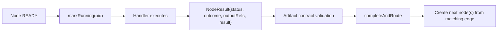
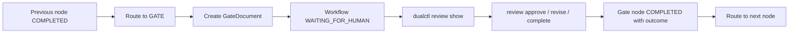
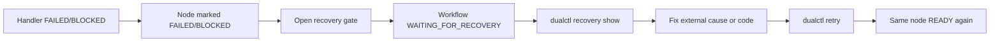
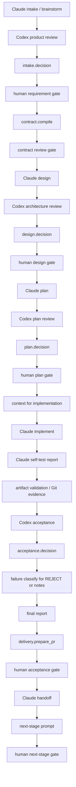

# Workflow State Machine

> Status: current implementation guide
> Last updated: public release cleanup

This document explains the runtime state model used by `dual-orchestrator`. It is intentionally implementation-oriented: if a real workstream stops, this should help an operator understand what happened and which command is safe next.

## 1. Mental Model

`dual-orchestrator` is a file-ledger workflow engine.

```text
WorkflowDefinition
  -> NodeInstance
  -> Handler Result
  -> Edge Routing
  -> Next NodeInstance(s)
  -> WorkflowCurrent
```

The runtime does not keep hidden in-memory state. The source of truth is the workstream ledger:

```text
.agent/workstreams/<workstream_id>/
  workflow/definition.json
  workflow/current.json
  workflow/instance.json
  nodes/*.json
  gates/*.json
  iterations/*.json
  events.jsonl
  timeline.json
```

## 2. Core Types

### Workflow

A workflow is the whole lifecycle for one workstream. Its current status lives in:

```text
workflow/current.json
```

Workflow statuses:

| Status | Meaning | Operator action |
|---|---|---|
| `CREATED` | Reserved initial state. Rare in current ledger. | Normally not seen. |
| `RUNNING` | At least one active node can be executed or is being executed. | `dualctl run`, `dualctl resume`, or `dualctl autorun`. |
| `WAITING_FOR_HUMAN` | Active node is a gate and needs a review action. | `dualctl review show`, then approve/revise/complete. |
| `WAITING_FOR_RECOVERY` | Active node failed or blocked and recovery gate is open. | `dualctl recovery show`, then fix cause and retry or abort. |
| `BLOCKED` | Workflow-level blocked state. Rare; most blocked nodes currently map to recovery. | Inspect recovery/timeline. |
| `COMPLETED` | No active nodes remain; workflow finished. | Review final report and delivery artifacts. |
| `FAILED` | Workflow was aborted or unrecoverably stopped. | Inspect recovery/events; start a new workstream if needed. |

### Node

A node is one executable or waitable unit. Node state lives in:

```text
nodes/<node_instance_id>.json
```

Node kinds:

| Kind | Meaning | Example |
|---|---|---|
| `TASK` | Executes a handler with side effects. | `acpx.agent_run`, `contract.compile`, `report.generate_final` |
| `DECISION` | Reads artifacts and returns a routing outcome. | `intake.decision`, `acceptance.decision` |
| `GATE` | Pauses for human or external action. | `gate.human_plan_approval` |

Node statuses:

| Status | Meaning |
|---|---|
| `CREATED` | Reserved pre-ready state. |
| `READY` | Runtime may execute this node. |
| `RUNNING` | Runtime marked it running and recorded `running_pid`. |
| `COMPLETED` | Handler finished successfully and produced an outcome. |
| `FAILED` | Handler failed and opened recovery. |
| `BLOCKED` | Handler or revision limit blocked progress and opened recovery. |
| `SKIPPED` | Reserved for future conditional skips. |
| `WAITING` | Gate node is open and waiting for review. |

## 3. Active Nodes and Open Gates

`workflow/current.json` has two important arrays:

```json
{
  "activeNodeInstanceIds": ["node-..."],
  "openGateIds": ["gate-..."]
}
```

Rules:

- `activeNodeInstanceIds` is the runtime work queue.
- A `RUNNING` workflow usually has active task/decision nodes.
- A `WAITING_FOR_HUMAN` workflow has an active gate node and an open gate id.
- A `WAITING_FOR_RECOVERY` workflow keeps the failed node active and opens a recovery gate.
- Fan-out can create multiple active nodes; current execution is still single-process and sequential within one `resume` loop.

## 4. Normal Task/Decision Flow



Important details:

- Runtime executes only `READY` nodes.
- `RUNNING` nodes are protected by a PID guard. If the PID is still alive, a second `resume` refuses to duplicate the agent process.
- If the PID is gone, runtime emits `node_stale_running_detected` and re-executes the active node.
- `outputRefs` from a completed node become `inputRefs` for successor nodes.

## 5. Gate Flow



Gate actions are ordinary routing outcomes.

Examples:

| Gate | Common actions | Meaning |
|---|---|---|
| `gate.contract_review` | `approve`, `clarify`, `reduce_scope`, `reject` | Approve or send contract back. |
| `gate.human_design_approval` | `approve`, `revise` | Approve design or ask Claude to revise. |
| `gate.human_plan_approval` | `approve`, `revise` | Approve plan or ask Claude to revise. |
| `gate.human_acceptance` | `approve`, `revise` | Accept delivery or return to implementation context. |
| `gate.human_next_stage_approval` | `revise`, `complete` | Revise handoff or finish the current workstream. |

`autorun` uses a benchmark-oriented policy:

- most gates -> `approved`
- final next-stage gate -> `complete`
- repeated gate definition -> stop, because a repair loop probably needs a human look

Real usage should read the review packet before resolving a gate.

## 6. Recovery Flow

When a task or decision returns `FAILED` or `BLOCKED`, routing stops.



Recovery does not create a new node. It resets the same active node to `READY`.

Recovery commands:

```bash
dualctl recovery show --workdir <effective_workdir> <workstream_id>
dualctl retry --workdir <effective_workdir> <workstream_id>
```

Abort is terminal:

```bash
dualctl recovery abort --workdir <effective_workdir> <workstream_id>
```

That writes `workflow_aborted` and sets workflow status to `FAILED`.

## 7. Auto-retry

Some acpx failures are recoverable, such as rate limit, missing session, reconnect, or context window issues.

On `resume`, if the workflow is `WAITING_FOR_RECOVERY` and the active failed node has:

```text
acpx_failure.recoverable = true
```

the runtime may:

1. check retry policy,
2. reset the node to `READY`,
3. optionally sleep for backoff,
4. execute the same node again.

If retry limit is reached, the workflow stays in `WAITING_FOR_RECOVERY` and asks for manual `dualctl retry`.

## 8. Iterations

Iterations are revision threads, not every node run.

The initial work starts in:

```text
iter-001
```

A new iteration starts when routing represents a revision/repair action, for example:

- Codex says design needs revision and routes back to Claude design.
- Human gate action is `revise`.
- Acceptance failure classification routes back to implementation or contract.

Simple linear progress does not create a new iteration.

Retrying a failed node also does not create a new iteration. It is the same node instance being attempted again.

## 9. Full Lifecycle

Current full lifecycle:



Key routing:

- `ACCEPT` -> final report.
- `ACCEPT_WITH_NOTES` -> classify notes -> final report.
- `REJECT` -> classify failure -> route to contract, context, or implementation repair depending on category.
- Final next-stage `complete` -> workflow completed.

## 10. Real Case Example

An internal rejection-prone benchmark exposed a contract source bug:

```text
contract.compile
  -> FAILED (TASK_CONTRACT_PROPOSAL_PARSE_FAILED)
  -> WAITING_FOR_RECOVERY
  -> runtime fixed
  -> dualctl retry
  -> same contract.compile node READY
  -> contract.compile COMPLETED
  -> workflow continued to COMPLETED
```

The important state-machine point:

- recovery reused the same active node;
- no new iteration was created for retry;
- events recorded `node_failed`, `node_retry_requested`, then `contract_compilation_completed`;
- final workflow status became `COMPLETED`.

An internal state-model benchmark validated the ordinary linear full-lifecycle path:

```text
start --run
  -> gate.human_requirement_review WAITING_FOR_HUMAN
  -> autorun approved 6 human gates
  -> long Agent calls stayed RUNNING with visible active node and PID
  -> acceptance ACCEPT_WITH_NOTES
  -> gate.human_next_stage_approval complete
  -> workflow COMPLETED with active nodes []
```

The important state-machine point:

- every human pause had an explicit open gate id;
- long-running Agent calls were inspectable through `status`;
- no recovery gate was opened;
- no revision iteration was created;
- final workflow status became `COMPLETED`.

This case did not validate recovery or revision loops. It should be read as evidence for the normal gate-driven path, not as proof that every edge path is covered.

## 11. Command Semantics

| Command | What it does |
|---|---|
| `dualctl start` | Creates workstream, worktree, ledger, and entry node. |
| `dualctl start --run` | Starts, then runs until first pause. |
| `dualctl resume` | Executes active node once when possible. |
| `dualctl run --max-steps N` | Runs repeated resume steps until pause or max steps. |
| `dualctl autorun` | Benchmark helper: runs, auto-approves gates, stops on recovery/repeated gates/completion. |
| `dualctl status` | Reads `workflow/current.json` and active node. |
| `dualctl timeline` | Reads stable `timeline.json` projection. |
| `dualctl review show` | Shows the current human review packet. |
| `dualctl review approve/revise/complete` | Resolves current human gate with that action. |
| `dualctl retry` | Resets active failed/blocked node to `READY`. |
| `dualctl recovery show` | Shows `recovery/current-failure.md`. |

## 12. Operator Checklist

When a run looks stuck:

1. Check status:

```bash
dualctl status --workdir <effective_workdir> <workstream_id>
```

2. If `WAITING_FOR_HUMAN`, inspect review packet:

```bash
dualctl review show --workdir <effective_workdir> <workstream_id>
```

3. If `WAITING_FOR_RECOVERY`, inspect failure summary:

```bash
dualctl recovery show --workdir <effective_workdir> <workstream_id>
```

4. If active node is `RUNNING`, do not start another agent manually. A second `resume` should report the live PID if the process is still active.

5. If the run completed, review:

```bash
dualctl timeline --workdir <effective_workdir> <workstream_id>
cat <effective_workdir>/.agent/workstreams/<workstream_id>/reports/latest-final-report.md
```
