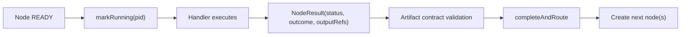

# Workflow 状态机

> 状态：当前实现说明
> 更新：公开发布清理版

这份文档说明 `dual-orchestrator` 的运行时状态模型。它的目标是帮助操作者回答三个问题：

- 现在跑到哪了？
- 为什么停住？
- 下一步什么命令是安全的？

## 1. 心智模型

`dual-orchestrator` 是一个基于文件账本的工作流引擎。

```text
WorkflowDefinition
  -> NodeInstance
  -> Handler Result
  -> Edge Routing
  -> Next NodeInstance(s)
  -> WorkflowCurrent
```

运行时不依赖隐藏的内存状态。事实来源是 workstream 账本：

```text
.agent/workstreams/<workstream_id>/
  workflow/definition.json
  workflow/current.json
  workflow/instance.json
  nodes/*.json
  gates/*.json
  iterations/*.json
  events.jsonl
  timeline.json
```

## 2. Workflow 状态

| 状态 | 含义 | 操作建议 |
|---|---|---|
| `RUNNING` | 有节点可以继续执行，或正在执行 | `dualctl run` / `resume` / `autorun` |
| `WAITING_FOR_HUMAN` | 停在人审 gate | `dualctl review show` 后 approve / revise / complete |
| `WAITING_FOR_RECOVERY` | 节点失败或阻塞，等待恢复 | `dualctl recovery show` 后修复并 retry |
| `COMPLETED` | 工作流完成 | 查看 final report、delivery、handoff |
| `FAILED` | 工作流被终止或无法恢复 | 查看 recovery/events，必要时新建 workstream |

## 3. Node 状态

每个节点是一个可执行或可等待的单元，状态写在：

```text
nodes/<node_instance_id>.json
```

| 类型 | 含义 | 示例 |
|---|---|---|
| `TASK` | 执行有副作用的 handler | `acpx.agent_run`、`contract.compile` |
| `DECISION` | 读取 artifact 并给出路由结果 | `intake.decision`、`acceptance.decision` |
| `GATE` | 等待人或外部动作 | `gate.human_plan_approval` |

## 4. 普通执行流



关键规则：

- runtime 只执行 `READY` 节点；
- `RUNNING` 节点受 PID guard 保护，避免重复启动同一个 Agent 进程；
- 如果 PID 已消失，runtime 会记录 stale running 并允许重新执行；
- `outputRefs` 会成为后续节点的 `inputRefs`。

## 5. 人审 Gate


Gate 的 action 本质上是路由 outcome。真实使用时应该先读 review packet，再做决定。

## 6. Recovery

当 task 或 decision 返回 `FAILED` / `BLOCKED` 时，workflow 会停在 `WAITING_FOR_RECOVERY`。


Recovery 不创建新节点，而是把同一个活跃节点重置回 `READY`。这样失败、重试和最终结果都能在同一条链路里追踪。

## 7. Iteration

Iteration 表示一次修订线程，不等于每个节点 run。

初始工作是：

```text
iter-001
```

当 Codex 要求设计修订、验收拒绝后进入修复、或人审要求 revise 时，才会创建新的 iteration。这样可以区分“同一阶段的重试”和“语义上的修订”。

## 8. Operator 命令

```bash
dualctl status --workdir <effective_workdir> <workstream_id>
dualctl trace --workdir <effective_workdir> <workstream_id>
dualctl review show --workdir <effective_workdir> <workstream_id>
dualctl review approve --workdir <effective_workdir> --run <workstream_id>
dualctl recovery show --workdir <effective_workdir> <workstream_id>
dualctl retry --workdir <effective_workdir> <workstream_id>
```

`trace` 和 operator panel 读取同一套 overview / attention 信息：当前状态、停在哪个节点、为什么停、下一步建议做什么。

## 9. 设计边界

当前状态机有意保持简单：

- 不引入 Spring StateMachine；
- 不把 LLM 自然语言直接当状态；
- 不靠大段 if-else 解析 Markdown；
- 不在 recovery 中自动改 contract 或业务代码；
- 不绕过 human gate。

系统只接受明确的结构化 artifact、节点 outcome 和 gate action。LLM 可以判断，但状态变更必须通过 harness 记录和校验。
