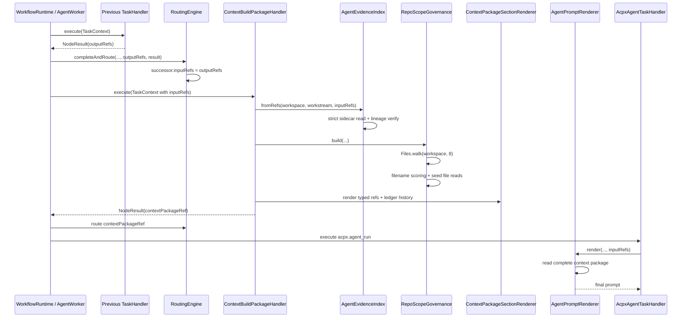
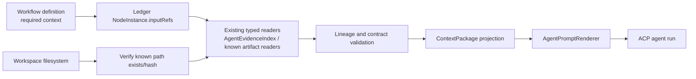

# Phase C Context Boundary Assessment

## 1. 结论

**Boundary Review: PASS for one subtraction implementation; implementation NOT ACTIVE.**

Phase C 不需要新增 Artifact Graph、Evidence Registry、Context Engine 模块或通用查询框架。
现有代码已经具备正确内核：

```text
ledger-routed inputRefs
  -> AgentEvidenceIndex
  -> AgentOutputLineageVerifier
  -> typed agent evidence
  -> ContextPackage
  -> AgentPromptRenderer
  -> ACP agent run
```

当前真正的缺口是 `ContextBuildPackageHandler` 在上述链路之外，还同步调用
`RepoScopeGovernance` 扫描 workspace、根据 requirement 词汇和文件名猜测候选文件，
读取候选文件内容生成 seed digest，再直接注入 Agent prompt。

它已经不再提供 read authority，但仍然是第二条 context content source，导致：

- 未经 ledger 路由的文件内容可以进入 Agent context；
- prompt 内容受目录结构、文件名和自然语言 tokenization 影响；
- context 构建延迟和 token 随 repository 大小波动；
- `ContextBuildPackageHandler` 继续承担 repository discovery，而不是只做 typed context projection；
- Phase B 删除的 heuristic authority 仍以 prompt intelligence 形式保留大量复杂代码。

Phase C 应做一次不可再拆的减法实现：**删除 context build 中的 workspace-wide
discovery 和 heuristic seed-content 注入，让 context 内容只来自 ledger facts、
明确 routed refs 和已知 typed artifacts。**

## 2. 与 Dual 总体架构的关系

### 2.1 Definition

workflow JSON 定义 `context.build_package` 节点、目标 Agent 节点、profile，以及可选的：

- `required_input_artifact`
- `required_agent_evidence`

Definition 只声明 context 需求，不拥有运行时 evidence。

### 2.2 Instance

`NodeInstanceDocument.inputRefs` 是当前节点收到的 durable refs。

`RoutingEngine.completeAndRoute(...)` 将前一节点的 `NodeResult.outputRefs` 原样写入
后继节点的 `inputRefs`。因此，正常 artifact lineage 是 workflow routing 的一部分，
不是 context builder 自行发现出来的。

### 2.3 Execution

`ContextBuildPackageHandler.execute(...)` 为一次 context node execution 构建 Markdown
context package，并返回 package ref。后继 `acpx.agent_run` 节点通过
`AgentPromptRenderer` 读取这个完整 package。

### 2.4 Artifact / Contract

Agent 最终结果的 authoritative representation 是 strict
`AgentResultEnvelope` 及其 validated `.contract.json` sidecar。

`AgentEvidenceIndex.fromRefs(...)`：

1. 只检查 routed refs；
2. 定位对应 contract sidecar；
3. 用 `AgentOutputContractDocument` 读取 typed contract；
4. 用 `AgentOutputLineageVerifier` 校验 workstream、node、execution 和 source ref；
5. lineage 不合法时 fail closed。

### 2.5 Projection

ContextPackage 是给 Agent 消费的 projection，不是新的事实来源。
`EvidenceManifest`、repo map、file relevance plan、working memory 和 Markdown section
也都只能是 projection；它们不得自行把未路由文件升级为可信 evidence。

## 3. 真实调用链



红线不在 ACP。ACP 只收到已装配的 prompt。问题发生在 context package 生成之前：
`RepoScopeGovernance` 产生了绕过 routed refs 的内容输入。

## 4. 当前 owner 与成熟度

| Fact / projection | 当前 owner | 状态 | 评估 |
|---|---|---|---|
| Workflow context requirement | lifecycle JSON | MODELED | 正确 |
| Node routed refs | ledger `NodeInstanceDocument.inputRefs` | ENFORCED | 正确 |
| Agent result contract | `AgentResultEnvelope` / sidecar | ENFORCED + PROVEN | 正确 |
| Agent evidence lineage | `AgentEvidenceIndex` + `AgentOutputLineageVerifier` | ENFORCED + PROVEN | 正确 |
| Required proposal/evidence gate | `ContextBuildPackageHandler` preflight | ENFORCED + PROVEN | 正确 |
| Context package Markdown | `ContextBuildPackageHandler` | PROJECTED | 正确定位，但职责过大 |
| Repo map / filename relevance | `RepoScopeGovernance` | PROJECTED | 不应成为 context content source |
| Seed evidence digest | `RepoScopeGovernance` | PROJECTED into prompt | 需要删除 |
| Human feedback / iteration history | ledger node/iteration files | PROJECTED | 来源正确，读取方式可后续收敛 |
| Evidence manifest | `EvidenceManifest` | PROJECTED | 可重建索引，不是 SoT |

## 5. Findings

### F1 — FAIL：workspace discovery 绕过 routed refs 进入 prompt

调用链：

```text
ContextBuildPackageHandler.executeGoverned
  -> RepoScopeGovernance.build
  -> buildRepoMap
  -> Files.walk(workspaceRoot, 8)
  -> addRepoMapMatches(requirementTerms)
  -> seedEvidenceDigests
  -> Files.readAllLines(candidate)
  -> appendMarkdownGuidance
  -> Agent prompt
```

这里的文件既不要求出现在 `NodeInstance.inputRefs`，也不要求有 typed artifact 或
lineage。即使它只是 recommendation，不参与 node success/failure，它仍会改变模型看到的
事实、token 和决策。

### F2 — WARN：generic routed ref 仍可作为 raw text 展开

`ContextPackageSectionRenderer.appendInputArtifacts(...)` 对 validated agent sidecar
处理正确，也会拒绝 transcript、diagnostic 和 unvalidated agent result。

但其余 generic ref 仍会被按文本展开。当前 refs 来自 ledger routing，因此不是目录扫描；
不过 context boundary 仍应明确只允许已知 system artifact 或普通用户输入，未知 ref
应 pointer-only 或 fail closed，不能依靠文件扩展名/路径命名猜类型。

### F3 — WARN：ledger projection 直接依赖文件布局

`ContextPackageSectionRenderer` 通过 `Files.list(nodesDir/iterationsDir)` 读取 human
feedback 和 iteration history；`EvidenceManifest` 也扫描 `nodes/` 重建 human decisions。

这些内容来自 authoritative ledger，不是业务 evidence 猜测，因此不阻塞第一轮减法。
但 handler 直接解析 ledger persistence layout，造成重复 projection owner。若后续真实
case 暴露状态不一致，应复用 ledger read model，而不是增加第三个索引。

### F4 — WARN：context 相关实现体积过大

当前主要类约 3,781 LOC：

- `ContextBuildPackageHandler`: 1,015
- `ContextPackageSectionRenderer`: 662
- `RepoScopeGovernance`: 1,163
- `EvidenceManifest`: 403
- `AgentEvidenceIndex`: 194
- `WorkstreamMemoryProjection`: 344

体积本身不是失败，但 `RepoScopeGovernance` 的 repository discovery、read guidance、
memory、telemetry 和 write projection 混合，是 handler 无法瘦身的直接原因。

## 6. 目标架构



禁止恢复为：

```text
workspace scan
  -> filename / natural-language relevance
  -> read candidate content
  -> prompt evidence
```

## 7. 建议的单次 implementation scope

这不是新 phase，也不拆成多个平台能力。一次提交完成以下减法：

1. `ContextBuildPackageHandler` 不再在同步 context build 中触发 workspace-wide
   `Files.walk`。
2. 删除 requirement tokenization、repo filename scoring 和 seed evidence digest
   对 prompt 的注入。
3. context 中保留：
   - `requirement.md`；
   - ledger-routed refs；
   - validated Agent sidecars；
   - canonical task contract、contract resolution、Git evidence、handoff；
   - ledger-owned human feedback 和 iteration facts；
   - actual read/write/tool-usage telemetry；
   - read-reuse contract（它是 token/reuse contract，不是 path authority）。
4. `EvidenceManifest` 在本切片中可继续作为 provenance/debug projection，但不得再为
   heuristic file relevance 提供内容来源。
5. generic input ref 只允许明确的 known artifact/user input；unknown agent-like 或
   unknown system ref 不展开正文。
6. 不新增模块、registry、graph、engine、event store 或通用 query DSL。

预期是 production LOC 净减少，而不是把 `RepoScopeGovernance` 搬进新类。

## 8. Cannot-Bypass Tests

实施前先固定以下行为：

1. workspace 中存在未路由且文件名高度匹配 requirement 的文件，其路径和正文均不得进入
   context package。
2. 未路由的更新 `.contract.json` sidecar 不得覆盖 routed validated sidecar。
3. routed validated sidecar 必须完整进入 context；lineage/hash 被篡改时 context node
   fail closed，后继 Agent 启动次数为 0。
4. raw agent output、transcript 和 diagnostic 即使被 routed，也不得作为可信正文展开。
5. unknown generic system ref 不得自动展开正文。
6. task contract、Git evidence、human feedback、iteration history 和 required self-test
   evidence 仍能进入对应 profile。
7. context package ref 必须由 ledger 路由到 `acpx.agent_run`，adapter 读取完整 package，
   不重新扫描 workstream 寻找 evidence。

## 9. 验收

```text
Declared by:
  workflow context-node config + ledger inputRefs

Proven by:
  typed sidecars / canonical artifacts / ledger facts

Consumed by:
  ContextBuildPackageHandler -> AgentPromptRenderer

Enforced before:
  downstream acpx.agent_run starts

Failure route:
  context node FAILED; downstream Agent launch count = 0

Cannot-bypass:
  unreferenced workspace file and unrouted sidecar never enter prompt

Residual raw path:
  only explicit user input or named system artifacts; no workspace discovery
```

Deterministic tests、full reactor、sibling sweep 和 fake transport smoke 通过后，才允许使用
Verification Gate 重跑 controlled README case。若 README 通过，再决定是否用 A3
多文件 case 验证 context 完整性；不得直接启动复杂 real-case。

## 10. Readiness

**Phase C assessment = COMPLETE.**

**Phase C subtraction implementation = READY, NOT ACTIVE.**

理由：

- 问题可从真实 production 调用链复现；
- 正确 typed owner 已存在，不需要新平台；
- 删除边界明确；
- cannot-bypass tests 可在 provider-free 环境证明；
- Phase B checkpoint `e1c094b` 已提交且 controlled real-case PASS；
- 实施可以保持净减代码并直接推进 orchestrator 简化与 handler 瘦身。
