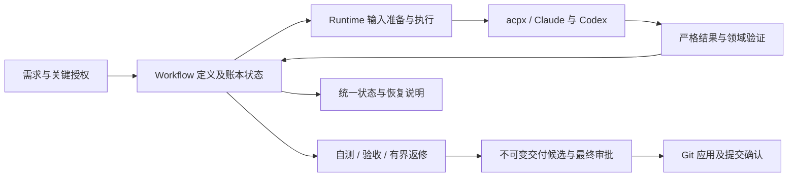

# Dual 整体架构与研发交付能力综合评估

评估日期：2026-09-17。代码基线：`3362eb42` 加接手时已有的未提交改动。性质：主 agent 只读评估；不是实施计划批准、独立同行评审或当前版本 E2E 通过声明。

## 1. 总体判断

**Dual 的基本架构值得保留，但当前证据不足以把它定义为可靠、可恢复的完整研发交付工具。它已经有能工作的多 agent 协作内核，主要短板是各边界组合后能否持续推进、验证结论的执行依据、以及中断后的确定性。**

Claude 作者、Codex 评审、acpx 执行、结构化结果、文件账本、人工门和 Git 候选交付已经形成真实能力。历史上既有完整交付，也有评审发现真实缺陷、作者修复后通过的证据。因此不能说“多 agent 架构本身失败”，也没有证据支持更换 LiteFlow、重写平台或增加 agent 数量。

但系统对“某个结果为什么应该被拒绝”的刻画，长期强于对“一个合法任务怎样继续完成”的刻画。严格的校验、正确的单节点和丰富的状态文件，仍可能拼成走不通的正常返工路径。与此同时，结构化自测报告比实际测试执行更容易被程序验证；文件之间的提交关系比单文件原子写更薄弱。这三项是整体可靠性的结构性缺口。

9 月 13 日的 workflow-first 设计对**控制权和合法续作**的修正方向正确，但它是一批必要的收敛工作，不能作为整体架构已经收口的充分方案。用户此前确认的“同版本可续作”“设计/计划后批准精确文件范围”“仅关键授权和最终交付强制审批”，都超出了该批局部收口已经证明的能力。

## 2. 证据范围与限制

本轮核对了五个相关项目的 Git worktree 注册、`~/.dual/operator-workspaces.json`、所有可访问的相关 worktree 池及 captcha 归档 ledger，并对项目 real-case 报告目录做全量索引。

| 证据 | 本次覆盖 |
|---|---:|
| 可读 workstream 账本目录，包含 2 份迁出的 captcha ledger | 150，150 个不同 ID |
| run.json | 947 |
| nodes/*.json | 2,260 |
| 原始账本 events 记录 | 8,628 |
| 账本内日志文件 | 1,805，19,777,981 bytes |
| 归档 real-case summary.json | 260，涉及 224 个非空 workstream ID |
| 归档日志/JSONL/NDJSON | 2,798，6,849,907 bytes |
| 补扫 worktree 内其他位置的日志/流文件 | 22，8,218,245 bytes；含 3 个归档 acpx 原始流、4 个归档账本事件/投影及 15 个目标项目测试日志 |
| 原账本与报告合并后的不同 workstream ID | 266 |
| design、plans、顶层 real-case Markdown 索引 | 195 篇 |
| operator 注册表中原 effectiveWorkdir 已不存在的记录 | 137 |

原账本的 current、node、run、event 已全量解析；日志逐文件读取并建立 hash/关键词索引；历史文档建立标题、状态和来源索引。随后按问题族和关键成功/失败链深入阅读输出、sidecar、日志及当前代码。**这不是对所有日志正文和全部文档逐行人工审计，也不是全仓安全审计。**已删除目录不能凭归档摘要恢复成“已独立重建的原始事实”。137 是缺失路径数，不等于没有任何归档证据的样本数。

原账本、归档副本及同一 workstream 不同时间的报告不能叠加计算成功率。`START_FAILED` 是旧 harness 报告口径，可能对应 ledger 的 `WAITING_FOR_RECOVERY`；后来恢复完成的样本也保留早期失败报告。大量样本是 token、permission、session、治理或故障专项实验，不是随机抽取的产品任务。本文不报告整体成功率，不比较不同模型优劣，也不从不同年代的样本推导复杂度阈值。

机器索引及绝对来源路径位于本目录：`summary.json`、`workstreams.json`、`runs.json`、`nodes.json`、`events.json`、`logs.json`、`archive-summaries.json`、`archive-logs.json`、`historical-documents.json`、`missing-registered-worktrees.json`、`git-worktree-registrations.json`。原账本索引解析错误为 0。

### 2.1 原账本的现状，不等于任务结果评分

| 来源 | 账本 | run | 当前状态 |
|---|---:|---:|---|
| cancer-clinic | 129 | 712 | COMPLETED 8；RECOVERY 88；HUMAN 6；RUNNING 26；FAILED 1 |
| captcha-auth-app，含 archive | 6 | 66 | COMPLETED 2；RECOVERY 3；HUMAN 1 |
| OKX | 12 | 158 | RECOVERY 8；HUMAN 3；RUNNING 1 |
| darwin-skill-optimizer | 1 | 9 | RECOVERY 1 |
| Dual 自身 implementation smoke | 1 | 1 | COMPLETED 1 |
| 尚存临时 semantic fixture | 1 | 1 | RECOVERY 1 |

**重要勘误：11 个 `COMPLETED` 不能算 11 次完整研发成功。**其中 Dual 自身是 implement-only smoke；cancer 的 MKPK、K3EH 各只有 1 次 intake run，completion-audit 为 `needs_review`，并列出 final report/handoff/next-stage prompt 缺失。其余 8 个有 `ready` completion audit，但仍须区分 README 专项、完整业务任务以及各自旧版本的完成标准。旧状态不证明当前终态守卫仍有同一漏洞。

另有 53 份归档 summary 声称 COMPLETED，包含专项 probe、缺失原账本和旧版本，不能直接加入当前完整交付计数。

### 2.2 最有判别力的成功与失败

- **WA53（captcha）**：39 runs，完整 terminal-delivery 完成；验收曾 REJECT，返修后 ACCEPT_WITH_NOTES。8 次 self-test run 中 3 次形成有效业务结果，5 次为执行/输出失败；有效自测实际发现模板属性和 Testcontainers 生命周期问题，后续验收又发现 OTP 首发问题。这说明自测与独立验收有价值，同时说明重试损耗很大。
- **AHBV（Mailpit）**：16 runs，完整验收与返修，completion audit ready，历史交付应用记录 APPLIED。已有最终 diff 评审支持具体交付内容。但该样本早于后续 D1/D2 的全部新守卫，不能证明当前候选交付版本已经重新真实闭环。
- **BXWV（OKX）**：4 次验收 REJECT 的内容依次从真实实现缺陷收敛到仅缺浏览器/live evidence。评审不是单纯噪声；最后无需源码修订却再次回实现，是流程分类/续作问题。
- **245D（OKX）**：在人工实现修复门明确登记缺少材料提交动作；当时并非再调用同一沙箱就能完成浏览器验收。当前已有 external-evidence 实现，历史停止仍保留，不能当作当前入口仍未实现。
- **6NX5（OKX）**：4 次业务 run 后，人工要求缩回 TR-9 扩张，后继输入准备失败；失败节点无 provider run，却被写成缺模型 JSON。是 harness 控制链问题。
- **2U4R（Darwin）**：验收指出完整可运行测试仍有两项不在合同豁免内的失败；不能因它们是 baseline failure 就自动豁免。它说明测试基线、合同排除项和环境能力应在执行前对齐。

详细来源及全部 OKX 停点见 [case-evidence.zh-CN.md](/Users/kriswang/work/projects/ai/codex-claude-ai-workflow/dual-orchestrator/output/architecture-audit-20260917/case-evidence.zh-CN.md)。补扫日志索引为同目录 `additional-log-files.json`；目标项目自己的测试日志与 Dual execution 日志分开解释。扫描排除了 `.git`、`node_modules` 与虚拟环境，未把全局 provider session 缓存当成所有 workstream 的完整证据。

## 3. 架构中已经成立、应保留的部分

1. **角色分工有实证价值。**作者与评审分离发现过普通绿色自测未覆盖的缺陷；不能为了减少调用就删除验收。主流程是明确角色的阶段协作，适合当前目标，没必要先扩成通用 agent 团队平台。
2. **流程、实例、执行分开是正确基础。**一次业务 revision、一次 process retry、一次 ACP correction、一次 session 不是同一件事。已有模型基本足够，不必再叠平行模型层。
3. **模型提供候选，程序决定是否可采纳。**严格 envelope、typed sidecar、SHA、lineage、scope、批准绑定应保留。合法 ACP end_turn 和 exit 0 从来不等于研发成功。
4. **Worktree 隔离与 immutable candidate 是正确交付边界。**审批绑定具体字节、目标基线和 expected tree，比交付时扫描“最新文件”可靠。
5. **acpx 的定位应继续是执行适配边界。**它提供过程、session、工具及消息事实；不能让它决定需求是否满足，也不能让 LiteFlow 代替真实执行验证或持久化恢复。
6. **已完成的减法方向正确。**读治理从控制降为观测、删除重复 process 推断、删除 canonical artifact 对权威 lineage 的替代、终止型任务减少 handoff，均比再加一层平台更有价值。

## 4. 主要缺陷及调整方向

### A. 控制链的职责已经画清，但跨边界的行为约束仍不完整

**结论：高优先级，历史反复证实；当前未提交实现有改善，尚不能宣称整体解决。**

这不是只有 READY/BLOCKED 一个条件写错。历史上出现过：验收分类要求改合同，却跳到没有新批准输入的 compile；仅补证据却进入 implementation；人可以 revise，作者却没有合法基准；execution 失败被后续产物校验改写。共同点是上游允许的输出，不满足下游真实的前置条件。

JSON edge 能说明“去哪里”，resolver/validator 又隐含“什么状态才允许去”。领域验证不能取消，但同一人工动作的含义不能在两个位置独立演化。`NodeResult` 通用 result map 本身也不阻止不同阶段的字段拼装和后处理误用。

**调整：**以既有 WorkflowDefinition、HumanGateActionSemantics、领域 resolver 和统一结果结束管线为落点，把合法输入与合法后继成对约束；阶段只解释自己负责的事实。审核的是“动作→写入→下一真实消费者→外部副作用→恢复出口”，不是文件数量。每个拒绝测试要有对应合法续作测试，每个返工测试必须走到重新验收，不能只停在后继 READY。

本轮前序隔离副本反证还显示：process 已是 `EXITED_NON_ZERO_WITH_INCOMPLETE_OUTPUT`，最终原因可能变成 `required_artifact_contract_failed`。因此只保住输入准备失败还不够。当前 `AgentExecutionOutcomeResolver` 先检查 artifact，再检查该类 process 状态；需整体明确失败优先关系。此项不是批准现在修改代码。

### B. 测试/验收的“来源可信”强于“执行充分性可证明”

**结论：高优先级，当前能力缺口；不能据此声称现有模型测试都无效。**

目前 SelfTestResult 的 checks/evidence/verification_summary 主要由 agent 产生；程序能验证结构、出处、轮次、COMPLETE 与缺证据是否矛盾。CompletionEvidenceLineageResolver 能验证验收消费的是哪份自测。它们并不等同于一个由程序负责的、覆盖全部批准验收项的测试执行凭据。

现有 `ExternalVerificationEvidence` 已把准备基线、材料字节和提交身份绑定起来，这是实质进步；但代码明确把 command/environment/time/exitCode 称作 operator declaration。材料 hash 证明“提交后未改”，不独立证明“命令确实在这个环境、这份源码上执行”。当前系统仍依赖 operator/agent 解释这种证据。

更现实的缺口是执行环境不匹配：产品需要浏览器、端口、数据库或容器，agent sandbox 未必能运行这些验证。SPM9、BXWV、245D 都体现过这类问题。让模型继续修代码不能补出环境能力，宿主测试失败也不能被“沙箱限制”掩盖。

**调整：**首次实现前明确每条验收要求对应的验证方式、执行环境、必要权限和可交付证据；能在已有边界执行的继续执行，环境不具备时明确走已实现的外部材料路径。若要达到更强的自动验收承诺，再评估复用现有执行/材料模型记录真实命令、源码基准、退出状态和测试报告引用。不能从 pom/package.json 猜命令，也不能拿 exit 0 自动代替语义自测。8 月 A8 评估否决“直接删自测 agent”仍然成立。

### C. 精确文件授权过早，与设计发现过程发生冲突

**结论：与用户已确认的目标流程不匹配；这是产品流程调整，不是放松 scope。**

当前链先批准精确 TaskContract，再让 design 的 planned_files 必须逐项符合该合同；plan 再受 design 和合同约束。这样能防止未授权写入，但把“设计阶段提议一个文件”也按“已经获准实施一个文件”处理了。

9BZG 的越范围拒绝、KPPZ 的占位路径拒绝是正确行为，不应改成容忍不合法路径。架构问题在于合理的只读发现可能被迫回到需求/合同链，且流程需要用户过早承担实现文件拆分决策。KPPZ 本身不是“应放行这个设计”的反例。

**调整：**需求先批准目标、验收和禁止范围；只读 design/plan 形成建议文件操作清单；首次写入前批准并冻结精确范围。后续确需新增文件必须重新申请；修改目标、验收或权限仍回关键授权。复用现有 proposal/approved contract/design/plan 区分建议与执行授权，不另建权限平台。此调整会影响现有 qualification 链，不能伪装成移动一个 gate 的小改动。

### D. 文件账本尚不满足“同版本、最后确认点续作”的承诺

**结论：已确认的高影响结构缺口；自然事故频率未知。**

R1 的现有故障注入评估覆盖 initialize、gate、stale recovery、normal routing：14 个写入前缀中 12 个在新 ledger 实例下不能安全重放。`gate=resolved` 已写而 successor/current 未写时，原人工动作失去重放资格；event 已追加而 current 未更新时可能重复 event ID。单文件 atomic move 无法提供跨文件提交事实。

当前代码仍先写节点/门，再写后继、事件、current/instance。新输入失败处理与写失败安全停止测试不等于这个问题已解决。用户接受“外部结果未知时人工裁定”，也不等于已知的纯本地提交每次中断都必须人工编辑 JSON。

**调整：**在现有 ledger 模块内重新评估有界提交与恢复语义：纯本地、已有完整事实的 transition 应可幂等完成；可能已调用模型、修改 Git 或应用 patch 而结果不明时，保留现场并禁止盲重做。必须同时覆盖 reader 对半完成状态的识别和 event 去重，不能只修 gate。旧 R1 比较曾因收益不明确而延期；现在用户的恢复要求使其成为需要重新设计评估的产品缺口，但不自动批准某种 journal、存储迁移或历史恢复。

还缺少可靠的**运行组合冻结**：definition 有持久化版本，不等于恢复时的 Dual binary、contract/prompt、reviewed acpx 和执行配置全部相同。当前关键恢复入口未见统一运行组合身份校验。Doctor/acpx patch identity 与实验 preflight 有价值，但不等于每个 workstream 的恢复准入。未来新任务应绑定运行组合；不支持的旧组合明确拒绝，别悄悄兼容。

### E. 审查循环能找问题，但“何时算有进展、何时升级”仍过度依赖 operator

**结论：已确认的产品可靠性限制，不宜用新算法保证语义收敛。**

BXWV 的验收从实现缺陷逐步收敛到仅证据缺失，说明多轮不是天然浪费；GCTW 又说明累计精确 obligation ID 会把事务性复制负担交给模型。历史上也曾因 must-fix 数量/表面重复过早止损，或者把新出现的更严格建议当成必须新增的需求。

已有 revision budget、义务 ID、revision response 和有界 correction 应继续使用。严格 ID 不是问题，要求模型反复正确复制所有机器身份的负担值得减轻；当前已有受限 correction，不能另加模糊匹配或无限修复。

**调整：**每轮显式区分原验收未满足、实现缺陷、仅缺证据、以及新增要求。新增要求不能自动变成旧合同义务；人工也不应只按 review 的 READY/BLOCKED 盖章。复用已有义务/响应，展示本轮解决、未解决、重现和新增的项目；有界推进并在预算或重大取舍处升级。不要用字符串相似度自动宣布问题已解决，也不要预先设一个“评审最多两轮”的通用结论。

### F. acpx/session 可靠性仍是实际成本中心，且必须与业务返工分开

**结论：历史执行损耗有直接证据；不能把旧 provider 故障全部算作当前 acpx 缺陷。**

WA53 self-test 的 38.5 分钟累计 run duration 中，约 26.8 分钟来自五次失败，三个有效业务结果约 11.8 分钟。直接删自测最多省掉的并不是全部 38.5 分钟。旧 execution-owner 收敛已经删除了重复 tail replay 和失败重算，正确方向应继续保持。

当前 acpx 已承担 session bootstrap、turn 边界、typed process/signal、bounded correction、权限传输和 reviewed fork 绑定。Claude/Codex 及不同 backend 的工具和环境能力不应被视为相同；同一 session 能复用也不证明新 authority 可继承。

**调整：**执行失败先定位到输入、spawn/session、process/turn、输出契约或领域验证；原始事实只产生一次，后处理不重新归因。恢复必须说明重试的前置变化与已发生副作用。把减少 session/output 失败的损耗，与删减必要 reviewer 的调用分开衡量。维护 reviewed acpx 的最小固定适配面和明确版本组合，不恢复网络 R4/Phase B，也不建设通用权限平台。

### G. 交付候选绑定较成熟，但“流程完成”与“已交付”仍是两段事实

**结论：当前设计边界合理；产品承诺、展示和中断处理仍要完整覆盖。**

`DeliveryApplicationService` 在 workflow COMPLETED、audit ready、accepted candidate、source capture 和 target base 校验后应用 patch，再比较 staged tree；finalizeCommit 还校验 parent/tree/HEAD。这些应保留。

所以 COMPLETED 代表流程通过，不自动代表目标仓库已应用、已提交，更不代表部署发布。AHBV 旧 ledger 记录 APPLIED、commit 为空，即使另有人工 Git 提交证据，也不能把 ledger 未记录的终态补想出来。

外部 Git 变更与 merge-plan 写入之间也有中断窗口。未知状态应核验目标 index/tree/commit 后进入可解释处置，不能普通 retry 重新应用；当前不能从 candidate 校验强就推导 crash recovery 也闭合。

**调整：**继续在现有模型分别展示验收完成、交付候选已批准、应用完成、提交确认。验收测试一直走到目标仓库的具体 tree/commit 和中断出口；无需把发布部署平台纳入 Dual。

### H. 验证与发布基线是系统短板，测试数量不能替代组合证明

**结论：已确认的工程可靠性问题，优先于新增功能。**

旧测试曾同时证明“分类正确走 compile”和“缺批准的 compile 必须拒绝”，却没把两者接起来；也曾把 READY 后人工 revise 被拒当成正确预期。结果是大量绿色测试与真实流程断链并存。

现有未提交实现新增真实 runtime/worker、ledger、LiteFlow 的序列测试，是进步。此前本会话的聚焦回归为 92 tests 全通过；完整构建在进程枚举受限处有两项环境错误，不能写成 full reactor PASS。隔离反证还发现同族错误覆盖，因此当前组合也不能直接升级成“可靠版本”。本轮恢复后的全面评估没有重新运行测试或 provider。

历史报告还大量依赖临时路径；同一事实分散在报告、ledger、acpx session、target Git 中，版本与 operator 干预不总能统一重建。此次仍可补证，不代表以后都可补证。

**调整：**用已有报告/metrics 保留一个可复核的冻结运行清单，包含组合身份、流程变体、真实/fixture 类型、用户目标、干预、终态审计、实际交付和缺失证据。离线回归从合法用户序列写预期，真实 E2E 只验证离线无法证明的模型/工具组合能力。错误是确定性的，不应再用昂贵完整样本发现。无需新建观测平台。

## 5. 完整控制链与写失败切面

以下是架构约束与现有缺口，不是声称本轮已重新执行每个 failpoint。

| 控制链 | 权威事实及 owner | 下一消费者/副作用 | 写入失败或结果未知时必须如何解释 | 当前判断 |
|---|---|---|---|---|
| 人工决定→作者→复评→批准 | gate/action/note 与 approved subject；ledger/领域 resolver | 作者输入，随后新的 review/approval | gate、node、event、current 不一致不能授权再次写代码；纯本地决定应可明确续完 | 合法续作正在改进；跨文件恢复未闭合 |
| 输入准备→provider | 已批准合同/作者上下文/执行策略；runtime、adapter | acpx spawn | 未调用就不能伪造 run/JSON 失败；prepared 不证明已启动 | 未提交实现覆盖了若干前置失败；兄弟阶段仍需整链核验 |
| 执行→输出获取→验证 | ProcessResult/ACP completion/signal；transport | correction、产物发布 | process 不可信时不得靠完整 JSON 洗成成功；保留首个决定性原因 | 基础 owner 已收敛；仍有失败优先关系缺口 |
| 验证→发布→路由 | 当前 run 的有效 typed sidecar/ref/SHA；validator+ledger | 下一节点 inputRefs | sidecar 存在不等于已提交路由；孤立文件不能成为有效输入 | lineage 强；多文件发布/路由仍须区分已确认与未确认 |
| 自测→验收→返修 | 自测/验收 artifact 与补证据基线 | 实现、补证据、重新授权三种不同后继 | 提交材料不等于 ACCEPT；源码变化须重新验证 | 已有细分路径；执行凭据与环境充分性不足 |
| 批准候选→Git apply→commit | immutable candidate + target Git facts | 目标仓库变更 | Git 已变更、plan 未落盘时不得盲 apply；必须核验现实 tree | 身份校验强；未知结果恢复不等于幂等完成 |
| 冷启动→续作/人工裁定 | 最后确认提交事实+冻结运行组合 | 下一次运行或恢复命令 | 不混用新旧 binary，不从 projection 猜完成 | 当前存储与版本绑定不足以全面承诺 |

对应六维检查中，许多边界已有 Declared/Proven/Consumed/Enforced；不足主要集中在**跨阶段的 Failure route、跨文件提交的权威事实、以及证明合法续作不可误拒的测试**。不能把每个模块各自有六维表当成整链六维已通过。

## 6. 调整顺序与成本取舍

这是评估建议，当前没有实施授权。

| 顺序 | 必要调整 | 收益 | 范围和成本约束 |
|---|---|---|---|
| 1 | 固定当前架构的端到端行为契约，完成合法返工与失败保真整链 | 首先消除 Dual 自己让合法任务走不通的问题 | 复用现有 owner；不能退化成只修两处分支；不新增框架 |
| 2 | 把验证环境、验收证据和最终交付要求前置明确 | 避免实现完才发现必需测试无可执行出口 | 先用已有外部材料路径；是否增加程序执行凭据单独比较，不直接替换自测 agent |
| 3 | 对齐授权时间与阶段自动推进 | 减少过早文件锁定与重复人工盖章，同时保留授权 | 这是跨 intake/design/plan 的产品设计变化，应完整评估后独立实施，不能混入诊断修复 |
| 4 | 为未来冻结版本建立有界重启续作 | 满足已经确认的恢复要求 | 先界定本地提交与外部未知结果；重用 R1 比较；不迁移历史样本，不直接引入存储平台 |
| 5 | 冻结组合后做代表性真实任务验证，再按事实减调用/耗时 | 证明当前组合能力，建立可比较基线 | 普通业务任务、需要返修任务、需要外部证据任务分开证明；不为了过 Gate 改需求 |

第 2–4 项的需求边界应在整体设计里同时讲清，实施可分批，但不能先声称完整可靠、再把关键缺口留给未来。若整体设计要求新 authority 或更强自动执行权，需要另行说明和批准。本报告不据此自动开启开发。

## 7. 不建议的方向与尚未证明的风险

- 不建议换 LiteFlow。它主要负责选边，当前主要缺口在调用前后、证据与账本写入，换引擎不会自动解决。
- 不建议把所有验证搬进 JSON，也不建议新建 DSL、model 层、权限平台、事件平台或通用 evaluator。
- 不建议因重复失败直接增加 reviewer 或更多 agent。现有 review 确实发现问题；关键是发现后由谁在什么授权/环境下解决。
- 不建议减少所有 gate 或删除所有中间评审。应减少不产生新授权的强制人工停顿，保留语义检查；代理审批需要授权，不能默认替人批准。
- 不建议重开 R4、Phase B 或救旧样本；正确拒绝、历史实验停止及 provider 故障不该各自再长出 production 兼容分支。
- LiteFlowPrototypeKernel 每次加载/清理全局 FlowExecutorHolder，而外层锁主要按 workstream；跨 workstream 并发隔离值得单列验证。本轮只有代码风险线索，没有复现串流/串路由，**不列为已确认 bug，也不作为当前重写引擎依据**。
- 没有证据证明所有模型错误都能靠更强 schema 消除，也没有证据证明目前 8/9/10 次固定 agent 调用对所有任务都划算。应按任务和每次调用的缺陷发现价值判断。

## 8. 对现有设计的最终评价

9 月 13 日设计正确抓住了人工 authority、结果处理阶段、下一消费者和失败提示的一致性；保留既有模型并约束范围，也吸收了多次过度设计的教训。它应作为整体改进的第一批控制链收敛，而不应承担超出其范围的结论。

整体需要调整的是：**从“严格检查每个节点”转向“在明确授权与可用验证环境内，让完整任务有界完成，并能准确解释每一个停止与续作点”。**这里既包括安全拒绝，也包括合法推进；既包括 typed 身份，也包括实际测试；既包括流程终态，也包括交付事实和重启语义。

当前应保留架构骨架，集中职责、减少重复解释，补上上述产品必需的连接。没有证据支持推倒重来；也没有证据支持仅修两个局部条件就宣布整体可靠。
