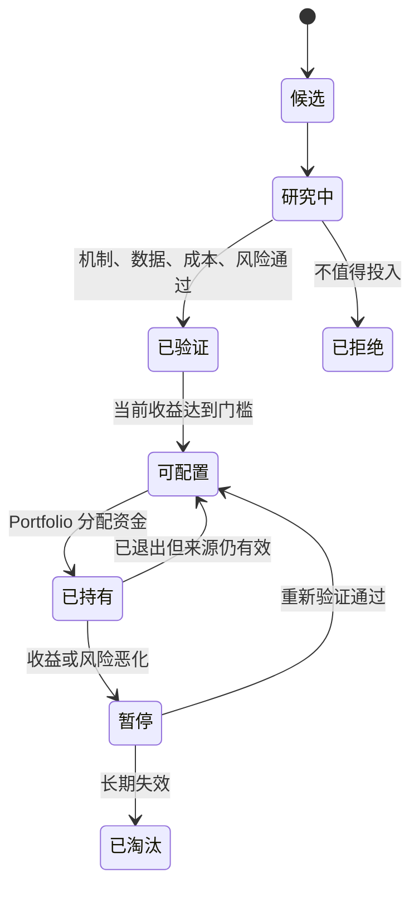
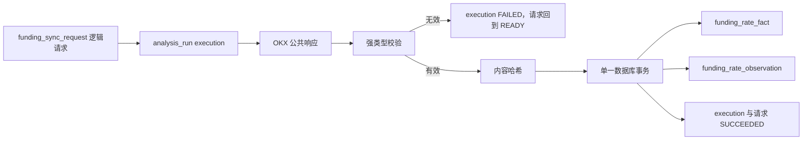

# 01. Income Source

## 1. 定义

Income Source 是“钱为什么会赚到”的经济机制，不是币，也不是交易所产品。

- BTC 是资产，不是 Income Source；
- OKX 智能套利是产品，不是 Income Source；
- 通过现货多头与永续空头收取净正资金费率，才是 Income Source。

Portfolio 管理的是 Income Source，而不是 BTC 或稳定币本身。V1 只考虑稳定币与 BTC；将来是否增加其他资产或交易所，必须重新证明它能改善长期净收益。

## 2. 当前候选

| Income Source | 收益来自 | OKX 载体示例 | 主要风险 |
|---|---|---|---|
| 资金费率 | 永续多空之间的费率支付 | 智能套利 | 费率转负、对冲偏差、保证金、平台风险 |
| 基差收敛 | 现货与交割合约价差收敛 | 现货 + 交割合约 | 基差扩大、资金锁定、退出流动性 |
| 利息 | 平台借贷或理财利息 | 简单赚币等 | 利率变化、赎回、稳定币和平台风险 |
| 波动收割 | 区间内多次低买高卖 | 现货网格 | 单边行情、持币亏损、区间失效 |

现货网格的网格收益与持币盈亏必须分开计算。它不是低方向风险套利。

## 3. 一个 Income Source 必须说清楚什么

```text
收益机制：谁为什么付钱？
实现方式：在 OKX 用什么产品和资产实现？
预期收益：在统一持有期内能赚多少？
全部成本：进入、持有、退出分别付多少？
容量：20 万 USDT 中最多能有效投入多少？
持续性：收益可能维持多久？
风险：什么情况下会少赚或亏损？
退出：什么时候退出，退出需要付什么代价？
证据：数据来自哪里，对应什么时间？
```

任何一项说不清楚，都只能进入研究列表，不能进入 Portfolio。

## 4. 净收益

先计算持有期收益，再展示年化：

```text
持有期净收益
= 可实现现金流
+ 可实现价差收益
- 持有期间手续费与滑点
- 持有期间资金、借贷或申赎成本
- 期末清算成本（仅在比较两侧统一清算时）
```

期初进入、退出当前仓位和切换时点的一次性费用，按 `07-Calculation-Method.md` 第 9 节归入 `Switch Cost`；`asOf` 之前已经发生的费用属于沉没成本。期末清算成本必须在 current/new 两侧对称计算或对称省略，任何费用不得重复扣除。

估计误差缓冲不是已经发生的现金成本，不进入持有期净收益；它是 Incremental Net Benefit 必须额外超过的决策门槛。只有能够明确货币化的新增风险成本才单独进入金额公式。

不能把一次瞬时资金费率或推广 APR 直接当作长期年化。每个来源至少提供保守、基准、乐观三个情景，Portfolio 主要使用保守和基准情景。

## 5. 进入条件

一个 Income Source 只有同时满足以下条件，才可配置：

- 收益机制可以解释并用现金流验证；
- 使用真实可用费率，而不是只看宣传值；
- 保守净收益高于当前现金管理基准；
- 容量足够，扩大投入后收益仍成立；
- 进入与退出成本已计算；
- 风险与退出方式可以接受；
- 产品在当前 OKX 账户真实可用；
- 真实持仓和收益可以核对。

## 6. 生命周期



这里的状态描述收益来源是否有效。OKX 中某个具体策略是否正在运行，属于 Portfolio 的真实持仓，不由本状态代替。

## 7. 四类来源如何判断

### 资金费率

看 7/30/90 日费率分布、正费率占比、趋势、盘口容量、两腿成本、对冲偏差和保证金安全。不能把 BTC 当天一次较高的费率直接当成未来可持续收益。

### 基差

看同一持有期的可成交基差、到期时间、资金占用、退出成本和极端基差扩大。到期年化高不代表可持续复投。

### 利息

看账户实际可用利率、额度、期限和赎回规则。它是资金等待时的收益，也是其他来源的机会成本基准，但不是无风险利率。

### 网格

看波动是否足够、趋势是否过强、手续费覆盖和区间失效概率。报告必须同时展示网格收益与标的方向盈亏。

## 8. 淘汰条件

出现以下情况，应暂停或淘汰：

- 实际净收益持续低于估计；
- 收益低于现金管理基准；
- 容量不足或退出成本显著上升；
- 产品条款改变；
- 关键数据或账户事实无法核对；
- 风险可能造成不可接受的永久性损失；
- 管理和工程成本已超过它创造的收益。

## 9. 新来源加入方式

AI Advisor 可以提出候选，但不能直接加入：

```text
AI 研究草案
→ 人工核实产品和条款
→ 全成本计算
→ 小资金验证
→ 对照真实收益
→ 加入或淘汰
```

只有真实验证完成后，它才成为 Portfolio 的可选 Income Source。

## 10. 历史回测

回测的首要目的不是证明未来会赚钱，而是发现收益机制、参数和实现中的错误。

### 必须回放的事实

- 资金费率及实际结算时间；
- 现货、永续和交割合约价格；
- 账户真实手续费等级；
- 保守滑点和可投入容量；
- 进入、持有、退出期间的每笔现金流；
- 对冲仓位、保证金和方向敞口；
- 数据缺失、产品暂停和异常行情。

OKX 官方资金费率历史接口目前最多返回约三个月数据，因此归档采用人工操作纪律，而不是新增 scheduler：首次尽量回补接口当前可用窗口；之后每周回补最近 14 天并允许窗口重叠，每次正式评估前再回补到该评估 `asOf`。每月至少确认一次最近回补未出现 `SOURCE_EXHAUSTED`，连续未成功归档不得超过 4 周；超过时视为数据事故，相关评估降级或暂停。失败沿用同 `request-key` 续传，必要时使用 `stale-list` / `stale-recover`。需要覆盖更长市场周期时，再补充经过校验的外部历史数据。资金费率间隔不能固定假设为 8 小时，应以实际 `fundingTime` 为准。[OKX 资金费率历史接口](https://www.okx.com/docs-v5/en/#public-data-rest-api-get-funding-rate-history)

### V1 资金费率事实口径

当前公共数据链路使用 `GET /api/v5/public/funding-rate-history`。入库时保留 OKX 原始字段，并转换为内部强类型事实：

| OKX 字段 | 内部含义 | 约束 |
|---|---|---|
| `instType` / `instId` | 合约类型与标的 | 首期只同步形如 `BTC-USDT-SWAP` 的永续合约 |
| `fundingRate` | 预计资金费率 | 不得与实际结算费率混用 |
| `realizedRate` | 实际结算费率 | 回测现金流优先使用该字段 |
| `fundingTime` | 资金费结算时点 | 毫秒时间戳转 UTC `Instant`，不得假定固定 8 小时 |
| `formulaType` | 费率公式类型 | `noRate` / `withRate` 显式映射，未知值拒绝入库 |
| `method` | 结算周期口径 | `current_period` / `next_period` 显式映射，未知值拒绝入库 |

外部 JSON 不是系统事实。只有通过响应码、API `code`、必填字段、标的一致性、枚举和数值校验后，才生成 `FundingRateObservation`。HTTP 429、5xx 和 OKX `50011` 被标记为可重试故障，但 V1 暂不自动重试，避免尚未定义的重试策略制造重复任务。

内容哈希只覆盖稳定的业务字段：交易所、合约类型、标的、公式类型、预计费率、实际费率、结算时点和结算周期。小数先去除无意义尾零，所有零值统一为 `0`；因此 JSON 键顺序、`0.000120` 与 `1.20E-4`、`0` 与 `-0` 不会制造新版本。修改这套规范必须同步升级契约测试，不能只改实现。

仓库中的 `funding-rate-history-btc-usdt-swap-2026-08-15.json` 是从 OKX 公共接口获取的真实响应快照，用于防止手写样例与真实字段漂移。它只证明该次响应中的字段集合，不代表 OKX 未来不会增加新枚举或出现空值。

### 追加式存储与可回放证据



- `funding_rate_fact` 保存不可变内容，以交易所、标的、结算时点和内容哈希去重；
- 同一结算时点若 OKX 后续修订内容，新哈希生成新事实，旧记录不覆盖；
- `funding_rate_observation` 记录某次 `analysis_run` 实际看到了哪些事实；
- 相同逻辑请求成功后重复调用直接回放成功 execution，不再次请求 OKX；
- 新运行重复看到同一内容时复用事实，但追加本次观察关系。

`funding_sync_request` 是逻辑请求，`analysis_run` 是一次 execution。失败 execution 保持终态，重试会创建 attempt 递增的新 execution。显式过期恢复只能终结超过指定截止时间的 `RUNNING` execution；旧进程恢复后已失去 fencing 权限，不能再提交事实。系统暂不自动判断过期，也不自动重试。

当前已支持最近一页同步和按 `after` 游标回补 `[from,to)`，并持久化页账本、游标与窗口内外统计。`coverage=COMPLETE` 只证明游标到达目标边界，不证明区间无缺失。周期调度和跨区间缺口检测暂不实现；只有缺失会改变收益判断时才补充，不能把数据完善本身当成产品目标。

账户手续费使用用户真实费率，不使用网上默认值。[OKX 账户费率接口](https://www.okx.com/docs-v5/en/#trading-account-rest-api-get-fee-rates)

### 回测必须发现的问题

- 资金费率方向、结算次数或年化计算错误；
- 手续费、滑点、空窗期或退出成本漏算；
- 现货和合约名义价值不匹配；
- 网格收益与持币盈亏混在一起；
- 使用未来数据决定过去动作；
- 参数稍微变化，结果就从盈利变成亏损；
- 进入和退出阈值过近，造成频繁切换；
- 重复计算收益或遗漏已发生现金流。

### 验证方法

1. **固定样例测试**：手工计算一小段现金流，与程序结果逐项相等；
2. **历史回放**：严格按当时可见数据推进，禁止前视；
3. **样本外验证**：参数只在训练区间选择，在未见区间验收；
4. **参数敏感性**：寻找一片稳定区域，不选择单个最优点；
5. **压力情景**：回放费率转负、基差扩大、流动性下降和缺失数据；
6. **模拟跟踪**：对实时市场生成建议，但不投入真实资金；
7. **小额实盘**：验证回测无法覆盖的真实费用、产品操作和退出过程。

OKX 模拟环境不能覆盖所有原生产品操作；官方列出的限制包括购买与赎回。因此简单赚币和部分原生策略不能只靠模拟验收，仍需小额实盘闭环。[OKX 模拟交易说明](https://www.okx.com/docs-v5/en/#overview-demo-trading-services)

### 回测输出

至少报告净收益、相对现金管理的增量收益、最大回撤、费用占比、调仓次数、方向敞口、最差区间、参数敏感性和无法模拟的风险。只报告年化收益的回测视为不合格。
