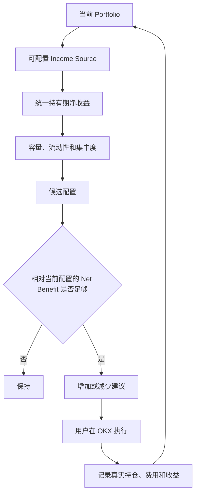

# 02. Portfolio

## 1. 第一性目标

Portfolio 的目标不是选择当前收益率最高的产品，而是让资金获得更高的 **长期净收益**。

它每天只做三类决定：

```text
保持
增加
减少
```

不是预测“BTC 要涨还是要跌”，而是对某个 Income Source 是否值得继续投入作判断。

## 2. 保持也是决策

优秀的 Portfolio 不应频繁变化。BTC 智能套利的当前 APR 高于 USDT 现金管理，不代表应该马上切换；还要考虑：

- 高收益能持续多久；
- 停止旧策略和建立新策略的费用；
- 调整期间的资金空窗；
- 新来源增加了什么风险；
- 估计是否可靠。

**默认动作是保持，调整需要额外证据。** 一年只调整几次完全可以接受。

## 3. 唯一公式

所有候选配置必须使用同一个持有期 `H` 比较：

```text
Incremental Net Benefit(H)
= Expected Operating Net Income_new(H)
- Expected Operating Net Income_current(H)
- Switch Cost
- Additional Risk Cost(H)
```

- `Expected Operating Net Income` 只计算从 `asOf` 到 `H` 末的经营现金流和持有成本；
- `Switch Cost` 只包含从完整当前状态变化到完整候选状态的一次性边际过渡成本；历史费用是沉没成本，持有期间持续成本属于经营净收益，具体唯一记账边界见 `07-Calculation-Method.md` 第 9 节；
- `Additional Risk Cost` 是新增风险要求的经济折扣或最低收益补偿，不是随意的风险分数。

只有 Incremental Net Benefit 显著为正，并超过估计误差的安全边际，才调整。不能用年化收益差直接减去一次性成本，除非已经换算到同一持有期。

## 4. Portfolio 管理什么

- 真实余额和可用资金；
- 已运行的 OKX 产品和策略；
- 每个 Income Source 的投入；
- 现货、合约、保证金和方向敞口；
- 已实现现金流、未实现盈亏和全部费用；
- 当前配置与最近一次保持/增加/减少决定。

交易所是余额、持仓和策略状态的最终外部事实来源。建议和 AI 文本不是持仓。

## 5. 分配流程



V1 使用透明规则：

1. 保留必要的流动资金；
2. 淘汰未验证或保守净收益不足的来源；
3. 按同一持有期比较净收益；
4. 结合容量、退出、方向和集中风险分配；
5. 新来源只给小额实验资金；
6. 剩余资金放回现金管理；
7. 只有相对当前组合明显更优才调仓。

在这套简单方法无法提高收益之前，不引入复杂优化器。

## 6. 资金角色

| 角色 | 用途 |
|---|---|
| 流动资金 | 等待机会、应对保证金和紧急退出 |
| 核心收益 | 已验证、可持续且有容量的 Income Source |
| 机会资金 | 短期条件较好但持续性较弱的来源 |
| 实验资金 | 小额验证新产品和真实成本 |

比例不是固定资产配置。机会少时可以大部分持有流动资金；新产品没有真实验证前不能进入核心收益。

## 7. 初始边界

以下只用于 200,000 USDT 的模拟和小资金试点，是风险上限而不是固定产品配比：

- 保留 15%–25% 流动资金；
- 单一 Income Source 一般不超过 35%–40%；
- 单一具体策略一般不超过 20%；
- 有明显方向风险的来源合计一般不超过 10%；
- 新来源单项实验资金一般不超过 2%–5%；
- 当前只使用 OKX，必须承认单平台集中风险。

这些数字不是永久规则。放宽时必须有真实收益、容量和风险证据。

## 8. 何时调整

可以调整：

- 现有来源的保守净收益持续恶化；
- 费率、基差、利率、容量或退出条件发生实质变化；
- 实际收益持续偏离预期；
- 集中度、保证金或方向风险超出边界；
- 新配置在合理持有期内能显著增加 Net Benefit。

不要调整：

- 单日排名变化；
- 一次瞬时高资金费率；
- AI 觉得某产品可能更好；
- 新产品刚上线但没有真实数据；
- 增量收益只勉强覆盖手续费和滑点。

## 9. OKX 执行

Portfolio 输出人工清单：保持什么、增加什么、减少什么、金额、理由、预期增量净收益、切换成本和下次检查条件。

用户在 OKX 执行。某产品可能支持追加或减少，也可能需要停止后重建，应以执行时的账户页面为准。

V1 只记录操作时间、产品、金额、实际结果和费用，不建设自动交易、复杂审批或执行状态机。

## 10. 收益归因

```text
Portfolio 净收益
= 资金费率
+ 基差收益
+ 利息
+ 网格已实现收益
+ 标的方向盈亏
- 手续费、滑点、融资和其他成本
```

每月回答：

- 哪个 Income Source 真正赚钱？
- 预测与实际差多少？
- 调仓是增加收益还是只增加费用？
- 相比全部放在现金管理，多赚了多少？
- 哪个来源已经不值得管理？

不能把 BTC 上涨归因于网格能力，也不能只报告总收益而不解释来源。

## 11. 完成标准

一次 Portfolio 调整只有在以下事实都确认后才完成：

- OKX 实际余额和策略状态已核对；
- 实际费用已记录；
- Income Source 投入已更新；
- 后续收益可以正确归因。

Portfolio 的闭环不是“建议已生成”，而是“真实净收益可以验证”。

## 12. 资金验证与扩大

20,000 与 200,000 USDT 不是二选一。资金按证据分阶段进入：

| 阶段 | 资金 | 验证重点 |
|---|---:|---|
| 回测 | 0 | 公式、参数、成本、前视偏差 |
| 实时模拟 | 0 | 数据同步、建议稳定性、收益归因 |
| 微型实盘 | 2,000–5,000 | 真实费用、滑点、申赎和退出 |
| 正式试点 | 20,000 | 净收益、容量、对账和运行稳定性 |
| 扩大 | 50k → 100k → 200k | 规模增加后经济性是否仍成立 |

如果只能在 20,000 和 200,000 之间选择，先选 20,000；第一笔真实资金仍建议从 2,000–5,000 开始。

### 扩大门槛

20,000 USDT 试点至少持续 30–60 天，并完成一次真实进入与退出。只有同时满足以下条件才扩大：

- OKX 余额、持仓和现金流能够逐项对账；
- 没有无法解释的盈亏；
- 实际手续费和滑点接近回测假设；
- 收益可正确归因到对应 Income Source；
- 保守净收益高于现金管理基准；
- 参数小幅变化不会使结论反转；
- 已验证停止策略后的资产处理；
- 没有未对冲、重复操作或错误年化；
- 放大后的盘口容量和产品额度仍足够。

任一条件失败，保持当前资金或退回上一级。时间到了不等于通过。

### 三种 Portfolio 必须分开

- **Backtest Portfolio**：历史数据上的假想持仓；
- **Shadow Portfolio**：实时数据上的模拟持仓；
- **Live Portfolio**：OKX 真实余额、策略和现金流。

三者可以使用同一计算逻辑，但必须有不同标识和独立净值。模拟或回测结果不得写入 Live Portfolio，也不能被报告成真实收益。
