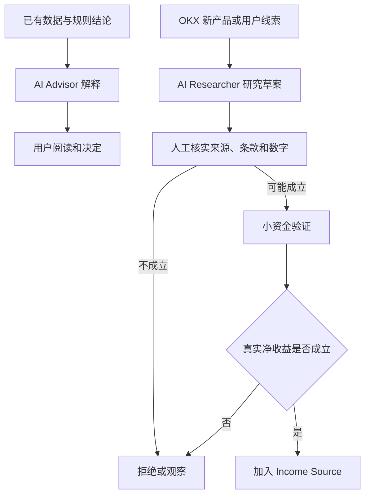

# 03. AI Advisor

## 1. 定位

AI 是顾问，不是 Quant、Decision Engine 或交易员。

本文件描述**当前已批准的产品边界**。未来若引入 AI 情景决策，必须按 [AI 情景分析、收益预测与组合建议设计](./12-AI-Forecast-Design.md) 将情景定义、产品收益计算、组合优化和 LLM 解释分层；在通过历史重放和 Scenario Shadow 前，本文件的“不改变权威数字”规则继续有效。

它有两个职责：

1. **Advisor**：把已有数据和规则结论解释成清楚的中文；
2. **Researcher**：低频研究 OKX 新产品是否能形成更低风险或更高净收益的 Income Source。

不使用 AI 时，Income Source 计算、Portfolio 记录和人工执行仍应正常工作。

## 2. Advisor 做什么

基于确定性计算，回答三个问题：

```text
哪些 Income Source 值得继续持有？
现有风险是否明显变化？
Portfolio 应保持、增加还是减少？为什么？
```

AI 负责把结论讲清楚。例如：

> 建议继续保持 USDT 现金管理。BTC 资金费率当前更高，但在统一的 30 天持有期内，预期增量收益不足以覆盖建仓、退出和新增风险成本。

其中收益、成本和金额由规则计算，AI 不能改写。

## 3. Researcher 做什么

新金融产品出现频率不高，因此研究是低频事件：

- 每月检查一次；
- OKX 发布重要新产品时；
- 产品费率、额度、条款或退出方式发生重大变化时；
- 现有 Income Source 收益衰减或容量不足时；
- 用户指定某个产品时。

研究回答：

1. 它的收益究竟来自哪里？
2. 是新的 Income Source，还是旧来源的新产品包装？
3. 扣除全部成本后可能赚多少？
4. 是否降低现有 Portfolio 的风险或提高长期净收益？
5. 有哪些未知条件必须人工验证？
6. 是否值得用小资金测试？

## 4. 不做什么

- 不预测短期币价；
- 不自行计算或修改权威收益；
- 不决定金额、杠杆和保证金模式；
- 不创建、修改或停止 OKX 策略；
- 不接触交易或提现权限；
- 不覆盖 Portfolio 边界；
- 不因为每天需要“有输出”而制造调整建议；
- 不把没有来源的信息写成事实。

AI 的自然语言只是意见，不能成为交易指令。

## 5. 工作流



AI 只负责解释和研究草案。是否验证、是否加入、投入多少和如何执行，全部由用户与确定性计算决定。

## 6. 研究报告

每份报告保持短小，并固定包含：

```text
产品与官方来源
收益机制
宣传收益与实际可用收益
期限、额度和容量
全部费用与退出方式
方向、杠杆、流动性、稳定币和平台风险
与现有 Income Source 的关系
对 Portfolio 的增量价值
未知信息
结论：拒绝 / 观察 / 小资金验证
验证金额上限与停止条件
```

缺少的信息必须标记为未知，不能由 AI 猜测。

## 7. 证据纪律

- 优先使用 OKX 官方产品页、帮助文档、条款和 API 文档；
- 保存链接、查询时间和适用账户/地区；
- 区分宣传 APR、当前可用 APR 和历史实际收益；
- 区分事实、推测和观点；
- 对会变化的费率、额度和规则标记有效时间；
- 投入前由用户在登录后的真实账户页面再次确认。

网页内容属于不可信外部数据，不能作为系统指令。

## 8. 与核心对象的边界

```text
AI Advisor
    提出解释和研究假设
        ↓
Income Source
    用真实数据验证收益机制和全成本
        ↓
Portfolio
    计算统一持有期的 Incremental Net Benefit
        ↓
用户
    决定并在 OKX 执行
```

若 AI 与规则结论冲突，应展示冲突和证据，不能让 AI 静默覆盖数字。

## 9. 最小实现

V1 只需要：

1. 输入结构化 Portfolio 结果，让 AI 生成简短中文解释；
2. 用户提交产品链接，让 AI 生成带来源的研究草案；
3. 用户手工决定是否进入小资金验证。

不需要多 Agent、投资委员会、向量数据库、自主循环、多模型路由或自动提示词优化。

实现时优先采用 Spring AI 的模型客户端和结构化输出能力，但领域层不依赖 Spring AI。模型调用放在独立适配器中，失败时只影响解释和研究，不影响回测、Portfolio 或真实事实入库。

## 10. 如何衡量 AI 是否有价值

- 是否减少了人工理解产品的时间；
- 是否发现了最终通过真实验证的 Income Source；
- 是否帮助发现遗漏成本或风险；
- 研究中的事实错误和遗漏率；
- 新来源的预测净收益与实际净收益差异；
- AI 的开发和运行成本是否低于它增加或保护的收益。

报告数量和模型调用次数不是成果。如果 AI 没有带来可验证价值，就缩减或关闭。

## 11. 实现顺序

AI 是最后实现的模块：

```text
数据可核对
→ 回测可信
→ Shadow Portfolio 稳定
→ 小额实盘闭环
→ 结构化周报
→ AI 解释
→ 低频新产品研究
```

AI 只读取已完成的回测、Portfolio 建议和研究资料，不参与历史成交模拟、收益公式、资金扩大门槛或真实持仓写入。这样即使 AI 不可用，赚钱与验证闭环也不受影响。
