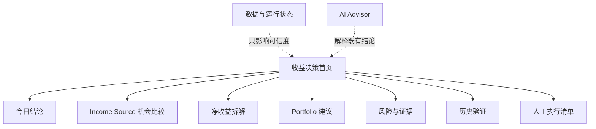

# 04. 收益决策 UI

> **非权威原型：**本文及 `prototypes/profitability-dashboard.html` 仅用于早期信息架构探索，其中硬编码的 20,000 USDT、ETH、静态比例和演示收益数字不构成产品或计算基线，也不得连接或冒充真实数据。当前权威定义见 `05-Product-Baseline.md`、`06-Functional-Architecture.md` 和 `07-Calculation-Method.md`。

> 本文定义 AI Crypto Income Assistant 的主页面。页面第一任务不是维护数据，而是回答：**现在是否有值得赚的钱，以及资金是否需要调整。**

静态高保真原型：[打开收益决策中心](./prototypes/profitability-dashboard.html)

## 1. 产品定位

这是个人数字资产收益管理工具的决策界面，不是行情终端、量化交易台或数据库管理后台。

页面每天回答三个问题：

1. 哪些 Income Source 扣除全部成本后仍值得赚？
2. 哪些风险正在变大，是否足以否定收益？
3. 相比当前 Portfolio，重新分配资金是否真的增加长期净收益？

默认动作是 **保持**。只有增量收益显著覆盖切换成本、风险折扣和估计误差时，页面才建议增加或减少。

## 2. 当前能力与诚实边界

当前程序已经具备 OKX 公共资金费率事实采集、历史游标回补和覆盖证明，但还没有形成完整收益判断所需的全部事实。

在以下数据补齐前，页面不得声称某项策略“一定能赚钱”：

- 现货与永续可成交价格及基差；
- 用户账户真实手续费等级；
- 保守滑点和可投入容量；
- 建仓、持有、退出期间的真实现金流；
- USDT 现金管理基准；
- 保证金、对冲偏差和极端退出成本；
- 可复现的历史回测和样本外结果。

因此原型中的金额均为 **演示数据**。正式页面遇到证据缺失时必须显示“数据不足”或降低置信度，不能用默认值伪造结论。

## 3. 信息架构



主导航按用户问题组织：

- **今日决策**：现在是否值得调整；
- **收益来源**：各 Income Source 的净收益和证据；
- **资金组合**：当前与建议配置的差异；
- **历史复盘**：Backtest、Shadow、Live 分账结果；
- **AI 顾问**：解释规则结论和低频研究。

数据同步、回补和 stale recovery 不进入主导航，只放在“数据状态”二级入口。只有数据问题影响收益判断时，才在首页形成提示。

## 4. 首屏结构

```text
┌──────────────────────────────────────────────────────────────────────┐
│ 收益决策中心       资金：20,000 USDT  持有期：30天  数据状态：待补充  │
├──────────────────────────────────────────────────────────────────────┤
│ 今日结论：暂不扩大，保留流动资金；BTC 套利只建议小额验证             │
│ 原因：可能有正收益，但相对现金管理的增量不足以形成可靠安全边际       │
├────────────────┬────────────────┬────────────────┬──────────────────┤
│ 30天净收益区间 │ 相对基准多赚   │ 保守净年化     │ 不利情景损失     │
├──────────────────────────────────────────────────────────────────────┤
│ 可赚钱机会：BTC套利 / ETH套利 / USDT理财 / 网格                     │
├───────────────────────────────┬──────────────────────────────────────┤
│ 净收益逐项拆解                │ 当前组合 → 建议组合                  │
├───────────────────────────────┼──────────────────────────────────────┤
│ 为什么不扩大                  │ 哪些风险正在变大                     │
└───────────────────────────────┴──────────────────────────────────────┘
```

## 5. 全局评估条件

页面顶部提供三个明确的评估输入：

| 输入 | 含义 | 初始值 |
|---|---|---:|
| 资金规模 | 本次情景的可配置资金，不代表真实持仓 | 20,000 USDT |
| 持有期 `H` | 所有收益与成本比较使用同一周期 | 30 天 |
| 估计方式 | 保守 / 基准 / 压力情景 | 保守 |

修改条件后必须请求后端重新评估。浏览器不得自行拼接年化、费用或推荐金额。

页面始终显示：

- `asOf`：评估使用的数据截止时间；
- `mode`：BACKTEST / SHADOW / LIVE；
- 数据完整度和缺失项；
- 当前结果是否为演示、模拟或真实账户结果。

## 6. 今日结论

结论只允许以下动作：

| 动作 | 含义 |
|---|---|
| 保持 | 没有充分证据证明切换更好 |
| 小额验证 | 收益机制可能成立，但真实成本或风险尚未闭环 |
| 增加 | 增量净收益显著为正且风险边界满足 |
| 减少 | 当前来源收益恶化或风险超限 |
| 不投入 | 保守净收益不足、风险不可接受或数据不足 |

结论必须同时展示：建议、建议金额、主要理由、反对证据、置信度和下次检查条件。

## 7. 唯一收益公式

页面所有数字来自后端确定性计算：

```text
Expected Net Income(H)
= Funding Income
+ Basis Income
+ Interest Income
+ Other Realized Income
- Entry Fee
- Exit Fee
- Slippage
- Financing Cost
- Hedge Error
- Other Holding Cost
```

组合是否调整使用：

```text
Incremental Net Benefit(H)
= Expected Net Income_new(H)
- Expected Net Income_current(H)
- Switch Cost
- Additional Risk Cost(H)
```

UI 不得只展示宣传 APR、单日费率或综合分数。必须展示同一持有期的金额结果，并让用户看到各项现金流。

## 8. Income Source 机会比较

机会表至少包含：

- 收益来源和具体标的；
- 建议投入金额；
- 持有期净收益区间；
- 保守净年化；
- 相对现金管理基准的增量收益；
- 可投入容量；
- 风险等级；
- 证据等级；
- 结论及下次复核条件。

排序优先级是“是否值得投入”，不是“APR 从高到低”。高 APR 但证据不足、容量太小或退出风险高的来源不得排在可靠现金管理之前。

## 9. 净收益拆解

选中一个 Income Source 后，展示完整现金流瀑布：

```text
预计资金费收入       +240 USDT
建仓与退出手续费      -42 USDT
保守滑点              -26 USDT
基差不利变化          -35 USDT
现金管理机会成本      -66 USDT
新增风险折扣          -28 USDT
────────────────────────────
相对基准增量收益       +43 USDT
```

每项数字可以展开查看口径、数据时间、来源和估计区间。无法核对的项目显示“未知”，不能按零处理。

## 10. Portfolio 建议

Portfolio 区域对比当前配置与建议配置：

| 资金角色 | 当前 | 建议 | 变化 | 原因 |
|---|---:|---:|---:|---|
| 流动资金 | 100% | 80% | -20% | 释放有限实验资金 |
| 核心收益 | 0% | 0% | 0% | 尚无来源通过正式验证 |
| 机会资金 | 0% | 15% | +15% | BTC 套利小额验证 |
| 实验储备 | 0% | 5% | +5% | 验证费用、申赎和退出 |

系统必须区分 Backtest、Shadow 和 Live Portfolio。模拟建议不能写入 Live 持仓；Live 只有在 OKX 账户快照或用户人工确认后才能更新。

## 11. 风险与证据

风险区不使用一个无法解释的总分，而是展示：

- 资金费率转负风险；
- 基差扩大或退出损失；
- 流动性与容量；
- 对冲偏差与方向敞口；
- 保证金和强平距离；
- 稳定币和交易所集中风险；
- 数据覆盖、手续费和价格证据质量；
- 模型估计误差。

风险状态分为正常、关注、阻断。任何阻断项存在时，增加资金动作必须被后端禁止，而不只是由 UI 隐藏按钮。

## 12. 历史验证

历史区域严格分开：

- Backtest：历史回放的假想结果；
- Shadow：实时数据上的模拟结果；
- Live：真实账户余额、现金流和费用。

至少展示累计净收益、相对现金管理超额收益、最大回撤、最差 30 天、盈利月份比例、费用占毛收益比例、参数敏感性和预测误差。

没有回测结果时显示“尚未验证”，不能用资金费率走势图代替收益证明。

## 13. 人工操作边界

页面允许：

- 保持当前配置；
- 生成小额验证清单；
- 记录“不采纳”及原因；
- 记录用户已在 OKX 手工执行的结果；
- 设置下次复核条件。

页面不允许：

- 下单、撤单或调整杠杆；
- 自动停止或重建 OKX 策略；
- AI 直接修改建议金额；
- 将“生成清单”显示为“执行成功”；
- 直接修改 Backtest、Shadow 或 Live 状态。

## 14. AI Advisor

AI 只解释后端已经形成的结构化结论，例如：

> BTC 资金费率近期高于 30 日中位数，但扣除建仓、退出和现金管理机会成本后，增量收益没有超过估计误差，因此建议保持。

所有金额、风险标志和推荐动作来自确定性评估。AI 输出必须标记为解释，不是事实或交易指令；AI 不可用时页面仍能完整展示结论。

## 15. 统一 Read Model

建议后端提供单一 `ProfitabilityDashboardView`，供页面、CLI 周报和未来 AI Advisor 共同消费：

```text
ProfitabilityDashboardView
├── asOf / mode / scenario
├── evidenceQuality / missingEvidence
├── headlineRecommendation
├── expectedNetIncome
├── incrementalNetBenefit
├── incomeSourceCandidates[]
├── currentAllocation[]
├── proposedAllocation[]
├── riskFindings[]
├── validationSummary
└── allowedActions[]
```

`allowedActions` 必须由应用层根据状态和风险生成，UI 只渲染，不能自行判断是否允许增加、减少或记录执行。

## 16. 建议接口

```text
GET  /api/profitability/dashboard?capital=20000&horizon=P30D&mode=SHADOW
GET  /api/income-sources/{id}
GET  /api/portfolios/{mode}/history

POST /api/decisions
POST /api/validation-plans
POST /api/manual-executions
```

写接口必须使用幂等键和类型化命令。它们记录人工决定或事实，不调用 OKX 交易 API。

## 17. 技术实现建议

首版继续使用单体 Spring Boot：

- Spring MVC + Thymeleaf 输出页面；
- HTMX 局部刷新；
- 少量原生 JavaScript 负责展示交互；
- 不引入 React、Node 构建链、WebSocket或微服务；
- 默认只监听 `127.0.0.1`；
- 图表只消费统一 Read Model，不在浏览器计算业务指标。

原型是独立 HTML，用于确认信息架构和视觉方向，不代表后端接口已经实现。

## 18. 分阶段落地

1. **原型阶段**：确认收益首页的信息优先级和人工动作。
2. **确定性评估**：补齐费用、基差、现金基准和第一版回测，形成 Read Model。
3. **只读页面**：接入真实评估结果，所有缺失信息诚实展示。
4. **人工决策记录**：加入验证清单和人工执行确认。
5. **Portfolio 闭环**：接入只读账户事实，对账真实收益。
6. **AI 解释**：最后接入，且只消费结构化结果。

不应为了尽早显示漂亮仪表盘而绕过阶段 2。没有收益计算和真实成本，UI 只能是演示壳，不能成为投资依据。

## 19. 验收标准

- 首屏无需查看数据任务即可理解“现在是否值得投入”；
- 每个建议都能追溯到净收益、成本、风险和证据；
- “保持”与“数据不足”是一级结论；
- Backtest、Shadow、Live 永不混淆；
- AI 文案无法修改金额或允许动作；
- 任何增加资金动作都由后端边界强制；
- 数据维护不占据主页面，但缺失数据会降低或阻断收益结论；
- 页面不存在直接交易能力。
