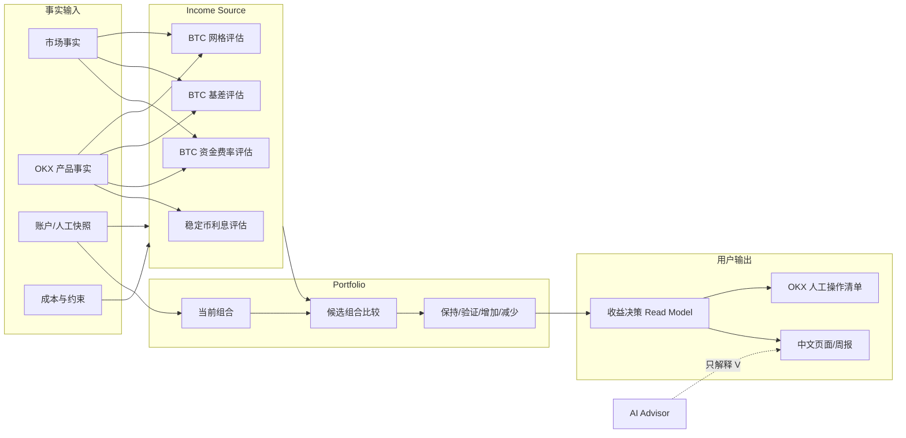
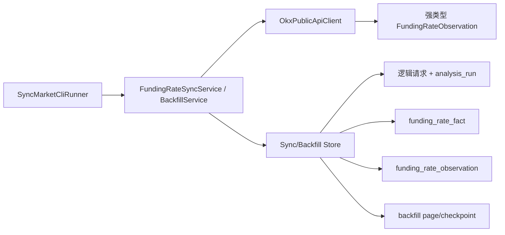

# 06. 功能架构与现状评估

> 本文描述实现产品目标所需的最小功能架构，并将其与提交 `a45280d` 的当前实现对照。它是设计和评估文档，不代表这些模块已经实现。

## 1. 架构结论

当前实现没有必要推翻。它是一条可靠但范围较深的 **OKX 资金费率事实采集子系统**，应当保留并冻结，作为资金费率 Income Source 的数据适配器。

当前实现与产品目标的主要差距不在数据质量，而在上层业务闭环尚未开始：系统还没有 Income Source 评估、当前 Portfolio、增量组合比较、人工操作清单和真实收益复盘。

推荐决策：`PROCEED_WITH_GUARDS`。

- 保留已经验证的数据事实和执行边界；
- 不再把数据回补、恢复和 coverage 当作产品路线图；
- 下一阶段只做一条从事实到收益建议的最小纵向切片；
- 不建设通用平台。

## 2. 目标功能架构



## 3. 最小模块及职责

| 模块 | 回答的问题 | 权威事实 | 是否写状态 |
|---|---|---|---|
| Market Facts | 市场实际发生了什么 | 已验证的市场事实表 | 只追加事实 |
| Product Facts | OKX 当前有哪些产品、利率和条款 | 账户页面/API/人工确认快照 | 保存带时间的快照 |
| Cost & Constraints | 用户实际手续费、滑点假设、流动性和风险边界是什么 | 账户费率与用户确认配置 | 保存版本化配置 |
| Income Source Evaluators | 每种收益机制在持有期内预计净赚多少 | 上述事实和统一计算规则 | 不修改 Portfolio |
| Current Portfolio | 现在实际持有什么、投入多少、何时进入 | OKX 只读账户快照或人工确认 | 只接受外部事实/人工确认 |
| Portfolio Comparator | 保持还是调整更划算 | 当前组合与候选评估 | 生成建议，不执行交易 |
| Decision Read Model | 用户现在需要知道什么 | 统一评估结果 | 只读投影 |
| Manual Execution Record | 用户在 OKX 实际做了什么 | 用户确认和交易所回执 | 记录事实，不代替交易所 |
| Outcome Review | 最终实际赚了多少、预测误差多大 | 真实现金流和组合快照 | 保存复盘结果 |
| AI Advisor | 为什么得出这个结论 | 统一 Read Model | 不拥有数字和动作 |

模块是职责边界，不要求拆成微服务、独立进程或大量框架。V1 继续使用一个 Spring Boot 单体。

## 4. 主业务流程

### 4.1 正常评估

```text
1. 获取或人工录入带时间的数据快照
2. 各 Income Source 独立形成结构化评估
3. 读取当前真实 Portfolio
4. 在同一持有期比较保持与候选变化
5. 应用流动性、集中度、方向风险和证据门槛
6. 形成保持/小额验证/增加/减少/不投入
7. 页面和周报读取同一个 Read Model
8. 用户在 OKX 手工执行或拒绝
9. 记录实际操作与后续真实收益
10. 复盘预测误差和调整是否产生增量收益
```

### 4.2 数据不足

缺失数据不应触发更多平台建设，而应先判断它是否影响当前决策：

- 不影响结论：显示警告，继续使用保守假设；
- 可能改变结论：该项标记为未知或只允许小额验证；
- 无法确认收益或损失上限：阻止增加资金；
- 只有反复出现并影响真实决策的数据缺口，才进入数据开发范围。

### 4.3 人工执行

建议与执行必须分开：

```text
Recommendation（系统建议）
→ Human Decision（采纳/拒绝/修改）
→ OKX Manual Execution（用户操作）
→ Execution Confirmation（人工确认/只读回执）
→ Live Portfolio Update（真实组合更新）
```

“生成操作清单”不等于“执行成功”；AI 文本、页面按钮和 Backtest 结果都不能更新 Live Portfolio。

## 5. 权威事实与投影边界

| 概念 | Source of Truth | 不得作为 SoT 的内容 |
|---|---|---|
| 市场资金费率 | `funding_rate_fact` 的有效事实版本 | CLI 文本、图表、AI 总结 |
| 数据采集执行 | `analysis_run` 与对应逻辑请求表 | 日志和进程是否仍存在 |
| 当前真实组合 | OKX 账户事实或用户确认快照 | 建议组合、模拟组合、AI 文本 |
| 产品实际利率/条款 | 带时间的 OKX 页面/API/人工快照 | 宣传材料中的长期固定 APR |
| 收益评估 | 结构化 Income Source Assessment | 浏览器临时计算、综合评分 |
| Portfolio 建议 | 统一 Portfolio Assessment | UI 自己重新排序或计算动作 |
| 用户决定 | 明确的人工决定记录 | 点击打开弹窗、生成文案 |
| 实际收益 | 真实现金流和组合权益变化 | 历史资金费率推测、Grid Profit 单项 |

## 6. 当前实现地图

当前代码的主要生命周期是：



### 当前模块

| 当前模块 | 已有能力 | 评价 |
|---|---|---|
| `funding/domain` | 资金费率观察、来源端口、回补和错误契约 | 边界清楚，保留 |
| `funding/application` | 单页同步、历史回补、stale 发现/恢复 | 可靠但已经足够，冻结 |
| `funding/infrastructure/okx` | OKX 公共资金费率适配、强类型解析 | 直接服务收益评估，保留 |
| `funding/infrastructure/mybatis` | 事实、观察、请求、页账本与 checkpoint | 保留；不继续扩张成通用数据框架 |
| `run` | execution 状态机、终态和 fencing | 采集链路需要，保留；不要让所有只读计算都强制创建 run |
| `cli` | 手工同步、回补和恢复入口 | 作为二级运维入口保留 |
| Flyway/MySQL/Testcontainers | 可复现数据与真实 MySQL 约束测试 | 保留 |
| `04-Profitability-UI.md` 与 HTML 原型 | 收益优先的信息架构 | 方向可复用，但硬编码演示金额、ETH 和静态比例必须重做 |

## 7. 当前实现与目标的差距

| 产品能力 | 当前状态 | 处理决定 |
|---|---|---|
| BTC 历史资金费率事实 | 已实现并验证 | 保留 |
| 历史分页和中断续传 | 已实现并充分硬化 | 冻结，不继续完善 |
| 数据缺口精确证明 | 未实现 | 接受不完美；需要时只显示置信度，不优先开发 |
| 稳定币利息产品事实 | 未实现 | 首版允许人工录入，不先建采集平台 |
| 账户真实手续费和持仓 | 未实现 | 首版人工确认；扩大真实资金前再接只读事实 |
| Income Source Assessment | 已有第一期确定性评估与情景产品计算 | 保留；继续以人工证据为主，不扩张成数据平台 |
| 当前/建议 Portfolio | 已有用户比例回测、保守实盘建议与多情景组合枚举 | 保留不同语义；情景建议不能冒充实盘调仓指令 |
| 增量收益与保持判断 | 已在现有工作台和情景读模型中分口径实现 | 保持来源、期限和资金语义可见 |
| BTC 基差评估 | 未实现 | 在资金费率纵向切片后按价值增加 |
| BTC 固定现货网格评估 | 已实现历史回测、Shadow 与情景路径计算 | 保留固定网格边界；不做移动网格和自动交易 |
| 中文收益页面 | 已有收益实验台与情景决策实验室 | 页面只消费后端 Read Model，不能成为 SoT |
| 人工 OKX 操作清单 | 只有原型 | 作为建议投影实现，不接交易 API |
| 实际收益复盘 | 未实现 | 小额实盘前必须补齐 |
| AI Advisor | 未实现 | 最后实现 |

## 8. 保留、冻结、重构、废弃

### 8.1 保留

- JDK 25、Spring Boot 单体、MySQL、Flyway、MyBatis-Plus；
- OKX 公共资金费率客户端；
- `funding_rate_fact` 和 observation 的追加式事实；
- 同步/回补既有事务、幂等、fencing 和测试；
- 当前中文核心文档 `01`–`03` 的 Income Source、Portfolio 和 AI 边界。

### 8.2 冻结

- 新的 funding backfill 状态和统计字段；
- 自动重试、自动恢复和 scheduler；
- 跨区间完美 coverage、通用数据质量框架；
- 为 CLI 数据维护增加更多命令。

冻结不是删除：发现影响真实收益结论的确定缺陷时仍可修复，但不能把“还能更完整”当作开发理由。

冻结调度和数据平台开发不等于停止归档。归档是人工操作纪律：首次尽量回补接口当前可用窗口；之后每周回补最近 14 天并允许重叠，正式评估前回补到评估 `asOf`；每月至少确认一次最近回补未出现 `SOURCE_EXHAUSTED`，连续未成功归档不得超过 4 周，否则相关评估降级或暂停。失败只使用现有同键续传与人工 stale 恢复，不为此新增 scheduler 或自动恢复。

### 8.3 后续轻量重构

- 将现有 funding 子系统在概念上定位为 `BTC Funding Income Source` 的数据适配器，而不是系统中心；
- 为所有页面、周报和 AI 提供一个统一收益决策 Read Model；
- 区分当前真实 Portfolio、Shadow 建议和 Backtest 结果；
- `PortfolioMode.LIVE` 当前用于公共数据同步的占位语义不准确，等真正引入 Portfolio 时再局部修正，暂不为此单独重构。

### 8.4 可以废弃或不再延续

- 把所有业务强制套入通用 `analysis_run` 的规划；
- 通用数据平台、任务编排平台和多交易所插件架构；
- 靠综合分数决定资金的设计；
- 固定 25%/15%/60% 等产品比例；
- HTML 原型中 ETH 候选、20,000 USDT 固定情景和硬编码收益数字；
- 没有统一 Read Model 前直接开发真实页面后端。

当前 Java/SQL 代码没有偏离到需要整体废弃的程度。偏离主要发生在开发优先级和产品叙事，而不是已实现事实的正确性。

## 9. 最小纵向切片

下一次实现不应先补齐所有产品，而应证明一条完整业务链：

```text
现有 BTC 资金费率事实
+ 人工输入的手续费/滑点/稳定币基准
+ 当前人工 Portfolio 快照
→ BTC 资金费率 Income Source Assessment
→ 保持与小额增加两个候选的增量比较
→ 中文只读结果和 OKX 人工验证清单
→ 用户记录采纳或拒绝
```

这条切片只需要最少的新对象：

- `IncomeSourceAssessment`：一个收益来源在持有期内的结构化评估；
- `PortfolioSnapshot`：当前实际配置的快照；
- `PortfolioAssessment`：保持与候选变化的比较结果；
- `ProfitabilityView`：页面、CLI 周报和 AI 共用的只读投影。

以上是概念边界，不要求立即持久化每个对象，也不要求为它们建立独立服务。

## 10. 分阶段顺序

| 阶段 | 最小产出 | 停止条件 |
|---|---|---|
| 设计收口 | 本文、产品基线、计算口径通过同行评审 | 领域概念和公式无歧义 |
| 第一纵向切片 | BTC 资金费率评估 + 当前组合比较 | 能回答保持还是小额验证 |
| 收益来源扩展 | 稳定币利息、基差、网格逐个加入 | 每次只加一个，能被同一 Portfolio 消费 |
| 人工闭环 | 记录用户决定、OKX 操作和真实结果 | 预测与实际可对账 |
| 只读账户事实 | 在资金扩大前核对持仓、费用和现金流 | 不再依赖关键人工估计 |
| AI 解释 | 解释结构化结论和低频研究 | 即使 AI 失败，核心仍可用 |

## 11. 架构守则

- 新数据字段只有被某个 Income Source 计算唯一消费，并能改变建议时才开发；
- UI、CLI、周报和 AI 只消费同一 Portfolio Assessment/Read Model；
- 估计值必须带场景、时间、来源和未知项，未知不能默认为零；
- 任何建议都不能直接更新 Live Portfolio；
- 任何自动化都必须证明节省了重复人工工作；
- 实现规模应服务一个人的 200,000 USDT，而不是假想机构或 SaaS 平台。

## 12. 边界闭合度评估

本文是设计，不把“文档中已有模型”误称为系统已经闭环。按 `MODELED → PROJECTED → VALIDATED → ENFORCED → PROVEN` 区分成熟度：

| Invariant | Declared by | Proven by | Consumed by | Enforced before | Failure route | Cannot-bypass test | 当前成熟度 |
|---|---|---|---|---|---|---|---|
| 无效外部资金费率不能成为事实 | `FundingRateObservation`、OKX 适配器、数据库约束 | `OkxPublicApiClientTest`、同步/回补集成测试 | `funding_rate_fact` | 事实事务提交前 | 来源失败或执行失败 | 有，真实 MySQL/契约测试 | `PROVEN`（采集边界） |
| 同一结算事实不能因分页或观察次数重复计收益 | 事实内容哈希、observation 独立关系、V5 三口径 | `FundingRateBackfillServiceTest` | 当前只被页账本消费；未来收益计算尚未消费 | 写事实和页账本前 | 事务回滚/重复关系计数 | 有，边界重复与跨 run 测试 | 采集侧 `PROVEN`，产品侧尚未闭合 |
| 采集 execution 终态不可复活，旧进程不能越权提交 | `analysis_run` 状态迁移、`current_run_id` fencing | `AnalysisRunServiceTest`、同步/回补恢复测试 | 同步与回补 Store | 提交事实/checkpoint 前 | 拒绝提交或恢复 | 有 | `PROVEN` |
| 建议不能修改真实 Portfolio | 产品基线与人工执行流程 | 尚无实现测试 | 未来 Manual Execution Record / Live Portfolio | 更新真实 Portfolio 前 | 未确认建议保持只读 | 无 | `MODELED` |
| UI、周报和 AI 必须读取同一收益结论 | `ProfitabilityView` / Decision Read Model 概念 | 尚无实现测试 | 未来 UI、报告、AI | 任何用户投影前 | 拒绝各端自行计算 | 无 | `MODELED` |
| Backtest/Shadow 不能冒充 Live 收益 | 计算文档三模式定义 | 尚无数据库或切片测试 | 未来 Portfolio 与 Outcome Review | 写 Live Portfolio/实际收益前 | 拒绝跨模式写入 | 无 | `MODELED` |

因此，当前代码可以证明“资金费率事实采集可靠”，不能证明“Portfolio 建议正确”或“这套工具能赚钱”。下一条纵向切片的验收重点，是让结构化收益评估成为页面、报告和人工清单的唯一输入，同时保持 Live Portfolio 的人工确认门槛。
