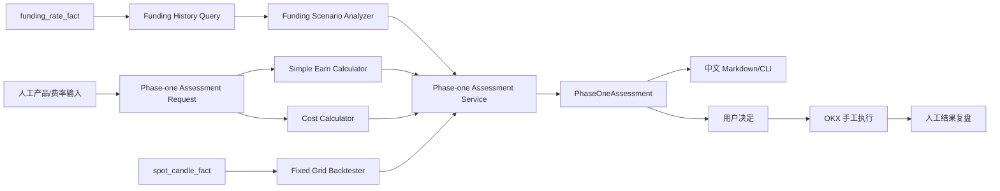

# 08. 第一期设计：简单赚币、BTC 智能套利与现货网格

> 状态：设计基线；批次 A（简单赚币与智能套利历史情景比较）、批次 B 固定网格只读纵向切片、以及 7–14 天并行 Shadow 账本已实现；真实账户结果复盘尚未实现。

## 1. 目标与完成定义

第一期只解决一个真实资金分配问题：一笔当前可配置的 USDT，应该购买 OKX 90 天 USDT 简单赚币，还是把其中一小部分用于 BTC 智能套利或 BTC/USDT 固定现货网格验证？

系统不预测 BTC 价格、不自动交易，也不承诺 10%–20% 年化。它使用现有 BTC 已实现资金费率事实、带时间的产品/账户参数和透明成本假设，形成可复核的中文评估。

第一期完成必须形成以下闭环：

```text
带时间的人工输入 + BTC 历史资金费率事实
→ 三个候选使用同一持有期和期末口径计算
→ 输出结构化收益比较和证据限制
→ 用户决定是否在 OKX 手工小额验证
→ 记录事前评估与实际结果，完成一次复盘
```

代码或回测运行成功不是完成。至少一次小额实盘必须能够回答：事前估计多少、实际赚了多少、差异来自哪里。

## 2. 本期范围

### 2.1 纳入

- USDT 90 天定期简单赚币：作为当前现金管理候选和收益门槛；
- BTC-USDT 智能套利：只评估资金费率收入以及显式输入的成本；
- BTC/USDT 固定现货网格：只做历史路径评估和 2,000–5,000 USDT 微型验证；
- 历史资金费率持有期情景分析；
- BTC/USDT 公共历史 K 线导入与固定网格情景回测；
- 三个候选在同一 90 天期限内的收益比较；
- `证据不足 / 简单赚币优先 / 继续观察 / 建议小额验证` 四种结果；
- 中文报告和 OKX 人工核对清单；
- Shadow 事前评估与人工录入的实际结果复盘。

### 2.2 不纳入

- 双币赢、基差套利和其他币种；
- 移动网格、自动调参、自动赚币叠加和追求复刻 OKX 撮合细节；
- 自动下单、自动停止、自动调仓和交易权限；
- Web 大屏、AI 决策、复杂评分或优化器；
- 私有账户 API、自动调度和新的数据治理平台；
- 把资金费率收入估计宣传成智能套利完整总收益。

双币赢保留为第二期候选。现货网格只增加一个固定参数纵向切片，不为移动网格或其他机器人预留通用策略框架。

## 3. 已知参数与待补参数

### 3.1 2026-08-18 用户提供的人工快照

| 参数 | 当前值 | 使用方式 |
|---|---:|---|
| USDT 90 天定期简单赚币 APR | 3.5% | 作为 90 天基准，不作为永久常量 |
| OKX 账户等级 | VIP2 | 说明费用适用账户，不能单独推导全部费率 |
| 现货挂单费率 | 0.06% | 现货腿挂单成交成本情景 |
| 现货吃单费率 | 0.07% | 现货腿保守成交成本情景 |
| 永续合约挂单费率 | 0.015% | 永续腿挂单成交成本情景 |
| 永续合约吃单费率 | 0.036% | 永续腿保守成交成本情景 |

所有输入都必须保存或输出 `asOf`、来源和是否人工确认。人工产品报价默认只对本次评估有效；再次评估必须重新确认。费率变化后创建新快照，不覆盖旧评估所引用的值。

### 3.2 2026-08-18 BTC 智能套利页面预览

用户在 OKX BTC-USDT 智能套利页面以 20,000 USDT 进入“策略预览 → 收益预览”，但因余额不足未创建策略。页面显示：

| 参数 | 页面值 | 证据含义 |
|---|---:|---|
| 当前资金费率 | 0.00529% / 8 小时 | 当前市场快照，不代表 90 天持续值 |
| 开仓价差率 | -0.039% | 当前预估开仓价差，不是交易手续费 |
| 预计总年化 | 5.58% | 页面选择“近 3 天”的估计口径 |
| 套利年化 | 5.12% | 页面短窗口估计，不等于未来 90 天实现收益 |
| 自动赚币预计年化 | 0.45% | 独立收益组成，机制和适用金额仍待确认 |
| 借币年化 | `--` | 当前预览未显示借币成本 |
| 预计开仓盈亏 | -36.001 USDT | OKX 聚合估计；组成仍须展开页面明细确认 |
| 页面给出的最短持有时长 | 12 天 | 按页面公式由开仓亏损和预计总年化机械换算，不是 AI 对未来收益的保证 |

页面的 12 天来自：

```text
36.001 / (20,000 × 5.58% / 365) ≈ 11.78 天
```

但第一期真正关心的是相对 3.5% 简单赚币的增量回本时间：

```text
相对基准开仓成本回收期
= 36.001 / (20,000 × (5.58% - 3.5%) / 365)
≈ 31.59 天
```

这还没有计入智能套利退出成本。若仅作压力情景、假设退出成本也为 36.001 USDT，则相对基准回收开仓和退出成本约需 63.18 天；退出成本相等不是已确认事实，不能写入基准结果。

如果机械假设 5.58% 在未来 90 天保持不变，则：

```text
90 天展示年化对应毛收入 ≈ 20,000 × 5.58% × 90 / 365 = 275.18 USDT
相对简单赚币毛增量 ≈ 275.18 - 172.60 = 102.58 USDT
再扣页面预计开仓盈亏后 ≈ 66.58 USDT
```

上述 `66.58 USDT` 仍未扣退出成本，也没有证明近 3 天年化能够维持 90 天，不能形成投资建议。页面“AI 智能预测”实质上使用展示公式计算回本天数，不得作为独立预测证据。

当前截图处于“收益预览”，没有显示现货/永续两腿数量、名义金额或保证金。下一步只需打开“仓位预览”，并展开 `-36.001 USDT` 的明细；无需创建策略。

随后取得的“仓位预览”和开仓盈亏明细补齐了预览口径：

| 参数 | 页面值 | 核对结果 |
|---|---:|---|
| BTC-USDT 永续预计卖出价 | 64,129.0 USDT | 预览价格，不是实际成交 |
| BTC/USDT 现货预计买入价 | 64,150.7 USDT | 预览价格，不是实际成交 |
| 初始投入 | 20,000.00 USDT | 候选总资金 |
| 现货投资额 | 19,047.61 USDT | 占总投入约 95.238% |
| 合约预留保证金 | 952.38 USDT | 占总投入约 4.762%，不是永续名义金额 |
| 预计开仓价差 | -15.810 USDT | 约为 19,047.61 × 0.083%，对应当次开仓条件阈值 |
| 现货开仓手续费 | -13.334 USDT | 19,047.61 × 0.07%，与 VIP2 现货吃单费率一致 |
| 合约开仓手续费 | -6.858 USDT | 19,047.61 × 0.036%，与 VIP2 永续吃单费率一致 |
| 预计开仓盈亏 | -36.001 USDT | 上述三项之和，存在展示舍入差异 |

从 `19,047.61 / 952.38 ≈ 20` 可以合理推断本次预览按约 20 倍永续杠杆分配；在 Delta 中性假设下，永续空头名义金额约等于现货名义金额 19,047.61 USDT，而不是保证金 952.38 USDT。这是本次页面快照的推断，不得硬编码为所有时间和账户的永久分配规则。

当输入总资金 `C` 且页面仍采用 20 倍分配时，可复核：

```text
Expected Spot Notional ≈ C × 20 / 21
Expected Perpetual Margin ≈ C / 21
Expected Perpetual Notional ≈ Expected Spot Notional
```

实现必须支持两种互斥输入方式：使用 OKX 聚合的 `Expected Opening PnL`，或者使用价差、现货手续费和合约手续费三个明细求和；不得同时扣减聚合值和明细值。该页面预览只证明预计开仓成本，不证明实际成交、滑点、再平衡或退出成本。

### 3.3 仍然缺失

- 创建后的实际两腿成交数量、名义金额和成交价格；
- 预览价与真实成交价之间的实际滑点；
- 90 天持有期间的再平衡、融资或产品服务成本；
- 退出时两腿如何成交，以及是否需要全部结算回 USDT；
- 简单赚币额度、锁定和赎回条款的当次确认。

预览阶段已经可以使用页面预计两腿名义和开仓成本做候选比较，但缺失的关键成本不得按零处理。关键滑点、再平衡或退出方式缺失时，只能输出成本区间和 `证据不足/继续观察`，不能输出精确智能套利净收益或建议扩大资金。

### 3.4 2026-08-18 BTC/USDT 现货网格页面预览

用户在 OKX 现货网格页面取得了一组“长期稳健型（3–6 个月）”候选参数：

| 参数 | 页面值 | 设计解释 |
|---|---:|---|
| OKX 回测年化收益率 | 24.87% | 最近历史参数筛选结果，不是未来收益保证 |
| 价格区间 | 47,483.2–76,382.5 USDT | 当前价约 63,146.6 时，下侧约 -24.8%、上侧约 +21.0% |
| 网格数量 | 50，等差 | 第一版只支持该固定网格语义 |
| 投资金额示例 | 20,000 USDT | 不代表首次实盘允许投入 20,000 |
| 单网格收益率 | 页面约 0.60%–1.09% | 必须核对是否已扣交易费，不能直接累计成年化 |
| 页面预计月收益 | 414.50 USDT | 由回测年化机械换算，不是已实现现金流 |
| 自动赚币展示 | 2.35% | 只可能作用于符合条件的闲置资金，不能与网格年化直接相加 |
| 移动网格扩展区间 | 33,033.6–90,832.1 USDT | 第一版排除；向下移动会显著放大 BTC 库存风险 |

OKX 官方说明表明，智能策略会对历史参数组合进行回测并选择表现较好的结果，因此 24.87% 同时带有参数筛选偏差；报告只能称其为 `OKX_BACKTEST_QUOTE`。网格是否赚钱必须看总盈亏，而不是只看“网格利润”。参考：[OKX Smart Strategies](https://www.okx.com/help/smart-strategies)、[OKX 网格总盈亏说明](https://www.okx.com/zh-hans/help/how-do-total-profit-and-loss-pnl-and-grid-profits-work)。

如果机械假设 24.87% 在未来 90 天保持不变：

```text
20,000 × 24.87% × 90 / 365 ≈ 1,226.47 USDT
相对 3.5% 简单赚币增量 ≈ 1,226.47 - 172.60 = 1,053.87 USDT
```

这 1,053.87 USDT 只相当于本金的约 5.27%。只要期末 BTC 库存相对成本产生超过 5.27% 的不利影响，宣传年化带来的优势就可能消失。该例证明“值得研究”，不证明“值得买入 20,000 USDT”。

## 4. 比较边界

### 4.1 同一期限

3.5% 是 90 天定期 APR，因此主比较期限固定为：

```text
H = [asOf, asOf + 90 days)
```

不能把 90 天定期收益与 7 天或 30 天智能套利收益直接比较。短窗口只用于观察资金费率稳定性，必须先转换成明确的 90 天情景估计，且不得暗示能够按同样收益连续复投。

### 4.2 同一初始状态与期末状态

首个用例假定比较时资金为可用 USDT：

```text
Current State = 可用 USDT
Candidate A = 申购 90 天 USDT 简单赚币
Candidate B = 建立 BTC 智能套利并持有 90 天
```

为了可比，报告必须明确期末口径：

- 若两侧都按 90 天末回到可用 USDT 比较，则智能套利计入两腿退出费用和滑点；
- 若不假设智能套利退出，则当前数据连完整期末策略权益也无法计算，只能展示资金费率收入观察，不能与已到期的简单赚币做精确现金比较或形成产品选择建议；
- 发生在评估 `asOf` 之前的费用是沉没成本，不得重复计入。

### 4.3 资金规模

- 计算金额是请求参数，不能硬编码 20,000 或 200,000 USDT；
- 报告可以展示 20,000 USDT 正式试点情景；
- 首次真实进入仍限定为 2,000–5,000 USDT 微型验证；
- 完成一次真实进入、退出和对账后，才允许给出不超过 20,000 USDT 的正式试点建议；
- 第一期不得建议直接投入 200,000 USDT。

### 4.4 现货网格的双基准

现货网格不是稳定币利息，也不是 Delta 中性套利。它会持有并动态改变 BTC 库存，因此必须同时比较：

```text
Benchmark A = 同期 90 天 USDT 简单赚币
Benchmark B = 同一时点用相同资金买入并持有 BTC，90 天末退出回 USDT
Candidate C = 固定 BTC/USDT 现货网格，90 天末退出回 USDT
```

只有 `Candidate C` 的保守总盈亏优于简单赚币，才能说明承担 BTC 风险获得了额外回报；只有它优于 BTC 买入持有，才能说明网格交易本身创造了价值。不得把 BTC 上涨带来的库存收益归功于网格能力。

第一版参数在评估开始后保持固定：上下限、网格数、等差模式、资金和费用假设都不能中途调整。移动网格、简单赚币分配和自动赚币叠加会改变策略语义，必须作为不同候选单独评估，不能套用 24.87% 的原回测结果。

## 5. 确定性计算

所有金额使用 `BigDecimal`，费率使用小数而不是百分数字符串，时间使用 UTC `Instant`。展示层可以四舍五入，领域计算不得在中间步骤提前舍入。

### 5.1 简单赚币

第一版按单利、365 天基数计算：

```text
Term Return = APR × Term Days / 365
Simple Earn Income = Allocated Capital × Term Return
Simple Earn End Value = Allocated Capital + Simple Earn Income
```

以 20,000 USDT、3.5%、90 天为例：

```text
Term Return = 3.5% × 90 / 365 ≈ 0.8630137%
Income ≈ 172.60 USDT
End Value ≈ 20,172.60 USDT
```

这只是按用户提供 APR 得到的计算示例。申购前仍须核对 OKX 确认页的实际 APR、计息日、额度、锁定和赎回规则。

### 5.2 历史资金费率事实选择

从 `funding_rate_fact` 读取 BTC-USDT-SWAP 在 `[from,to)` 内的 `realized_rate`：

1. 只使用 `first_observed_at <= evaluationAsOf` 的事实；
2. 同一 `exchange + instrument_id + funding_time` 有多个修订版本时，选择 `evaluationAsOf` 前 `first_observed_at` 最新的一条；并列时选择 `id` 最大；
3. 不使用 `predicted_rate`；
4. 不按 observation 数量重复计算；
5. 不假设每天三次或每 8 小时结算，只按真实 `funding_time` 求和；
6. 查询结果和关键数据缺口必须进入结构化证据，不允许报告层自行补数。

### 5.3 资金费率收入

必须区分策略总投入与永续空头名义金额：

```text
Funding Holding Return = Σ Signed Realized Rate_i
Funding Income = Hedged Short Notional × Funding Holding Return
```

对于现货多头 + 永续空头，正资金费率是收入，负资金费率是支出。不得使用 `Allocated Capital × ΣRate`，除非已明确证明 `Hedged Short Notional = Allocated Capital`。

### 5.4 智能套利成本

完整往返交易成本：

```text
Spot Trading Fee
= Spot Entry Notional × Spot Entry Fee Rate
+ Spot Exit Notional  × Spot Exit Fee Rate

Perpetual Trading Fee
= Perp Entry Notional × Perp Entry Fee Rate
+ Perp Exit Notional  × Perp Exit Fee Rate

Total Slippage
= 每条腿每次实际或保守滑点金额

Known Round-trip Cost
= Spot Trading Fee
+ Perpetual Trading Fee
+ Total Slippage
+ Rebalance Cost
+ Financing/Service Cost
```

已知交易费率至少支持两个情景：

- 挂单情景：每次现货成交使用 0.06%，每次永续成交使用 0.015%；
- 吃单情景：每次现货成交使用 0.07%，每次永续成交使用 0.036%。

这已经覆盖两条腿的账户交易费率，但仍不是智能套利总成本。不能把费率简单相加后乘以全部投入资金；必须分别乘以现货和永续每次进出的实际名义金额，并另外计入滑点、再平衡、融资或服务成本。

仅作量级示例：如果现货腿和永续腿每次进出名义金额都为 10,000 USDT，且名义在退出时不变，则：

```text
全挂单往返交易费
= 10,000 × 0.06% × 2 + 10,000 × 0.015% × 2
= 15.00 USDT

全吃单往返交易费
= 10,000 × 0.07% × 2 + 10,000 × 0.036% × 2
= 21.20 USDT
```

这不是当前智能套利产品的真实分配假设，也未包含滑点、再平衡和融资/服务成本；系统不得把示例名义写成默认事实。永续保证金不等于永续名义金额：带杠杆时，少量保证金可以支持与现货腿接近的永续名义金额。必须读取 OKX 实际两腿数量/名义和杠杆，不能按总投入资金的一半推导。

### 5.5 第一版可声明的收益

```text
Estimated Funding-only Net Income
= Funding Income
- Known Round-trip Cost

Incremental Income vs Simple Earn
= Estimated Funding-only Net Income
- Simple Earn Income
```

由于第一期没有现货/永续历史成交价格、基差变化和真实再平衡现金流，这个结果只能叫“资金费率收入估计（扣已知成本）”，不能叫“智能套利总收益”。

### 5.6 固定现货网格收益

每条已配对网格成交可以解释为已实现价差，但决策必须使用整个账户权益：

```text
Grid Total PnL
= Ending USDT
+ Ending BTC × Terminal BTC Price
+ Withdrawn Amount
- Added Amount
- Initial Capital

Grid Net Income (EXIT_TO_USDT)
= Grid Total PnL
- Terminal BTC Liquidation Fee
- Terminal BTC Liquidation Slippage
```

回测归因同时展示但不得重复相加：

```text
Grid Total PnL
= Completed Grid Profit
+ Inventory PnL
- Trading Fees
- Other Attributable Costs
```

固定等差网格的每格挂单成交默认使用用户 VIP2 现货挂单费率 0.06%；初始 BTC 建仓和期末强制退出按保守吃单费率 0.07% 加显式滑点计算。费率必须可配置且带 `asOf`，实盘成交是吃单还是挂单以 OKX 账单为准。

## 6. 简化历史分析

### 6.1 正确名称

当前历史数据大多是事后通过公共接口回补得到，不能证明系统在每个历史时点已经拥有这些事实。因此第一版应称为：

```text
历史持有期情景分析
```

而不是无前视偏差的“策略回测”或“Walk-forward 回测”。`evaluationAsOf` 只能阻止使用该评估时点之后才观察到的修订，不能把事后回补数据变成当时可见数据。

### 6.2 输出指标

在数据允许范围内计算：

- 完整历史区间、结算次数与缺失警告；
- 总资金费持有收益；
- 正/负/零资金费率结算占比；
- 7 天、30 天滚动资金费收益分布；
- 最差 7 天和最差 30 天；
- 最长连续负资金费率次数与区间；
- 90 天实际历史结果（只有一个窗口时明确标记样本不足）；
- 挂单/吃单及缺失成本下的结果区间；
- 相对 90 天简单赚币的增量收益区间。

滚动窗口可以用于描述稳定性，但重叠窗口不是独立样本。不能把大量重叠窗口显示成大量独立成功次数。

### 6.3 数据门槛

- `coverage=COMPLETE` 只代表分页到达目标边界，不代表区间无缺口；
- 数据晚于评估时点、关键成本未知或样本不足，都必须降低证据状态；
- 只有约 90 天公共历史时，不足以证明长期 10%–20% 年化，也不足以建议直接扩大资金；
- 数据不足不触发新数据平台建设，只阻止强结论并推动 Shadow/小额验证。

### 6.4 固定网格回测语义

OKX 公共 `GET /api/v5/market/history-candles` 可在不使用 API Key 的情况下取得 BTC/USDT 历史 K 线。第一版只导入完成的 1 分钟 K 线，范围限定为评估所需的 90 天，不建设通用行情平台。

K 线只有开、高、低、收，无法证明一根 K 线内部先到最高价还是最低价。为避免伪精确，回测对同一根 K 线同时运行两条确定路径：

```text
Path A = Open → Low → High → Close
Path B = Open → High → Low → Close
```

两条路径结果相同则该段在当前模型下无路径歧义；不同则同时输出两个结果，并报告差额和歧义 K 线数量。两者都必须通过收益/风险门槛且差异在用户容忍范围内，才允许小额验证。这只是敏感性分析，不是覆盖所有逐笔成交顺序的置信区间；不得只选择收益更高的路径。

回测规则还必须明确：

- 只使用评估 `asOf` 前已完成的 K 线；
- 初始资金全部为 USDT，按显式算法买入建立首批可卖 BTC 库存；
- 每个价位仅有一张有效限价单，成交后才在相邻价位补反向单；
- 跌破下限后不继续加仓，上破上限后不追高重建；
- 期末按 `EXIT_TO_USDT` 清算剩余 BTC，计入吃单费和滑点；
- 不模拟移动网格、借币、杠杆或自动赚币；
- 同时输出总盈亏、已实现网格利润、库存盈亏、费用、最大回撤、完成循环数、期末 BTC、区间外时长和双基准差额。

公共 API 的历史 K 线属于市场数据，不需要 OKX 只读子账户。只读 API 只在未来自动对账真实策略持仓和成交时有价值，不是完成第一版回测的前置条件。

## 7. 评估契约

### 7.1 输入

```text
AssessmentRequest
- evaluationAsOf
- candidateType(SIMPLE_EARN | SMART_ARBITRAGE | FIXED_SPOT_GRID)
- instrumentId(BTC-USDT-SWAP | BTC-USDT)
- horizonDays = 90
- candidateCapital
- simpleEarnQuote(apr, termDays, asOf, source, termsConfirmed)
- feeSnapshot(accountTier, spotMaker, spotTaker,
              perpMaker?, perpTaker?, asOf, source)
- positionAssumption(spotEntry/ExitNotional, perpEntry/ExitNotional)
- slippageAssumption(optional ranges)
- fixedGridParameters(lowerPrice, upperPrice, gridCount, ARITHMETIC)
- gridRiskLimits(maxAcceptableDrawdown, maxEndingBtcValueRatio,
                 maxPathDivergence)
- terminalPolicy(EXIT_TO_USDT | KEEP_STRATEGY_OPEN)
```

### 7.2 结构化输出

```text
PhaseOneAssessment
- requestEcho
- simpleEarnAssessment
- fundingHistoryEvidence
- spotCandleEvidence
- fixedGridBacktest(optional pathRange, benchmarks, drawdown, endingInventory)
- makerScenario
- takerScenario
- incrementalIncomeRange
- evidenceStatus
- recommendation
- recommendationReasons[]
- blockers[]
- unknowns[]
- manualOkxChecklist[]
```

报告、CLI 和未来 UI 只消费 `PhaseOneAssessment`，不得重新计算收益、把 UNKNOWN 变成 0，或根据文案推导 recommendation。

### 7.3 证据状态

```text
SUFFICIENT_FOR_COMPARISON
SUFFICIENT_FOR_MICRO_VALIDATION
INSUFFICIENT
STALE
```

证据状态是领域事实，由评估服务产生；Markdown/CLI 只是投影。

### 7.4 建议状态

```text
INSUFFICIENT_EVIDENCE      证据不足，不能比较
PREFER_SIMPLE_EARN         保守情景不优于简单赚币
WATCH_SMART_ARBITRAGE      可能更好，但关键成本/样本不足
MICRO_VALIDATE_ARBITRAGE   保守情景仍优于基准，只允许微型实盘
WATCH_FIXED_GRID           网格可能有价值，但保守回测或风险约束不足
MICRO_VALIDATE_FIXED_GRID  保守路径通过双基准和风险约束，只允许微型实盘
```

第一期不产生 `INCREASE` 或直接投入 200,000 USDT 的建议。

### 7.5 决策规则

按以下顺序执行，不能由 UI 或 AI 覆盖：

1. 期限、币种、`asOf` 或金额非法：拒绝请求；
2. 简单赚币快照过期、条款未确认或资金费事实不可用：`INSUFFICIENT_EVIDENCE`；
3. 两腿名义、关键滑点或退出政策缺失，或者期末选择 `KEEP_STRATEGY_OPEN`：`WATCH_SMART_ARBITRAGE`，只展示区间/阻断项；
4. 完整保守情景净收益不高于简单赚币：`PREFER_SIMPLE_EARN`；
5. 完整保守情景优于简单赚币，但尚未完成真实闭环：`MICRO_VALIDATE_ARBITRAGE`，金额限定 2,000–5,000 USDT；
6. 固定网格没有完整 90 天 K 线、双路径结果、双基准或用户风险上限：`WATCH_FIXED_GRID`；
7. 固定网格两条路径均同时优于简单赚币，路径差异在容忍范围内，参数小幅扰动不使结论反转，并满足最大回撤和期末 BTC 库存约束：`MICRO_VALIDATE_FIXED_GRID`，金额限定 2,000–5,000 USDT；
8. 已完成一次真实闭环后的扩大判断不属于本切片，另行评审后才允许增加到 20,000 USDT。

“保守情景”必须由显式成本和收益输入构成，不能用 AI 置信度或综合分数代替。收益差很小但估计误差可能改变结论时，保持或观察。

## 8. 最小模块与所有权



| 模块 | 职责 | 是否拥有状态 |
|---|---|---|
| Funding History Query | 按 as-of 修订规则读取资金费事实 | 否，事实 SoT 仍是 `funding_rate_fact` |
| Simple Earn Calculator | 计算指定期限利息 | 否 |
| Funding Scenario Analyzer | 计算历史持有期指标 | 否 |
| OKX Spot Candle Import | 有界回补 BTC-USDT 90 天完成 K 线 | 否；市场事实写入 `spot_candle_fact` |
| Fixed Grid Backtester | 按固定参数运行双路径回测并产生双基准结果 | 否 |
| Cost Calculator | 按两腿名义和费率计算成本 | 否 |
| Phase-one Assessment Service | 唯一产生证据状态与建议 | 否；纯评估不强制创建 `analysis_run` |
| Assessment Snapshot | 可选持久化事前评估，供 Shadow/复盘引用 | 是，若本批实现 Shadow |
| Markdown/CLI Projector | 中文展示和人工清单 | 否，不得重新计算 |
| Outcome Review | 记录人工确认的实际结果和预测差异 | 是，不得反推或修改 Live Portfolio |

第一版继续使用 Spring Boot 单体。不得为了这些计算器引入策略 DSL、通用插件框架、消息队列、调度器或统一行情平台。

## 9. 人工 OKX 清单

建议达到 `MICRO_VALIDATE_ARBITRAGE` 时，报告只生成核对步骤，不生成订单：

1. 登录 OKX，确认当前仍为 VIP2；
2. 在账户费率页面核对现货与永续挂单/吃单费率；
3. 打开 90 天 USDT 简单赚币，核对实际 APR、额度、锁定和赎回条款；
4. 打开 [BTC-USDT 智能套利页面](https://www.okx.com/zh-hans/trade-swap-strategy/btc-usdt-swap#ord-type=smart_arbitrage)，核对两腿、保证金模式、预计 APY 口径和退出资产处理；
5. 首次只输入 2,000–5,000 USDT；
6. 保存确认页参数、创建时间和实际成交/费用；
7. 记录持有期间资金费、再平衡和异常；
8. 退出时记录两腿成交、费用、滑点和最终 USDT 等值；
9. 完成预测与实际差异复盘后，再决定是否进入 20,000 USDT 试点。

固定现货网格达到 `MICRO_VALIDATE_FIXED_GRID` 时另生成清单：

1. 只复制已回测的固定区间、等差网格数和投入金额，不开启移动网格；
2. 不开启简单赚币分配或自动赚币，避免实盘配置与回测语义不一致；
3. 首次投入 2,000–5,000 USDT，并记录创建前 BTC 价格、初始 BTC 数量和初始费用；
4. 每周记录 OKX 展示的总盈亏、网格利润、BTC 数量和区间状态；
5. 90 天末按既定政策退出回 USDT，记录完整成交和费用；
6. 用总盈亏分别对比同期简单赚币与 BTC 买入持有，再决定是否扩大。

## 10. 实现切片与验收

建议分成两个连续的小批次实现，先完成稳定币/套利比较，再加入网格；第二批不得阻塞第一批交付。

批次 A：

1. 领域值对象、输入校验和两个确定性计算器；
2. as-of 资金费率查询；
3. 历史持有期情景分析；
4. 统一 `PhaseOneAssessment` 与决策规则；
5. 中文 Markdown/CLI 投影；
6. 可复现测试样例。

实现状态：已完成。入口为 `assess-income phase-one`；评估是纯只读计算，不创建 `analysis_run`，不写 Portfolio/Live 状态。

批次 B：

1. OKX 公共 BTC-USDT 完成 K 线客户端和 90 天有界回补；
2. 最小追加式 `spot_candle_fact`，唯一身份为交易所、标的、周期和开始时间；
3. 固定等差网格双路径回测器；
4. 简单赚币与 BTC 买入持有双基准；
5. `WATCH_FIXED_GRID / MICRO_VALIDATE_FIXED_GRID` 规则及中文报告；
6. 2,000–5,000 USDT 人工实盘清单。

实现状态：上述只读纵向切片已完成。公共 `grid-ai-params` 只保存候选；`grid-ui-config` 保存 App 复制 AI 后的最终人工确认配置，收益评估只接受后者。`3–6 个月` 原样保存为非精确期限标签，90 天仅是统一比较窗口。入口为 `sync-product`、`grid backfill` 和 `grid assess`；数据库只保存追加式配置/K 线事实，评估结果不写入 Portfolio 或 Live 状态。详细验收见 `10-Fixed-Grid-Test-Runbook.md`。

Shadow 评估快照和实际结果复盘可以紧接在同一阶段的第二个小批次实现；不得为了持久化它们先设计通用 Portfolio/Run 平台。

必须覆盖的测试：

- 20,000 USDT、3.5%、90 天得到约 172.60 USDT；
- 3.5% 的 90 天产品拒绝与 30 天候选直接比较；
- as-of 只选当时已观察到的最新修订，并列选最大 id；
- `predicted_rate` 和 observation 数量不能进入收益；
- 不假设固定 8 小时结算；
- 负资金费率正确降低收益；
- 手续费按每条腿实际名义计算且每笔只出现一次；
- 聚合开仓盈亏与三个组成明细只能选择一种口径，不能重复扣减；
- 缺关键滑点、再平衡或退出方式时不能生成精确净收益；
- 当前方案与自身比较的增量收益为 0；
- 报告只投影 typed assessment，不重算 recommendation；
- 回测/Shadow 结果不能更新 Live Portfolio；
- 第一期不能产生超过 5,000 USDT 的首次实盘建议。
- 未完成 K 线和非法/未完成 K 线不能进入网格回测；
- 同一根 K 线双路径结果必须形成区间，准入使用较差值；
- 网格总盈亏包含期末 BTC 盯市/清算，不能只返回已配对网格利润；
- 固定网格跌破下限不继续买入、突破上限不自动重建；
- 网格交易费用逐笔只计一次，期末退出费不与历史成交费重复；
- 同一行情下简单赚币、BTC 买入持有和网格使用相同 90 天边界；
- 参数轻微扰动或较差路径使结论反转时只能 `WATCH_FIXED_GRID`；
- 移动网格、自动赚币和自动参数优化不能通过请求绕入第一版。

## 11. 边界闭环要求

| Invariant | Declared by | Proven by | Consumed by | Enforced before | Failure route | Cannot-bypass test |
|---|---|---|---|---|---|---|
| 同期限比较 | AssessmentRequest + validator | 90/30 天拒绝测试 | Assessment Service | 任何收益比较前 | 参数失败/证据不足 | 有 |
| 历史事实修订口径唯一 | Funding History Query | MySQL as-of 查询测试 | Scenario Analyzer | 求和前 | 排除不可用事实 | 有 |
| 未知成本不按零 | Cost model | 缺滑点/退出测试 | Assessment Service | recommendation 前 | WATCH/INSUFFICIENT | 有 |
| 开仓成本只扣一次 | Cost model 的 aggregate/components XOR 契约 | -36.001 与三明细等价测试 | Assessment Service | 净收益求和前 | 拒绝双重输入 | 有 |
| 网格只使用完成行情事实 | Spot Candle Query | 未完成 K 线拒绝测试 | Fixed Grid Backtester | 撮合模拟前 | 排除/拒绝行情 | 有 |
| K 线路径不确定性不被隐藏 | Dual-path result | 路径分叉样例测试 | Assessment Service | 网格准入前 | 使用较差路径/WATCH | 有 |
| 网格总盈亏与双基准同口径 | Grid result + benchmark result | 期末清算和恒等测试 | Assessment Service | recommendation 前 | WATCH/INSUFFICIENT | 有 |
| 建议由领域服务唯一产生 | PhaseOneAssessment | 投影一致性测试 | CLI/Markdown/UI | 展示前 | 不生成建议投影 | 有 |
| 建议不等于执行 | Human decision/manual execution boundary | 集成测试/人工验收 | Outcome Review | Live 事实更新前 | 无确认则不更新 | 实现复盘时补齐 |
| Backtest/Shadow/Live 隔离 | Mode + repository boundary | 跨模式拒绝测试 | Review/Report | 任何 Live 写入前 | 拒绝跨模式引用 | 实现持久化时补齐 |

设计成熟度：同期限、as-of 修订、完成 K 线、双路径、双基准和建议唯一消费已由自动化测试达到 `PROVEN`；Shadow/Live 持久化隔离仍为 `MODELED`，只有实现真实结果复盘并加入不可绕过测试后才可称闭环。

## 12. 仍需用户补充的最少信息

开始实现不必等待，但生成可操作的智能套利净收益结论前需要：

1. 用户选择的退出假设：90 天末全部退出回 USDT，还是保持策略继续运行；
2. 一次真实小额操作后获得的实际成交名义、滑点、再平衡和退出费用。

生成可操作的现货网格小额验证结论前还需要：

3. 用户可接受的 90 天最大回撤；
4. 用户可接受的期末 BTC 库存上限（金额或占候选资金比例）；
5. 跌破网格下限后是继续持有 BTC，还是人工停止并退出回 USDT。第一版不替用户猜测该偏好。

这些信息优先人工录入，不接只读 API，不延迟第一批确定性计算和历史情景分析。

## 13. Boundary Review

```text
Boundary Review: PASS WITH WARNINGS
Touched boundaries: 产品事实快照、账户费用快照、资金费/K 线历史事实查询、收益评估、建议投影、人工执行
Source of truth: funding_rate_fact；spot_candle_fact；带 asOf 的人工产品/费用输入；未来人工确认的实际结果
Projection surfaces: Markdown/CLI，未来 UI
Findings: 期限已统一为 90 天；资金费收入与智能套利总收益已分开；固定网格使用总盈亏、双路径和双基准；OKX 24.87% 仅作为外部回测报价；移动网格和自动赚币已排除
Required fixes before implementation: 无；缺失参数通过 typed UNKNOWN 和建议降级处理
Required tests: 第 10、11 节所列
Accepted debt: K 线不能还原逐笔成交和同 K 线内真实路径；历史回补数据不构成无前视回测；尚无真实基差/对冲误差/再平衡数据；Shadow/Live 隔离仍待实现证明
```
