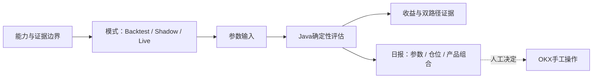

# 11. 回测、Shadow、实盘收益实验台

## 1. 目标

本地页面用于调整固定网格参数、运行只读回测，并生成“今天是否需要调整参数、仓位或产品组合”的中文日报。它不是交易终端，不连接 OKX 交易权限。

入口：启动 Spring Boot 后访问 `http://127.0.0.1:8080/`。

## 2. 三种模式不能混用

| 模式 | 权威事实 | 当前状态 | 页面允许的动作 |
|---|---|---|---|
| Backtest | 历史 K 线、确认配置、单次情景参数、确定性计算结果 | 已实现 | 调参并运行只读计算 |
| Shadow | 创建时冻结的策略定义、逐日保守估值事实 | 已实现 | 创建、读取、手工刷新、停止并生成日报 |
| Live | OKX 只读账户快照或带来源时间的人工事实 | 尚未实现 | 只显示能力缺口，不建议真实调仓 |

回测参数只存在于单次请求，不更新 `grid_configuration_snapshot`。日报是回测结果的投影，不是新的收益事实。

Shadow 固定比较两组参数：用户批准的 80% 区间 / 30 格候选，与 `grid_configuration_snapshot` 中的原始 50 格基准。两者共享开始时间、虚拟资金、手续费、滑点和比较基准。
页面从数据库读取 Shadow 观察列表，并显示 ID、状态、已观察天数以及候选/基准网格数；当前浏览器会记住最近一次选择。读取观察只生成投影，不会复制或修改冻结定义。

## 3. 页面结构



回测页把“真实组合规划”和“单产品情景比较”分成两个边界。前者允许用户调整产品比例，后者只回答每个产品单独使用同一候选资金时会怎样。两者不能相加或互相冒充。

回测页包括：

- 顶部 OKX 公共行情状态：BTC-USDT 最新成交价、提供方时间、本地观察时间、滚动 90 天分钟 K 线的数据库覆盖度和同步执行状态；
- 真实组合规划总资金：默认 200,000 USDT；90 天定期、活期/流动 USDT、智能套利、固定网格四项比例可调整，后端强制每项在 0%–100% 且合计 100%；
- 单产品回测候选资金：默认 20,000 USDT；每个产品分别、独立地使用该金额做反事实比较，不代表重复投资或实际组合分配；
- UTC+8 的 90 天收益观察窗口，以及本次分析允许使用的数据版本截止时间；
- 回测与 Shadow 共用同一份分钟 K 线事实、覆盖状态和更新入口；任一页面位置触发更新后，两处立即展示相同状态，不再各自维护“是否已同步”；
- 确认配置 ID；
- BTC 上下限、网格数、止盈、止损；
- 资金、简单赚币 APR、VIP2 现货费率、退出滑点和风险阈值；
- 固定网格、BTC 智能套利、USDT 简单赚币活期与 90 天定期的同屏评估，并保留 BTC 持有方向基准；网格若较晚进入区间，必须显示实际可运行期，不能冒充完整 90 天比较；
- 真实组合历史回测：同时展示用户比例、各产品按分配金额贡献的历史净收益、组合总收益、累计收益率、简单年化、保守基线及相对增量；用户输入不会被系统静默覆盖；
- 单产品内部资金结构：简单赚币明确 BTC 为 0；固定网格展示初始化 BTC、BTC 买入名义和用于后续买单的预留 USDT；智能套利同时展示现货多头、等名义永续空头、保证金和估算净方向名义；
- 三方净收益、累计收益率和按实际有效观察分钟计算的简单年化；
- 分钟内两条路径的收益、退出原因、时间和回撤；
- 网格数敏感性；
- 参数、仓位和产品组合三项日报建议。

## 4. Controller

```http
GET /api/workbench/capabilities
GET /api/workbench/market-data
POST /api/workbench/market-data/refresh
POST /api/workbench/market-data/refresh/manual
POST /api/workbench/backtests/grid
POST /api/workbench/candles/sync
GET /api/workbench/candles/sync/{id}
POST /api/workbench/income/simple-earn
POST /api/workbench/shadows/grid-pairs
GET /api/workbench/shadows
GET /api/workbench/shadows/{id}
POST /api/workbench/shadows/{id}/refresh
POST /api/workbench/shadows/{id}/stop
```

能力接口返回三种模式的状态及原因，UI 不自行推断。回测请求包含真实组合规划、单产品候选资金和单次情景参数，响应包含四类产品的分项评估、真实组合建议、BTC 持有方向基准、两条路径、敏感性、结构化推荐和 `dailyReport`。四类结果不是无条件的总排名：网格的直接基准使用相同实际有效窗口，智能套利与 90 天定期使用完整 90 天窗口。

市场数据接口同样只返回后端统一读模型。`POST /api/workbench/market-data/refresh` 实际请求 OKX 公共 ticker 与历史 K 线接口：ticker 追加写入 `btc_market_tick_fact`，已完成分钟线追加写入 `spot_candle_fact`；形成中的分钟线不能入库。回测和 Shadow 的“更新共享 K 线”按钮都调用该统一入口，旧的 `/candles/sync` 只保留为兼容 API，不再作为浏览器中的第二套同步状态来源。若只缺窗口末尾 1–2 根且此前没有内部缺口，状态为 `WAITING_LATEST_CANDLE`，等待 OKX 确认后进行下一次增量刷新，不启动全量回补。其他滚动 90 天缺口由后端根据最新 `candle_sync_execution` 终态决定是否启动持久化全量同步：普通失败冷却 15 分钟，`INCOMPLETE_COVERAGE` 冷却 6 小时，冷却期间不会再次访问全量分页接口。`POST /api/workbench/market-data/refresh/manual` 是用户明确点击后的人工入口，可以绕过自动冷却，但仍受单活跃执行约束和尾部确认等待规则。浏览器只展示 `readiness`、覆盖度、执行进度和后端给出的 `automaticRetryAt`，不自行猜测“数据完整”或自行决定重试。页面打开期间每 60 秒刷新一次；它不是常驻后台调度器，单次页面轮询最多 20 分钟。

简单赚币保持最小实现：活期只读取 OKX 公共市场的下一期预估借款 APR，并按官方用户收益分成换算为估算净 APR；90 天定期只接收用户从确认页抄录的当前 APR。两者只计算日收益和 90 天持有期收益，不建设期限、额度或产品目录模型。活期外推不等于锁定 90 天收益，定期报价也不会被程序自动刷新。

### 4.1 资金口径

页面有两套明确分离的资金口径：

1. **真实组合规划**：用户可调整四个产品比例，金额由 `组合总资金 × 比例` 得出。它是规划草案，不是 OKX 实际余额，也不触发调仓。
2. **单产品候选情景**：网格、简单赚币和智能套利分别假设独占使用同一候选金额，因此结果可以比较但不能相加。Shadow 候选金额也不计入真实组合。
   Shadow 页面中的候选网格、确认网格和简单赚币是同一笔虚拟资金的实验组与比较基准，不是实际产品分配，因此不按真实组合比例隐藏；真实组合结果仍只展示比例大于 0% 的产品。

系统当前返回的 80% 定期、20% 活期/流动 USDT、0% 智能套利、0% 网格，是“缺少 Live 事实且网格仍在 Shadow 时”的保守运营基线，不是未来收益优化器求出的数学最优解。用户可以提交其他比例；系统会按该比例计算历史组合，同时把尚未通过准入门槛的智能套利或网格标为“已纳入回测·未通过实盘门槛”，不会把历史盈利自动包装成实盘建议。

组合回测不再只展示分配金额。每个产品先用单产品候选资金得到历史净收益率，再按 `真实组合总资金 × 用户比例` 线性缩放分项净收益并聚合：

```text
产品历史收益率 = 单产品候选净收益 / 单产品候选资金
产品组合贡献 = 真实组合总资金 × 用户比例 × 产品历史收益率
用户组合历史净收益 = Σ 产品组合贡献
```

该线性缩放在当前确定性模型内成立，但尚未模拟大额资金可能引起的容量、成交量、滑点和费用非线性，因此是历史组合情景，不是 20 万 USDT 可直接复制的收益承诺。智能套利或网格即使尚未通过实盘准入门槛，只要候选净收益可计算，仍会计入用户组合历史回测；红色仅提示实盘证据不足。若用户给某个净收益未知的产品分配非零比例，系统保留方案并返回 `PARTIAL`，其他分项继续显示，但不伪造组合总收益。

- 固定网格的 BTC/USDT 拆分由回测器按第一根实际可运行 K 线和网格初始化规则计算，是该产品的内部资金结构；未买 BTC 的 USDT 是为后续网格买单预留的资金，不是可重复分配的闲置资金；
- 简单赚币只持有 USDT，BTC 数量和 BTC 占比均为 0；
- 智能套利的“现货投入”和“预留保证金”来自 OKX 策略预览的人工录入；BTC 数量仅按人工录入的参考现货价换算，属于估算；当前按等名义永续空头对冲展示，因此现货占候选资金 95.24% 不等于组合承担 95.24% 的 BTC 净方向风险；
- 真实组合规划与产品内部拆分由不同 typed model 持有，页面只能消费 Controller 返回的统一投影，不能从内部 BTC/USDT 拆分反推产品组合比例。

### 4.2 时间口径（页面均显示 UTC+8）

每次重新打开或刷新页面时，浏览器先按当前完整分钟生成临时滚动 90 天窗口，随后用市场数据接口返回的 `candles.from`、`candles.to` 和 `checkedAt` 校正回测窗口、分析截止时间、Shadow 日报估值时间和新建 Shadow 的开始时间。每分钟行情刷新只更新数据状态，不持续覆盖用户正在编辑的时间字段；用户可点击“应用最新共享窗口”再次对齐。

人工报价与成本证据时间不自动前移。只有用户重新核对 OKX 定期报价、智能套利预览或 Shadow 参数证据后，才能修改对应时间；把旧数值的时间自动改成当前时刻会制造虚假新鲜度。

| 页面名称 | 精确定义 | 作用 |
|---|---|---|
| 90天收益观察期开始 | 历史情景区间的包含起点 | 从该分钟开始读取收益事实 |
| 90天收益观察期结束 | 历史情景区间的不包含终点 | 只读取早于该时点的数据 |
| 本次分析使用的数据版本截止时间 | as-of 证据截止点 | 若同一事实后来修订，只允许使用该时点之前已观察到的版本 |
| 你确认该定期 APR 的时间 | 人工看到 OKX 定期报价的时间 | 说明报价新鲜度，不改变历史窗口 |
| 你确认智能套利成本的时间 | 人工看到策略预览和成本输入的时间 | 说明成本证据新鲜度，不改变历史窗口 |
| Shadow 开始累计收益的时间 | 冻结定义生效的样本外起点 | 之后的参数不可静默修改 |
| 本次日报累计收益到 | Shadow 本次估值终点 | 决定累计到哪一分钟 |
| 本次日报使用的数据版本截止 | Shadow as-of 证据截止点 | 防止使用当时尚不可见的后验修订 |

非法窗口、区间、网格数、止盈止损返回 HTTP 400。Controller 只负责 DTO 转换；收益、风险和推荐仍由 `FixedGridAssessmentService` 唯一计算。

累计收益率为 `净收益 / 情景资金`。简单年化使用相同累计收益率和实际有效观察分钟线性折算，不做复利假设。Shadow 未满 7 天时后端只返回累计收益率，并将年化状态标记为 `SAMPLE_TOO_SHORT`；UI 不得自行计算或显示短样本年化数字。

## 5. 日报口径

日报必须分别回答：

1. **参数是否调整**：历史不通过时拒绝“继续调到盈利”；历史通过时冻结参数进入样本外 Shadow。
2. **仓位是否调整**：没有 Live 持仓事实时明确阻断实际调仓；回测通过也只允许提出 Shadow 和未来小额上限。
3. **产品组合是否调整**：可以比较用户输入方案与当前保守建议，但没有 Live 余额、持仓和切换成本事实时，不能把规划比例表述为真实调仓指令。

回测日报不持久化；Shadow 定义和每日事实持久化。当前没有调度器，用户在页面点击刷新后才会读取已入库的完整分钟 K 线并追加事实。

## 6. Shadow 实现

```text
ShadowDefinition（冻结参数和准入依据）
  └── ShadowInstance（ACTIVE / STOPPED）
        └── ShadowDailyFact（当日虚拟持仓、现金、估值、费用）
              └── ShadowDailyReport（只读投影）
```

- 创建 Shadow 时复制参数快照，之后不可静默修改；调参必须创建新版本；
- 每个估值时点同时追加候选与基准事实，同一时点重复刷新保持幂等；
- 停止是终态，不能由页面直接复活；
- Shadow 永不写入 Live 表，也不触发 OKX 操作；
- 日报比较候选、原始 50 格、同期简单赚币与 BTC 持有基准；
- 估值采用“双路径中的保守结果”，每次刷新按当时退出回 USDT 计算可比净收益，并不代表真的退出 Shadow；
- 分钟 K 线未完整覆盖 `[startAt, valuationAt)` 时保持 `WAITING_FOR_DATA`，不写入部分事实；
- 到达目标天数后，只有候选同时胜过 50 格、简单赚币和 BTC 买入持有，且风险阈值通过，才显示“可考虑不超过 5,000 USDT 的人工验证”。

## 7. Live 设计

Live 首版只接收 OKX 只读 API 的余额、策略持仓和费用事实，或用户人工录入且带 `observedAt`、`sourceReference` 的确认事实。Controller 只允许记录事实和人工决定，不允许下单。任何“增加/减少”建议必须先通过事实新鲜度、风险阻断项、切换成本和人工确认门。

## 8. 边界闭环

| 不变量 | Declared by | Proven by | Consumed by | Enforced before | Failure route |
|---|---|---|---|---|---|
| 回测参数不覆盖确认配置 | `GridScenarioParameters` | 情景隔离测试 | 评估服务 | 每次回测 | HTTP 400 / 计算拒绝 |
| Shadow 与 Live 能力不混用 | `ModeCapability` | Controller 测试 | 页面模式条 | 展示结果前 | Live 锁定并说明缺口 |
| 50 格基准不能由 UI 伪造 | `GridConfigurationSnapshot` | 服务测试 | Shadow 创建服务 | 创建定义前 | HTTP 400 |
| 每个估值点成对且幂等 | `grid_shadow_daily_fact` 唯一键 | MySQL 集成测试 | Shadow 统一读模型 | 日报生成前 | 事务回滚 / 重复不新增 |
| STOPPED 是终态 | `GridShadowStudyService` + 条件更新 | 无 K 线读取测试、MySQL 条件更新测试 | API/UI | 读取 K 线与写事实前 | HTTP 409 |
| 日报不发明收益 | `FixedGridAssessment` | 服务测试与真实回放 | `DailyDecisionReport` | Controller 投影前 | 没有评估就没有日报 |
| 真实组合比例必须完整 | `PhaseOnePortfolioRecommendationService.validatePlan` | Service 与 Controller 测试 | 产品评估和组合投影 | 调用任何产品评估前 | HTTP 400，且不触发网格/套利/赚币评估 |
| 用户比例必须实际参与组合收益 | `PortfolioAllocationLine` 分项收益与 `PortfolioRecommendation` 聚合收益 | 60/0/10/30 组合计算测试 | 真实组合历史回测 | Controller 返回组合投影前 | 非零未知分项返回 PARTIAL，不拒绝或伪造总收益 |
| 用户方案不冒充系统建议 | `PortfolioAllocationLine` 的 proposed/recommended 双口径 | Service 测试 | 真实组合历史回测 | 返回组合投影前 | 用户历史情景与当前实盘建议并列展示 |
| 产品内部资金不冒充 Portfolio | `GridInitialAllocation`、`SmartArbitrageAllocation` 与 `PortfolioRecommendation` 分模 | Calculator/Backtester/静态资源测试 | 单产品资金表与组合表 | 页面渲染前 | 无跨边界字段推导 |
| 实盘调仓需要账户事实 | Live 能力状态 | 当前为缺失状态 | 日报 | 生成仓位建议前 | `BLOCKED` |
| 页面不能交易 | 无交易 Adapter | 依赖边界检查 | 页面与 Controller | 所有用户动作前 | 仅返回只读结果 |
| 同一时刻只有一个 K 线同步任务 | `candle_sync_execution.active_slot` 唯一约束 | MySQL 集成测试 | 同步进度 API/UI | 发起公共 API 回补前 | 复用现有任务 |
| K 线同步终态不可被进度覆盖 | 条件更新与终态 CHECK | MySQL 集成测试 | 进度轮询与日报刷新 | 写入进度/终态前 | 拒绝晚到写入 |
| 全量同步成功必须等于数据库覆盖完整 | `CandleWindowCoverage` + `CandleSyncExecutionService` | 覆盖查询与同步服务测试 | 市场数据统一读模型、回测窗口按钮 | 写入 `SUCCEEDED` 前 | `FAILED/INCOMPLETE_COVERAGE`，不生成新收益结论 |
| 自动刷新不能形成全量回补风暴 | 最新 `candle_sync_execution` 终态 + `CandleSyncExecutionService.startAutomatically` | 冷却与人工绕过服务测试、Controller/UI 契约测试 | 市场数据统一读模型与页面 | 创建新 execution、访问 OKX 全量分页前 | 返回 `automaticRetryAt`；人工入口可显式绕过 |
| ticker 不能冒充完成 K 线 | `BtcMarketTick` 与 `CandleFact` 分表分模 | OKX 客户端、尾部刷新和 MySQL 测试 | 行情卡片与 K 线评估分别消费 | 数据入库前 | 来源失败返回 502；形成中 K 线被过滤 |

当前成熟度：Backtest 为 `PROVEN`；K 线同步任务的定义、进度、单活跃约束、数据库覆盖门和终态为 `PROVEN`；页面打开期间的分钟级 ticker/尾部 K 线刷新为 `ENFORCED`，关闭页面后不运行；Shadow 的定义、账本、终态与 API/UI 已达到 `PROVEN`，但尚无定时刷新；Live 仅为 `MODELED`，不得在产品文案中称为已实现。
