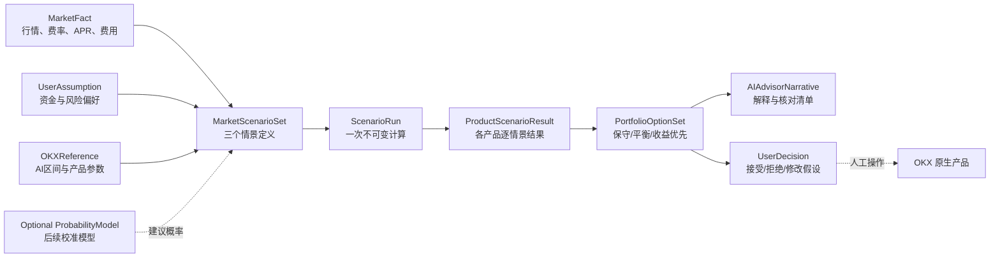

# 12. AI 情景分析、收益预测与组合建议设计

> 实现状态（2026-08-21）：本文的原型交付记录保留为历史设计基线；确定性情景引擎、无状态 API 和 `/scenario-lab.html` 后端接入已经完成。当前仍不接 LLM、不预测 BTC 涨跌、不交易，详见 [13](./13-Scenario-Engine-Backend-Design.md) 与 [14](./14-Scenario-Evaluation-API.md)。

## 1. 产品结论

本功能的准确定位不是“AI 猜 BTC 涨跌”，而是：

> 基于用户、OKX 或量化规则给出的多个 BTC 市场情景，计算各个 OKX 产品和资产组合的净收益、风险与目标达成情况，给出 2–3 种可解释的资金配置方案，辅助用户人工决策。

核心原则：

1. **赚钱第一**：以长期净收益为主要目标，显式评估能否达到 10%–20% 年化；
2. **不伪造确定性**：10%–20% 是目标，不是承诺；达不到时必须说明差距；
3. **先算情景，再谈预测**：第一版不依赖 LLM 或复杂模型预测 BTC；
4. **收益与风险同时展示**：不能只给最高收益方案而隐藏下跌损失、回撤和流动性；
5. **AI 只做顾问**：数字由确定性计算器和经验证的量化模型产生，AI 负责研究、解释、质疑和生成核对清单；
6. **人工执行**：所有申购、创建、停止和调仓仍由用户在 OKX 完成。

架构决策：`PROCEED_WITH_GUARDS`。

## 2. 需要澄清的两个数学事实

### 2.1 “最低风险、最高收益”不存在唯一答案

收益和风险是冲突目标。没有用户对回撤、流动性和 BTC 敞口的偏好，就不存在唯一的数学最优组合。

系统因此不输出一个“标准答案”，而输出帕累托前沿上的三个代表方案：

| 方案 | 目标 | 适合回答的问题 |
|---|---|---|
| 保守收益 | 优先守住本金和流动性 | 最坏情况下大约会怎样？ |
| 平衡目标 | 在可接受回撤内提高目标达成率 | 哪个方案最接近 10%–20% 且风险可控？ |
| 收益优先 | 接受更大 BTC 路径风险换取上行 | 若市场有利，收益上限能到哪里？ |

### 2.2 只有“期末 BTC 价格”不足以计算网格收益

假设 90 天后 BTC 都是 70,000 USDT，下面两条路径的网格收益可能完全不同：

```text
路径 A：60,000 → 70,000（单边上涨，网格成交较少）
路径 B：60,000 ⇄ 68,000 ⇄ 55,000 ⇄ 70,000（多次震荡，网格成交较多）
```

因此每个 BTC 价格情景还必须包含：

- 期末价格或价格区间；
- 期间波动率；
- 路径类型或多条模拟路径；
- 是否跌破网格下限、突破网格上限；
- 对应资金费率与 USDT 收益率假设。

系统可以让用户只填写期末价格，但必须用历史重采样或规则路径补齐波动与过程，并明确标注这是模型假设。

### 2.3 对原设计的三类行情覆盖审查

原设计已经提出下行、基准和上行情景，但还没有把三类行情转换为足够精确的可计算路径。缺失项如下：

| 缺失内容 | 单边上涨时的影响 | 单边下跌时的影响 | 震荡时的影响 |
|---|---|---|---|
| 趋势强度与单调性 | 网格逐步卖出 BTC，可能明显踏空 | 网格持续买入 BTC，库存风险快速上升 | 决定是真震荡还是带趋势震荡 |
| 区间外停留时间 | 突破上限后停止成交，资金闲置 | 跌破下限后停止成交并持有较多 BTC | 短暂穿网与长期失效不能等同 |
| 有效往返次数 | 单边行情可能几乎没有完整网格循环 | 下跌中的小反弹可能制造“网格利润为正”假象 | 是网格真正赚钱的主要路径事实 |
| 初始价格在区间的位置 | 靠近上限启动会较快穿网 | 靠近下限启动会迅速积累 BTC | 影响首批买卖单分布和初始 BTC 比例 |
| 期末处置方式 | 卖回 USDT 会放弃继续持有 BTC | 卖回 USDT 会实现库存亏损 | 继续持有与退出回 USDT 收益不同 |
| 跳空、滑点和止损成交 | 突破止盈价不等于按该价成交 | 急跌时止损可能明显低于触发价成交 | 高频成交会放大费用误差 |
| BTC 现货持有候选 | 缺少它会让系统无法表达上涨敞口 | 可作为明确的方向风险对照 | 用于判断网格是否真的增加收益 |
| 行情切换 | 上涨后转震荡可能适合延后建网格 | 下跌后转震荡可能是机会，也可能继续下破 | 震荡转单边是网格主要失效方式 |

因此，情景定义不能只有 `BEAR / BASE / BULL`。它还必须携带路径形态、波动率、区间内停留率、穿网时长、往返次数、最大不利变动和退出口径。

## 3. 系统要回答的问题

当前 Backtest 回答：

```text
如果过去的行情重新发生，这个产品或组合会赚多少？
```

新情景分析回答：

```text
如果未来 BTC 分别处于下跌、震荡、上涨情景：
1. 每个 OKX 产品的净收益是多少？
2. 20 万 USDT 的不同组合会赚多少、最多可能亏多少？
3. 哪些组合能达到 10% 或 20% 年化目标？
4. 为了获得更多收益，需要额外承担什么风险？
5. 用户应该在 OKX 人工购买哪些产品、投入多少钱？
```

能力边界：

| 能力 | 输入 | 输出 | 当前定位 |
|---|---|---|---|
| Backtest | 已发生历史路径 | 历史净收益 | 已有证据 |
| Shadow | 冻结参数后的新路径 | 样本外结果 | 准入证据 |
| Scenario Analysis | 用户/规则定义的未来情景 | 条件化收益与组合 | 第一版核心 |
| Probability Forecast | 多年数据和校准模型 | 情景概率 | 后续增强 |
| AI Advisor | 结构化结果和来源 | 中文解释与核对清单 | 顾问投影 |
| Live | 真实余额、持仓、成交和费用 | 账户事实 | 非预测 |

## 4. 投资范围

第一版保持当前范围：

- 资产：USDT、BTC；
- 产品/资产袖套：90 天定期简单赚币、活期/流动 USDT、BTC 智能套利、BTC 固定现货网格、BTC 现货持有；
- 资金：默认 200,000 USDT，可调整；
- 执行：OKX 原生产品，用户手工创建或申购；
- 禁止：ETH、SOL、杠杆方向仓位、自动下单、自动调仓。

产品收益必须按相同的资金周期、费用口径、退出方式和情景路径进行比较。

BTC 现货持有不是稳定收益产品，也不产生“利息”。它作为方向风险资产袖套和基准存在：单边上涨时保留上涨收益，单边下跌时完整暴露价格损失。若不纳入候选，收益优先组合在上涨情景中会被错误限制；若只把它当基准而不允许配置，也必须在页面明确说明这一限制。

## 5. BTC 情景定义

### 5.1 三类默认情景

系统默认生成三个可编辑情景，不把示例涨跌幅写死：

| 情景 | 含义 | 期末价格来源 | 路径要求 |
|---|---|---|---|
| 下行情景 | BTC 明显走弱 | 用户输入、支撑位或历史分位 | 包含下破和低位震荡路径 |
| 基准情景 | BTC 震荡或温和变化 | 当前价格附近、核心区间 | 包含多条震荡路径 |
| 上行情景 | BTC 明显走强 | 用户输入、阻力位或历史分位 | 包含突破和高位震荡路径 |

每类情景至少包含两种严重程度（温和、压力），并共享同一套冻结后的产品参数。不能针对每个情景分别挑选事后最优网格区间和网格数，否则会引入后视偏差。

每个情景可以有概率，也可以没有：

- 用户未提供概率时，系统只做三个条件情景比较，不显示虚假的“预期收益”或“达标概率”；
- 用户提供且概率合计 100% 时，可以计算概率加权收益；
- 后续量化模型校准通过后，可以建议概率，但必须显示模型版本和置信等级；
- AI 文本不能直接写入概率字段。

### 5.2 情景来源

情景可以来自：

1. 用户主动假设，例如“90 天后 BTC 为 50,000 / 65,000 / 80,000”；
2. OKX AI 网格给出的价格上下限与技术解释；
3. 规则引擎基于当前价、ATR、历史波动率、BOLL、均线、支撑阻力生成；
4. 后续经过走步验证和 Shadow 校准的概率模型。

来源必须进入结构化字段：`USER`、`OKX_REFERENCE`、`RULE_ENGINE` 或 `CALIBRATED_MODEL`，并记录 `asOf`、引用说明和数据版本。

OKX 官方资料可作为参数来源证据，但不能当作未来收益保证：

- [快速了解现货网格策略](https://www.okx.com/zh-hans/help/how-do-i-automate-grid-trading-strategies-on-spot-grid-crypto-trading-bot)：OKX 说明 AI 策略使用系统推荐参数，推荐逻辑基于近期历史回测；同时明确现货网格适合震荡或震荡上涨行情，下跌会带来亏损风险；
- [如何进行现货网格交易](https://www.okx.com/zh-hans/help/how-do-i-manually-set-up-spot-grid-trading-bots-eea)：OKX 说明复制 AI 参数来自历史行情回测，并提示网格越密可能增加成交与手续费；
- [永续合约资金费常见问题](https://www.okx.com/zh-hans-ar/help/funding-fees-for-perpetual-contracts-faq)：OKX 说明正资金费率时多头向空头支付、负资金费率时空头向多头支付，因此智能套利收益不能假设资金费永久为正。

### 5.3 三种路径原型及产品含义

| 路径原型 | 必须生成的路径 | 网格主要风险 | 组合含义 |
|---|---|---|---|
| 单边上涨 | 缓涨、急涨、上涨后高位震荡 | 逐格卖出导致 BTC 越来越少；突破上限后停止成交；跑输 BTC 持有 | 保留一定 BTC 现货袖套，比较“网格增益”与“踏空代价” |
| 单边下跌 | 缓跌、急跌、下跌后低位震荡 | 持续买入导致 BTC 库存上升；跌破下限后停摆；止损滑点放大 | 限制 BTC 总敞口，比较止损与继续持有的损失 |
| 区间震荡 | 低波动、有效波动、先上后下、先下后上 | 振幅太小无法覆盖费用；振幅过大可能穿网；路径顺序改变库存 | 比较网格循环收入是否稳定跑赢简单赚币 |

情景路径至少输出以下事实：

```text
terminalPrice
realizedVolatility
trendEfficiency = abs(期末价 - 期初价) / 路径总变动
inRangeTimeRatio
timeAboveUpper / timeBelowLower
completedGridCycles
maximumAdverseExcursion
maximumFavorableExcursion
endingBtcQuantity / endingBtcValueRatio
exitReason / executableExitPrice
```

`trendEfficiency` 接近 1 代表接近单边走势，接近 0 代表大量往返；它和实际波动率共同决定“有波动”是否真的能形成网格循环。

### 5.4 行情切换与路径生成纪律

真实市场不会保持单一标签 90 天。除三类主路径外，必须加入以下切换压力路径：

- 震荡后向下破位；
- 震荡后向上突破；
- 急涨后高位震荡；
- 急跌后低位震荡或反弹。

路径生成不能为了让网格多成交而人工画出规则锯齿。第一版使用历史分钟/小时收益块重采样，并约束期末价、实际波动率和趋势效率；同一情景至少生成多条不同顺序路径。历史数据不足时只能标记 `ASSUMPTION_ONLY`，不能显示概率。

是否立即入场也必须成为独立比较项：`立即建仓`、`价格进入候选区间后建仓`、`等待路径确认`。等待不是零成本，它可能损失定期利息或错过上涨；立即进入则可能在区间边缘建立不利库存。

## 6. 各产品如何在情景中计算

### 6.1 90 天定期简单赚币

- 用户确认 APR、期限、额度和是否可申购后，使用确定性持有期计算；
- 作为低风险收益基准；
- 未锁定的当前报价只能标记为“可用报价”，不能当作未来必然获得的收益；
- 每日收入用于理解，不把日收益简单复利成虚高年化。

### 6.2 活期 / 流动 USDT

- 第一版只读取或人工录入当前 APR，计算每日和持有期估算；
- 主要价值是流动性和等待机会，不扩展复杂产品模型；
- APR 在期间变化时可设置保守、基准、乐观三个利率假设。

### 6.3 BTC 智能套利

- 使用历史已实现资金费率生成保守、基准、乐观累计费率；
- 扣除开仓、退出、滑点、再平衡和服务/融资成本；
- 显示现货名义、永续对冲名义、保证金和净方向敞口；
- 计算相对 90 天定期的增量收益；
- 若在所有合理情景下都不优于定期，组合优化器自然给出 0%，但仍可在候选研究区说明原因。

智能套利虽接近价格中性，也不能在三类行情中使用同一个资金费假设：上涨拥挤时资金费可能增加，去杠杆或下跌阶段可能转负；急涨急跌还会改变基差、保证金缓冲、再平衡和退出滑点。价格路径与资金费路径必须作为相关情景共同输入，不能把历史平均资金费独立拼接到所有 BTC 路径。

### 6.4 BTC 固定现货网格

- 在每个 BTC 情景的多条价格路径上运行现有确定性网格撮合器；
- 计算初始买入 BTC、剩余 USDT、网格利润、BTC 库存盈亏、费用、退出结果和最大回撤；
- 输出收益区间而不是只显示单一路径年化；
- 将“网格利润”和“策略总净收益”严格分开；
- 将“网格 BTC 库存盈亏”和“独立 BTC 现货持有盈亏”作为两个不同贡献字段，禁止使用同一标签合并；
- 不能因为网格成交利润为正就忽略 BTC 库存下跌。

必须额外计算两个机会成本：

- 上涨行情中的 `gridNetIncome - buyAndHoldNetIncome`，用于识别逐格卖出造成的踏空；
- 下跌行情中的 `gridNetIncome - fixedEarnIncome`，用于识别承担 BTC 风险后是否仍不如无方向基准。

### 6.5 BTC 现货持有

- 按初始现货买入、VIP2 费用、期末退出或继续持有口径计算；
- 不把价格上涨称为利息或网格收入；
- 显示 BTC 数量、买入成本、期末市值、最大回撤和退出成本；
- 在单边上涨情景中是收益机会基准，在单边下跌情景中是方向风险压力基准；
- 第一版仍由用户在 OKX 手工买入，不生成自动交易指令。

## 7. 组合生成方法

### 7.1 目标函数

“赚钱第一”落实为：在风险边界内最大化长期净收益，而不是先最小化波动再看收益。

```text
Maximize:
    情景加权净收益（有可信概率时）
  或 多情景中位净收益（无可信概率时）
  - 下行损失惩罚
  - 调仓与退出成本
  - 流动性不足惩罚

Subject to:
  所有比例合计 = 100%
  流动 USDT >= 用户最低要求
  BTC 净方向敞口 <= 用户上限
  单产品比例 <= 产品上限
  未通过数据/回测/Shadow 门槛的产品不得进入真实建议
  网格 BTC 库存 + BTC 现货持有的合计方向敞口 <= 用户上限
```

### 7.2 10%–20% 目标如何使用

目标不能作为强行配高风险产品的硬约束，而应成为组合排序的重要指标：

- 90 天净收益折算简单年化；
- 显示每个方案在各情景下是否达到 10% 和 20%；
- 有可信情景概率时，显示达到 10% / 20% 的概率；
- 无可信概率时，显示“三个情景中有几个达标”；
- 若所有可行组合都低于 10%，选择净收益最高且满足风险限制的方案，并显示目标缺口；
- 若达到目标必须接受超出用户上限的回撤或 BTC 敞口，明确显示“目标与风险约束冲突”。

### 7.3 三个方案的选择

按 5% 步长枚举候选比例，过滤无效组合，再从帕累托前沿选择：

| 方案 | 排序重点 | 必须展示 |
|---|---|---|
| 保守收益 | 最低下行情景损失，其次净收益 | 最坏收益、流动资金、目标差距 |
| 平衡目标 | 风险约束内的目标达成率和中位收益 | 各情景收益、回撤、10%/20%覆盖 |
| 收益优先 | 上行净收益和加权净收益 | 下行情景损失、BTC敞口、切换成本 |

这三个方案都必须在**同一组市场路径**上评估。不能把各产品独立计算的 P10/P50/P90 直接相加。

组合优化还必须区分两个结果：

1. **跨情景稳健组合**：同一组比例在全部行情中评估，是默认可执行候选；
2. **单情景事后最优组合**：展示如果某种行情确定发生会怎样配置，只用于敏感性分析，不能冒充当前建议。

在缺乏可信概率时，平衡方案优先最大化最差情景净收益与中位情景净收益的组合目标；不能通过主观概率把单边上涨情景权重调高来强行命中 10%–20%。

### 7.4 预警与人工复核

预警的目标是要求重新评估，不是自动止损。至少包含：

- BTC 跌破网格下限并持续超过设定时间；
- BTC 突破网格上限后网格停止成交，且相对持币踏空扩大；
- 组合净收益低于同期 90 天定期基准；
- 网格利润为正但总净收益为负；
- BTC 总方向敞口、最大回撤或期末库存超过用户上限；
- 震荡路径的区间内停留率、有效循环数显著低于冻结假设；
- 资金费率转负或智能套利保证金缓冲不足。

预警输出只能是 `保持 / 复核 / 考虑减仓 / 考虑退出` 及证据，不得直接触发 OKX 操作。单纯“当前网格收益低于定期”也不足以决定止损，因为立即退出可能实现更大的 BTC 库存亏损；系统必须同时比较继续持有、现在退出和等待回到区间三种条件结果。

## 8. AI 的职责

### 8.1 可以做

- 汇总 OKX 参数说明、历史特征和当前市场事实；
- 建议下行/基准/上行情景的价格区间，并列出来源；
- 解释为什么某个组合在某个情景下表现更好；
- 提供反方观点和最敏感假设；
- 把结构化组合转换成 OKX 中文页面的人工操作清单；
- 低频研究新 OKX 产品，进入候选池前仍需独立验证。

### 8.2 不可以做

- 直接生成不可追溯的收益数字；
- 修改计算器产生的收益、比例、回撤或费用；
- 用新闻语气决定 BTC 情景概率；
- 将一个情景写成确定会发生；
- 自动创建、停止、调仓或交易；
- 在数据过期或结果校验失败时继续给出建议。

LLM 产出的情景建议必须先转换成 typed artifact，并经过字段校验和用户复核，不能以自然语言正文驱动组合计算。

## 9. 权威对象与状态边界



### 9.1 Source of Truth

| 对象 | Owner | 内容 | 性质 |
|---|---|---|---|
| MarketFact | 数据层 | as-of 前可见行情、费率、APR、费用 | 追加修订 |
| MarketScenarioSet | 情景域 | 期限、价格、路径、概率、来源和版本 | 审核后冻结 |
| ScenarioRun | 执行域 | 输入快照、状态、时间和失败原因 | 终态不可复活 |
| ProductScenarioResult | 收益域 | 每产品、每情景净收益和风险拆解 | 不可变 |
| PortfolioConstraintSnapshot | 组合域 | 总资金、流动性、敞口、产品上限 | 不可变 |
| PortfolioOptionSet | 组合域 | 2–3 个方案、比例、金额、目标与风险 | 不可变 |
| AIAdvisorNarrative | AI 适配器 | 中文解释、反方意见、人工步骤 | 只读投影 |
| UserDecision | 人工决策 | 接受、拒绝、修改假设和理由 | 追加事件 |
| ScenarioOutcome | 评估域 | 情景到期后的真实路径与偏差 | 追加事实 |

页面、日报和 AI 只能消费统一 Read Model，不能各自重新计算收益或组合比例。

`ScenarioRun` 不复用现有 `analysis_run`。现有 `analysis_run` 只记录产生外部或持久化副作用的数据同步/回补执行；情景计算是只读计算。第一版若不保存历史，可作为无状态服务返回不可变结果；当日报、历史复核或 Scenario Shadow 明确要求持久审计时，再由独立 `scenario_run` 表保存冻结输入、计算版本与终态。无论是否持久化，页面都不能充当结果 owner。

### 9.2 生命周期

```text
MarketScenarioSet:
DRAFT -> REVIEWED -> FROZEN

ScenarioRun:
CREATED -> RUNNING -> SUCCEEDED | FAILED

PortfolioOptionSet:
GENERATED -> REVIEWABLE -> ACCEPTED | REJECTED | EXPIRED
```

`ACCEPTED` 只表示用户接受为人工计划，不代表已经在 OKX 执行。情景、数据或产品报价过期后，旧方案只能作为历史证据，不能继续显示为当前建议。

### 9.3 现有实现与新增页面的架构地图

| 模块 | 当前责任 | 是否权威状态 | 本次处理 |
|---|---|---|---|
| `FixedGridBacktester` / 收益服务 | 计算历史网格、简单赚币和智能套利结果 | 是，针对已有历史评估 | 保留，未来由情景运行复用计算能力 |
| `GridShadowStudy` | 冻结并记录样本外网格观察 | 是，针对 Shadow | 保留，不与未来情景混用 |
| `DecisionWorkbenchController` | 聚合 Backtest/Shadow/Live 只读投影 | 否 | 不修改，不增加伪情景接口 |
| `/index.html` | 当前收益实验台 | 否 | 完全保留 |
| `/scenario-lab.html` | 新情景决策页面 | 否 | 本批只交付交互原型 |
| `MarketScenarioSet` / `ScenarioRun` | 未来情景定义与执行 | 未来 SoT | 仅设计，不在本批实现 |
| `PortfolioOptionSet` | 未来 2–3 个组合的权威结果 | 未来 SoT | 仅设计，不在本批实现 |

主链路：

```text
用户/规则/OKX候选参数
  -> 冻结 MarketScenarioSet
  -> ScenarioRun 在共享路径上计算各产品
  -> ProductScenarioResult
  -> PortfolioOptionSet
  -> 统一 Read Model
  -> 新页面 / 日报 / AI解释
  -> 用户在 OKX 人工执行
```

## 10. 新页面设计

页面名称：**AI 情景决策与组合建议**。

现有 `/` 收益实验台保持不变，继续负责 Backtest / Shadow / Live。新功能使用独立页面 `/scenario-lab.html`；在后端 `MarketScenarioSet -> ScenarioRun -> PortfolioOptionSet` 闭环实现前，页面只能作为清楚标注的交互原型，不能调用现有回测接口拼出“预测结果”。

### 10.1 页面结构

```text
┌────────────────────────────────────────────────────────────────┐
│ AI 情景决策与组合建议                    UTC+8 · 只读 · 人工执行 │
│ 资金 200,000 USDT · 期限 90天 · 目标年化 10%–20%              │
├────────────────────────────────────────────────────────────────┤
│ 你的边界                                                       │
│ 最大可接受亏损/回撤 · 最低流动USDT · 最大BTC敞口 · 产品上限    │
├────────────────────────────────────────────────────────────────┤
│ BTC 情景（均可编辑）                                           │
│ 下行：期末价/区间 · 缓跌/急跌 · 区间外时长 · 概率? · 来源      │
│ 震荡：价格区间 · 波动率 · 往返次数 · 区间内时间 · 概率?        │
│ 上行：期末价/区间 · 缓涨/急涨 · 突破时长 · 概率? · 来源        │
│ [采用规则建议] [引用OKX参数] [冻结并计算]                      │
├────────────────────────────────────────────────────────────────┤
│ 三个组合方案（只显示比例 > 0% 的产品）                         │
│ 保守收益       平衡目标       收益优先                          │
│ 金额与比例     金额与比例     金额与比例                        │
│ BTC敞口        BTC敞口        BTC敞口                           │
├────────────────────────────────────────────────────────────────┤
│ 情景收益矩阵                                                   │
│              下行            基准            上行              │
│ 保守方案     净收益/APR      净收益/APR      净收益/APR         │
│ 平衡方案     净收益/APR      净收益/APR      净收益/APR         │
│ 收益方案     净收益/APR      净收益/APR      净收益/APR         │
├────────────────────────────────────────────────────────────────┤
│ 目标达成                                                       │
│ 10%：达标情景 2/3 · 20%：达标情景 1/3                         │
│ 若有可信概率：达到10%的概率 xx% · 达到20%的概率 xx%            │
├────────────────────────────────────────────────────────────────┤
│ 收益与风险拆解                                                 │
│ 产品贡献 · 费用 · BTC库存盈亏 · 踏空代价 · 最大回撤 · 切换成本 │
├────────────────────────────────────────────────────────────────┤
│ AI 顾问                                                        │
│ 为什么这样配 · 反方理由 · 最敏感假设 · OKX人工购买步骤         │
├────────────────────────────────────────────────────────────────┤
│ 证据                                                           │
│ 数据截止 · 情景来源 · 计算版本 · Backtest/Shadow状态 · 限制     │
└────────────────────────────────────────────────────────────────┘
```

### 10.2 页面交互纪律

- 默认 90 天，但允许 30/90/180 天；比较时统一期限；
- 用户可直接编辑 BTC 情景价格、概率和风险约束；
- 概率为空时不计算“期望收益率”，只显示条件结果；
- 方案卡只显示比例大于 0% 的产品；
- 候选研究区可以显示 0% 产品及未入选原因；
- 默认不填写情景概率，先进入条件情景比较；只有三项概率全部填写且合计 100% 时，才能展示概率加权指标；
- 所有收益必须同时显示 USDT、持有期收益率和简单年化；
- 10% 与 20% 的达标情景数必须由情景结果自动统计，不允许由页面硬编码；
- 预测、历史回测、Shadow 和真实账户事实使用不同标题和颜色；
- 每项数字都能展开查看计算口径和来源；
- 点击“生成方案”只计算，不触发 OKX 操作。
- 网格卡必须同时展示网格循环收入、BTC 库存盈亏、相对持币差额和相对定期差额；
- 情景卡必须展示路径形态，不得只展示一个期末价；
- 单边上涨、单边下跌和震荡都必须有温和与压力路径，不能只展示对网格有利的路径。

### 10.3 一项重要的产品选择

默认推荐“跨情景稳健组合”，而不是“下跌买 A、上涨买 B、每天跟着预测切换”。后者容易因预测误差、手续费、锁定期和频繁调仓损失收益。

用户仍可查看每个情景下的事后最优组合，作为敏感性分析，但页面必须标注它不是当前可执行建议。

### 10.4 原型交付边界

- 原型文件：`src/main/resources/static/scenario-lab.html`、`scenario-lab.css`、`scenario-lab.js`；
- 原型 URL：`http://localhost:8080/scenario-lab.html`；
- 原型数据：固定演示数据，页面显著标注“未连接计算引擎”；
- 原页面 URL：`http://localhost:8080/`，本次不修改；
- 原型交互：切换行情、切换组合、检查输入概率、联动查看产品贡献与 0% 产品未入选原因；产品贡献拆分网格循环、网格 BTC 库存和独立 BTC 现货；
- 原型路径：每类行情只展示一条代表路径；温和/压力路径切换及贡献口径展开留待计算引擎接入时实现；
- 原型禁止：调用 OKX、写数据库、复用 `/api/workbench/backtests/grid` 伪造未来结果。

## 11. API 草案

下列多资源接口只描述未来需要持久化情景、运行和用户决定时的完整形态，**不是第一批实现清单**：

```http
POST /api/scenario-sets
GET  /api/scenario-sets/{id}
POST /api/scenario-sets/{id}/freeze
POST /api/scenario-runs
GET  /api/scenario-runs/{id}
GET  /api/scenario-runs/{id}/product-results
GET  /api/scenario-runs/{id}/portfolio-options
POST /api/portfolio-options/{id}/decisions
GET  /api/scenario-suggestions?asOf=...&horizon=P90D
```

组合接口只接受已冻结的情景 ID、约束快照 ID 和产品证据版本。自然语言不能作为计算输入或生命周期状态。

第一批采用更小的无状态纵向切片：只实现 `POST /api/scenario-evaluations`，一次提交已校验的三情景、产品证据和组合约束，直接返回统一 `ScenarioDecisionReadModel`。在没有历史审计、Scenario Shadow 或用户决定事件的明确需求前，不创建 `scenario_run` 表或资源生命周期。详细契约见 [13-Scenario-Engine-Backend-Design.md](./13-Scenario-Engine-Backend-Design.md)。

## 12. 实现优先级与可行性

### 12.1 第一阶段：情景决策引擎

当前数据即可开始，不必等待多年历史：

1. 用户编辑三个 BTC 情景；
2. 规则引擎补齐波动和路径；
3. 复用现有产品收益计算器；
4. 生成帕累托前沿和三个组合；
5. 新页面展示情景矩阵、目标达成和风险拆解；
6. AI 解释结果，但不参与数字计算。

可行性：高。它是确定性的 What-if 分析，直接服务投资决策，也最符合短期成本与长期价值平衡。

### 12.2 第二阶段：历史校验与 Scenario Shadow

- 用历史窗口重放情景生成规则；
- 冻结情景后观察未来真实路径；
- 评估情景覆盖、组合后悔值和建议稳定性；
- 未通过 Shadow 的产品仍可参与研究，但不能进入真实建议。

可行性：高，是把“看起来合理”变成“有样本外证据”的必要步骤。

### 12.3 第三阶段：概率预测增强

只有取得足够多年数据后再做：

- 市场状态概率；
- BTC 收益与波动率分位；
- 资金费率累计分布；
- 情景概率校准；
- Forecast Shadow。

可行性：中。价值在于为情景加权，不是取代情景分析或保证方向判断。

### 12.4 暂不做

- LLM 直接预测 BTC 价格或收益；
- 深度学习、强化学习、多 Agent 投资委员会；
- 新闻自动触发调仓；
- 自动交易、自动申购、自动停止产品；
- 高频重算和频繁换仓。

## 13. 可行性评估

| 能力 | 可行性 | 判断 |
|---|---|---|
| 用户给定 BTC 价格的条件推演 | 高 | 第一版核心，确定性强 |
| 根据 OKX/规则建议三个价格情景 | 中高 | 可解释，但不是事实 |
| 网格多路径收益区间 | 中高 | 可复用现有撮合器，结果依赖路径假设 |
| 生成 2–3 个帕累托组合 | 高 | 约束清晰即可稳定计算 |
| 评估能否达到 10%–20% | 高 | 可计算条件达成，不可保证未来实现 |
| 预测情景发生概率 | 中 | 需要多年数据和持续校准 |
| 稳定实现 10%–20% 年化 | 无法保证 | 通常需要承担 BTC/网格风险，必须展示下行情景 |
| LLM 解释与质疑结果 | 高 | 有明显可读性价值，失败不影响数字 |
| LLM 直接给收益与比例 | 低且不安全 | 不采用 |

重要判断：简单赚币约 3.5%、智能套利近期情景约 5% 左右时，要争取 10%–20% 通常必须给现货网格或 BTC 敞口更高权重。这不等于不该追求目标，而是页面必须把额外收益与额外下行损失放在同一张表中。

## 14. 验证指标

情景决策引擎优先监控：

| 指标 | 含义 |
|---|---|
| Scenario Coverage | 真实结果是否落入预先定义的情景范围 |
| Target Attainment | 组合实际是否达到 10% / 20% 年化 |
| Downside Breach | 实际亏损是否超过预先展示的下行情景 |
| Portfolio Regret | 建议组合与事后最佳可行组合的差距 |
| Turnover / Switch Cost | 建议是否频繁制造成本 |
| Decision Stability | 轻微输入变化是否导致组合剧烈跳变 |
| Relative Fixed Earn | 是否真正跑赢简单赚币基准 |

概率模型上线后再增加 Brier Score、Pinball Loss 和预测区间覆盖率，不能用模型指标替代真实净收益。

## 15. 边界闭环评审

```text
Decision: PROCEED_WITH_GUARDS

Authoritative fact:
  冻结的 MarketScenarioSet、ProductScenarioResult、PortfolioOptionSet

Owner:
  情景域、收益计算域、组合域；AI 和 UI 均不是 owner

Unique consumers:
  统一 Portfolio Decision Read Model -> 页面 / 日报 / AI 解释

Enforced before:
  情景冻结、字段校验、金额守恒、风险约束和产品准入通过后，才生成方案

Failure route:
  数据过期、情景不完整、概率不守恒、计算失败或准入不足 -> 不生成当前建议

Cannot-bypass tests:
  同情景同结果、金额守恒、0%产品隐藏、无概率不显示达标概率、
  网格路径敏感性、失效方案不可接受、UI/API/日报同一read model
```

本设计目前达到 `MODELED`。只有情景计算与组合约束被核心服务强制消费，达到 `ENFORCED`；再经过历史重放或 Scenario Shadow 证明不可绕过后，才能称为 `PROVEN`。
