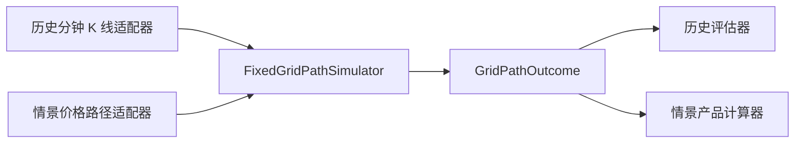
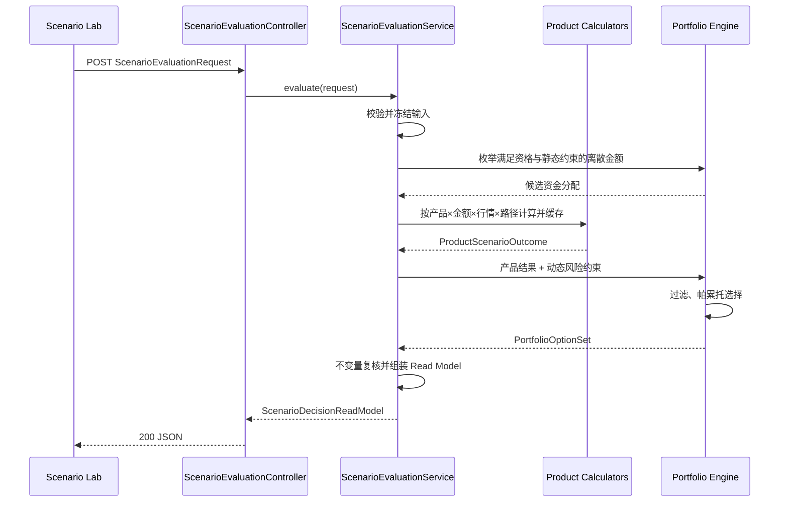

# 13. 情景决策引擎后端详细设计

> 本文把 [12-AI-Forecast-Design.md](./12-AI-Forecast-Design.md) 收敛成第一条可实现的后端纵向切片。目标不是预测 BTC 一定涨跌，而是在用户给定的下行、震荡和上行情景下，确定性计算不同产品与组合的收益和风险，辅助用户在 OKX 手工决策。

## 1. 结论

第一批只实现一个无状态用例：

```text
ScenarioEvaluationRequest
  -> 校验并冻结本次输入
  -> 枚举满足约束的资金分配
  -> 按实际分配金额在共享路径上计算产品
  -> 选择 2–3 个帕累托方案
  -> ScenarioDecisionReadModel
```

设计判断为 `PROCEED_WITH_GUARDS`：现有简单赚币、智能套利和固定网格计算能力可以复用或提取，但现有 `PhaseOnePortfolioRecommendationService` 只是按候选收益率线性放大，不是情景优化器；`DecisionWorkbenchController` 同时聚合回测、Shadow 和产品输入，也不应成为新引擎的核心。

第一批明确不做：

- 不保存 `ScenarioRun`，不新建数据库表；
- 不接 LLM，不预测情景概率；
- 不请求 OKX，不读取交易权限，不创建策略；
- 不修改现有 `/` 工作台、Shadow 或 Live 状态；
- 不做通用优化平台、蒙特卡洛、机器学习或自动调仓。

## 2. 第一条纵向切片回答什么

输入固定为：总资金、统一 90 天期限、BTC 起始价格、下行/震荡/上行三类行情及其代表/压力路径、用户风险边界与产品上限，以及每个产品的费用、收益假设、来源和证据等级。

第一批的资金语义固定为 `NEW_MONEY_USDT`：假设待规划资金当前全部是 USDT，产品计算包含从 USDT 建仓和在 90 天末统一退出回 USDT 的成本。它不能用于声称“应当调整现有实盘仓位”。未来支持真实再平衡时，必须另加当前持仓快照和只对仓位差额计算的 Switch Cost，不能复用新资金口径冒充调仓建议。

输出只回答：

1. 每个产品按实际分配金额在每条路径上净赚或净亏多少；
2. 哪些组合满足流动性、BTC 敞口、最大亏损和产品准入约束；
3. 保守、平衡、收益优先三类方案分别如何分配；
4. 每个方案在三类行情下能否达到 10% 或 20% 简单年化目标；
5. 哪些输入最影响结论，哪些产品因证据不足而未入选。

概率为空时只输出条件结果和“达标情景数”，不得输出期望收益或达标概率。

## 3. 现有模块如何处理

| 现有模块 | 当前语义 | 第一批处理 |
|---|---|---|
| `SimpleEarnIncomeService` | 90 天定期和活期的金额收益，同时包含 OKX 拉取与 85% 分成推导 | 只提取纯利息公式；现有服务、市场源和硬编码分成均不进入情景引擎 |
| `PhaseOneAssessmentService` | 用历史实际资金费率比较智能套利与定期 | 不直接调用；提取“资金费现金流 + 已知成本”纯计算规则 |
| `FixedGridBacktester` | 用连续分钟 K 线做双路径历史回测 | 保留历史入口；提取共享的固定网格路径模拟器供显式未来路径使用 |
| `FixedGridAssessmentService` | 90 天历史准入与双基准判断 | 不作为未来情景计算器；其 Shadow/准入结论只作为产品资格证据 |
| `PhaseOnePortfolioRecommendationService` | 按用户比例线性缩放历史候选收益 | 保留给现有工作台；新组合引擎不复用其推荐逻辑 |
| `GridShadowStudyService` | 冻结参数后的样本外观察 | 只提供网格资格证据，不写入或推进 Shadow |
| `DecisionWorkbenchController` | 现有 Backtest/Shadow/Live 聚合接口 | 不修改；新建独立的情景接口和页面适配器 |
| `/scenario-lab.html` | 已接入统一情景 API | 只构造输入和消费统一 Read Model，不在浏览器重新计算金额、年化、比例或资格；固定示例也调用真实后端 |

需要做的唯一结构性提取是把固定网格的状态机从“分钟 K 线读取方式”中分开：



两种入口必须使用同一买卖、手续费、库存和退出规则，不能复制一份近似的网格公式。

## 4. Source of Truth 与边界

第一批没有持久化生命周期，只有一次请求内的不可变对象。

| 边界 | 权威对象 | Owner | 说明 |
|---|---|---|---|
| 输入定义 | `ScenarioEvaluationRequest` | API 适配层 | 原始请求，只负责反序列化 |
| 已校验定义 | `FrozenScenarioEvaluation` | 情景应用层 | 所有金额、路径、概率、约束和证据已通过校验 |
| 产品结果 | `ProductScenarioOutcome` | 收益计算域 | 单产品、单情景的净收益与贡献拆解 |
| 组合结果 | `PortfolioScenarioOutcome` | 组合域 | 单组合在单情景下的金额守恒、收益和风险 |
| 方案集合 | `PortfolioOptionSet` | 组合域 | 帕累托候选与三个确定性标签 |
| 页面结果 | `ScenarioDecisionReadModel` | 应用层 | 页面、未来日报和未来 AI 解释的唯一消费模型 |

`ScenarioDecisionReadModel` 是计算结果的只读投影，不是 Live Portfolio，也不表示用户接受或已经在 OKX 执行。

第一批不创建 `ScenarioRun`，也不复用 `analysis_run`。纯计算没有外部或持久化副作用，不需要伪造 `CREATED/RUNNING/SUCCEEDED` 状态。只有未来明确需要保存历史建议、生成 Scenario Shadow 或审计用户决定时，才单独设计持久化的 definition / execution / decision 边界。

## 5. 核心领域对象

以下为设计契约，不要求类名逐字相同，但字段语义不能合并或省略。

### 5.1 冻结输入

```text
FrozenScenarioEvaluation
  evaluationId             请求内生成的 UUID，仅用于追踪响应
  asOf                     本次可用证据截止时点
  horizon                  P90D
  totalCapitalUsdt
  capitalContext           第一版固定 NEW_MONEY_USDT
  startingBtcPrice
  scenarios[3]
  constraints
  productAssumptions
  evidenceManifest
  calculationVersion
```

```text
MarketScenario
  code                     BEAR | RANGE | BULL
  label                    下行 | 震荡 | 上行
  probability?             三项全部为空，或全部存在且合计 1
  paths[]                  至少含 REPRESENTATIVE 与 STRESS
  sourceType               USER | RULE | OKX_REFERENCE
  sourceReference
```

每条 `path` 都必须包含起点和期限终点，且价格点按时间严格递增。路径而不是期末价决定网格成交；同一期末价的不同路径必须允许得到不同网格收益。三类行情的概率属于行情类别，不为同类内部的代表/压力路径伪造概率。

```text
PortfolioConstraintSnapshot
  minimumLiquidUsdtRatio
  maximumBtcDirectionalExposureRatio
  maximumBearLossRate
  maximumProductRatios[productCode]
  allocationStep           第一版固定 0.05
  targetAprLow             0.10
  targetAprHigh            0.20
```

### 5.2 产品假设与资格

API 提交的是产品证据原始字段；产品资格不能由调用方直接指定。应用层必须通过 `ProductQualificationPolicy` 得到权威资格：

```text
ProductEvidenceInput
  productCode
  observedAt
  sourceReference
  knownFields[]
  unknownFields[]
```

```text
QualifiedProductEvidence
  productCode
  status                   ELIGIBLE | RESEARCH_ONLY | INELIGIBLE
  observedAt
  sourceReference
  reasonCodes[]
```

- `ELIGIBLE`：可进入当前可执行组合候选；
- `RESEARCH_ONLY`：可以计算并展示，但只能进入研究方案，不能包装成当前建议；
- `INELIGIBLE`：关键收益或成本未知，不进入组合枚举，不得把未知按 0；
- 证据过期规则由产品类型显式配置，过期后必须降级，不由 UI 自行判断或通过请求字段绕过。

第一版产品假设：

| 产品 | 必要输入 |
|---|---|
| 90 天定期简单赚币 | 净 APR、可投入上限、报价时间、条款已确认 |
| 活期简单赚币 / 流动 USDT | 净 APR、报价时间、可赎回假设 |
| BTC 智能套利 | 对冲名义比例、三情景累计资金费率、开仓/退出/滑点/再平衡/服务成本 |
| BTC 固定现货网格 | 上下限、格数、现货费率、退出滑点、止盈止损、资格状态 |
| BTC 现货 | 买入/卖出费率、滑点、产品上限 |

### 5.3 产品情景结果

```text
ProductScenarioOutcome
  productCode
  scenarioCode
  pathCode
  allocatedCapitalUsdt     本候选组合的实际分配金额
  netIncomeUsdt
  holdingReturnRate
  simpleAnnualizedRate
  endingEquityUsdt
  btcDirectionalExposure
  maximumDrawdownRate?
  contributions[]
  evidenceStatus
  limitations[]
```

贡献代码必须保持分离：

- `FIXED_EARN_INTEREST`
- `FLEXIBLE_EARN_INTEREST`
- `SMART_ARBITRAGE_FUNDING`
- `SMART_ARBITRAGE_COST`
- `GRID_CYCLE_SPREAD`
- `GRID_INVENTORY_PNL`
- `GRID_TRADING_FEE`
- `BTC_SPOT_PNL`
- `ENTRY_EXIT_FEE`
- `SLIPPAGE`
- `OTHER_KNOWN_COST`

所有 contribution 都是带正负号、可相加的金额，合计必须严格等于 `netIncomeUsdt`。尤其禁止把 `GRID_INVENTORY_PNL` 合并进 `GRID_CYCLE_SPREAD`，也禁止把网格持有的 BTC 库存盈亏再重复算成 `BTC_SPOT_PNL`。`totalFees` 等说明字段只能是 contribution 的分组汇总，不能再参与第二次扣减。

## 6. 产品计算契约

所有产品使用同一 `asOf`、同一 90 天期限和同一条情景路径，并按候选组合的实际分配金额计算。不得先用 20,000 USDT 得到一个收益率，再无条件线性放大到 200,000 USDT；产品额度、固定费用、滑点和成交容量都可能非线性。

### 6.1 简单赚币

```text
income = allocatedCapital × netApr × actualDays / 365
```

定期与活期分别计算。活期 APR 是条件假设，不得描述为锁定收益。产品额度不足时，超出部分不能继续按同一 APR 线性放大。

情景引擎只复用纯公式，不注入或调用现有 `SimpleEarnIncomeService`。净 APR、是否已经扣除平台分成、分成比例及规则版本都来自本次请求证据；第一批不实时请求 OKX，也不把现有 `0.85` 常量当成永久规则。分配金额超过已确认产品额度时，该候选组合直接判为不可行，不能把超额部分静默按 0 收益或自动转入活期。

### 6.2 智能套利

```text
hedgedNotional = allocatedCapital × hedgedNotionalRatio
fundingIncome = hedgedNotional × scenarioCumulativeFundingRate
netIncome = fundingIncome - allKnownCosts(allocatedCapital)
```

三种情景必须分别给出累计资金费率假设，不能把历史 90 天总和直接当成未来事实。任一关键成本未知时，该产品为 `INELIGIBLE` 或只输出区间，不能输出精确净收益。

智能套利不承担计划内 BTC 方向收益；若对冲误差被纳入，必须作为单独贡献和风险限制，不能悄悄借 BTC 上涨抬高收益。

### 6.3 固定现货网格

情景路径进入共享 `FixedGridPathSimulator`，输出：

```text
netIncome
= gridCycleSpread
+ gridInventoryPnl
- gridTradingFee
- entryExitFee
- slippage
- otherKnownCost
```

这里是对共享模拟核心新增的**毛额归因口径**：模拟器需要输出毛额循环价差、毛额库存价格盈亏、网格成交费、建仓/退出费、退出滑价和其他已知成本。现有 `GridPathResult.completedGridProfit` 已扣除已完成循环的双边手续费，`inventoryPnl` 又是吸收其他费用与滑价的残差；历史入口必须通过兼容映射继续保持这两个既有净额字段的数值和含义，不能把它们直接映射为上述毛额 contribution。历史回测回归测试仍按既有 `GridPathResult` 字段断言；情景引擎只消费新毛额归因结果。

结果同时保留初始买入 BTC 数量、初始 BTC 占用 USDT、期末退出前 BTC 数量、费用、最大回撤、越界时长和退出原因。路径点间的移动次序由输入显式给出；系统不得从单一 OHLC 再猜一条有利路径。

### 6.4 BTC 现货

```text
btcQuantity = allocatedCapital / entryPrice
grossPricePnl = btcQuantity × (exitPrice - entryPrice)
netIncome = grossPricePnl - entryFee - exitFee - slippage
```

这部分代表独立 BTC 现货配置。网格内部初始化 BTC 已在网格产品权益里结算，二者不能交叉归因。

实现可以采用“费用进入可购数量”的真实现金算法，但输出 contribution 必须重排为可加总的毛价差、建仓费、退出费和滑价，并与最终现金净收益严格守恒。

## 7. 组合生成与选择

### 7.1 枚举而不是黑箱优化

第一版按 5% 步长枚举所有产品比例。五个产品合计 20 个步长，原始组合数约一万级，单机可直接计算，无需优化框架。产品计算按 `(product, allocatedAmount, scenario, path, calculationVersion)` 缓存；同一离散金额只计算一次，从而兼顾非线性费用与运行成本。

依次执行：

1. 只保留 `ELIGIBLE` 产品；研究视图可另行包含 `RESEARCH_ONLY`；
2. 比例和金额守恒；
3. 满足最低流动 USDT；
4. 满足单产品上限；
5. 按每个离散分配金额计算并缓存产品在所有共享路径上的结果；
6. 满足 BTC 最大方向敞口和下行情景最大亏损；
7. 删除被另一组合在收益、下行和流动性上同时支配的方案；
8. 从帕累托前沿按确定性规则选择最多三个方案。

### 7.2 三个标签不是三个分数

| 标签 | 确定性选择规则 |
|---|---|
| 保守 | 先最大化下行情景净收益，再最小化 BTC 敞口和产品切换量 |
| 平衡 | 在下行约束内最大化三情景中的最小净收益，再优先接近 10% 目标 |
| 收益优先 | 先最大化达到 10%/20% 的情景数，再最大化最小净收益；不得只看上行情景 |

若多个标签选择到同一组合，只返回一次并列出多个标签。没有满足约束的组合时返回明确失败，不放宽约束伪造答案。

若用户提供了三项且已验证的概率，可以额外显示概率加权收益；概率不参与第一版默认排序，以免让未经校准的数字主导配置。

### 7.3 组合聚合

```text
portfolioNetIncome(s, path) = Σ productNetIncome(p, allocatedAmount, s, path)
portfolioEndingEquity(s, path) = totalCapital + portfolioNetIncome(s, path)
```

组合 BTC 敞口的最终精确口径应按同一时点的各产品方向敞口相加。批次 B 的单品结果尚未提供完整的同步敞口序列，因此硬约束先使用“各产品路径内峰值方向金额之和 / 组合总资金”作为保守上界：它不得低估风险，但可能淘汰少量实际可行组合，Read Model 必须明确标注 `CONSERVATIVE_SUM_OF_PRODUCT_PEAKS`。未来补齐同步敞口序列后才能改称精确组合峰值。期末 BTC 敞口另作展示字段，不能替代峰值约束。每类行情展示代表/压力路径形成的收益区间，并以压力路径参与风险约束。最大回撤只有在所有入选产品都提供同一共享时间轴的权益序列时才能聚合；否则返回 `UNKNOWN` 并使用下行情景压力路径的最大亏损作为硬约束，不能用各产品最大回撤简单相加或伪造精确值。

## 8. 统一 Read Model

```text
ScenarioDecisionReadModel
  evaluation
    id, asOf, horizon, calculationVersion, generatedAt
  scenarios[]
    code, label, pathSummaries[], probability?, source
  constraints
  productOutcomes[]
  options[]
    labels[]
    allocations[]           只含比例 > 0 的产品
    scenarioOutcomes[]
    targetAttainment
    riskSummary
    contributionBreakdown[]
    evidenceWarnings[]
  excludedProducts[]
    productCode, status, reasonCodes
  limitations[]
```

页面、未来日报和未来 AI 顾问必须消费这一个模型。浏览器不得重算金额、年化、目标达成数或组合比例。研究区可以展示 0% / 未入选产品及原因；最终方案卡不展示 0% 产品。

## 9. API

第一批只需要一个接口：

```http
POST /api/scenario-evaluations
Content-Type: application/json
```

请求体对应 `ScenarioEvaluationRequest`，成功直接返回 `ScenarioDecisionReadModel`。它是同步、只读、幂等计算；相同规范化输入与相同计算版本必须得到相同业务结果，只有 `evaluationId/generatedAt` 可以不同。

错误契约：

| HTTP | code | 含义 |
|---|---|---|
| 400 | `INVALID_SCENARIO_REQUEST` | 字段、时间、路径、金额或概率不合法 |
| 422 | `INSUFFICIENT_PRODUCT_EVIDENCE` | 可用产品证据不足，无法形成比较 |
| 422 | `NO_FEASIBLE_PORTFOLIO` | 约束下不存在可行组合 |
| 500 | `SCENARIO_CALCULATION_FAILED` | 不变量被破坏；不返回部分建议 |

控制器只做 JSON 转换和错误映射。业务校验、产品资格、组合约束和金额守恒必须由应用/领域层强制执行。

原设计中的情景集、运行、方案决定等多资源 API 延后；在没有持久化审计、Shadow 或用户决定事件需求前，不引入资源生命周期。

## 10. 模块分解

```text
app.cryptoincome.scenario
  domain/
    MarketScenario
    FrozenScenarioEvaluation
    ProductScenarioOutcome
    PortfolioScenarioOutcome
    PortfolioOptionSet
    ScenarioDecisionReadModel
    ScenarioEvaluationFailure
  application/
    ScenarioEvaluationService
    ProductScenarioCalculator
    ProductQualificationPolicy
    PortfolioCandidateGenerator
    ParetoPortfolioSelector
  adapter/
    SimpleEarnScenarioCalculator
    SmartArbitrageScenarioCalculator
    FixedGridScenarioCalculator
    BtcSpotScenarioCalculator

app.cryptoincome.web
  ScenarioEvaluationController
```

产品计算器通过统一接口返回结构化结果，不得直接返回用于 UI 的中文段落。未来 AI 适配器只能读取 `ScenarioDecisionReadModel` 并生成解释，不能回写结果。

## 11. 执行顺序



任一步失败都不返回“部分推荐”。允许在成功结果中列出被排除的产品，但每个入选方案必须完整可解释。

## 12. 不变量与失败路由

| 不变量 | 声明与 Owner | 强制时点 | 失败结果 |
|---|---|---|---|
| 三类行情的所有路径共享起点、期限与时间轴 | `FrozenScenarioEvaluation` / 情景域 | 产品计算前 | 400 |
| 概率全空或完整且合计 1 | 情景域 | 冻结前 | 400 |
| 产品资格由后端证据规则生成 | `ProductQualificationPolicy` / 收益域 | 组合枚举前 | 排除产品或 422 |
| 产品未知成本不按 0 | 产品资格规则 / 收益域 | 组合枚举前 | 排除产品或 422 |
| 网格循环、网格库存、独立现货分列 | `ProductScenarioOutcome` / 收益域 | 结果创建时 | 500 |
| 单组合分配比例与金额守恒 | 组合域 | 计算每个候选前后 | 候选丢弃；核心异常则 500 |
| 产品贡献合计等于产品净收益 | 收益域 | 产品结果创建时 | 500 |
| 组合分项合计等于组合净收益 | 组合域 | Read Model 创建前 | 500 |
| 0% 产品不进入最终方案卡 | Read Model 构造器 | 返回控制器前 | 500 |
| 无可行组合不放宽约束 | 组合域 | 选择结束 | 422 |
| 页面不拥有公式 | Controller/UI | 输出后 | 浏览器契约测试阻止发布 |

## 13. 测试设计

### 13.1 领域与应用测试

1. 相同规范化输入与版本得到相同产品结果和组合顺序；
2. 任一路径的起点或期限不一致时，在调用任何产品计算器前拒绝；
3. 概率部分填写或合计不为 1 时拒绝；全部为空时结果不含期望收益和达标概率；
4. 定期、活期、智能套利、网格、BTC 现货分别通过独立手算样例；
5. 同一终点价、不同路径的网格结果允许不同；BTC 现货结果必须相同；
6. 网格全部带符号 contribution 的合计与网格净收益一致，费用不会重复扣减；
7. 网格库存盈亏不重复进入 `BTC_SPOT_PNL`；
8. 每个产品贡献合计、每个组合金额合计和组合收益合计严格守恒；
9. 过期、未知退出成本或未确认条款使对应产品降级/排除，调用方不能直接声明 `ELIGIBLE` 绕过；
10. 5% 步长枚举不产生超产品上限、低于流动性或高于 BTC 敞口的方案，并按实际金额计算非线性成本；
11. 所有方案被约束淘汰时返回 `NO_FEASIBLE_PORTFOLIO`；
12. 同一方案承载多个标签时去重；最终 allocations 不含 0%；
13. 不提供统一权益时间轴时，组合最大回撤为 UNKNOWN，不做错误相加；
14. 服务执行期间不调用 OKX、不写数据库、不更新 Backtest/Shadow/Live；
15. 第一批拒绝非 `NEW_MONEY_USDT` 的资金语义，不输出实盘再平衡建议。

### 13.2 API 与页面契约测试

1. 合法请求返回一个完整 `ScenarioDecisionReadModel`；
2. 400/422 使用稳定的错误码，不暴露堆栈和内部类名；
3. 页面金额、年化、达标数和方案比例全部来自响应；
4. API、页面和未来日报对同一 Read Model 展示一致；
5. 演示模式与后端模式有明显标识，后端不可用时不得继续显示旧演示结果为当前结论。

### 13.3 不能绕过的纵向测试

一条 Spring Boot slice test 提交包含三类行情（每类代表/压力路径）、五产品和风险约束的完整请求，断言：只返回满足约束的 2–3 个方案；每个方案只显示非零产品；所有路径的金额和贡献守恒；网格循环、网格库存和独立 BTC 现货分列；10%/20% 达标数由结果自动推导；没有数据库写入、OKX 请求或 Live/Shadow 状态变化。

这条测试通过后，第一批边界才能达到 `PROVEN`；只有类和单元测试存在时最多是 `VALIDATED`。

## 14. 分批实现计划

### 批次 A：计算核心

- 建立冻结输入、产品结果、组合结果和失败类型；
- 提取共享固定网格路径模拟器，并保证历史回测回归不变；
- 实现四类产品计算器，其中简单赚币含定期/活期两个产品；
- 完成手算、路径敏感性和归因守恒测试。

通过条件：现有网格测试全部不变，新产品结果在三情景下可重复计算。

### 批次 B：组合与 API

- 实现 5% 枚举、资格过滤、约束和帕累托选择；
- 实现 `ScenarioEvaluationService` 与一个 POST 接口；
- 完成失败契约、金额守恒和无副作用纵向测试。

通过条件：一个请求可得到结构完整、可手算复核的 2–3 个方案。

### 批次 C：接入新页面

- 用后端 Read Model 替换 `/scenario-lab.html` 的固定演示数据；
- 保留演示模式，但显式标识且不能冒充当前计算；
- 展示三情景矩阵、贡献、目标达成、证据和排除原因；
- 不修改现有 `/` 工作台。

通过条件：浏览器端不再拥有收益或组合公式，API 与页面数值逐项一致。

### 批次 D：样本外验证，暂缓

只有 A–C 证明有决策价值后，再设计 Scenario Shadow、历史建议保存和真实结果复核。它是新的持久化边界，不在第一批顺手加入。

## 15. 边界闭环清单

| Invariant | Declared by | Proven by | Consumed by | Enforced before | Failure route | Cannot-bypass test |
|---|---|---|---|---|---|---|
| 冻结输入是唯一计算定义 | `FrozenScenarioEvaluation` | 请求规范化测试 | 所有产品计算器 | 产品计算 | 400 | 有 |
| 产品资格不能由 API 自报 | `ProductQualificationPolicy` | 过期/未知证据测试 | 组合引擎 | 枚举 | 排除或 422 | 有 |
| 产品结果是组合唯一收益来源 | `ProductScenarioOutcome` | 贡献守恒测试 | 组合引擎 | 枚举 | 500 | 有 |
| 约束不能被展示层绕过 | `PortfolioConstraintSnapshot` | 无可行组合测试 | 帕累托选择器 | 生成方案 | 422 | 有 |
| 统一 Read Model 是唯一投影来源 | `ScenarioDecisionReadModel` | API/UI 契约测试 | 页面/未来日报/AI | 输出 | 阻止发布 | 有 |
| 情景计算不改变外部状态 | 应用服务端口边界 | Spring slice test | — | 服务返回 | 500 | 有 |

设计完成时成熟度为 `MODELED`。批次 A、B 的核心校验与纵向测试完成后可声明 `PROVEN`；页面接入后，统一投影边界才达到 `PROVEN`。
