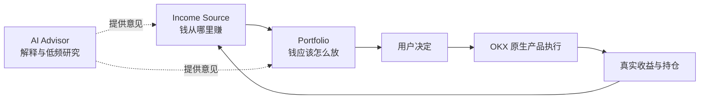
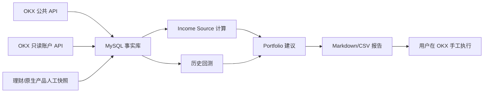

# AI Crypto Income Assistant

> 一个帮助个人长期管理数字资产收益的小工具。

## 目标

管理约 **200,000 USDT**，通过 OKX 已有产品（智能套利、简单赚币、现货网格等），在可接受风险下争取 **10%–20% 长期年化净收益**。

这是目标，不是承诺。市场没有好机会时，持有现金也是正确答案。

## 三条原则

### 赚钱第一

项目只看真实净收益：赚了多少，付了多少费用，承担了什么风险。功能数量、代码规模、AI 调用次数都不是成果。

### 工程第二

如果一个功能不能提高收益、减少损失或节省明显的人工时间，就不开发。优先使用 OKX 原生产品，不自建交易、对冲、网格或订单系统。

### AI 第三

AI 是顾问，不是决策引擎，更不是交易员。它负责解释现有结论和低频研究新产品；规则与真实数据负责计算，用户负责决定和执行。

## 三个核心对象



- [Income Source](./01-Income-Source.md)：定义真正的收益来源。
- [Portfolio](./02-Portfolio.md)：围绕长期净收益做保持、增加、减少。
- [AI Advisor](./03-AI-Advisor.md)：解释为什么，并低频研究新产品。

## 产品与实现设计

- [产品设计基线](./05-Product-Baseline.md)：固定 20 万 USDT、稳定币/BTC、OKX 原生执行和收益优先边界；
- [功能架构与现状评估](./06-Functional-Architecture.md)：目标功能、权威事实、当前实现的保留/冻结/废弃决定；
- [收益、风险与组合计算口径](./07-Calculation-Method.md)：分别定义利息、资金费率、基差、网格和 Portfolio 的确定性计算。
- [第一期设计：简单赚币、BTC 智能套利与现货网格](./08-Phase-1-Design.md)：固定 90 天比较边界、账户费用快照、资金费情景、固定网格双路径回测、建议状态与实现切片。
- [第一期测试手册](./09-Phase-1-Test-Runbook.md)：第一期收益评估的完整测试、独立验算、只读边界和进入小额验证的验收标准。
- [固定现货网格测试手册](./10-Fixed-Grid-Test-Runbook.md)：抓取当日 OKX 参数、回补 90 天分钟 K 线、运行双路径/双基准评估和 Shadow。
- [回测、Shadow、实盘收益实验台](./11-Decision-Workbench.md)：可运行的本地回测 UI、Controller、结构化日报，以及 Shadow/Live 的状态边界和下一批设计。
- [AI 情景分析、收益预测与组合建议设计](./12-AI-Forecast-Design.md)：按 BTC 下行/基准/上行情景计算产品净收益，生成保守/平衡/收益优先组合并评估 10%–20% 目标。
- [情景决策引擎后端详细设计](./13-Scenario-Engine-Backend-Design.md)：把情景设计收敛为一个无状态接口、确定性产品计算、5% 组合枚举、统一 Read Model 和不能绕过的纵向测试；计算核心与 API 已实现，暂不持久化、不接 AI、不交易。
- [情景组合评估 API 使用说明](./14-Scenario-Evaluation-API.md)：接口输入、产品资格字段、组合约束、返回模型、限制和稳定错误码。

独立情景决策 UI：启动程序后访问 `/scenario-lab.html`。自定义分析和固定示例都调用 `/api/scenario-evaluations`；页面只展示统一 Read Model，不在浏览器计算收益、年化、比例或资格。原 `/` 收益实验台保持不变。

`04-Profitability-UI.md` 及其 HTML 是早期信息架构原型，不是当前产品或计算的权威定义；其中硬编码金额、ETH 示例和演示配置需要在真正接入统一 Read Model 前重做。

## Quick Start

### 1. 环境要求

本地需要：

- JDK 25；
- Maven 3.9 或更高版本；
- Docker Desktop，且支持 `docker compose`；
- `curl`，用于检查应用健康状态。

先确认工具可用：

```bash
java -version
mvn -version
docker version
docker compose version
```

`mvn -version` 输出中的 Java 必须是 JDK 25。仅安装 JDK 但 Maven 仍指向旧 Java 时，项目无法按当前基线编译。

### 2. 初始化配置和数据库

进入项目目录：

```bash
cd /Users/kriswang/work/projects/ai/ai-crypto-arbitrage
```

第一次运行时创建本地环境文件：

```bash
cp .env.example .env
```

编辑 `.env`，至少替换两个示例密码：

```dotenv
MYSQL_DATABASE=crypto_income
MYSQL_USER=crypto_income
MYSQL_PASSWORD=请换成仅用于本地开发的密码
MYSQL_ROOT_PASSWORD=请换成另一个本地密码
```

`.env` 已被 Git 忽略，不能提交。应用使用 `MYSQL_USER`，不使用 root 账户。

启动 MySQL：

```bash
docker compose up -d mysql
docker compose ps
```

等待 `docker compose ps` 中 MySQL 状态变成 `healthy`。如果需要查看启动过程：

```bash
docker compose logs -f mysql
```

MySQL 容器只创建空数据库和业务用户。表结构由应用启动时的 Flyway 自动初始化，不要手工执行 `db/migration` 目录中的 SQL。

### 3. 初始化和验证程序

完整运行编译与测试：

```bash
mvn test
```

测试会通过 Testcontainers 启动独立的 MySQL 8.4，不会使用或清空上面启动的本地数据库。首次运行需要下载 Maven 依赖和 Docker image，因此时间会稍长。

### 4. 本地启动整个应用

Spring Boot 不会自动读取 `.env`，启动前需要把变量导出到当前终端：

```bash
set -a
source .env
set +a
mvn spring-boot:run
```

应用启动期间会自动执行 Flyway V1–V5。看到 Spring Boot 启动完成日志后，在另一个终端检查：

```bash
curl -fsS http://127.0.0.1:8080/actuator/health
```

预期输出：

```json
{"status":"UP"}
```

三个状态不能混为一谈：

| 状态 | 证明了什么 | 没有证明什么 |
|---|---|---|
| MySQL `healthy` | 容器内业务账户可登录目标数据库并执行 `SELECT 1` | Flyway 表结构已经迁移、应用已经启动 |
| Actuator `UP` | Spring Boot 已启动且数据库连接正常 | 已经从 OKX 同步资金费率 |
| `analysis_run` 为 `SUCCEEDED` | 某次同步 execution 已原子完成 | 历史数据已经完整回补 |

当前版本没有 REST API，也没有定时任务：本地正常启动（不带 `sync-market` 参数）只会运行 Spring Boot 和健康检查，不会自动请求 OKX，也不会自动产生 `funding_rate_fact`。资金费率的单页同步与历史回补都必须由人工通过下文的 `sync-market` CLI 触发。

### 5. 手动执行资金费率同步（sync-market CLI）

CLI 复用与测试相同的 application 边界：逻辑请求幂等（相同 `request-key` 成功后回放、不重复请求 OKX）、失败后可用相同 `request-key` 重试（自动创建 attempt 递增的新 execution）、事实与观察关系原子提交。

同步最近一页（公共接口，不需要任何 API Key）：

```bash
set -a; source .env; set +a
java -jar target/ai-crypto-arbitrage-0.0.1-SNAPSHOT.jar \
  sync-market latest --instrument BTC-USDT-SWAP --limit 100 --request-key manual-20260816-01
```

也可用 Maven 直接运行：`mvn spring-boot:run -Dspring-boot.run.arguments="sync-market latest --instrument BTC-USDT-SWAP --limit 100 --request-key manual-20260816-01"`。

`--request-key` 是人工幂等键：同一键成功后再次执行会直接回放已成功结果；一次执行中断或失败后，用同一键重试会创建新的 execution，不会复活旧记录。`--request-key` 只能包含小写字母、数字与 `. _ -`（输入会统一转小写），控制字符、空白与其他符号会被直接拒绝，避免输出注入和大小写歧义。

退出码约定：

| 退出码 | 含义 |
|---|---|
| 0 | 同步成功或成功回放；stale-list 完成（无论是否发现）；stale-recover 恢复成功 |
| 1 | 未预期的内部错误 |
| 2 | 参数错误（此时不会创建任何 execution） |
| 3 | 相同逻辑请求正在执行中，拒绝并发 |
| 4 | OKX 来源失败（分类与可重试标志会打印在输出中） |
| 5 | stale-recover 拒绝恢复（请求不存在、已不在执行、runId 不匹配或未超过阈值） |

CLI 输出不包含异常堆栈与原始响应体。

### 6. 历史游标回补（sync-market backfill）

按 OKX 官方 `after` 语义（请求某 fundingTime 之前更旧的数据）向历史推进，回补区间为 `[from, to)`——首次请求 `after=to`，之后使用本页最旧 `fundingTime` 作为下一页游标，游标必须严格向过去移动：

```bash
set -a; source .env; set +a
java -jar target/ai-crypto-arbitrage-0.0.1-SNAPSHOT.jar \
  sync-market backfill \
  --instrument BTC-USDT-SWAP \
  --from 2026-05-01T00:00:00Z \
  --to 2026-08-01T00:00:00Z \
  --limit 400 \
  --max-pages 30 \
  --request-key backfill-20260816-01
```

同样使用公共接口，**不需要任何 API Key**。要点：

- **页账本与游标持久化**（`funding_backfill_request` / `funding_backfill_page`），不在内存中；每页一个独立短事务提交"事实 + 观察关系 + checkpoint"，OKX HTTP 请求不在数据库事务内；
- **可续传**：进程中断或 HTTP 失败后，用相同 `request-key` 重新执行即从 checkpoint 继续，已提交的页与游标保留，不重复写事实，不复活旧 execution（新 attempt）；
- **分页边界重复会被容忍**（下一页重复包含上一页最旧记录是正常的），但游标不前进会立即失败（`CURSOR_STALLED`），不会死循环；
- **coverage 状态不会谎报**：
  - `COMPLETE`：仅当真正到达 `from` 边界（本页最旧记录 ≤ from）才声明——含义是**已到达目标边界，区间完整性尚未检查**（分页连续不等于无缺口，缺口检测属后续工作）；也不代表 OKX 全部历史完整；
  - `BUDGET_EXHAUSTED`：`--max-pages` 用尽（每次执行最多 1000 页），用相同 `request-key` 重跑即可续传；
  - `SOURCE_EXHAUSTED`：OKX 在当前游标返回空页但尚未到达 `from`（公共历史接口窗口约三个月，越界部分无法取回）；
- **统计口径分离**（页账本 `funding_backfill_page` 与 CLI 输出一致）：
  - `新增全局事实`（new_global_facts）：本页真正新增到 `funding_rate_fact` 的数量；
  - `新增观察关系`（new_observation_links）：本页新增的 run→fact 观察关系数量；
  - `重复观察关系`（duplicate）：当前 run 内重复的观察关系数量；
  - `接收`按回补窗口拆分为**窗口内/窗口外**——一页跨过 `from` 边界时窗口外记录仍是合法事实、照常保留，但不能计入窗口内数量。V4 时代的历史账本行无法推导新口径，保持 NULL(UNKNOWN)。
- 输出包含：页数、接收数（窗口内/外）、三种统计口径、最早/最晚 fundingTime、当前 cursor、coverage 状态与下一步动作。

### 7. 运行第一期收益评估（assess-income）

先确保 `[from,to)` 的 BTC-USDT-SWAP 资金费率已经回补，然后运行只读评估：

回补结束后先捕获评估时点：

```bash
EVAL_AS_OF="$(date -u '+%Y-%m-%dT%H:%M:%SZ')"
```

`EVAL_AS_OF` 必须晚于本次回补事实的 `first_observed_at`。它与 OKX 产品截图的报价时间不是同一个概念；使用早于回补完成时间的固定 `as-of`，会按规则排除刚入库的历史事实。

```bash
set -a; source .env; set +a
java -jar target/ai-crypto-arbitrage-0.0.1-SNAPSHOT.jar \
  assess-income phase-one \
  --as-of "$EVAL_AS_OF" \
  --from 2026-05-20T00:00:00Z \
  --to 2026-08-18T00:00:00Z \
  --capital 20000 \
  --simple-apr 0.035 \
  --simple-quote-as-of 2026-08-18T00:00:00Z \
  --simple-source OKX确认页 \
  --simple-terms-confirmed true \
  --hedged-notional 19047.61 \
  --cost-as-of 2026-08-18T00:00:00Z \
  --cost-source OKX预览+用户假设 \
  --opening-cost 36.001 \
  --exit-cost 20.192 \
  --slippage-cost 10 \
  --rebalance-cost 0 \
  --service-cost 0 \
  --terminal-policy exit-to-usdt
```

说明：

- 上述金额是根据当前截图整理的命令示例，其中滑点、退出、再平衡和服务成本必须替换为用户明确采用的保守假设或真实记录；不能因为示例写了 `0` 就认定真实成本为零；
- `simple-apr` 使用小数，3.5% 输入 `0.035`；
- `simple-source`、`cost-source` 及各自 `as-of` 会原样进入评估证据，便于区分 OKX 页面值、用户假设和真实账单；
- `hedged-notional` 是永续空头名义金额，不是保证金；
- `opening-cost` 是正数成本金额。也可以不用聚合值，改为同时提供 `opening-spread-cost`、`spot-entry-fee` 和 `perp-entry-fee`，两种口径不能并用；
- `exit-cost`、`slippage-cost`、`rebalance-cost`、`service-cost` 省略表示未知，不会按零处理；
- `terminal-policy=exit-to-usdt` 才能与 90 天到期的简单赚币做同口径比较；
- 输出最多建议 2,000–5,000 USDT 小额验证，不会创建、修改或停止任何 OKX 策略；
- 结果是历史持有期情景分析。它会按 `as-of` 选择当时可见的最新事实修订，但不会把事后回补数据伪装成无前视偏差回测。

完整测试、MySQL 独立复核和进入小额验证的验收步骤见 [第一期测试手册](./09-Phase-1-Test-Runbook.md)。

`assess-income` 退出码：`0` 完成评估，`1` 内部错误，`2` 参数错误。该命令不创建 `analysis_run`，也不写 Portfolio/Live 状态。

### 8. 发现并恢复卡死的同步（stale-list / stale-recover）

进程在请求 OKX 途中被杀时，逻辑请求会停留在 RUNNING（单页同步与历史回补同样适用）。发现是只读的：

```bash
java -jar target/ai-crypto-arbitrage-0.0.1-SNAPSHOT.jar \
  sync-market stale-list --older-than PT15M
```

`--older-than` 使用 ISO-8601 时长，允许范围是 **PT1M 到 P30D**（精度不能低于 1 微秒）；是否“过期”由 MySQL `CURRENT_TIMESTAMP(6)` 统一判断，不依赖本机时钟。超出范围的时长在 Service 层被拒绝（CLI 退出码 2），不会修改任何请求或 execution 状态。

恢复必须人工确认两件事——`request-key` 和当前 `runId`（来自 stale-list 输出）——然后显式执行：

```bash
java -jar target/ai-crypto-arbitrage-0.0.1-SNAPSHOT.jar \
  sync-market stale-recover \
  --request-key sync-funding:BTC-USDT-SWAP:100:manual-20260816-01 \
  --expected-run-id 41 \
  --older-than PT15M
```

恢复会把旧 execution 标记为 `FAILED(STALE_RECOVERED)`、逻辑请求回到 READY；旧 execution 从此失去提交权（fencing），即使它其实还活着也不能再写事实。若恢复时 current run 已变化，命令直接拒绝（退出码 5）。系统不做自动恢复，也不做批量恢复。

### 9. 使用打包后的 JAR 启动

也可以先打包再运行：

```bash
mvn clean package
set -a
source .env
set +a
java -jar target/ai-crypto-arbitrage-0.0.1-SNAPSHOT.jar
```

默认只监听 `127.0.0.1:8080`。需要临时更换端口时：

```bash
SERVER_PORT=8081 mvn spring-boot:run
```

### 10. 检查数据库初始化结果

应用至少成功启动一次后，可以查看 Flyway 和业务表：

```bash
docker compose exec mysql sh -c \
  'mysql -u"$MYSQL_USER" -p"$MYSQL_PASSWORD" "$MYSQL_DATABASE" -e "SHOW TABLES;"'
```

查看迁移记录：

```bash
docker compose exec mysql sh -c \
  'mysql -u"$MYSQL_USER" -p"$MYSQL_PASSWORD" "$MYSQL_DATABASE" -e \
  "SELECT installed_rank, version, description, success FROM flyway_schema_history ORDER BY installed_rank;"'
```

应能看到 V1 到 V5，且 `success` 都为 `1`。

执行过 `sync-market latest` 后，核对事实与运行记录：

```bash
docker compose exec mysql sh -c \
  'mysql -u"$MYSQL_USER" -p"$MYSQL_PASSWORD" "$MYSQL_DATABASE" -e \
  "SELECT instrument_id, COUNT(*) AS facts, MIN(funding_time) AS earliest, MAX(funding_time) AS latest FROM funding_rate_fact GROUP BY instrument_id;"'
```

```bash
docker compose exec mysql sh -c \
  'mysql -u"$MYSQL_USER" -p"$MYSQL_PASSWORD" "$MYSQL_DATABASE" -e \
  "SELECT r.request_key, a.attempt_no, a.status, a.failure_code, a.created_at, a.completed_at FROM analysis_run a JOIN funding_sync_request r ON r.id = a.sync_request_id ORDER BY a.id DESC LIMIT 10;"'
```

注意：`funding_rate_fact` 的条数只说明已采集范围，是否到达目标边界要看 `funding_backfill_request.coverage_state`。OKX 公共历史接口只返回约三个月窗口；`coverage=COMPLETE` 只代表分页游标已到达目标边界，**区间完整性尚未检查**，也不代表 OKX 全部历史完整。回补进度核对：

```bash
docker compose exec mysql sh -c \
  'mysql -u"$MYSQL_USER" -p"$MYSQL_PASSWORD" "$MYSQL_DATABASE" -e \
  "SELECT request_key, state, coverage_state, pages_fetched, cursor_ts, earliest_fact_time, latest_fact_time FROM funding_backfill_request ORDER BY id DESC LIMIT 10;"'
```


### 11. 停止程序

运行 Spring Boot 的终端按 `Ctrl+C` 停止应用，然后停止数据库：

```bash
docker compose stop mysql
```

后续用 `docker compose start mysql` 可以继续使用原有数据。

只有确定要删除本地数据库和全部历史数据时，才执行：

```bash
docker compose down -v
```

该命令会永久删除 `mysql-data` volume，不能用于日常停止。

### 12. 常见问题

#### 应用提示数据库连接失败

依次检查：

```bash
docker compose ps
set -a
source .env
set +a
mvn spring-boot:run
```

确认 MySQL 已经 `healthy`，并且应用启动终端确实导出了 `.env`。

#### sync-market 提示“正在执行中”（退出码 3）

说明相同 `request-key` 的逻辑请求已被另一个进程占用。等待它完成；若确认没有进程在执行，先 `stale-list` 发现，再 `stale-recover` 人工恢复，然后重试。

#### 修改 `.env` 密码后 MySQL 仍然拒绝连接

MySQL 初始化密码只在 volume 第一次创建时生效。修改 `.env` 不会自动修改现有数据库用户密码。应恢复原密码；若要保留数据，应先用现有管理员凭据执行 `ALTER USER`，再仅重建容器以刷新环境变量。只有确认本地数据可以全部丢弃并明确接受永久删除时，才执行 `docker compose down -v` 后重新初始化。

#### 8080 端口已被占用

```bash
SERVER_PORT=8081 mvn spring-boot:run
curl -fsS http://127.0.0.1:8081/actuator/health
```

#### 3306 端口已被占用

当前 `compose.yaml` 固定映射 `127.0.0.1:3306`。先停止占用该端口的本地 MySQL，或者明确修改 Compose 端口映射，并同步设置应用的 `MYSQL_PORT`。不要只修改其中一处。

## 这个项目每天做什么

每天只回答三个问题：

1. 现有收益来源还值得继续持有吗？
2. 哪些风险明显变大了？
3. 当前组合需要调整吗？

**系统最常见的建议应该是：保持。**

如果系统每天都要求切换、停止或重建策略，说明它没有正确计算切换成本和不确定性。

## 唯一决策公式

所有调整都服从同一个公式，并使用相同的持有期：

```text
Incremental Net Benefit(H)
= 新配置在 H 内的预期净收益
- 当前配置在 H 内的预期净收益
- 切换成本
- 新增风险的经济折扣
```

只有结果显著为正，且足以覆盖估计误差时，才考虑调整。否则保持。

## 边界

V1 只做 OKX 上的稳定币与 BTC。ETH、SOL、美股、ETF、多交易所和自动交易都不在当前范围内。

AI 不接触交易或提现权限，不直接生成订单。资金操作由用户在 OKX 完成。

## 衡量项目是否成功

1. 扣除手续费、滑点、资金成本后的实际净收益；
2. 相对简单赚币或现金管理基准多赚了多少；
3. 最大回撤和永久性损失；
4. 调仓增加的收益是否超过切换成本；
5. 项目本身花费的时间和费用是否值得。

## V1

- 建立少量可验证的 Income Source；
- 记录 OKX 真实费率、余额、持仓、费用和收益；
- 每周给出保持、增加、减少建议；
- 用户手工执行；
- 每月复盘预测与实际收益；
- AI 按需解释，并按月或在新产品出现时做研究。

V1 不需要复杂架构，甚至不依赖 AI 也应能运行。先证明这套方法能提高净收益，再增加工程能力。

## 工具实现计划

V1 是一个本地只读工具，不是交易平台：



技术基线使用 **JDK 25 + Spring Boot 4.1.0 + Maven + MySQL 8.4 LTS**。Spring Boot 4.1 官方支持到 Java 26，因此包含 JDK 25；后续补丁升级必须先通过完整回归测试。[Spring Boot 系统要求](https://docs.spring.io/spring-boot/system-requirements.html)

MySQL 使用官方 `mysql:8.4` Docker image。8.4 属于 MySQL LTS 系列，适合长期维护；生产或长期运行时再锁定具体补丁版本或镜像摘要。[MySQL 8.4 LTS 说明](https://dev.mysql.com/doc/refman/8.4/en/which-version.html)

V1 是单体 Spring Boot 应用：

- MyBatis-Plus：使用 Spring Boot 4 专用的 `mybatis-plus-spring-boot4-starter`，简化普通 CRUD 和类型映射；
- Flyway：唯一数据库结构迁移入口；
- MySQL Connector/J：数据库驱动；
- JDK `HttpClient` + Jackson：访问和解析 OKX API；
- Spring Boot Actuator：只提供健康检查；
- JUnit 5 + Testcontainers MySQL：用真实 MySQL 行为验证金额、时区和约束；
- 金额使用 `BigDecimal`，时间使用 UTC `Instant`。

MyBatis-Plus 官方从 **3.5.13** 起支持 Spring Boot 4。当前工程通过 `mybatis-plus-bom` 锁定 **3.5.17**；不要再单独引入 MyBatis、`mybatis-spring-boot-starter` 或 `MyBatis-Spring`，避免依赖冲突。[MyBatis-Plus 安装文档](https://baomidou.com/getting-started/install/)

MyBatis-Plus 只负责减少样板代码，不拥有业务规则：简单单表读写使用 `BaseMapper` 和类型安全的 Lambda 条件；现金流归因、收益聚合、回测查询以及 `analysis_run` 状态转换使用可审查的 Mapper XML 或显式 SQL。领域服务只能依赖项目定义的 Repository 接口，不能直接散落调用 `BaseMapper`。Flyway 仍是唯一建表和变更结构的工具，不启用自动建表。

暂不使用 JPA、Spring Batch、消息队列、微服务、自动交易和实时大屏。Spring AI 只在最后阶段按需加入。

最小命令：

```text
sync-market       同步资金费率、价格和产品事实（latest/backfill/stale-list/stale-recover 已实现）
snapshot-account  保存只读账户与持仓快照
backtest          回放指定 Income Source 和参数
evaluate          评估当前收益来源与 Portfolio
report            生成中文周报和实验报告
```

最小代码结构：

```text
pom.xml
compose.yaml
src/main/java/app/cryptoincome/
  CryptoIncomeApplication.java Spring Boot 入口
  funding/domain/               资金费率事实、端口与异常契约
  funding/application/          幂等同步用例与运行编排
  funding/infrastructure/okx/   OKX 公共 API 适配器
  funding/infrastructure/mybatis/ 追加式事实仓储
  run/                          analysis_run 状态机
  cli/SyncMarketCliRunner.java  sync-market 手动入口
  backtest/FundingBacktest.java 历史事件回放
  portfolio/PortfolioService.java 快照、净收益和保持/增加/减少
  report/MarkdownReport.java    Markdown/CSV 输出
src/main/resources/
  application.yml
  db/migration/V1__baseline.sql
  db/migration/V2__funding_rate_facts.sql
  db/migration/V3__funding_sync_request.sql
  db/migration/V4__funding_backfill.sql
  db/migration/V5__backfill_page_semantics.sql
  mapper/AnalysisRunMapper.xml  状态转换 SQL
  mapper/FundingSyncRequestMapper.xml 同步请求占用与完成 SQL
  mapper/FundingBackfillRequestMapper.xml 回补占用/游标/coverage SQL
src/test/java/app/cryptoincome/
  funding/OkxPublicApiClientTest.java
  funding/FundingRateSyncServiceTest.java
  run/AnalysisRunServiceTest.java
```

MySQL 保存市场观测、资金费率、账户费率、Portfolio/持仓快照、现金流、评估结果和运行记录。历史事实采用追加写入，修正使用新记录而不是静默覆盖。回测、实时模拟和实盘记录必须同时使用 `mode` 与 `run_id` 区分，并由数据库约束禁止跨模式引用。

AI 研究报告以后存入独立表，只能引用已验证事实；它无权更新 Portfolio、持仓、现金流或执行状态。

只有产生外部或持久化副作用的 execution（当前为资金费率同步与回补）必须对应持久化 `analysis_run`，状态只允许 `CREATED → RUNNING → SUCCEEDED/FAILED`，终态不可复活。纯只读 evaluate/report 不得被强制套入 `analysis_run`；未来若需要持久化审计证据，必须先单独证明需求并明确 owner。资金费率同步另外使用 `funding_sync_request` 表示逻辑请求；一次逻辑请求可以因失败或过期恢复产生多个 execution，但同时只允许一个 execution 持有执行权。事实、观察关系、execution 成功和逻辑请求成功必须在同一事务提交。页面、报告和 AI 只读取。真实 Portfolio 只能由 OKX 账户快照和人工确认的现金流更新，不能从 Backtest、Shadow 或 AI 结果推导。

### MySQL Docker

本地开发只运行一个 MySQL 容器：

```yaml
services:
  mysql:
    image: mysql:8.4
    environment:
      MYSQL_DATABASE: crypto_income
      MYSQL_USER: crypto_income
      MYSQL_PASSWORD: ${MYSQL_PASSWORD}
      MYSQL_ROOT_PASSWORD: ${MYSQL_ROOT_PASSWORD}
    ports:
      - "127.0.0.1:3306:3306"
    volumes:
      - mysql-data:/var/lib/mysql

volumes:
  mysql-data:
```

密码放在不提交版本库的 `.env`。应用使用普通业务账号，不使用 root；数据库连接统一使用 UTC。容器健康检查、备份和恢复演练在进入 20,000 USDT 实盘前补齐。

第一版只实现资金费率 Income Source。基差、利息和网格等它正确跑通后再逐个加入，避免同时验证四套不成熟模型。

### 实施顺序

| 阶段 | 产出 | 通过条件 |
|---|---|---|
| 0. 工程基线 | JDK 25、Spring Boot、MyBatis-Plus、MySQL Docker、Flyway | 应用、Mapper 与数据库健康检查通过 |
| 1. 数据核对 | OKX 数据样本、字段口径、账户费率 | 同一事实可重复拉取并解释 |
| 2. 资金费率回测 | 第一个可回放 Income Source | 收益、费用、方向和年化测试通过 |
| 3. 模拟 Portfolio | 每日建议与净值曲线 | 无前视数据，结果可复现 |
| 4. 微型实盘 | 2,000–5,000 USDT 实验 | 真实持仓、费用和收益可对账 |
| 5. 20,000 USDT 试点 | 30–60 天真实验证 | 达到 Portfolio 文档中的扩大门槛 |
| 6. 分批扩大 | 50k → 100k → 200k | 每一级重新验证容量和净收益 |
| 7. AI Advisor | Spring AI 解释与低频研究 | 证明能节省时间或发现有效来源 |

不按日历自动升级。上一个阶段没有产生可靠证据，就停在当前阶段修正。

当前进度：BTC 公共资金费率链路已经完成到可保留、可冻结的程度。工程已通过 MySQL 8.4 Testcontainers 验证 Flyway 迁移、`analysis_run` 终态、逻辑请求与 execution 分离、并发占用、失败重试、过期恢复、原子事实提交，以及 OKX 公共资金费率的强类型解析和追加式入库。仓库保存了 2026-08-15 获取的真实 OKX 公共响应作为回归样本。`sync-market` CLI 已支持手动单页同步、历史游标回补（`after` 语义、页账本与游标持久化、断点续传、统计区分全局事实/观察关系/窗口内外；coverage 的 COMPLETE 仅代表已到达目标边界，区间完整性尚未检查）、只读 stale 发现与人工确认的 stale 恢复（stale 判定统一使用数据库时钟）。下一步不继续扩建数据平台，而是用现有事实完成第一个可解释的收益评估闭环；账户真实费率、调度或完整性检查只在该闭环确实需要时补充。

## 风险声明

低方向风险不等于低风险。资金费率反转、基差变化、网格方向亏损、强平、流动性、稳定币和交易所风险都可能造成损失。本文档是产品设计，不构成收益保证或个别投资建议。
