# AI 智能体：权威指南

## 面向生产环境的设计、部署与评估

**Nicole Koenigstein 著 · 第 1–2 章简体中文译文**

根据所提供的原书 PDF 翻译，范围为 PDF 第 22–100 页。图片保留原图；图注、表格与代码讲解译为中文。代码、模型名称及示例输出按原书保留。

- [第 1 章　从 LLM 到智能体：基础蓝图](#chapter-1)
- [第 2 章　架构与模式：规划、反应性与多智能体系统](#chapter-2)
- [阅读与译校说明](README.md)

---

<a id="chapter-1"></a>

## 第 1 章　从 LLM 到智能体：基础蓝图

> 原书：*AI Agents: The Definitive Guide — Design, Deployment, and Evaluation for Production*，Nicole Koenigstein 著。译文依据用户提供的 PDF，第 22–55 页。
>
> 排版约定：保留原图及编号，图注译为中文，图中英文另附中文对照；代码保留原始标识符、字符串、提示词和注释，仅恢复 PDF 折行与缩进，代码旁注另译。正文中的论断及 API 用法忠实于原书，不代表已按当前库版本验证。文中的“页”均指 PDF 文件页序。

<!-- source: PDF 22–27 -->

人类智能的一个鲜明特征，是能够把内在推理与具体行动结合起来。这与配备工具的大语言模型（LLM）智能体的工作方式，有着惊人的相似之处。以开发一个编程项目为例：作为人类开发者，你首先接到一个提示，也就是客户的需求。接下来是推理，你勾勒出解决问题的计划；然后采取行动，例如查找文档、编写函数或调试错误。当测试失败、同行评审指出不足，或者客户试用应用时，反馈就进入了这个循环。每一步都不是静止的，而是在迭代中推进：推理随着新认识而调整，行动也随之改变。

单个 LLM 智能体也是如此。收到任务后，智能体先推理：还缺少什么？下一步该做什么？随后，它通过调用工具来检索数据、运行代码或检查结果。正如开发者的反馈循环，环境会提供错误、缺漏或确认等信号，为下一轮迭代指明方向。代码库或文档等外部支持，对应于检索系统或网络搜索等工具，它们能让输出超越模型自身原有能力的限制。

**LLM 智能体，是嵌入“推理、行动、反馈”循环的大语言模型；在这一循环中，它可以调用外部工具，并根据结果调整行为。** 独立的 LLM 仅限于静态文本生成，而智能体则作为工作流中的决策主体运行。图 1-1 展示了这一流程。

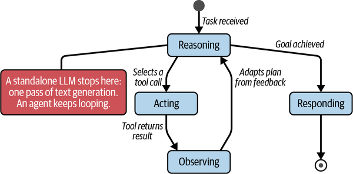

*图 1-1　LLM 智能体在推理、行动和观察反馈之间循环，直到达成目标。*

> 图中文字对照：Task received＝收到任务；Reasoning＝推理；Acting＝行动；Observing＝观察；Responding＝响应；Selects a tool call＝选择一次工具调用；Tool returns result＝工具返回结果；Adapts plan from feedback＝根据反馈调整计划；Goal achieved＝目标达成。红色说明框：独立的 LLM 到这里就停止了，只完成一次文本生成；智能体则会继续循环。

本书会交替使用“AI 智能体”“智能体”和“LLM 智能体”这些术语。不过，严格来说，AI 智能体完全可以不包含语言模型。按经典定义，智能体感知环境、作出决策，并采取行动以达成目标。它并不需要理解或生成人类语言。

例如，在纯强化学习中，可以让智能体直接通过与环境的试错交互接受训练。将 LLM 引入智能体系统的好处，是带来强大的泛化、推理和自然语言能力，让智能体行为更灵活，能够应用于狭窄定义的环境之外的更多场景。

个人能力终究会遇到极限，单个智能体所能推动的工作流也有边界；复杂度上升之后，就需要协调。想一想，在小公司里，一个人可能端到端包办设计、编码、测试和部署。但随着项目扩大，团队也需要扩充：有人负责后端，有人负责前端，还有人负责测试。

为了让大家保持一致，技术负责人或工程副总裁会介入，协调工作量、分配任务并整合结果。独立贡献者与协作团队之间的差别，直接对应着单智能体与**多智能体系统（multi-agent system，MAS）**之间的差别。就像技术负责人协调多位贡献者一样，监督智能体可以编排多个专业智能体，让它们协作完成复杂目标。

> **配套网站与读者社区**
>
> 你可以在本书的[配套网站](https://ai-agents-the-definitive-guide.com/)找到更多材料，包括代码示例、应用案例，以及扩展各章主题的补充内容。
>
> 本书还有一个 [Discord 频道](https://oreil.ly/JXpgv)，读者可以在那里提问、讨论示例并关注更新。

同样需要认识到，无论人类还是智能体，都不拥有无限制的自主权。开发者受到编码规范、项目需求和组织流程的引导，其自由也受这些结构约束。智能体同样受到工作流限制，只能在所提供的工具、权限和防护措施范围内运行。这种有界自主性并不是弱点，恰恰是两种系统能够实际运转的基础。对人类而言，结构有助于保证代码质量、可维护性和客户满意度；对智能体而言，约束有助于保证安全性、可靠性，以及与开发者和用户设定目标的一致性。

这种类比说明了，为什么给纯 LLM 扩展工具是合理的。单独的语言模型就像一个无法访问 StackOverflow、IDE 或 GitHub 等资源的开发者：能够推理，却无法在没有外部帮助的情况下收集新数据、验证结果或改善任务输出。软件团队通过增加更好的工具、资源和领导机制来扩大能力；同样，当 LLM 被嵌入智能体工作流，甚至成为 MAS 中的多个专业智能体时，其能力也会扩展。缺少这些增强手段，两者都只能局限于最初训练的能力范围，并在面对复杂任务时很快不堪重负。有了工具、反馈和分而治之的方法，LLM 就能反复改进、适应，并解决原本超出其独立能力范围的复杂任务。

本书假定你具备使用 LLM 的实践知识。你也许读过 O’Reilly 出版的 [*Hands-On Large Language Models*](https://learning.oreilly.com/library/view/hands-on-large-language/9781098150952//) 或类似书籍。要让智能体运作起来，你不必事先掌握如何部署 LLM，因为我会在后续章节带你完成这些步骤。不过，我希望你能够熟练阅读和修改 Python 代码，并熟悉机器学习和深度学习的核心概念，例如反向传播和训练循环。你不需要详细掌握反向传播，但了解它有助于理解模型如何根据训练信号调整参数、从而完成学习。熟悉线性代数和微积分也很有帮助，因为它们是现代深度学习与优化方法的重要基础。此外，理解 Transformer 如何处理序列，并至少大致了解嵌入如何工作、向量存储如何支持检索，也会有所裨益。

如果你已经有一阵子没接触这些主题，**不要惊慌！** 就像《银河系漫游指南》劝你不要惊慌一样，我的这本指南也要这样说。话虽如此，每个概念都会落实到代码中，让你的知识重新变得可用，而不必翻出那些落满灰尘的旧课本。还有，在你开口之前先说明：有关 AI 智能体的一切问题，答案并不是 42；但我保证，你会在本书中逐步找到答案。

> **本书代码**
>
> 本书所有代码示例都可在[配套 GitHub 仓库](https://oreil.ly/github-ai-agents)中找到。仓库按章节组织，方便你定位各节对应的代码。

如果你希望更深入地了解不同领域中的 Transformer，以及嵌入如何应用于文本和其他模态，我的另一本书 [*Transformers: The Definitive Guide*](https://learning.oreilly.com/library/view/transformers-the-definitive/9781098167004/)（O’Reilly）可以作为补充资料。那本书还讲解了强化学习的基础知识，帮助你为理解本书后面介绍的高级智能体概念打下更牢固的基础。

因此，本书面向希望超越好奇心、进一步付诸实践的读者，这也是理解上述基础知识为何如此重要。其中包括在生产环境中构建实际系统的数据科学家、软件工程师和机器学习工程师，以及需要理解相关权衡、成本和护栏机制的技术负责人。本书不打算从头解释 LLM，也不讨论抽象的承诺或思想实验，而是关注构建和运行 AI 智能体时的现实问题：让它们走出 PowerPoint 演示或实验室演示，真正发挥作用。

本章将解释：LLM 如何从静态提示发展为动态智能体系统；为什么工具使用不可或缺；以及当智能体在既定工作流、权限和防护措施之内运行时，自主性究竟意味着什么。

### 有限状态机与层次状态机：智能体的基础范式

<!-- source: PDF 27–34 -->

[LangGraph](https://oreil.ly/duukM)、[CrewAI](https://crewai.com/) 及类似框架，为组织智能体行为提供了不同层级的抽象。LangGraph 明确展现了有状态、基于图的模型；CrewAI 则围绕智能体、团队（crew）和流程（flow），提供更高层的框架。框架未必会把这种结构暴露为正式的有限状态机（finite state machine，FSM）或层次状态机（hierarchical state machine，HSM）API。不过，任何智能体工作流都需要控制模型：它必须跟踪状态、决定采取什么行动、观察结果、更新上下文，并最终终止。

从宏观上看，状态机是一种计算模型，在任一时刻都处于有限个状态中的某一个。它会响应特定事件或输入，在状态之间转换；下一个状态由当前状态和输入决定。

本节旨在通过状态机模式，解释现代 AI 智能体系统的控制流，帮助你建立关于智能体的心智模型。简单来说，可以把它理解为结构化的状态转换：这种模式长期用于编译器、图形用户界面、嵌入式系统和网络协议，如今被应用于基于 LLM 的智能体的推理与工具使用。

我先用 FSM 和 HSM 为你的理解打基础，并不只是想作一个宽泛的类比。我希望为你提供一份构建稳健、可靠、适应性强的 LLM 智能体的蓝图，让你不仅理解概念，也能在后续学习更复杂的主题时有效运用它们。如果你最近没有用过状态机，也不用担心：代码示例会展示这些模式如何直接转化为实现。你可以把下面这些术语，看作贯穿全书的工具使用和多智能体示例背后的控制语法。

#### 有限状态机

有限状态机描述系统可能处于的模式，以及模式之间允许发生的转换。每次转换都由事件触发，可能受某个谓词条件保护，也可能执行更新状态的动作。开始和结束是具有特殊含义的状态。核心术语如下。

- **状态（State）**：一个紧凑的快照，记录系统在某一时刻掌握的信息。对智能体而言，它可能是消息列表、路由提示或进度标记。
- **事件（Event）**：自上一次决策以来发生的事情，例如工具被调用或返回结果。
- **守卫条件（Guard）**：根据当前状态和最新事件，判断应当采用哪条转换路径的检查。
- **动作（Action）**：转换过程中执行的工作，例如调用工具、追加消息、保存检查点或请求人工输入。
- **终止（Termination）**：表明流程已到达终点的条件。

图 1-2 展示了用于工具使用的有限状态机。每次转换都由事件、守卫条件和动作定义。

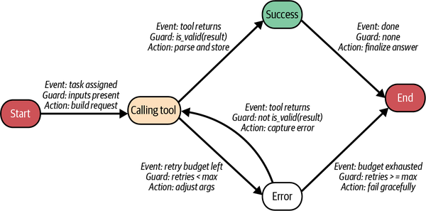

*图 1-2　用于工具使用的有限状态机概览。*

> 图中文字对照：Start＝开始；Calling tool＝调用工具；Success＝成功；Error＝错误；End＝结束。各边上的 Event、Guard、Action 分别表示事件、守卫条件和动作。路径依次为：分配任务／输入齐备／构建请求；工具返回／`is_valid(result)`／解析并保存；工具返回／`not is_valid(result)`／捕获错误；尚有重试预算／`retries < max`／调整参数；任务完成／无条件／完成最终答案；预算耗尽／`retries >= max`／妥善结束失败流程。

当系统行为在少量稳定模式之间交替，而且可恢复性很重要时，FSM 非常适合。实现时可以在每个节点或状态边界保存检查点，并在崩溃后从最后完成的步骤恢复。

从状态的角度思考，可以把复杂任务分解为不同步骤。例如，你不必用一条“写一篇博客文章”的提示包办一切，而可以定义选题构思、生成提纲、起草、编辑和 SEO 优化等状态。每个状态都可以关联到智能体将使用的特定工具。

转换机制会促使你明确：一项任务在什么条件下把工作交给下一项。例如，提纲生成状态产生什么输出，才会触发起草状态。这种结构可以避免非结构化、一次性提示的问题；仅依靠 LLM 时，这类提示往往会产生不一致的结果。

一旦增加规划、反思、审批关卡和重试等更多模式，FSM 就可能迫使你重复逻辑，或形成纠缠不清的路由。你需要牢牢掌控图中的边，因为它们就是决策点：每条边都编码了驱动功能的事件、守卫条件和动作。此时，层次结构就派上了用场。

#### 层次状态机

层次状态机允许状态包含其他状态。父状态（superstate）封装共享的进入／退出行为和共享守卫条件；子状态继承这些规则，并增加自己的规则。历史节点会记住离开时所处的子状态，以便稍后准确恢复到那里。状态机新增的这些概念说明如下。

- **父状态（Superstate）**：将一组子状态及其公共策略组织在一起的状态。进入父状态时执行一次共享逻辑；退出时执行一次共享清理。
- **子状态（Substate）**：位于父状态内部的具体模式。它拥有自己的边，同时继承父状态的守卫条件和动作。
- **历史（History）**：一个“记住我刚才在哪里”的标记。浅历史恢复到最后一个活动子状态；深历史则恢复到更深层嵌套的后代状态。用智能体的术语来说，这是图中某一部分的检查点。
- **并行区域（Parallel region）**：父状态中两个或更多独立推进的子区域。适合把工具调用或智能体角色分发出去并行执行，然后再汇合。

图 1-3 展示了一个包含 `WORKING` 父状态的层次状态机。`PLAN`、`ACT` 和 `REFLECT` 是子状态。`H` 是浅历史标记，用于记录最后一个活动子状态，以便重新进入父状态时从那里恢复执行。

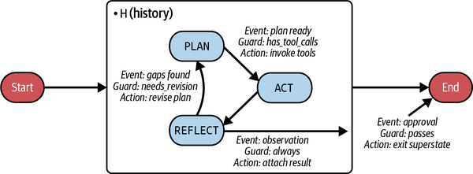

*图 1-3　带有历史标记的层次状态机概览；该标记记录最后一个活动子状态。*

> 图中文字对照：H (history)＝历史标记；PLAN＝规划；ACT＝行动；REFLECT＝反思；Start／End＝开始／结束。转换标注：计划就绪／`has_tool_calls`／调用工具；收到观察结果／始终成立／附加结果；发现缺漏／`needs_revision`／修订计划；获得批准／通过／退出父状态。

HSM 尤其适用于更高级的 MAS。HSM 允许“状态中再嵌套状态”，从而减少重复，让策略清晰可见。例如，你可以把限流、安全过滤器或熔断器绑定到 `WORKING` 父状态上，让规划、行动和反思继承相同的防护措施。守卫条件或路由器只需定义一次，就能在多个节点间复用。

以研究智能体为例。与其把研究看成一个庞大的单一步骤，不如把它拆成一个子状态机，包含搜索关键词、收集 URL、抓取数据和总结发现等状态。每个状态甚至都可以映射到一个拥有自身能力的专用智能体，为更大的智能体团队作出贡献。这种嵌套结构有助于管理复杂度、保持策略一致，并让整个系统更容易理解和维护。

#### 将 FSM／HSM 映射到智能体框架

LangGraph 本身就使用状态机和层次结构的语言。你可以通过子图和共享键来实现这些模式。选择下一步动作的路由器或决策智能体，例如决定调用哪个智能体或工具，对应于经典状态机中的事件处理器。它读取当前状态和 LLM 输出（事件或载荷），决定下一项符合逻辑的操作。直接对应关系如下。

**状态模式（State schema）**

父图的 `TypedDict` 定义共享“总线”。子图声明自己读写哪些键；重叠的键构成父状态的接口：

```python
class State(TypedDict):
    messages: List[BaseMessage]
    working_last: str | None
```

1. `messages`：父图与子图之间的共享总线。
2. `working_last`：可选的浅历史标记。

**节点与子图（Nodes and subgraphs）**

一个子图对应 HSM 中的父状态，其内部节点对应子状态。进入子图时运行入口节点；离开时沿退出边返回父图：

```python
def plan_node(state: State) -> State:
    ai = AIMessage(content="Plan next step")
    return {"messages": [ai], "working_last": "plan"}

def act_node(state: State) -> State:
    ai = AIMessage(content="Act on plan")
    return {"messages": [ai], "working_last": "act"}

subgraph_builder = StateGraph(State)
subgraph_builder.add_node("PLAN", plan_node)
subgraph_builder.add_node("ACT", act_node)
subgraph_builder.add_edge(START, "PLAN")
subgraph = subgraph_builder.compile()
```

1. `subgraph` 就是父状态。

**守卫条件与条件边（Guards and conditional edges）**

父级守卫条件落实预算、安全等全局策略。子级守卫条件则在 `PLAN`／`ACT`／`REFLECT` 之间路由。由于守卫条件只是普通的 Python 代码，因此保持了确定性和可审计性：

```python
def route_within_working(state: State):
    last = state.get("working_last")
    return "ACT" if last == "plan" else END

subgraph_builder.add_conditional_edges(
    "PLAN", route_within_working, {"ACT": "ACT", END: END}
)

parent = StateGraph(State)
parent.add_node("WORKING", subgraph)

def global_guard(state: State):
    tail = "".join([
        getattr(m, "content", "") for m in state["messages"][-3:]
    ]).lower()
    return END if "stop" in tail else "WORKING"

parent.add_edge(START, "WORKING")
parent.add_conditional_edges(
    "WORKING", global_guard, {"WORKING": "WORKING", END: END}
)
```

1. 在子图内部添加条件边。
2. 创建带全局守卫条件的父图。
3. 策略示例：如果用户说了 `stop`，则结束。

**历史与检查点（History and checkpointing）**

`MemorySaver` 可直接提供浅历史和深历史：恢复某条线程时，会在最后完成的节点处重建子图。如果你希望显式地“回到此前在 `WORKING` 内部的位置”，就持久化一个小标记，例如 `state["working_last"] = "reflect"`，并在重新进入时依据它选择分支：

```python
def reflect_node(state: State) -> State:
    ai = AIMessage(content="Reflect on result")
    return {"messages": [ai], "working_last": "reflect"}

checkpointer = MemorySaver()
app = parent.compile(checkpointer=checkpointer)

cfg = {"configurable": {"thread_id": "session-1"}}
app.invoke(
    {"messages": [HumanMessage(content="start")], "working_last": None},
    config=cfg
)
```

1. 子状态在退出时设置 `working_last`。
2. 编译时启用检查点。
3. 在线程中运行。恢复时，`MemorySaver` 会恢复到最后完成的节点。

FSM 提供了一种把任务组织为稳定、可恢复步骤的方法。HSM 在此基础上进一步扩展，在工作流变复杂时减少重复、集中管理策略。这两种模式都为下一步作好准备：把静态的 LLM 预测转变为动态、有状态的智能体。

### 基础：从静态模型到动态智能体

<!-- source: PDF 34–37 -->

正如上一节所示，加入状态与控制流对自动化至关重要。这一原则同样适用于智能体。从静态的 LLM 用法走向智能体系统，需要显式的状态和控制流。状态把一次性的工具调用变成有状态的过程，使先前的动作、工具结果和路由决策能够跨步骤保留下来。控制流则加入守卫条件和转换机制，规定何时规划、何时行动、何时停止。

之所以要为 LLM 加入这些能力，原因很简单：LLM 是静态预测器。给定提示后，它们仅依赖训练数据中编码的模式，生成下一个 token。这使它们拥有强大的推理能力，却仍被限制在已有知识之内。它们无法更新知识、验证论断，也无法与环境交互。

当推理与行动结合时，能动性便产生了。推理是规划或决定下一步的内部过程；行动则通过调用工具、检索数据、执行代码或调用外部服务，对这一过程作出延伸。两者共同形成迭代循环：推理、行动、接收反馈、调整。这个循环是智能体行为的基础。

表 1-1 比较了静态 LLM 与智能体系统。这些对比不仅说明为什么需要智能体，也展示了这种设计如何将传统机器学习工作流转变为由工具增强的动态系统。

**表 1-1　静态 LLM 与智能体系统的比较**

| 静态 LLM（传统用法） | 智能体系统 |
| --- | --- |
| 单次运行的 token 生成器 | 迭代的推理—行动—反馈系统 |
| 局限于训练数据 | 能够检索、验证和更新知识 |
| 没有记忆，无状态 | 有状态，具备短期与长期记忆 |
| 线性的提示—响应过程 | 迭代且自适应的工作流 |
| 不使用工具 | 由工具增强：检索、代码、API |
| 对提示的解释固定 | 能够动态细化或重新解释目标 |
| 没有外部验证 | 主动检查、纠正并改善输出 |

图 1-4 展示了不同模块如何把静态 LLM 转变为动态智能体。用户请求进入核心模块，规划与记忆影响其推理，工具使具体行动成为可能。推理、行动和适应的循环，来自这些要素之间的协调。具体的记忆架构、存储选择、检索策略和持久化机制将在第 10 章介绍。

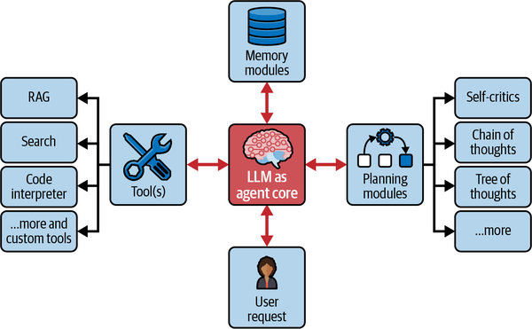

*图 1-4　智能体基础架构：单独的 LLM 只能预测文本；加入规划、记忆和工具后，它就成为可用的智能体系统。*

> 图中文字对照：LLM as agent core＝作为智能体核心的 LLM；User request＝用户请求；Memory modules＝记忆模块；Planning modules＝规划模块；Tool(s)＝工具；RAG＝检索增强生成；Search＝搜索；Code interpreter＝代码解释器；…more and custom tools＝更多工具及自定义工具；Self-critics＝自我批评；Chain of thoughts＝思维链；Tree of thoughts＝思维树；…more＝其他方法。

规划模块引导智能体推理，其方式从简单的思维链（chain-of-thought）[^ch1-1]轨迹，到思维树（trees of thought）[^ch1-2]、自我批评等更高级的方法。记忆模块提供连续性，让智能体回忆先前步骤、复用已有知识，或者跨会话保留信息。工具则把智能体连接到环境，无论是通过搜索、检索、代码执行，还是自定义 API。

此外，传统 LLM 用法与智能体系统之间的一个关键差别，是工作流究竟无状态还是有状态。无状态调用把模型当作黑箱：接收提示、预测后续 token，然后返回结果。它不会记住任何东西，不采取行动，也不存在反馈循环。示例 1-1 展示了一次无状态的 LLM 调用。

**示例 1-1　使用 LangChain 进行无状态 LLM 调用**

```python
llm = ChatOpenAI(model="gpt-5-mini")
response = llm.invoke("What are AI agents?")
print(response.content)
```

<!-- source: PDF 38–41 -->

此外，一旦需要训练数据之外的事实，或者希望模型采取行动，例如搜索、计算，就需要引入工具。

下面的代码（示例 1-2 至示例 1-4）展示了一次最小化的无状态工具使用运行：先给 LLM 绑定两个工具，再运行一个小循环，执行模型为完成任务而请求的工具调用。首先需要定义工具。示例 1-2 给出了一种实现。

**示例 1-2　为无状态运行定义工具**

```python
@tool("internet_search")
def internet_search(query: str) -> str:
    """Search Google via SerpAPI for up-to-date information."""
    serp_api_key = os.environ["SERPAPI_API_KEY"]
    params = {"engine": "google", "gl": "us", "hl": "en"}
    search = SerpAPIWrapper(params=params, serpapi_api_key=serp_api_key)
    return search.run(query)

@tool("calculator")
def calculator(expression: str) -> str:
    """Evaluate a single-line mathematical expression with numexpr."""
    local_dict = {"pi": math.pi, "e": math.e}
    out = numexpr.evaluate(
        expression.strip(),
        global_dict={},
        local_dict=local_dict,
    )
    return str(out)

tools = [internet_search, calculator]
tool_map: Dict[str, Any] = {t.name: t for t in tools}
```

1. LangChain 的 `@tool` 装饰器根据函数名、带类型的函数签名和文档字符串，构建模型看到的模式。
2. 文档字符串是必需的：如果缺失，LangChain 会在构建工具模式或把工具绑定到模型时抛出错误。
3. 限制表达式求值：禁止访问全局变量，只暴露你希望提供的常量。这样可使计算器保持确定性和安全性。

使用 LangChain 的 `@tool` 装饰器时，函数签名和文档字符串用于构建模型看到的模式。为了高效完成任务，它们应当准确、一致，并尽可能清楚地解释用途。文档字符串充当工具说明，也是 LangChain 的硬性要求：缺少它就会报错。此外，如果文档字符串含糊不清，模型就更容易生成无效调用。

接下来，只需像示例 1-3 那样，将工具绑定到 LLM，就能让 LLM 访问工具。

**示例 1-3　将工具绑定到 LLM**

```python
llm = ChatOpenAI(model="gpt-4o", temperature=0,
                max_tokens=800).bind_tools(tools, tool_choice="auto")
```

1. 将工具绑定到模型。`tool_choice="auto"` 允许模型自行决定是否调用工具，以及调用哪个工具。

> **现代 LLM 为智能体任务而构建**
>
> 现代 LLM 不仅能够调用工具，而且越来越多地专门针对智能体任务进行训练和优化。例如，[Kimi K2](https://oreil.ly/2rXu1)、[Llama 4](https://oreil.ly/oWvTA) 和 [Qwen3.6](https://oreil.ly/CPUFZ) 等模型，都明确针对编码、工具使用和驱动智能体系统进行了调优。这些模型不再只是回答聊天窗口里的问题。它们经过指令微调，以采取行动；调用 API、运行代码或检索数据，已成为其核心设计的一部分。

绑定工具之后，就可以运行一个最小化的无状态工具循环。示例 1-4 中的代码执行模型请求的工具调用，并把工具结果作为观察结果反馈回去。在工具调用工作流中，助手可能生成工具调用，而不是最终答案。代码执行该工具后，最新消息是工具观察结果，模型还需要再运行一轮，才能解释结果并写出最终响应。因此，循环包含了一条简短的收尾指令：如果运行在工具观察结果之后达到了步数上限，就强制生成一条最终助手消息。

**示例 1-4　带工具循环的单次无状态运行**

```python
def run_once(prompt: str, max_steps: int = 8) -> str:
    messages: List[HumanMessage | AIMessage | ToolMessage] = [
        HumanMessage(content=prompt)]
    last_ai: AIMessage | None = None

    for _ in range(max_steps):
        ai: AIMessage = llm.invoke(messages)
        messages.append(ai)
        last_ai = ai

        calls = getattr(ai, "tool_calls", None) or []
        if not calls:
            return messages[-1].content

        for call in calls:
            name = call["name"]
            args = call.get("args", {}) or {}
            result = tool_map[name].invoke(args)
            messages.append(ToolMessage(
                content=str(result),
                name=name,
                tool_call_id=call.get("id")
            ))

    messages.append(HumanMessage(content="""
Finish now. Give a short final answer in this exact format:

Current temperature:
Square of current temperature:
""".strip()))
    final_ai: AIMessage = llm.invoke(messages)
    return final_ai.content

print(run_once("""Two-step task.

Step 1: Use internet_search to get the current air temperature in New York City
today. Show the exact query you used, the top source title and snippet, and
extract a numeric temperature in Celsius. Return this temperature as feedback
for Step 2.

Step 2: Using the Celsius value from Step 1, compute its square with calculator.
Show the exact expression you used and the numeric result.

Important: Give a short final answer in this format:
Current temperature:
Square of current temperature:"""))
```

1. 只在本次运行中使用的局部短期记忆。因此，不同运行之间的工作流是无状态的。
2. 用一个简单的步数上限，防止 LLM 无终止条件地反复循环。
3. 一步模型调用。助手可能选择调用工具。
4. 读取结构化工具调用。
5. 用匹配的 `tool_call_id` 附加观察结果，使模型能够把结果与调用对应起来。
6. 工具循环可能停在一次观察结果之后。最后这条指令用于保证生成符合所需格式的收尾助手消息。

#### 赋予 LLM 状态

<!-- source: PDF 41–49 -->

把 LLM 变成智能体的第一步，是将其放入有状态的工作流。工作流不再把每次模型调用看成彼此孤立的提示和响应，而是记录智能体当前处于哪里、已经发生了什么，以及哪些信息应当继续向后传递。本书中的“状态”，指工作流的结构化运行时快照，而不仅是传入模型的文本上下文。模型上下文可以是状态的一部分，但状态还可以包括路由信息、工具结果、检查点、分支标识符和其他控制数据。图 1-5 对比了无状态与有状态的智能体流程。

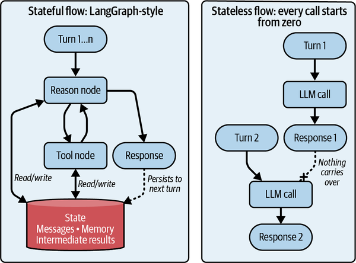

*图 1-5　无状态智能体独立处理每次调用，而有状态智能体在每一步都读写共享状态。*

> 图中文字对照：Stateful flow: LangGraph-style＝LangGraph 风格的有状态流程；Stateless flow: every call starts from zero＝无状态流程，每次调用都从零开始；Turn＝轮次；Reason node＝推理节点；Tool node＝工具节点；Response＝响应；Read/write＝读／写；Persists to next turn＝保留至下一轮；State／Messages／Memory／Intermediate results＝状态／消息／记忆／中间结果；LLM call＝LLM 调用；Nothing carries over＝不保留任何信息。

系统根据输入和逻辑转换到下一个状态，每个状态都对应某种函数或行为。在 LangGraph 中，状态可以采用任意 Python 类型，但通常是 `TypedDict` 或 [Pydantic `BaseModel`](https://oreil.ly/mPQkx)。下面列出用 LangGraph 构建有状态、可适应的 AI 智能体时所需的关键概念。

- **状态（State）**：表示应用当前快照的共享数据结构。
- **节点（Nodes）**：编码智能体逻辑的函数。它们接收当前状态，执行计算或产生副作用，再返回更新后的状态。
- **边（Edges）**：依据当前状态选择下一个节点的规则。它们可以是条件分支，也可以是固定转换，同时还应检测结束条件是否满足。
- **命令（Command）**：将控制流与状态更新结合在一起、支持多参与者通信的对象。节点可以通过返回一个 `Command`，同时更新状态并选择下一个节点。

到目前为止，前面创建的工具只用于无状态循环。每次运行都相互独立：模型可以调用工具、获得答案并收尾，但运行一结束，全部上下文就丢失了。如果现在想结合 LangGraph 的概念构建有状态智能体，就需要把工具嵌入有状态工作流。每轮之后不再丢弃消息，而是把消息保存在结构化状态中。系统由此具备智能体特征：

- LLM 节点推理下一步该做什么。
- 工具节点执行外部动作。
- 边根据是否请求了工具来路由控制流。
- 记忆检查点保存对话，使智能体能在后续轮次复用先前结果。

这让工具从一次性的辅助能力，转变为持续的推理—行动—适应循环。接下来的代码清单（示例 1-5 至示例 1-13）将以示例 1-3 至示例 1-4 中的工具和 LLM 绑定为基础，用 LangGraph 构建这样的有状态智能体。

示例 1-5 展示如何在 LangGraph 中实现状态对象，用于承载对话并协调控制流。你可以复用示例 1-3 的工具和已绑定工具的 LLM，只添加新的部分：带类型的状态、追加助手消息的 LLM 节点、执行调用的工具节点，以及根据工具调用决定继续还是停止的路由器。

**示例 1-5　构建包含状态、节点和路由的最小 LangGraph**

```python
class AgentState(TypedDict):
    messages: Annotated[List[BaseMessage], add_messages]

def llm_node(state: AgentState) -> AgentState:
    ai = llm.invoke(state["messages"])
    return {"messages": [ai]}

tool_node = ToolNode(tools=tools)

graph = StateGraph(AgentState)
graph.add_node("llm", llm_node)
graph.add_node("tools", tool_node)
graph.add_edge(START, "llm")

def route(state: AgentState):
    last = state["messages"][-1]
    calls = getattr(last, "tool_calls", None) or []
    return "tools" if calls else END

graph.add_conditional_edges("llm", route, {"tools": "tools", END: END})
graph.add_edge("tools", "llm")
```

1. 状态以消息列表的形式承载对话。`add_messages` 负责安全合并各节点的更新。
2. 核心推理节点：接收当前状态，返回一条新的助手消息。
3. 执行助手发出的工具调用的预构建节点。
4. 容纳节点和边的图容器。
5. 路由器：如果助手最后一轮请求了工具，就转到 `tools`；否则结束。

定义好图之后，需要让它可运行，并具备持久化能力。示例 1-6 使用内存检查点保存器编译图，并分配线程 ID。检查点保存器在每一轮恢复之前的消息，让智能体能够复用早先的结果。线程 ID 用于区分分支，因此可以并行运行多个对话而互不干扰。

**示例 1-6　使用内存检查点编译并配置线程**

```python
checkpointer = MemorySaver()
app = graph.compile(checkpointer=checkpointer)

cfg = {"configurable": {"thread_id": "nyc-weather-session"}}
```

1. 轻量、按线程管理的检查点，使状态能够跨轮次保留。
2. 生成一个知道如何保存和加载状态的可运行应用。
3. 线程 ID 标识一条对话分支。新的 ID 会创建新的分支。

有了可运行的应用和检查点之后，下一步是让执行过程可观察。你会希望看到图正在做什么、哪些消息在流转，以及工具输出如何附加到状态中。示例 1-7 引入一个小巧的辅助函数，把消息格式化为易读的单行输出，让你更容易跟踪执行轨迹，同时避免日志过多。

**示例 1-7　格式化消息，生成简洁的执行轨迹输出**

```python
def _short(msg: BaseMessage, max_len: int = 140) -> str:
    """Compact one-line view of a message."""
    role = type(msg).__name__.replace("Message", "").lower()
    content = getattr(msg, "content", "")
    if isinstance(content, list):
        # some tool outputs can be list payloads
        try:
            content = json.dumps(content)
        except Exception:
            content = str(content)
    text = str(content).replace("\n", " ").strip()
    if len(text) > max_len:
        text = text[: max_len - 3] + "..."
    if hasattr(msg, "tool_calls") and getattr(msg, "tool_calls"):
        tnames = [tc.get("name", "tool") for tc in msg.tool_calls]
        return f"{role}: tool_calls -> {tnames}"
    if isinstance(msg, ToolMessage):
        return f"{role}({msg.name}): {text}"
    return f"{role}: {text}"
```

1. 如有工具名称或函数调用信息，就将其纳入输出。

示例 1-8 打印消息和路由提示的简洁视图。结合起来，你就能验证工具输出是否正确附加，以及状态转换是否符合预期。

**示例 1-8　打印当前状态快照**

```python
def print_state_snapshot(app, config, title: str):
    """Print current graph state and memory for a given thread."""
    snap = app.get_state(config)
    values = snap.values or {}
    msgs: List[BaseMessage] = values.get("messages", [])
    print(f"\n=== {title} | state snapshot ===")
    print(f"messages: {len(msgs)} total")
    for i, m in enumerate(msgs[-5:], start=max(0, len(msgs)-5) + 1):
        print(f"  {i:>3}: {_short(m)}")

    nxt = getattr(snap, "next", None)
    tasks = getattr(snap, "tasks", None)
    if nxt:
        print(f"next nodes: {list(nxt)}")
    if tasks:
        print(f"queued tasks: {tasks}")
    print("memory: in-memory checkpoint present for this thread")
```

1. 读取某条线程的最新状态。
2. 简洁打印消息末尾部分，保持日志易读。
3. 如有路由信息和排队任务，则显示出来。

示例 1-9 以流式方式输出节点更新，让你看到图执行的每一步。

**示例 1-9　以流式方式输出图执行更新**

```python
def run_with_tracing(app, input_state: AgentState, config, title: str):
    """Run the graph while printing per-node updates and final memory."""
    print(f"\n=== {title} | execution trace ===")
    final = None
    for event in app.stream(input_state, config=config, stream_mode="updates"):
        for node, upd in event.items():
            keys = list(upd.keys())
            print(f"[enter {node}] updated: {keys}")
            # if messages updated, print the last one briefly
            msgs = upd.get("messages") or []
            if msgs:
                print(f"  {_short(msgs[-1])}")
            print(f"[leave {node}]")
            final = upd
    print_state_snapshot(app, config, title=f"{title} | after run")

    snap = app.get_state(config)
    msgs = snap.values.get("messages", [])
    return msgs[-1].content if msgs else ""
```

1. 流式输出节点更新，以查看图中的准确执行流程。
2. `upd` 是形如 `{"messages": [<new msg>]}` 的字典，或工具结果。
3. 从 `app.get_state` 取得最终助手消息并显示。

示例 1-10 请求纽约市当前的摄氏气温。执行轨迹显示图进入 LLM 节点、按需发起工具调用，并返回最终助手消息。状态快照则确认，该结果已保存到这条线程的记忆中。

**示例 1-10　第 1 轮：获取纽约市当前的摄氏气温**

```python
turn1_answer = run_with_tracing(
    app,
    {"messages": [HumanMessage(content="Get the current air temperature in New York City in Celsius.")]},
    config={**cfg, "recursion_limit": 20},
    title="TURN 1",
)
print("\nTURN 1 (final assistant):\n", turn1_answer)
```

模型输出如下：

```text
TURN 1 (final assistant):
The current air temperature in New York City is 18°C.
```

即：纽约市当前气温为 18°C。

接下来继续使用同一条线程。示例 1-11 请求计算先前获取的温度的平方。由于线程 ID 不变，应用会恢复此前的消息，使助手能够使用先前结果，而不必在提示中再次提供这个数值。

**示例 1-11　第 2 轮：在同一线程中计算该温度的平方**

```python
turn2_answer = run_with_tracing(
    app,
    {"messages": [HumanMessage(content="Now compute the square of that temperature.")]},
    config={**cfg, "recursion_limit": 20},
    title="TURN 2",
)
print("\nTURN 2 (final assistant):\n", turn2_answer)
```

现在会计算平方，模型返回：

```text
TURN 2 (final assistant):
The square of the temperature, 18°C, is 324.
```

即：温度数值 18 的平方为 324。

智能体经常需要在不丢失进度的情况下探索其他方案。示例 1-12 通过不同的线程 ID 启动一个独立分支，并提出另一项后续请求。这会创建一条隔离的对话，可以偏离主路径，同时保持主线程的记忆不变。

**示例 1-12　创建并行线程分支，处理不同的后续请求**

```python
branch_answer = run_with_tracing(
    app,
    {"messages": [HumanMessage(content="Instead of squaring, convert it to Fahrenheit and report both.")]},
    config=cfg_branch,
    title="BRANCH",
)
print("\nBRANCH (final assistant):\n", branch_answer)
```

最后，你可以检查各个分支记住了什么。示例 1-13 为主线程和分支打印简洁快照。将两者并排比较，可确认状态在线程内持续保留、在线程间相互隔离；这正是可靠的多步骤、多分支智能体工作流的基础。

**示例 1-13　查看两条线程的快照**

```python
print_state_snapshot(app, cfg, title="MAIN THREAD memory view")
print_state_snapshot(app, cfg_branch, title="BRANCH THREAD memory view")
```

通过这个小型实现，你现在可以准确看到：图记住了什么、如何进行路由，以及每个分支最新的助手状态是什么。

### 机械降神：当下究竟能做到什么？

<!-- source: PDF 49–54 -->

一旦把智能体看成包含状态的 HSM，自主性的范围就取决于你在父状态中赋予了多少选择。路由器是只有一条边、一个守卫条件的 FSM；工具调用智能体是带有 `WORKING` 父状态的 HSM，在 `PLAN`、`ACT` 和 `REFLECT` 之间循环；MAS 则在监督者父状态之下组合多个子图，有时还包含并行区域。系统仍然运行在显式状态和守卫条件之内；人们感受到的“自主性”，不过是在边界明确的区域里拥有更丰富的选择。

在古希腊戏剧中，*deus ex machina*（机械降神）指的是一位神突然出现，解决原本无法解决的冲突或问题。人们很容易以同样的方式想象 AI 智能体：一台机器突然拥有完全的自主性与智能，替你解决所有问题。但今天还做不到这一点；智能体是工程系统。它们的力量并不来自隐藏的魔法，而来自精心设计的工作流、定义清楚的工具，以及让它们保持安全和可用的边界。也就是说，智能体仍然受到你提供的工具、实施的防护措施，以及允许运行的工作流的限制。正是这些约束，让今天的智能体具备实际可行性：可以安全部署，行为可以预测，并与预期目标保持一致。

当前系统展现的是一种**编排式自主性（orchestrated autonomy）**。正如前面的 LangGraph 示例（示例 1-5）所示，智能体可以按条件选择分支、调用工具，或者决定是否继续工作流。这已经与静态的提示—响应调用很不一样，但仍然有边界。编排逻辑是固定的；LLM 可以在其中作出选择，却不能重新定义自己的架构。表 1-2 简要列出了智能体目前能做什么。

**表 1-2　当前智能体的自主性：已经能够做到什么，以及尚未实现什么**

| 智能体能够做到的事 | 智能体目前还做不到的事 |
| --- | --- |
| 在预定义路径之间路由，例如路由节点 | 重新设计或重新连接自己的控制图 |
| 选择要调用的工具或子智能体 | 动态生成并验证新的图拓扑 |
| 决定完成任务前是否还需要更多步骤 | 持续评估工具有效性，或自主创建新工具 |
| 在限定范围内修改自己的提示或工具集 | 在执行中途改变策略时，保证对齐与连贯性 |
| 编写并运行小段代码，以决定后续步骤 | 脱离编排框架，作为完全自我驱动的系统运行 |

智能体会在运行时适应，但只能在你设计的框架内适应。把它看作一个连续谱很有帮助。一端是路由器：从固定选项中作出一次决策。中间是支持多步骤推理、反思和记忆的工具调用智能体。另一端是 MAS：专业智能体在监督者协调下协作，将决策分散到不同角色。图 1-6 展示了自主性的连续谱，从简单的路由决策，一直到完全自我驱动执行的设想。在实践中，几乎所有真实系统都位于中间地带：它们是智能体系统，而不是真正自主的智能体。它们的自主性经过编排，而非自行演化；即使智能体能在运行时自适应地作出选择，决策仍发生在预定义状态、转换和工具集构成的框架之内。

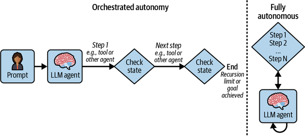

*图 1-6　在编排式自主性中，决策点预先定义在工作流里；在完全自主性中，LLM 可以生成新的工具、动作或决策路径来达成目标。*

> 图中文字对照：Orchestrated autonomy＝编排式自主性；Fully autonomous＝完全自主；Prompt＝提示；LLM agent＝LLM 智能体；Step 1／Next step＝步骤 1／下一步，例如工具或其他智能体；Check state＝检查状态；End＝结束；Recursion limit or goal achieved＝达到递归上限或目标已达成；Step 1、Step 2、…、Step N＝步骤 1、步骤 2、……、步骤 N。

智能体可以利用反思、规划和结构化输出，在 LangGraph 等框架内表现出灵活性。不过，我们尚未拥有能够自由重新定义自身架构，或者以稳健、通用的方式推理自身目标的系统。

> **AI Scientist：有限自主性已经能够做到什么**
>
> AI Scientist v2[^ch1-3] 是编排式自主性已经带来哪些可能性的一个例子。它建立在整合了树搜索、实验管理和视觉—语言反馈的多智能体工作流之上，能够生成研究假设、编写代码进行检验、在调试和改进的同时并行运行实验、可视化结果，并最终起草科学论文。2025 年，该系统向一个 [ICLR 研讨会](https://iclr.cc/About)提交了三篇论文，其中一篇通过同行评审并获得正式接收，成为已知首个由 AI 完整生成、且达到这一标准的科学论文案例。
>
> 不过，这项成果也存在明确局限。被接收的是研讨会级别的论文，而不是大会主会论文。三篇投稿中有两篇被拒；即使是被接收的那篇，也存在方法上的缺漏、论证不清、分析浅显和数据集方面的限制。尽管评审者赞赏其清晰性与严谨性，但也强调，它缺少顶级出版物所要求的深度与创新。系统还遇到了 LLM 常见的问题，包括引用错误和具有误导性的图表说明。因此，尽管它能够自主改进和调试，令人印象深刻，但尚不能自主产生根本性的新科学范式。
>
> 这个案例展示了当前自主性的两面。在工程化编排的边界之内，智能体系统已经能够贯通从想法到实验、代码，甚至同行评审发表的全过程。而超越这些边界，要持续产出突破性科学成果，或开展不受约束的创造活动，今天的智能体仍有局限，人工监督仍然重要。

现在你已经理解，今天的智能体并不是“机械降神”式的解决方案，而是经过精心编排的系统，通过结构、工具和反馈循环扩展 LLM。它们的自主性在设计上就有边界；正因为如此，它们才实用、安全、可部署。尽管仍有限制，它们已经令人印象深刻，能够以远超静态 LLM 的方式进行推理、行动和适应。

### 结论

<!-- source: PDF 54–55 -->

本章介绍了 LLM 如何通过加入状态、控制流和工具使用，从静态预测器发展为动态智能体。把推理嵌入行动与反馈的循环之后，LLM 就能根据结果调整行为，其能力也远远超出了单纯提示—响应交互的范围。

有限状态机与层次状态机为智能体设计提供了概念基础。FSM 让你把工作流组织为可恢复的步骤；HSM 则在复杂的多步骤任务中减少重复、集中管理策略。这些抽象可以直接映射到 LangGraph 等现代框架；在这些框架中，状态、节点和路由规则定义了智能体如何随时间推理和行动。

现在，你也能在更恰当的背景下理解自主性。你知道，今天的智能体在边界清楚的工作流内运行：在预定义路径之间选择、调用工具、反思结果，但不会重新设计自身架构。这种编排式自主性不是弱点，而是优势，因为约束使智能体安全、可预测，并能切实部署。AI Scientist v2 的例子展示了这种方法的潜力与局限：智能体已经能够生成和检验假设，但仍需要监督来保证严谨性和深度。

有了这些基础，你就可以进入第 2 章，探索那些让规划、反应性、反思和人机交互成为现实的架构与模式。

[^ch1-1]: Jason Wei 等，[“Chain-of-Thought Prompting Elicits Reasoning in Large Language Models”](https://arxiv.org/abs/2201.11903)（《思维链提示激发大语言模型的推理能力》），2023 年。年份按原书保留。
[^ch1-2]: Shunyu Yao 等，[“Tree of Thoughts: Deliberate Problem Solving with Large Language Models”](https://arxiv.org/abs/2305.10601)（《思维树：使用大语言模型进行审慎的问题求解》），2023 年。
[^ch1-3]: Yutaro Yamada 等，[“The AI Scientist-v2: Workshop-Level Automated Scientific Discovery via Agentic Tree Search”](https://arxiv.org/abs/2504.08066)（《AI Scientist-v2：通过智能体树搜索实现研讨会级别的自动化科学发现》），2025 年。

---

<a id="chapter-2"></a>

## 第 2 章　架构与模式：规划、反应性与多智能体系统

> 原书：*AI Agents: The Definitive Guide — Design, Deployment, and Evaluation for Production*，Nicole Koenigstein 著。译文依据用户提供的 PDF，第 56–100 页。排版与代码保留约定见[第 1 章](第1章-从LLM到智能体.md)。数学公式使用 Markdown 常见的 LaTeX 数学语法，并附可直接阅读的文字说明。

<!-- source: PDF 56–59 -->

现在你已经知道，AI 智能体不是魔法。它们是工程系统，其能力来自对架构的策略性配置。通过结合推理循环、工具、有状态设计和自适应控制，LLM 可以超越静态提示，发展成能够实时规划、响应和反思的多智能体系统（MAS）。本章探讨让这一切成为可能的架构：从思维链、思维树和 ReAct 等结构化推理方法，到监督者和层次式智能体等架构范式。在这个过程中，你会更深入地理解推理流程，并看到审批关卡、纠正和中断等人类在环机制，如何让这些系统保持可靠、对齐和安全。

比较简单的单步智能体与多步智能体如何处理同一项任务，就能看出架构的重要性。单步智能体接收请求，在内部规划所有步骤，一次性执行并返回结果，不会重新检查中间步骤。相比之下，多步智能体在迭代循环中交替进行推理和行动，并在工作过程中根据部分结果或新的观察来调整计划。正是这种灵活性，让智能体能够动态改进输出，并应对环境中的不确定性或反馈。图 2-1 展示了两者的区别，表 2-1 则逐步列出了它们处理同一项任务时的具体过程。

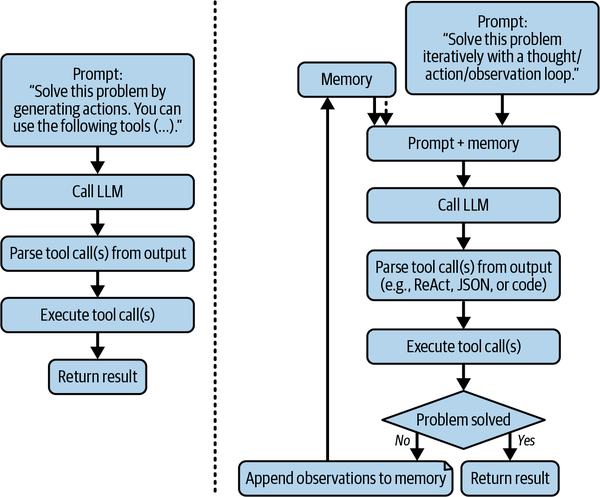

*图 2-1　单步智能体工作流（左）与 ReAct 智能体工作流（右）。左侧将工具结果直接作为输出，以突出非迭代路径。生产系统可以直接返回该结果，也可以将它交回 LLM，以整理最终响应格式。*

> 图中文字对照：左侧提示为“通过生成动作解决这个问题。你可以使用以下工具（……）”；右侧提示为“通过思考／行动／观察循环，迭代解决这个问题”。Call LLM＝调用 LLM；Parse tool call(s) from output＝从输出解析工具调用；Execute tool call(s)＝执行工具调用；Return result＝返回结果；Memory＝记忆；Prompt + memory＝提示＋记忆；e.g., ReAct, JSON, or code＝例如 ReAct、JSON 或代码；Problem solved＝问题是否解决；Yes／No＝是／否；Append observations to memory＝将观察结果追加到记忆。

**表 2-1　示例：对“总结文档并为关键统计数据绘制柱状图”这一任务，单步执行与多步（ReAct）执行的比较**

| 步骤 | 单步智能体 | 多步（ReAct）智能体 |
| --- | --- | --- |
| 1 | 读取一次请求 | 读取请求，并对第一个动作（提取统计数据）形成初步想法 |
| 2 | 在内部规划完整操作序列 | 行动：执行提取；观察：把提取的数据保存到记忆中 |
| 3 | 一次性生成摘要和图表 | 思考：规划下一步，依据提取的数据生成摘要 |
| 4 | 返回输出，不重新检查中间结果 | 行动：生成摘要；观察：把输出保存到记忆中 |
| 5 | 执行过程中不作调整 | 思考：规划最后一步，绘制柱状图；行动：生成图表；观察：检查输出 |
| 6 | — | 如果中间结果不完整，就重复循环，直到满意，然后返回最终输出 |

表格逐步展示了差别，图 2-1 则并排展示了整体工作流。单步智能体沿着从提示到结果的线性流水线运行；多步智能体则把推理、行动和记忆嵌入迭代循环，直到问题解决或计算预算耗尽才停止。记忆将在第 10 章深入讨论。

### 结构化推理与行动

<!-- source: PDF 59–62 -->

赋予智能体不同的人设，有时也称为拟人化，可以让它们的推理更敏锐、贡献更聚焦。被设定为有条理的战略家的规划智能体，与被设定为评估者的批评智能体，会以不同方式处理问题。当每个智能体都有明确的角色和思维方式时，它们的推理链通常会更连贯，在 MAS 中的互动也会更有目的性。这种角色对齐有助于协作，因为每个智能体都知道自己应当贡献哪类知识。

不过，定义角色只完成了一半。要让智能体更有效，你可能还需要塑造它的思考方式。这正是思维链、思维树和 ReAct 等结构化推理方法发挥作用的地方。

#### 让 AI 智能体把思考过程说出来

**思维链提示（chain-of-thought prompting，CoT）**[^ch2-1] 受到人类思考过程启发：先解决中间步骤，再得出最终答案。CoT 经常被介绍为一种提示技巧，但在 AI 智能体的背景下，它可以充当额外的推理步骤，引导控制流。通过要求模型生成中间步骤，你能够更清楚地观察推理过程。这样做通常能提高可靠性，也能帮助较小模型完成原本需要较大模型才能完成的任务，在降低成本的同时，让你更清晰地理解智能体如何作出决策。表 2-2 提供了常见场景下的提示思路，你可以根据需要调整。

**表 2-2　示例：不同场景下的思维链提示**

| 场景 | CoT 提示示例 |
| --- | --- |
| 规划 | “逐步规划一周的博客发布安排。解释每项选择背后的理由。” |
| 数据分析 | “先描述数据集。接着指出其中的模式或趋势。最后清楚总结所得见解。” |
| 数学问题 | “把问题拆成更小的部分。逐一求解并作出解释。然后合并结果，给出最终答案。” |
| 研究任务 | “先列出核心问题。逐一调查。最后给出综合总结。” |
| 调试 | “首先列出可能的原因。依次检验每个原因。排除不符合情况的原因并解释为什么，直到找到修复办法。” |
| 决策 | “列出所有可选方案。逐步考虑优缺点。选出最符合标准的方案，并解释原因。” |

为了更具体地展示如何把这种方法放进工作流，我们来看一个数据分析智能体。CoT 风格智能体的核心能力，是把工作组织成中间推理步骤，因此数据分析是一个合适的例子。目标不是把不受限制的原始推理作为最终答案暴露出来，而是引导智能体完成可见的分析阶段：先描述数据集，再指出模式或趋势，最后给出解释。

示例 2-1 给出了这类智能体可以使用的通用系统提示。为简洁起见，我省略了其他代码，但你可以在[本书仓库](https://oreil.ly/github-ai-agents)找到完整可运行的实现。

**示例 2-1　CoT 提示**

```python
SYSTEM_INSTRUCTIONS = f"""You are a careful data analysis assistant.
Think step-by-step and be explicit in your reasoning.

Structure your analysis as a clear chain of thought, and present your FINAL ANSWER
in these three parts:
1. Describe the dataset: its shape, its columns, and what each column represents.
2. Highlight the patterns or trends you find.
3. Conclude with a clear summary of insights.
Return your FINAL ANSWER only after you have executed the analysis successfully."""
```

> 提示译文：你是一位细致的数据分析助手。逐步思考，并明确说明推理。用清晰的思维链组织分析，最终答案分为三部分：① 描述数据集的形状、各列及其含义；② 指出发现的模式或趋势；③ 清楚总结所得见解。只有成功执行分析后，才返回最终答案。

要让智能体使用 Python，就需要沙箱。LangChain 提供的 `PyodideSandboxTool` 可以创建隔离的 Pyodide 环境，将结果打印到标准输出，并以异常回溯形式呈现错误。Pyodide 是编译为 WebAssembly 的完整 Python 运行时，能够在浏览器内直接运行标准 Python 代码。示例 2-2 实现了这一功能。

**示例 2-2　创建 Pyodide 沙箱**

```python
python_repl = PyodideSandboxTool(
    name="python_repl",
    description=(
        "Execute Python code for data analysis. Always print results. Use pandas for "
        "tables. Charts must be emitted as pure SVG strings printed to stdout "
        "(matplotlib is not available, and the sandbox filesystem is not visible to "
        "the host)."
    ),
    allow_net=True,
)
tools = [python_repl]
```

接下来，只需像示例 2-3 那样创建一个智能体，就可以让它使用这个提示。

**示例 2-3　CoT 智能体**

```python
agent = create_react_agent(
    model=llm,
    tools=tools,
    prompt=SYSTEM_INSTRUCTIONS,
)
```

运行这段代码时，智能体正确描述了演示数据集，准确分析了其中的模式与趋势，还生成了一张柱状图和见解总结。

这个例子说明，CoT 如何让智能体的推理过程可见、可验证。如果使用这个示例中的代码，基本上就是要求智能体把中间步骤显式呈现出来；这不仅增强了对结果的信心，也为结论的形成过程建立了透明的审计轨迹。

#### 生成一棵可能性之树

<!-- source: PDF 62–67 -->

现在设想这样一种场景：任务更复杂，但你不想使用推理模型或完整的多智能体架构；与此同时，又确实需要更具探索性和策略性的方法。在这种情况下，可以使用**思维树提示（tree-of-thoughts prompting，ToT）**[^ch2-2]。ToT 将 CoT 推理扩展为分支搜索过程，先探索和评估多条推理路径，再决定最佳下一步。

在接下来的代码示例（示例 2-4 至示例 2-6）中，我将展示如何把 ToT 实现为分阶段工作流，而不是完整的多智能体系统。核心思路是：使用生成阶段提出多条潜在路径，使用评估阶段打分或筛选，再使用执行阶段沿着选定路径推进。这些阶段可以实现为独立的智能体角色、图节点或 LLM 调用，并可根据成本与质量要求使用不同模型。这种简化的 ToT 方法，在简单的 ReAct 循环（见“如何让智能体行动并反思”）与更完整的树搜索算法所需的计算复杂度之间，提供了一种务实的折中；后者将在“测试时计算：在模型规模与思考之间取得平衡”一节介绍。

> **把 ToT 作为工程捷径**
>
> 让较小模型提出分支、较强模型负责评估的轻量 ToT 配置，有时可以替代完整的多智能体架构。在这种情况下，“角色”是工作流阶段，而非独立智能体。如果较小的配置已经能给出可靠结果，就无需反复调用大型推理模型，从而简化设计、节省金钱和时间。

首先创建一棵可能性之“树”。示例 2-4 中的 `propose_options` 节点就是第一步。它不产生单一、线性的输出，而是使用较小的 LLM 为一篇博客提出三种不同方案。在这个示例中，分支因子被有意限制为 3，以便工作流易于检查、运行成本较低。这些方案代表候选分支，也就是 ToT 意义上的“思维”；工作流可以先评估它们，再选择路径。这与暴露推理模型的内部轨迹不同。这里的“思维”是作为工作流一部分明确生成的候选输出。这正是 ToT 的核心原则：从单链过程转向多路径探索。

**示例 2-4　生成候选思路**

```python
def propose_options(state: BlogState) -> BlogState:
    """Generator (small): propose 3 creative approaches (ToT-style branching)."""
    proposer = gen_llm.with_structured_output(OptionsPayload)
    prompt = (
        "Generate exactly 3 distinct approaches for a developer-focused blog on:\n"
        f"{state['topic']}\n\nFor each option, provide: title, audience, angle, "
        "a 5-bullet outline, and a concise rationale."
    )
    payload: OptionsPayload = proposer.invoke(prompt)
    state["options_json"] = payload.model_dump_json()
    state["messages"].append(AIMessage(content=state["options_json"]))
    return state
```

然后引入负责反思和选择的智能体（示例 2-5），对树进行剪枝。这里由更强大的 LLM 评估提出的三个方案。可以要求模型根据清晰度、原创性等标准逐一批评，再选出最佳方案。我在剪枝步骤使用更强模型，是因为评估者正在作出影响重大的路由决策：如果选错分支，工作流可能过早丢弃最有希望的路径。这与大规模相对评估不同：在后者中，如果评判者只需要在一组候选项内部一致地排序，较便宜的模型也可能足够。这个步骤对 ToT 至关重要，因为它确保智能体不会直接沿着第一个想法推进，而是先批判性地评估备选方案，再选择最有希望的路径。

**示例 2-5　剪枝节点**

```python
def reflect_and_select(state: BlogState) -> BlogState:
    """Judge (stronger): critique options and select best one."""
    chooser = judge_llm.with_structured_output(ChoicePayload)
    eval_prompt = (
        "Evaluate the 3 approaches for clarity, originality, developer relevance, "
        "and feasibility under time constraints. Pick ONE by index 0..2 and justify."
        f"Options JSON:\n{state['options_json']}"
    )
    choice: ChoicePayload = chooser.invoke(eval_prompt)
    opts = json.loads(state["options_json"])["options"]
    idx = max(0, min(choice.choice_index, len(opts)-1))
    choice.choice_index = idx
    state["choice_json"] = choice.model_dump_json()
    state["messages"].append(AIMessage(content=state["choice_json"]))
    return state
```

和前面一样，为简洁起见，我省略了其他节点的剩余代码；完整实现可在[本书仓库](https://oreil.ly/github-ai-agents)中找到。这里要展示的是，如何在 LangGraph 中将各部分连接起来，以及我建议使用哪些类型的 LLM。其中一个重要范式是**交接（handoff）**。交接规定控制权如何在智能体之间转移：接下来谁发言、谁行动，以及在什么条件下发生。在 LangGraph 中，节点编码智能体逻辑，边代表交接。把多个节点连接起来，实际上就是在一张图内构建一个 MAS。共享状态则是所有节点共同使用的记忆和上下文。示例 2-6 展示了 ToT 中的实际连接方式。

**示例 2-6　创建 ToT 图**

```python
graph = StateGraph(BlogState)
graph.add_node("propose", propose_options)
graph.add_node("reflect", reflect_and_select)
graph.add_node("research", research_with_tools)
graph.add_node("draft", draft_outline_and_intro)

graph.add_edge(START, "propose")
graph.add_edge("propose", "reflect")
graph.add_edge("reflect", "research")
graph.add_edge("research", "draft")
graph.add_edge("draft", END)

checkpointer = MemorySaver()
app = graph.compile(checkpointer=checkpointer)
```

1. `propose`：负责创意生成的小型 LLM。
2. `reflect`：更强的评判／反思 LLM。
3. `research`：使用工具的研究者。
4. `draft`：小型写作模型。

运行代码后，你会看到提出的不同主题及参考链接。为了进一步优化结果，可以加入人类在环交互（见“设计人类在环工作流”），审查并批准动作。

人们很容易把 CoT 和 ToT 当成巧妙的提示技巧，但你已经看到，它们也可以是强大的工程工具。图 2-2 对比了两种方法：左侧是使用 CoT 推理的单个智能体；右侧是多智能体配置，不同角色协作探索、反思和改进，模拟 ToT。

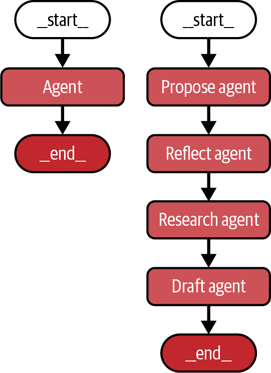

*图 2-2　对比 CoT 与 ToT 的控制流图。*

> 图中文字对照：Agent＝智能体；Propose agent＝提案智能体；Reflect agent＝反思智能体；Research agent＝研究智能体；Draft agent＝起草智能体；`__start__`／`__end__`＝开始／结束。

两者共同展示了结构化推理的范围：从由中间步骤组成的线性链，到探索与筛选构成的分支过程。它们都说明，只要引导智能体分阶段思考，无论是由单一角色完成，还是由协调的团队完成，结果都会更审慎、更可靠。

#### 如何让智能体行动并反思

<!-- source: PDF 67–74 -->

上一节展示了 CoT 和 ToT 如何帮助推理，但仅有推理还不够。只推理的智能体始终停留在纸面上，只行动的智能体则无法从决策中学习。要结合两者，就需要 **ReAct**[^ch2-3]，即推理与行动（reasoning and action）。简单来说，ReAct 把每一步看成一次选择：是用语言进行思考，还是在环境中行动。智能体查看当前上下文，决定生成推理轨迹还是调用工具，然后将结果带入下一步。

从数学上看，可以把这个过程理解为：将上下文 $c_t$ 映射为增强动作 $\hat{a}_t$，该动作位于增强动作空间 $\hat{A}=A\cup L$ 中。这里，$A$ 是影响环境的任务特定动作集合，$L$ 是基于语言的推理轨迹或思维集合。换句话说，每一步都可以产生外部动作、推理轨迹，或者同时产生两者。

这些轨迹会重新纳入智能体状态，因此上下文按如下方式演化：

$$
c_{t+1} = (c_t, \hat{a}_t)
$$

也就是说，下一步上下文由当前上下文和新产生的增强动作共同构成。

此外，遵循如下策略：

$$
\pi(a_t\mid c_t)
$$

这里，$o_t$ 是第 $t$ 步的观察，例如用户消息或工具结果；$a_t$ 是对此作出的动作，例如一个推理步骤或工具调用。因此，上下文可以写成：

$$
c_t=(o_1,a_1,\ldots,o_{t-1},a_{t-1},o_t)
$$

换句话说，智能体向后传递的不仅有它做过什么，还有为什么选择那条路径。这种递归结构使反思成为可能：智能体未来的决策同时受到动作历史和已积累推理的影响。图 2-3 展示了用 LangGraph 实现的最小智能体循环。

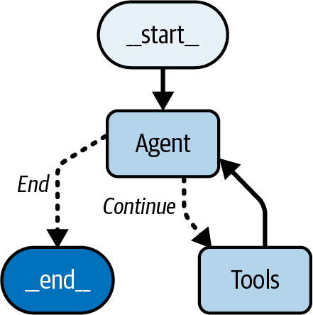

*图 2-3　ReAct 智能体的控制流图。该循环是策略 $\pi(a_t\mid c_t)$ 的实际运行形式。*

> 图中文字对照：Agent＝智能体；Tools＝工具；Continue＝继续；End＝结束；`__start__`／`__end__`＝开始／结束节点。

流程从 `__start__` 开始，将控制权交给智能体，然后根据结果选择分支：

- 如果智能体判断已经得出结论，就产生结束信号，转入 `__end__`。
- 如果还需要更多推理或行动，就发出继续信号，并可能调用工具，获取更多信息或执行动作。
- 与工具交互之后，控制权回到智能体，让它整合结果并反思，再决定继续还是停止。

这个循环就是 ReAct 的本质：在迭代周期中结合推理、行动和反思。ReAct 不只是“模型先思考，再行动”。推理轨迹本身也成为不断演化的状态的一部分。也就是说，ReAct 智能体交替产生推理轨迹和工具输出，并将这些轨迹反馈到上下文中。

虽然这个例子讨论的是单个智能体，同样的结构也能自然扩展到更大的 MAS。每个智能体都可以维护自己的推理与行动循环，并在智能体之间共享或交换推理轨迹。因此，ReAct 不仅是个体决策工具，也是更复杂智能体系统中协作与反思的基础。

下面把数学表达和流程图落实到代码中。接下来的清单把 ReAct 方程转成代码。和前面一样，这里只展示重要部分，完整可运行实现见[配套 notebook](https://oreil.ly/-6AJc)。

进入代码前，先记住目的：维护不断增长的对话状态 $c_t$，同时让模型在语言轨迹 $L$ 与任务动作 $A$ 之间交替。每一步都会把思维、动作或工具观察结果追加到状态中。代码正是对这个循环的映射。因此，首先像示例 2-7 那样，为图创建状态。

**示例 2-7　创建 ReAct 状态**

```python
class AgentState(TypedDict):
    messages: Annotated[Sequence[BaseMessage], add_messages]
```

1. `AgentState`：智能体的状态。
2. 上下文 $c_t$ 就是消息流。

接下来，在示例 2-8 中赋予模型两种能力：生成充当思维 $L$ 的语言 token，以及请求结构化工具调用 $A$。绑定工具后，这些动作就成为运行时可以分派执行的一等输出。

**示例 2-8　初始化 LLM**

```python
model = ChatOpenAI(model="gpt-5.4-mini", temperature=0)
model = model.bind_tools(TOOLS)
```

1. 给模型绑定工具，将动作空间扩展为 $\hat{A}=A\cup L$。

示例 2-9 是策略步骤。它读取完整消息历史，应用系统规则，然后只产生一次输出：思维、工具调用请求，或两者兼有。这里不做分支判断，只返回模型作出的决定。

**示例 2-9　调用模型**

```python
def call_model(state: AgentState, config: RunnableConfig) -> Dict[str, Any]:
    response = model.invoke([SYSTEM_PROMPT] + state["messages"], config)
    return {"messages": [response]}
```

1. 策略 $\pi(c_t)\rightarrow\hat{a}_t$ 对应在当前上下文上调用 `model.invoke`。
2. 归并函数（reducer）追加新消息，实现 $c_{t+1}=(c_t,\hat{a}_t)$。

在示例 2-10 中，将意图转化为实际效果。每个被请求的工具调用都会确定性地执行，其结果封装为消息。把观察结果推入同一条消息流，就能让下一次策略步骤根据新的证据推理，而无须特殊处理。

**示例 2-10　执行工具调用**

```python
def tool_node(state: AgentState) -> Dict[str, Any]:

    last = state["messages"][-1]
    outputs: list[ToolMessage] = []
    for tc in getattr(last, "tool_calls", []) or []:
        name = tc.get("name")
        args = tc.get("args") or {}
        tool_fn = TOOLS_BY_NAME.get(name)
        if not tool_fn:
            result = json.dumps({"error": f"Unknown tool {name}"})
        else:
            result = tool_fn.invoke(args)
        outputs.append(
            ToolMessage(
                content=result,
                name=name,
                tool_call_id=tc.get("id"),
            )
        )
    return {"messages": outputs}
```

1. 如果模型选择了动作 $a_t\in A$，就执行工具。
2. 工具输出是为下一步提供依据的观察结果。

示例 2-11 的停止规则很简单：如果模型请求了工具，就必须先完成该动作，再次询问模型；如果没有请求工具，就假定它已经生成最终答案。这使循环保持可预测，并避免出现悬空动作。

**示例 2-11　停止条件**

```python
def should_continue(state: AgentState) -> str:
    last = state["messages"][-1]
    if getattr(last, "tool_calls", None):
        return "continue"
    return "end"
```

1. 停止检查读取最后一条 AI 消息，决定继续还是结束。

现在把各部分连接成一个小型状态机，如示例 2-12 所示。边编码了与 ReAct 图对应的控制流。策略节点先运行；如果发出动作，就路由到工具节点，然后回到策略节点；如果只发出思维或最终答案，则终止。

**示例 2-12　构建工作流图**

```python
workflow = StateGraph(AgentState)
workflow.add_node("agent", call_model)
workflow.add_node("tools", tool_node)
workflow.set_entry_point("agent")

workflow.add_conditional_edges(
    "agent",
    should_continue,
    {"continue": "tools", "end": END},
)

workflow.add_edge("tools", "agent")
graph = workflow.compile()
```

运行时，图每次沿一条边推进。条件边决定下一跳是 `tools` 还是 `END`；从 `tools` 返回 `agent` 的固定边，则闭合了思考—行动循环。

要观察实际效果，可以提出一个问题；我问的是苏黎世的天气。LLM 首先决定调用哪个工具最有利于回答问题，然后工具返回证据，模型再据此写出最终答案。由于每一步都记录在消息流中，推理过程可以被检索出来：

````text
> Entering new ReAct trace...
Question: What is the weather in Zurich today?

Reasoning Summary: selecting a tool based on the query
Action:
```
{
  "action": "internet_search",
  "action_input": {
    "query": "Zurich weather today forecast"
  }
}
```
Observation:
```
{
  "title": "Zurich, Zurich, Switzerland Weather Forecast",
  "snippet": "Hourly Weather \u00b7 1 AM 55\u00b0. rain drop 54% \u00b7
   2 AM 54\u00b0. rain drop 25% \u00b7 3 AM 54\u00b0. rain drop 20% \u00b7
   4 AM 54\u00b0. rain drop 20% \u00b7 5 AM 53\u00b0. rain drop 20% \u00b7 ...
```

Final Answer: Today in Zurich, it looks **cloudy with periods of rain and
temperatures around 14–19°C. Some forecasts also suggest light rain / showers
with a high chance of precipitation.

For more details, you can check the full forecast
[here](https://www.accuweather.com/en/ch/zurich/316622/weather-forecast/316622).

> Finished trace.
````

> 上述示例输出的中文对照：问题是“今天苏黎世天气如何？”；推理摘要为“根据查询选择工具”；动作是用 `internet_search` 搜索“苏黎世今日天气预报”；观察结果是天气预报网页的标题和逐小时摘要。最终答案表示，苏黎世当天多云、间有降雨，气温约 14–19°C，部分预报提示小雨或阵雨、降水概率较高，并提供完整预报链接。原书的观察结果本身是截断片段，且最终答案中的 Markdown 加粗标记未闭合，此处按原输出保留。

现在你已理解 ReAct 的能力。关键不仅在于智能体交替思考和行动，更在于推理本身成为状态的一部分。这种递归过程让智能体能够适应、改进策略并解释选择。在实践中，它使相对较小的模型也能更可靠地完成复杂任务，同时让决策过程透明可见。

CoT、ToT 和 ReAct 共同展示了不同推理策略如何塑造智能体的智能。每种方法都有优势：CoT 提供透明性与可靠性；ToT 在确定方案前探索多个备选项；ReAct 则将推理与工具使用结合起来，闭合循环。表 2-3 汇总了这些推理模式，并提示它们最适合什么场景。

**表 2-3　模式总结：结构化推理方法（CoT、ToT、ReAct）**

| 方法 | 使用场景 | 优点 | 权衡／失败模式 |
| --- | --- | --- | --- |
| 思维链（CoT） | 数学、规划、分析中的逐步推理 | 提高可靠性和透明性；让较小模型能处理更难的任务 | 较慢，输出冗长；可能产生看似合理但实际错误的推理 |
| 思维树（ToT） | 存在多条求解路径的探索性任务，例如创意写作、策略搜索 | 探索备选方案；减轻“首个答案偏见” | 计算成本较高；如果不剪枝，分支可能迅速膨胀 |
| ReAct | 同时需要推理和工具使用的任务，例如研究、编码、API 操作 | 整合推理与行动；建立审计轨迹；根据反馈调整 | 状态管理更复杂；可能过度调用工具，或在缺少停止条件时持续循环 |

这说明，一旦把这些方法整合进整体智能体工作流，它们就能成为强大的构建模块。

### 别闹了，AI 智能体！

<!-- source: PDF 75–84 -->

有时，智能体的行为颇有娱乐性。它可能调用错误的工具、无休止地循环，或者给出出奇富有创意的响应。遇到这种情况，你可能会笑着在心里对它说：“你是在开玩笑吧？”但当同样的不可预测性涉及访问控制、金融操作或客户数据时，就不再好笑了。在错误的时机、对错误的系统采取动作，可能造成严重后果。这正是**人类在环（human-in-the-loop，HITL）**存在的原因。HITL 让智能体能在关键点暂停，请求你的批准，并在确认可以安全继续后才向前推进。

HITL 不仅用于在错误发生前拦截它们，还提供问责能力和透明性。在智能体工作流中插入检查点，可以确保不可逆动作经过审查、决策可追溯、敏感操作保持在人类控制之下。这种监督并非单纯拖慢系统，而是让智能体更值得信任，也更容易被生产环境采用。

#### 设计人类在环工作流

HITL 工作流可以使用几种不同的中断方式。最常见的如下。

- **批准或拒绝**：在 API 调用等关键步骤之前暂停图，供人审查并批准动作。如果动作被拒绝，就阻止图执行这一步，并可能采取替代动作。这种模式通常涉及依据人工输入来路由图。
- **审查与编辑**：暂停图，以审查和编辑图状态。这适用于纠正错误，或用额外信息更新状态。
- **审查工具调用**：如果工具调用可能影响外部系统，就在执行前检查参数。例如，在实际预订旅行行程之前，先确认预订详情。
- **验证人工输入**：在图中的某个特定步骤显式请求人工输入。这可以收集额外信息或上下文，为智能体决策提供依据，也可以支持多轮对话。

LangGraph 提供了关于如何在应用中使用这些模式的[详细文档](https://oreil.ly/n0BLl)。此外，[本书仓库](https://oreil.ly/github-ai-agents)包含六种模式的完整可运行示例，可以通过 `main()` 函数进行选择，如示例 2-13 所示。

**示例 2-13　HITL 模式演示的主函数**

```python
def main():
    menu = """
Pick a demo
1. Human feedback loop for writing
2. Approval gate before API call
3. Review and edit state
4. Parallel interrupts with resume map
5. Tool call review in a tiny ReAct loop
6. Static interrupts for debugging
q. Quit
> """
```

> 菜单译文：选择演示：1. 写作中的人工反馈循环；2. API 调用前的审批关卡；3. 审查与编辑状态；4. 使用恢复映射的并行中断；5. 小型 ReAct 循环中的工具调用审查；6. 用于调试的静态中断；q. 退出。

在下面的代码示例（示例 2-14 至示例 2-21）中，我将说明如何实现前文及示例 2-13 提到的模式，并介绍实现时需要留意的关键点。

> **LangGraph 中的 Command**
>
> LangGraph 的 `Command` 将控制流（边）与状态更新（节点）结合起来，方便多个参与者或多个智能体通信。例如，一个节点可以更新自己的状态，并决定接下来访问哪个节点。LangGraph 通过让节点函数返回 `Command` 对象来实现这一点。

如果要为 HTTP 调用之类会产生副作用的步骤设置关卡，就使用“批准或拒绝”模式。

示例 2-14 要求 LLM 生成请求计划，并将其保存在 `proposed_request` 中。

**示例 2-14　使用 LLM 提出请求方案**

```python
def b_propose(state: BState) -> BState:
    prompt = "Return only JSON with keys url and params for GET to https://httpbin.org/get using q and limit."
    text = LLM.invoke(prompt).content
    m = re.search(r"\{.*\}", text, re.S)
    data = {"url": "https://httpbin.org/get", "params":
           {"q": "fallback", "limit": 1}}
    if m:
        try:
            data = json.loads(m.group(0))
        except Exception:
            pass
    return {"proposed_request": data}
```

1. 要求 LLM 生成结构化计划。
2. 解析失败时使用默认的后备请求。
3. 尝试从模型输出中解析 JSON。
4. 将结果保存在状态的 `proposed_request` 字段中。

示例 2-15 调用 `interrupt(...)` 暂停，向人请求批准或修订。

**示例 2-15　请求的审批关卡**

```python
def b_gate(state: BState) -> Command[Literal["b_call", "b_propose"]]:
    v = interrupt({
        "question": "Approve or revise request",
        "proposed_request": state["proposed_request"],
        "schema": {
            "type": "object",
            "properties": {
                "action": {"enum": ["approve", "revise"]},
                "update": {"type": "object"}
            },
            "required": ["action"]
        }
    })
    action = v.get("action")
    if action == "approve":
        return Command(goto="b_call", update={"decision": "approved"})
    upd = v.get("update") or {}
    new_req = state["proposed_request"].copy()
    if "url" in upd:
        new_req["url"] = upd["url"]
    if isinstance(upd.get("params"), dict):
        new_req.setdefault("params", {}).update(upd["params"])
    return Command(goto="b_gate", update={
        "proposed_request": new_req, "decision": "revised"
    })
```

1. 暂停执行，等待人工决策。
2. 展示拟议请求，供人检查。
3. 施加结构化的批准／修订模式约束。
4. 获得批准后，路由到调用步骤。
5. 如果修订，则携带更新后的请求回到审批关卡。

恢复时，传入 `Command(resume={"action": "approve"})` 即可继续；或者传入 `{"action": "revise", "update": {...}}`，合并修改并返回审批关卡。

示例 2-16 只在批准之后执行 HTTP 调用，并保存 `api_result`。你可以通过拒绝来阻止执行，路由取决于人工输入。

**示例 2-16　执行已批准的 HTTP 调用**

```python
def b_call(state: BState) -> BState:
    import requests
    r = requests.get(
        state["proposed_request"]["url"],
        params=state["proposed_request"]["params"], timeout=10
    )
    return {"api_result": {"status_code": r.status_code, "url": r.url}}
```

1. 只在获得批准后运行外部请求。
2. 将结果保存在状态中的 `api_result` 字段下。

“审查与编辑”通过直接写入状态来纠正或改善模型输出。这里，示例 2-17 用 LLM 生成简短摘要，并保存在 `summary` 中。

**示例 2-17　生成摘要文本**

```python
def c_write(state: CState) -> CState:
    text = LLM.invoke("Write 2 sentences about why human in the loop matters for agents").content
    return {"summary": text}
```

1. 要求 LLM 生成候选摘要。
2. 将摘要保存在状态中，供稍后审查。

示例 2-18 通过 `interrupt(...)` 暂停，其中包含要求提供 `edited_text` 的 JSON Schema。

**示例 2-18　中断以进行人工编辑**

```python
def c_edit(state: CState) -> CState:
    res = interrupt({
        "task": "Edit the summary text",
        "summary": state["summary"],
        "schema": {
            "type": "object",
            "properties": {"edited_text": {"type": "string"}},
            "required": ["edited_text"]
        }
    })
    return {"summary": res["edited_text"]}
```

1. 暂停并请求人工编辑输入。
2. 提供生成的摘要，供人检查。
3. 将编辑内容限制为字符串字段。
4. 用人工修订覆盖摘要。

通过 `Command(resume={"edited_text": "your revision"})` 恢复。节点重新开始后会返回你的编辑内容，而不是再次暂停；随后，图用人工版本更新 `summary`。这意味着，你确实先暂停审查，再用编辑后的内容覆盖图状态。

当工具可能影响外部系统、需要检查参数时，就使用“审查工具调用”模式。示例 2-19 用 `interrupt([...])` 包装任意工具。中断载荷要求人选择接受、编辑或直接回应。

**示例 2-19　用审查关卡包装工具**

```python
def add_hitl(tool_obj: BaseTool | Any) -> BaseTool:
    if not isinstance(tool_obj, BaseTool):
        tool_obj = tool(tool_obj)

    @tool(tool_obj.name, description=tool_obj.description,
          args_schema=tool_obj.args_schema)
    def wrapped(**tool_input):
        request = [{
            "action_request": {"action": tool_obj.name, "args": tool_input},
            "config": {"allow_accept": True, "allow_edit":
                       True, "allow_respond": True},
            "description": "Review this tool call"
        }]
        response = interrupt(request)[0]
        if response["type"] == "accept":
            return tool_obj.invoke(tool_input)
        if response["type"] == "edit":
            new_args = response["args"]["args"]
            return tool_obj.invoke(new_args)
        if response["type"] == "response":
            return response["args"]
        raise ValueError("Unsupported interrupt response type")
    return wrapped
```

1. 将原工具调用包装为审查请求。
2. 传递工具名和参数，供人检查。
3. 允许人接受、编辑或直接回应。
4. 暂停，直到收到决策。
5. 接受时执行原始工具调用。
6. 编辑时用修订后的参数执行工具。
7. 直接回应时，用人工响应替代工具输出。

可以使用下列命令之一来恢复：

```text
{"type": "accept"}
{"type": "edit", "args": {"args": {"query": "weather in NY"}}}
{"type": "response", "args": "Skip the tool right now"}
```

包装器会执行原始工具调用、用编辑后的参数执行，或者不调用工具，直接返回人工消息。这样，你就能在工具调用真正触及外部世界之前检查并批准它们。

> **中断与副作用**
>
> 绝不要把会产生副作用的代码，例如 API 调用或数据库写入，与 `interrupt(...)` 放在同一个节点中。始终先暂停，只在明确批准之后才执行副作用，以避免恢复时重复执行。

有时你还希望并行收集多份输入，在所有输入就绪之后恢复图。当多个独立人工决策可以同时作出时，这很有用，例如并行审查两段生成文本、分别进行法务与技术审批，或让多位分析师验证智能体输出的不同部分，然后再继续工作流。示例 2-20 展示了实现方式。

**示例 2-20　并行人工中断**

```python
class DState(TypedDict, total=False):
    text_1: str
    text_2: str

def d_h1(state: DState):
    v = interrupt({"text_to_revise": state["text_1"]})
    return {"text_1": v}

def d_h2(state: DState):
    v = interrupt({"text_to_revise": state["text_2"]})
    return {"text_2": v}

def build_graph_D():
    g = StateGraph(DState)
    g.add_node("d_h1", d_h1)
    g.add_node("d_h2", d_h2)
    g.add_edge(START, "d_h1")
    g.add_edge(START, "d_h2")
    g.add_edge("d_h1", END)
    g.add_edge("d_h2", END)
    return g.compile(checkpointer=CHECKPOINTER)
```

1. 为第一段文本输入触发中断。
2. 用修订后的 `text_1` 更新状态。
3. 为第二段文本输入触发中断。
4. 用修订后的 `text_2` 更新状态。
5. 将两个节点都添加到图中。
6. 两个节点都直接从 `START` 分支出去。
7. 编译时使用检查点保存器，让两个中断都能够恢复。

这里，两个节点都从 `START` 开始，各自调用 `interrupt(...)`。示例 2-21 构建一个字典，将 `interrupt_id` 映射到对应值，再通过 `Command(resume=that_map)` 恢复。

**示例 2-21　恢复多个中断**

```python
def wait_for_interrupt_and_prompt(app, cfg):
    state = app.get_state(cfg)
    ints = getattr(state, "interrupts", []) or []
    if not ints:
        print("No interrupts pending")
        return None

    if len(ints) > 1:
        print("\nMultiple interrupts pending:")
        for i, it in enumerate(ints, 1):
            print(f"[{i}] id={it.interrupt_id} value={jdump(it.value)}")
        print("Enter values per interrupt. Leave blank to echo original.")
        resume_map = {}
        for it in ints:
            val = input(f"Value for {it.interrupt_id}: ").strip()
            if val:
                try:
                    resume_map[it.interrupt_id] = json.loads(val)
                except Exception:
                    resume_map[it.interrupt_id] = val
            else:
                resume_map[it.interrupt_id] = it.value
        return Command(resume=resume_map)
```

1. 从状态中收集所有待处理的中断。
2. 一次处理多个中断。
3. 打印每个中断 ID 及其当前值。
4. 为每个中断向人请求一个新值。
5. 尝试按 JSON 解析，以支持结构化编辑。
6. 如果没有输入，则保留原值。
7. 使用包含全部更新值的映射恢复执行。

正如你所见，加入人工监督并没有唯一“正确”的方式。可以根据任务敏感度和希望保留的控制程度选择不同模式。我鼓励你在[配套 notebook](https://oreil.ly/G-f2Z)中试验这些模式；这样更容易理解，人工监督如何从简单的审批关卡，发展成更丰富的人与智能体协作。

### 高级智能体范式：监督者与层次式智能体

<!-- source: PDF 84–85 -->

如果任务开始变得比前面的例子更复杂，或者你发现智能体处理起来很吃力，将任务拆成更小的子任务可能会有帮助。可以把它想象成组建团队：每个人带来不同技能，共同解决更大的挑战。

同样，你可以引入更小、相互独立的智能体，组成 MAS。一种常见配置是**监督者架构（supervisor architecture）**：每个智能体都向同一位监督者汇报，由监督者决定接下来谁行动。更高级的版本是**层次式架构（hierarchical architecture）**：不仅有监督者，还有监督者的监督者。这种推广带来了更灵活的控制流。它与 ToT 不同。ToT 通过分支探索同一任务的多条可能推理路径；监督式或层次式 MAS 则通过路由，决定接下来由哪个专业智能体或子团队行动。换句话说，ToT 在思维空间中组织备选方案，而 MAS 架构在智能体之间组织工作。图 2-4 比较了单智能体配置与这两种多智能体模式。

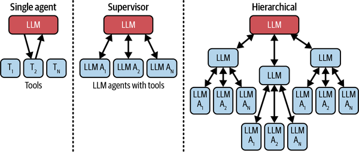

*图 2-4　单智能体、监督者和层次式智能体架构的比较。*

> 图中文字对照：Single agent＝单智能体；Supervisor＝监督者；Hierarchical＝层次式；Tools＝工具；LLM agents with tools＝配备工具的 LLM 智能体。`T₁…Tₙ` 表示工具，`A₁…Aₙ` 表示智能体。

使用 MAS 的主要好处是模块化、专业化和可控性。把功能分散到多个智能体，可以使整个系统更容易开发、测试和维护。每个智能体都可以被设计成领域专家，从而提升系统整体表现。与简单的函数调用不同，多智能体配置还让你能显式控制智能体之间的通信方式。

#### 构建层次式研究团队

<!-- source: PDF 85–93 -->

为了把监督者和子智能体的概念讲清楚，我们来看一个构建层次式研究团队的例子。我会使用 LangGraph 预构建、可复用的 `create_react_agent` 组件，加快 ReAct 智能体的实现。然后给每个工作智能体明确的角色：有的专注网络搜索，有的抓取网页，有的查询 [Exa](https://exa.ai/) 以获得更结构化的搜索结果，还有的在 Google 上查询专利。监督智能体位于上层，协调这些专业角色，根据当前任务、对话状态和工作智能体返回的最新输出，决定接下来谁行动。最终目标是组建一个市场研究团队。图 2-5 展示了将要构建的最终应用。

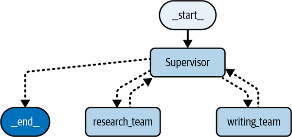

*图 2-5　采用层次式架构的最终应用。*

> 图中文字对照：Supervisor＝监督者；research_team＝研究团队；writing_team＝写作团队；`__start__`／`__end__`＝开始／结束。

不过，在达到这个目标之前，要先从较小规模入手，构建第一套监督者配置：研究团队。图 2-6 展示了将要创建的团队概况。完成之后，第二步是添加写作团队。这个团队接收研究团队的输出，并将其作为一个简单文本文件保存到文件系统中。

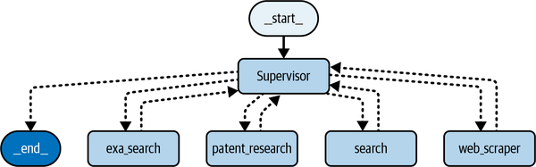

*图 2-6　研究团队的流程图。*

> 图中文字对照：Supervisor＝监督者；exa_search＝Exa 搜索；patent_research＝专利研究；search＝搜索；web_scraper＝网页抓取；`__start__`／`__end__`＝开始／结束。

这里省略创建工具的细节，因为你已经在第 1 章的示例 1-2 中学过。

首先需要一个创建监督者的辅助函数（示例 2-22）。该函数充当路由器（见“将 FSM／HSM 映射到智能体框架”），决定哪个工作智能体执行下一步，或者流程是否应该结束。

**示例 2-22　监督者辅助函数**

```python
class State(MessagesState):
    next: str

def make_supervisor_node(llm: BaseChatModel, members: list[str]) -> str:
    options = ["FINISH"] + members
    system_prompt = (
        "You are a supervisor tasked with managing a conversation between the"
        f" following workers: {members}. Given the following user request,"
        " respond with the worker to act next. Each worker will perform a"
        " task and respond with their results and status. When finished,"
        " respond with FINISH."
    )

    class Router(TypedDict):
        """Worker to route to next. If no workers needed, route to FINISH."""

        next: Literal[*options]

    def supervisor_node(state: State) -> Command[Literal[*members, "__end__"]]:
        """An LLM-based router."""
        messages = [
            {"role": "system", "content": system_prompt},
        ] + state["messages"]
        response = llm.with_structured_output(Router).invoke(messages)
        goto = response["next"]
        if goto == "FINISH":
            goto = END

        return Command(goto=goto, update={"next": goto})

    return supervisor_node
```

1. 创建状态，用于跟踪下一个工作智能体。
2. 定义辅助函数，为任意一组智能体构建监督者节点。
3. 提供系统提示，告诉 LLM 如何担任监督者。
4. 使用结构化输出，可靠地决定下一个调用哪个工作智能体。
5. 监督者返回 `FINISH` 时，让工作流正常终止。

接下来需要一个创建工作节点的辅助函数，实现如示例 2-23 所示。这样可以让配置简洁、可复用，避免每添加一个新智能体都重复相同的样板代码。

**示例 2-23　节点创建辅助函数**

```python
def make_react_worker_node(
    *,
    llm: ChatOpenAI,
    name: str,
    tools: list,
    prompt: str | None = None,
    goto: str = "supervisor",
):
    agent = create_react_agent(llm, tools=tools, prompt=prompt)

    def node(state: State) -> Command[Literal["supervisor"]]:
        result: Dict[str, Any] = agent.invoke(state)
        msgs: Sequence[BaseMessage] = result.get("messages", [])
        content = getattr(msgs[-1], "content", "") if msgs else ""
        return Command(
            update={"messages": [HumanMessage(content=content, name=name)]},
            goto=goto,
        )

    return node
```

1. 用工具和角色提示创建专业化的 ReAct 智能体。
2. 使用当前状态调用智能体。
3. 把智能体的最新输出写回状态，并返回监督者。

有了这些辅助函数，就可以定义智能体。给每个智能体分配具体角色很有帮助。这里的目标是构建市场研究团队，因此角色应当非常有针对性。示例 2-24 展示了我使用的角色提示。

**示例 2-24　为研究智能体分配角色**

```python
SEARCH_PROMPT = """Role: Web researcher. Use the search tool and return a
concise research note with sources. No follow-up questions."""

SCRAPER_PROMPT = """Role: Web scraper. Use the scraping tool to fetch details
from given URLs and summarize key findings. No follow-up questions."""

EXA_PROMPT = """Role: Research assistant. You can search for all recent info
on Exa Search. Your response should clearly articulate the key points you found."""

PATENT_PROMPT = """Role: Market researcher with 20 years of experience.
You are very knowledgeable in patent research and in finding up-to-date info
about patents using the Google Patents API."""
```

> 角色提示译文：
>
> - `SEARCH_PROMPT`：网络研究员。使用搜索工具，返回附有来源的简洁研究笔记。不追问。
> - `SCRAPER_PROMPT`：网页抓取员。使用抓取工具，从给定 URL 获取详细信息并总结关键发现。不追问。
> - `EXA_PROMPT`：研究助理。可在 Exa Search 搜索所有最新信息，回答应清楚陈述所发现的要点。
> - `PATENT_PROMPT`：拥有 20 年经验的市场研究员。熟悉专利研究，以及如何通过 Google Patents API 查找最新专利信息。

现在创建智能体。使用示例 2-23 的辅助函数，可以实例化每个工作智能体，并为其分配相应角色和工具。实现见示例 2-25。

**示例 2-25　创建研究智能体**

```python
specs = [
    dict(
        name="search",
        tools=[tavily_tool],
        prompt=SEARCH_PROMPT,
    ),
    dict(
        name="web_scraper",
        tools=[scrape_webpages],
        prompt=SCRAPER_PROMPT,
    ),
    dict(
        name="exa_search",
        tools=[exa_search_tool],
        prompt=EXA_PROMPT,
    ),
    dict(
        name="patent_research",
        tools=[patent_search],
        prompt=PATENT_PROMPT,
    ),
]

nodes = {s["name"]: make_react_worker_node(llm=llm, **s) for s in specs}

search_node = nodes["search"]
web_scraper_node = nodes["web_scraper"]
exa_search_node = nodes["exa_search"]
patent_research_node = nodes["patent_research"]
```

1. 用各自的工具和角色定义每个工作智能体。
2. 使用辅助函数实例化全部工作智能体，避免重复样板代码。

为了完成监督者架构，需要设置一个能协调全部四个研究智能体的监督者。这可确保工作流不会停滞，并让每个智能体在合适的时机作出贡献。实现见示例 2-26。

**示例 2-26　创建研究监督者节点**

```python
research_supervisor_node = make_supervisor_node(
    llm, ["search", "web_scraper", "exa_search", "patent_research"]
)
```

1. 创建一个协调全部四个研究智能体的监督者。

最后，通过注册节点、连接定义控制流的边，构建实际的图。这样就得到一个功能完整的研究团队图，如示例 2-27 所示。

**示例 2-27　构建研究团队图**

```python
research_builder = StateGraph(State)

research_builder.add_node("supervisor", research_supervisor_node)
research_builder.add_node("search", search_node)
research_builder.add_node("web_scraper", web_scraper_node)
research_builder.add_node("exa_search", exa_search_node)
research_builder.add_node("patent_research", patent_research_node)

research_builder.add_edge(START, "supervisor")
research_builder.add_edge("search", "supervisor")
research_builder.add_edge("web_scraper", "supervisor")
research_builder.add_edge("exa_search", "supervisor")
research_builder.add_edge("patent_research", "supervisor")

research_graph = research_builder.compile()
```

1. 注册监督者与工作智能体节点。
2. 连接边，使所有工作智能体都路由回监督者。
3. 将图编译为可执行工作流。

可以运行示例 2-28 的代码来测试这一配置。

**示例 2-28　用提示运行研究团队**

```python
for s in research_graph.stream(
    {"messages": [("user", """What are AI agents? Are there any patents out there
                              about LLM agents?""")]},
    {"recursion_limit": 100},
):
    print(s)
    print("---")
```

1. 用查询运行研究图，由监督者编排哪些智能体行动。查询内容是：“什么是 AI 智能体？是否存在与 LLM 智能体有关的专利？”

它会先返回对 AI 智能体的简短描述，再使用专利工具检查近期专利。步骤如下；为简洁起见，这里省略了智能体之间的实际消息：

```text
{'supervisor': {'next': 'search'}}
{'supervisor': {'next': 'patent_research'}}
{'supervisor': {'next': '__end__'}}
```

写作团队也可以用同样的方法搭建。本节的 notebook 包含完整可运行代码，图 2-7 则提供了写作团队的概览。

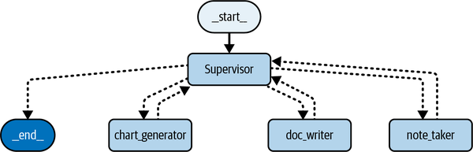

*图 2-7　写作团队的流程图。*

> 图中文字对照：Supervisor＝监督者；chart_generator＝图表生成器；doc_writer＝文档撰写者；note_taker＝笔记记录者；`__start__`／`__end__`＝开始／结束。

这种模块化方法便于逐步组合能力越来越强的 MAS：先连接专业工作智能体，再把整个团队组合到更大的图中。在实践中，这意味着可以从较小规模开始，例如在研究团队中提供搜索、抓取和专利查询，然后将其接入写作团队，形成完整的端到端流水线；还可以继续扩展，加入内部数据，以及图表编写和绘图智能体。

要从独立团队发展为真正的层次结构，需要再构建一张图，把所有部分连接起来。可以把它视为“上层图”，如示例 2-29 所示。

**示例 2-29　构建层次式架构**

```python
super_builder = StateGraph(State)
super_builder.add_node("supervisor", teams_supervisor_node)
super_builder.add_node("research_team", call_research_team)
super_builder.add_node("writing_team", call_paper_writing_team)

super_builder.add_edge(START, "supervisor")
super_graph = super_builder.compile()
```

完成后，就可以像示例 2-30 那样，向层次式 MAS 发出提示。

**示例 2-30　运行层次式 MAS**

```python
TARGET_FILE = "semiconductor_whitepaper.txt"

TASK_MSG = f"""
Write an 800-word research report whitepaper on semiconductor development.
Start with an executive summary of your findings.
Search for relevant recent patents and include links to them.
IMPORTANT: Provide links to all your sources.
Finally, save the full report to disk as a .txt file using the write_document tool.
Use file_name="{TARGET_FILE}".
"""

for step in super_graph.stream(
    {
        "messages": [
            ("user", TASK_MSG.strip())
        ],
    },
    {"recursion_limit": 150},
):
    print(step)
    print("---")
```

> 任务提示译文：撰写一份关于半导体发展的 800 词研究报告白皮书。先给出研究发现的执行摘要；搜索近期相关专利，并附链接。重要要求：为所有来源提供链接。最后使用 `write_document` 工具，将完整报告作为 `.txt` 文件保存到磁盘，文件名使用 `TARGET_FILE` 的值。

运行这套配置后，监督者会依次作出如下决策；这里同样省略了消息：

```text
{'supervisor': {'next': 'research_team'}}
{'supervisor': {'next': 'writing_team'}}
{'supervisor': {'next': 'writing_team'}}
{'supervisor': {'next': '__end__'}}
```

运行结束时，报告成功保存为 `semiconductor_whitepaper.txt`。在实际运行中，这个工作流只需要约两分钟，就能完成资料收集、文本生成和文件写入。

#### 开发智能体群

<!-- source: PDF 94–99 -->

另一种重要范式是**智能体群架构（swarm architecture）**。在这种架构中，智能体根据各自专长，动态地将控制权交接给彼此。与严格的层次结构不同，智能体群强调对等协作。系统会跟踪最后一个处于活动状态的智能体，让后续交互无缝地延续到合适的智能体。这种来回交接使工作能够自然地在智能体之间流转：例如，研究者收集来源后交给写作者；而写作者在完成综合整理之前，又可能要求补充数据。图 2-8 展示了这种持续流转。

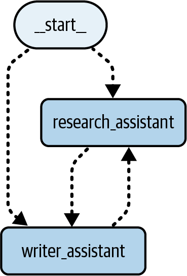

*图 2-8　智能体群之间的交接流程。*

> 图中文字对照：research_assistant＝研究助理；writer_assistant＝写作助理；`__start__`＝开始。

LangGraph 提供了一个[开源库](https://oreil.ly/JqLgF)，用于加快智能体群开发。默认情况下，群中的智能体使用预构建的 `create_handoff_tool` 创建交接工具。你也可以创建自定义交接工具，以更好地适应工作流。例如，可以：

- 更改工具名或描述，让交接目的更清楚。
- 添加供 LLM 填写的工具调用参数，例如给下一个智能体的具体任务说明。
- 控制传递给下一个智能体的数据。默认情况下，`create_handoff_tool` 会传递完整消息历史（此前所有智能体消息）以及一条确认交接的工具消息；你也可以只发送筛选后的部分上下文。

在连接完整智能体群之前，首先需要像示例 2-31 那样定义交接辅助工具。这些工具充当信号，让一个智能体把控制权传给另一个。在接下来的例子中，研究助理在收集到足够来源后可以交接给写作者；如果需要更多证据，写作者又能把控制权交回研究助理。

**示例 2-31　创建交接工具**

```python
to_writer = create_handoff_tool(
    agent_name="writer_assistant",
    description="""Transfer to the writing assistant to synthesize sources into
                an answer.""",
)
to_research = create_handoff_tool(
    agent_name="research_assistant",
    description="""Return to the research assistant to fetch or scrape more
                sources.""",
)
```

1. 定义一个工具，让研究助理将工作交接给写作助理。
2. 定义反向工具，让写作者能够把控制权交回研究助理。

交接辅助工具准备好后，就可以定义智能体。保持角色分工鲜明很有帮助。在这一配置中，一个智能体只专注研究，另一个只专注写作。交接工具确保工作流在需要更多来源或进入综合整理阶段时，能够往返流转。角色定义见示例 2-32。

**示例 2-32　为研究助理和写作助理分配角色**

```python
research_assistant = create_react_agent(
    model=llm,
    tools=[tavily_tool, scrape_webpages, to_writer],
    prompt=(
        """You are a research assistant. Search the web with Tavily.
        When you have 3 to 5 solid sources, scrape key pages for details,
        then hand off to the writer assistant."""
    ),
    name="research_assistant",
)

writer_assistant = create_react_agent(
    model=llm,
    tools=[to_research],
    prompt=(
        """You are a writing assistant. Read the provided documents and messages.
        Synthesize a concise answer with citations by site name in brackets. If
        sources are thin or unclear, hand back to research with a short request."""
    ),
    name="writer_assistant",
)
```

1. 定义负责网络搜索和抓取的研究助理。
2. 授予研究助理使用工具的能力，包括交接给写作者的工具。
3. 定义负责综合整理和引用的写作助理。
4. 如果需要更多证据，允许写作者把控制权交回研究助理。

> 提示译文：研究助理使用 Tavily 搜索网络，获得 3–5 个可靠来源后抓取关键页面细节，再交给写作助理。写作助理阅读所提供的文档与消息，综合成简洁答案，并在方括号内标注网站名称作为引用；如果来源不足或不清晰，则附上简短请求，交回研究助理。

两个角色定义好之后，就可以将其连接为智能体群。智能体群提供协调机制：默认从研究助理开始，但允许交接给写作者，再交回来，直到任务完成。实现见示例 2-33。

**示例 2-33　构建研究—写作智能体群**

```python
swarm = create_swarm(
    agents=[research_assistant, writer_assistant],
    default_active_agent="research_assistant",
).compile()
```

要测试系统，可以运行下面的示例提示。这里，我请求总结瑞士金融科技许可制度。智能体群先搜索来源，再交给写作助理综合整理；如有需要，则返回研究环节补充数据。提示见示例 2-34。

**示例 2-34　运行研究—写作智能体群**

```python
user_request = {
    "messages": [
        {
            "role": "user",
            "content": (
                """Find the current Swiss fintech licensing options for small
                 startups. Gather authoritative sources and produce a short
                 summary with three bullet points and references."""
            ),
        }
    ]
}

for chunk in swarm.stream(user_request):
    print(chunk)
    print()
```

1. 定义用户提示，询问瑞士金融科技许可详情：查找当前适用于小型初创企业的许可选项，收集权威来源，用三个要点给出简短总结，并附参考资料。
2. 流式输出智能体群的结果，展示由交接驱动的工作流。

运行后会得到三个清晰的要点及参考资料，引用瑞士监管机构官方网站和可信的金融信息来源。如果写作者认为证据不足，则可以触发返回研究环节的交接。整个循环只需约 30 秒，即可收集信息并生成最终的结构化输出。

本节介绍的监督者、层次式和智能体群架构，展示了不同协调策略对 MAS 的影响。监督者提供集中控制；层次结构能够把“团队的团队”组织起来，支持扩展；智能体群则强调灵活的对等协作。表 2-4 比较了这些模式，并指出各自的适用时机。

**表 2-4　模式总结：多智能体协调策略**

| 架构 | 适用时机 | 优点 | 权衡 |
| --- | --- | --- | --- |
| 监督者 | 任务边界清晰的小型智能体团队 | 配置简单；控制力强；避免死锁 | 中央瓶颈；单点故障 |
| 层次式 | 需要可扩展性的较大规模、多团队工作流 | 模块化；可扩展；映射组织结构 | 更难调试；需要精心设计 |
| 智能体群 | 对等角色之间的动态协作，例如研究者 ↔ 写作者 | 灵活；自然的往返流转 | 可预测性较低；需要稳健的交接设计 |

这说明，每种协调模式都支持不同规模、不同风格的智能体协作。通过组合这些模式，可以在整体 MAS 设计中，构建兼顾可控性、可扩展性和适应性的智能体工作流。

### 结论

<!-- source: PDF 99–100 -->

本章最重要的认识是：AI 智能体的智能也来自架构，而不仅仅来自它使用的 LLM。基于这一点，你探索了架构模式如何塑造 AI 智能体的智能与可靠性。通过超越单步执行，你看到了 CoT、ToT 和 ReAct 等推理循环如何把结构嵌入智能体的思考过程，使输出更审慎、更透明。

同样重要的是，你看到了人类在环如何让智能体更安全。中断、审批关卡和审查步骤展示了：在错误会造成实际后果的真实环境中，护栏机制如何让智能体值得信任。自主性与监督之间的平衡，是现代智能体设计的一个核心主题。

你还学到了这些推理方法如何扩展到 MAS。监督者与层次式架构把任务分配给专业工作智能体，智能体群则支持对等角色之间灵活交接。这些范式共同说明，智能体智能不仅取决于更强的模型，还取决于如何把模型编排为能够规划、行动和反思的系统。

有了这些基础，你就可以进入下一阶段。第 3 章将探讨高级范式，把这些架构进一步扩展到可规模化的执行、更深入的规划策略和更复杂的推理方法。你将学会如何设计不仅能够响应和反思，还能在更大规模上规划，并在更大型系统中协调复杂工作流的智能体。

[^ch2-1]: Jason Wei 等，[“Chain-of-Thought Prompting Elicits Reasoning in Large Language Models”](https://arxiv.org/abs/2201.11903)（《思维链提示激发大语言模型的推理能力》），2023 年。年份按原书保留。
[^ch2-2]: Shunyu Yao 等，[“Tree of Thoughts: Deliberate Problem Solving with Large Language Models”](https://arxiv.org/abs/2305.10601)（《思维树：使用大语言模型进行审慎的问题求解》），2023 年。
[^ch2-3]: Shunyu Yao 等，[“ReAct: Synergizing Reasoning and Acting in Language Models”](https://arxiv.org/abs/2210.03629)（《ReAct：协同语言模型中的推理与行动》），2023 年。
