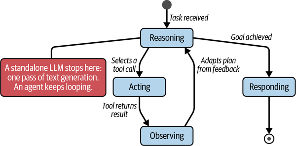
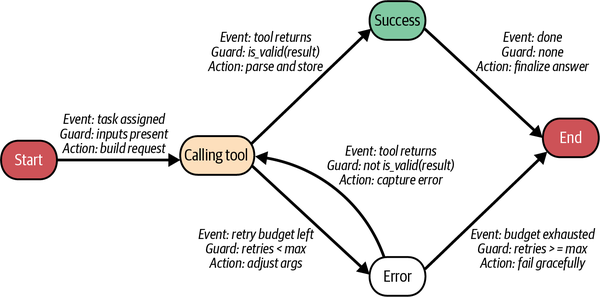
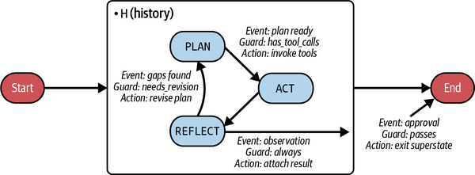
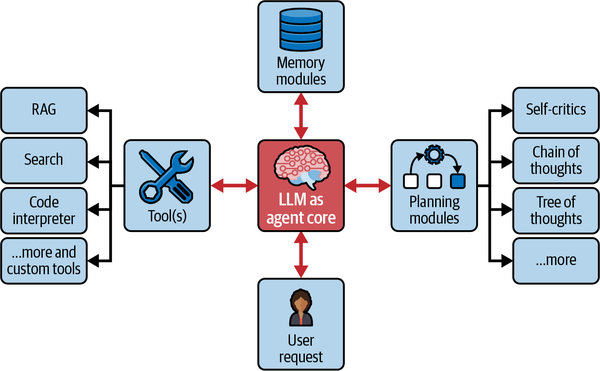
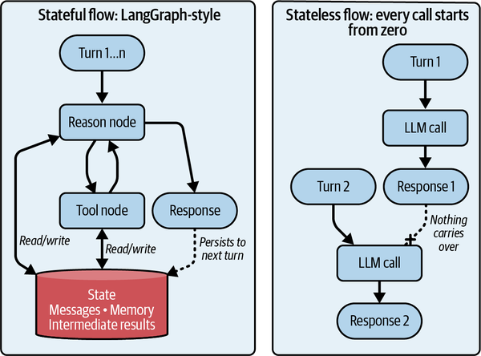
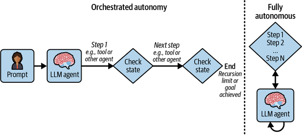

# 第 1 章　从 LLM 到智能体：基础蓝图

> 原书：*AI Agents: The Definitive Guide — Design, Deployment, and Evaluation for Production*，Nicole Koenigstein 著。译文依据用户提供的 PDF，第 22–55 页。
>
> 排版约定：保留原图及编号，图注译为中文，图中英文另附中文对照；代码保留原始标识符、字符串、提示词和注释，仅恢复 PDF 折行与缩进，代码旁注另译。正文中的论断及 API 用法忠实于原书，不代表已按当前库版本验证。文中的“页”均指 PDF 文件页序。

<!-- source: PDF 22–27 -->

人类智能的一个鲜明特征，是能够把内在推理与具体行动结合起来。这与配备工具的大语言模型（LLM）智能体的工作方式，有着惊人的相似之处。以开发一个编程项目为例：作为人类开发者，你首先接到一个提示，也就是客户的需求。接下来是推理，你勾勒出解决问题的计划；然后采取行动，例如查找文档、编写函数或调试错误。当测试失败、同行评审指出不足，或者客户试用应用时，反馈就进入了这个循环。每一步都不是静止的，而是在迭代中推进：推理随着新认识而调整，行动也随之改变。

单个 LLM 智能体也是如此。收到任务后，智能体先推理：还缺少什么？下一步该做什么？随后，它通过调用工具来检索数据、运行代码或检查结果。正如开发者的反馈循环，环境会提供错误、缺漏或确认等信号，为下一轮迭代指明方向。代码库或文档等外部支持，对应于检索系统或网络搜索等工具，它们能让输出超越模型自身原有能力的限制。

**LLM 智能体，是嵌入“推理、行动、反馈”循环的大语言模型；在这一循环中，它可以调用外部工具，并根据结果调整行为。** 独立的 LLM 仅限于静态文本生成，而智能体则作为工作流中的决策主体运行。图 1-1 展示了这一流程。



*图 1-1　LLM 智能体在推理、行动和观察反馈之间循环，直到达成目标。*

> 图中文字对照：Task received＝收到任务；Reasoning＝推理；Acting＝行动；Observing＝观察；Responding＝响应；Selects a tool call＝选择一次工具调用；Tool returns result＝工具返回结果；Adapts plan from feedback＝根据反馈调整计划；Goal achieved＝目标达成。红色说明框：独立的 LLM 到这里就停止了，只完成一次文本生成；智能体则会继续循环。

本书会交替使用“AI 智能体”“智能体”和“LLM 智能体”这些术语。不过，严格来说，AI 智能体完全可以不包含语言模型。按经典定义，智能体感知环境、作出决策，并采取行动以达成目标。它并不需要理解或生成人类语言。

例如，在纯强化学习中，可以让智能体直接通过与环境的试错交互接受训练。将 LLM 引入智能体系统的好处，是带来强大的泛化、推理和自然语言能力，让智能体行为更灵活，能够应用于狭窄定义的环境之外的更多场景。

个人能力终究会遇到极限，单个智能体所能推动的工作流也有边界；复杂度上升之后，就需要协调。想一想，在小公司里，一个人可能端到端包办设计、编码、测试和部署。但随着项目扩大，团队也需要扩充：有人负责后端，有人负责前端，还有人负责测试。

为了让大家保持一致，技术负责人或工程副总裁会介入，协调工作量、分配任务并整合结果。独立贡献者与协作团队之间的差别，直接对应着单智能体与**多智能体系统（multi-agent system，MAS）**之间的差别。就像技术负责人协调多位贡献者一样，监督智能体可以编排多个专业智能体，让它们协作完成复杂目标。

> **配套网站与读者社区**
>
> 你可以在本书的[配套网站](https://ai-agents-the-definitive-guide.com/)找到更多材料，包括代码示例、应用案例，以及扩展各章主题的补充内容。
>
> 本书还有一个 [Discord 频道](https://oreil.ly/JXpgv)，读者可以在那里提问、讨论示例并关注更新。

同样需要认识到，无论人类还是智能体，都不拥有无限制的自主权。开发者受到编码规范、项目需求和组织流程的引导，其自由也受这些结构约束。智能体同样受到工作流限制，只能在所提供的工具、权限和防护措施范围内运行。这种有界自主性并不是弱点，恰恰是两种系统能够实际运转的基础。对人类而言，结构有助于保证代码质量、可维护性和客户满意度；对智能体而言，约束有助于保证安全性、可靠性，以及与开发者和用户设定目标的一致性。

这种类比说明了，为什么给纯 LLM 扩展工具是合理的。单独的语言模型就像一个无法访问 StackOverflow、IDE 或 GitHub 等资源的开发者：能够推理，却无法在没有外部帮助的情况下收集新数据、验证结果或改善任务输出。软件团队通过增加更好的工具、资源和领导机制来扩大能力；同样，当 LLM 被嵌入智能体工作流，甚至成为 MAS 中的多个专业智能体时，其能力也会扩展。缺少这些增强手段，两者都只能局限于最初训练的能力范围，并在面对复杂任务时很快不堪重负。有了工具、反馈和分而治之的方法，LLM 就能反复改进、适应，并解决原本超出其独立能力范围的复杂任务。

本书假定你具备使用 LLM 的实践知识。你也许读过 O’Reilly 出版的 [*Hands-On Large Language Models*](https://learning.oreilly.com/library/view/hands-on-large-language/9781098150952//) 或类似书籍。要让智能体运作起来，你不必事先掌握如何部署 LLM，因为我会在后续章节带你完成这些步骤。不过，我希望你能够熟练阅读和修改 Python 代码，并熟悉机器学习和深度学习的核心概念，例如反向传播和训练循环。你不需要详细掌握反向传播，但了解它有助于理解模型如何根据训练信号调整参数、从而完成学习。熟悉线性代数和微积分也很有帮助，因为它们是现代深度学习与优化方法的重要基础。此外，理解 Transformer 如何处理序列，并至少大致了解嵌入如何工作、向量存储如何支持检索，也会有所裨益。

如果你已经有一阵子没接触这些主题，**不要惊慌！** 就像《银河系漫游指南》劝你不要惊慌一样，我的这本指南也要这样说。话虽如此，每个概念都会落实到代码中，让你的知识重新变得可用，而不必翻出那些落满灰尘的旧课本。还有，在你开口之前先说明：有关 AI 智能体的一切问题，答案并不是 42；但我保证，你会在本书中逐步找到答案。

> **本书代码**
>
> 本书所有代码示例都可在[配套 GitHub 仓库](https://oreil.ly/github-ai-agents)中找到。仓库按章节组织，方便你定位各节对应的代码。

如果你希望更深入地了解不同领域中的 Transformer，以及嵌入如何应用于文本和其他模态，我的另一本书 [*Transformers: The Definitive Guide*](https://learning.oreilly.com/library/view/transformers-the-definitive/9781098167004/)（O’Reilly）可以作为补充资料。那本书还讲解了强化学习的基础知识，帮助你为理解本书后面介绍的高级智能体概念打下更牢固的基础。

因此，本书面向希望超越好奇心、进一步付诸实践的读者，这也是理解上述基础知识为何如此重要。其中包括在生产环境中构建实际系统的数据科学家、软件工程师和机器学习工程师，以及需要理解相关权衡、成本和护栏机制的技术负责人。本书不打算从头解释 LLM，也不讨论抽象的承诺或思想实验，而是关注构建和运行 AI 智能体时的现实问题：让它们走出 PowerPoint 演示或实验室演示，真正发挥作用。

本章将解释：LLM 如何从静态提示发展为动态智能体系统；为什么工具使用不可或缺；以及当智能体在既定工作流、权限和防护措施之内运行时，自主性究竟意味着什么。

## 有限状态机与层次状态机：智能体的基础范式

<!-- source: PDF 27–34 -->

[LangGraph](https://oreil.ly/duukM)、[CrewAI](https://crewai.com/) 及类似框架，为组织智能体行为提供了不同层级的抽象。LangGraph 明确展现了有状态、基于图的模型；CrewAI 则围绕智能体、团队（crew）和流程（flow），提供更高层的框架。框架未必会把这种结构暴露为正式的有限状态机（finite state machine，FSM）或层次状态机（hierarchical state machine，HSM）API。不过，任何智能体工作流都需要控制模型：它必须跟踪状态、决定采取什么行动、观察结果、更新上下文，并最终终止。

从宏观上看，状态机是一种计算模型，在任一时刻都处于有限个状态中的某一个。它会响应特定事件或输入，在状态之间转换；下一个状态由当前状态和输入决定。

本节旨在通过状态机模式，解释现代 AI 智能体系统的控制流，帮助你建立关于智能体的心智模型。简单来说，可以把它理解为结构化的状态转换：这种模式长期用于编译器、图形用户界面、嵌入式系统和网络协议，如今被应用于基于 LLM 的智能体的推理与工具使用。

我先用 FSM 和 HSM 为你的理解打基础，并不只是想作一个宽泛的类比。我希望为你提供一份构建稳健、可靠、适应性强的 LLM 智能体的蓝图，让你不仅理解概念，也能在后续学习更复杂的主题时有效运用它们。如果你最近没有用过状态机，也不用担心：代码示例会展示这些模式如何直接转化为实现。你可以把下面这些术语，看作贯穿全书的工具使用和多智能体示例背后的控制语法。

### 有限状态机

有限状态机描述系统可能处于的模式，以及模式之间允许发生的转换。每次转换都由事件触发，可能受某个谓词条件保护，也可能执行更新状态的动作。开始和结束是具有特殊含义的状态。核心术语如下。

- **状态（State）**：一个紧凑的快照，记录系统在某一时刻掌握的信息。对智能体而言，它可能是消息列表、路由提示或进度标记。
- **事件（Event）**：自上一次决策以来发生的事情，例如工具被调用或返回结果。
- **守卫条件（Guard）**：根据当前状态和最新事件，判断应当采用哪条转换路径的检查。
- **动作（Action）**：转换过程中执行的工作，例如调用工具、追加消息、保存检查点或请求人工输入。
- **终止（Termination）**：表明流程已到达终点的条件。

图 1-2 展示了用于工具使用的有限状态机。每次转换都由事件、守卫条件和动作定义。



*图 1-2　用于工具使用的有限状态机概览。*

> 图中文字对照：Start＝开始；Calling tool＝调用工具；Success＝成功；Error＝错误；End＝结束。各边上的 Event、Guard、Action 分别表示事件、守卫条件和动作。路径依次为：分配任务／输入齐备／构建请求；工具返回／`is_valid(result)`／解析并保存；工具返回／`not is_valid(result)`／捕获错误；尚有重试预算／`retries < max`／调整参数；任务完成／无条件／完成最终答案；预算耗尽／`retries >= max`／妥善结束失败流程。

当系统行为在少量稳定模式之间交替，而且可恢复性很重要时，FSM 非常适合。实现时可以在每个节点或状态边界保存检查点，并在崩溃后从最后完成的步骤恢复。

从状态的角度思考，可以把复杂任务分解为不同步骤。例如，你不必用一条“写一篇博客文章”的提示包办一切，而可以定义选题构思、生成提纲、起草、编辑和 SEO 优化等状态。每个状态都可以关联到智能体将使用的特定工具。

转换机制会促使你明确：一项任务在什么条件下把工作交给下一项。例如，提纲生成状态产生什么输出，才会触发起草状态。这种结构可以避免非结构化、一次性提示的问题；仅依靠 LLM 时，这类提示往往会产生不一致的结果。

一旦增加规划、反思、审批关卡和重试等更多模式，FSM 就可能迫使你重复逻辑，或形成纠缠不清的路由。你需要牢牢掌控图中的边，因为它们就是决策点：每条边都编码了驱动功能的事件、守卫条件和动作。此时，层次结构就派上了用场。

### 层次状态机

层次状态机允许状态包含其他状态。父状态（superstate）封装共享的进入／退出行为和共享守卫条件；子状态继承这些规则，并增加自己的规则。历史节点会记住离开时所处的子状态，以便稍后准确恢复到那里。状态机新增的这些概念说明如下。

- **父状态（Superstate）**：将一组子状态及其公共策略组织在一起的状态。进入父状态时执行一次共享逻辑；退出时执行一次共享清理。
- **子状态（Substate）**：位于父状态内部的具体模式。它拥有自己的边，同时继承父状态的守卫条件和动作。
- **历史（History）**：一个“记住我刚才在哪里”的标记。浅历史恢复到最后一个活动子状态；深历史则恢复到更深层嵌套的后代状态。用智能体的术语来说，这是图中某一部分的检查点。
- **并行区域（Parallel region）**：父状态中两个或更多独立推进的子区域。适合把工具调用或智能体角色分发出去并行执行，然后再汇合。

图 1-3 展示了一个包含 `WORKING` 父状态的层次状态机。`PLAN`、`ACT` 和 `REFLECT` 是子状态。`H` 是浅历史标记，用于记录最后一个活动子状态，以便重新进入父状态时从那里恢复执行。



*图 1-3　带有历史标记的层次状态机概览；该标记记录最后一个活动子状态。*

> 图中文字对照：H (history)＝历史标记；PLAN＝规划；ACT＝行动；REFLECT＝反思；Start／End＝开始／结束。转换标注：计划就绪／`has_tool_calls`／调用工具；收到观察结果／始终成立／附加结果；发现缺漏／`needs_revision`／修订计划；获得批准／通过／退出父状态。

HSM 尤其适用于更高级的 MAS。HSM 允许“状态中再嵌套状态”，从而减少重复，让策略清晰可见。例如，你可以把限流、安全过滤器或熔断器绑定到 `WORKING` 父状态上，让规划、行动和反思继承相同的防护措施。守卫条件或路由器只需定义一次，就能在多个节点间复用。

以研究智能体为例。与其把研究看成一个庞大的单一步骤，不如把它拆成一个子状态机，包含搜索关键词、收集 URL、抓取数据和总结发现等状态。每个状态甚至都可以映射到一个拥有自身能力的专用智能体，为更大的智能体团队作出贡献。这种嵌套结构有助于管理复杂度、保持策略一致，并让整个系统更容易理解和维护。

### 将 FSM／HSM 映射到智能体框架

LangGraph 本身就使用状态机和层次结构的语言。你可以通过子图和共享键来实现这些模式。选择下一步动作的路由器或决策智能体，例如决定调用哪个智能体或工具，对应于经典状态机中的事件处理器。它读取当前状态和 LLM 输出（事件或载荷），决定下一项符合逻辑的操作。直接对应关系如下。

**状态模式（State schema）**

父图的 `TypedDict` 定义共享“总线”。子图声明自己读写哪些键；重叠的键构成父状态的接口：

```python
class State(TypedDict):
    messages: List[BaseMessage]
    working_last: str | None
```

1. `messages`：父图与子图之间的共享总线。
2. `working_last`：可选的浅历史标记。

**节点与子图（Nodes and subgraphs）**

一个子图对应 HSM 中的父状态，其内部节点对应子状态。进入子图时运行入口节点；离开时沿退出边返回父图：

```python
def plan_node(state: State) -> State:
    ai = AIMessage(content="Plan next step")
    return {"messages": [ai], "working_last": "plan"}

def act_node(state: State) -> State:
    ai = AIMessage(content="Act on plan")
    return {"messages": [ai], "working_last": "act"}

subgraph_builder = StateGraph(State)
subgraph_builder.add_node("PLAN", plan_node)
subgraph_builder.add_node("ACT", act_node)
subgraph_builder.add_edge(START, "PLAN")
subgraph = subgraph_builder.compile()
```

1. `subgraph` 就是父状态。

**守卫条件与条件边（Guards and conditional edges）**

父级守卫条件落实预算、安全等全局策略。子级守卫条件则在 `PLAN`／`ACT`／`REFLECT` 之间路由。由于守卫条件只是普通的 Python 代码，因此保持了确定性和可审计性：

```python
def route_within_working(state: State):
    last = state.get("working_last")
    return "ACT" if last == "plan" else END

subgraph_builder.add_conditional_edges(
    "PLAN", route_within_working, {"ACT": "ACT", END: END}
)

parent = StateGraph(State)
parent.add_node("WORKING", subgraph)

def global_guard(state: State):
    tail = "".join([
        getattr(m, "content", "") for m in state["messages"][-3:]
    ]).lower()
    return END if "stop" in tail else "WORKING"

parent.add_edge(START, "WORKING")
parent.add_conditional_edges(
    "WORKING", global_guard, {"WORKING": "WORKING", END: END}
)
```

1. 在子图内部添加条件边。
2. 创建带全局守卫条件的父图。
3. 策略示例：如果用户说了 `stop`，则结束。

**历史与检查点（History and checkpointing）**

`MemorySaver` 可直接提供浅历史和深历史：恢复某条线程时，会在最后完成的节点处重建子图。如果你希望显式地“回到此前在 `WORKING` 内部的位置”，就持久化一个小标记，例如 `state["working_last"] = "reflect"`，并在重新进入时依据它选择分支：

```python
def reflect_node(state: State) -> State:
    ai = AIMessage(content="Reflect on result")
    return {"messages": [ai], "working_last": "reflect"}

checkpointer = MemorySaver()
app = parent.compile(checkpointer=checkpointer)

cfg = {"configurable": {"thread_id": "session-1"}}
app.invoke(
    {"messages": [HumanMessage(content="start")], "working_last": None},
    config=cfg
)
```

1. 子状态在退出时设置 `working_last`。
2. 编译时启用检查点。
3. 在线程中运行。恢复时，`MemorySaver` 会恢复到最后完成的节点。

FSM 提供了一种把任务组织为稳定、可恢复步骤的方法。HSM 在此基础上进一步扩展，在工作流变复杂时减少重复、集中管理策略。这两种模式都为下一步作好准备：把静态的 LLM 预测转变为动态、有状态的智能体。

## 基础：从静态模型到动态智能体

<!-- source: PDF 34–37 -->

正如上一节所示，加入状态与控制流对自动化至关重要。这一原则同样适用于智能体。从静态的 LLM 用法走向智能体系统，需要显式的状态和控制流。状态把一次性的工具调用变成有状态的过程，使先前的动作、工具结果和路由决策能够跨步骤保留下来。控制流则加入守卫条件和转换机制，规定何时规划、何时行动、何时停止。

之所以要为 LLM 加入这些能力，原因很简单：LLM 是静态预测器。给定提示后，它们仅依赖训练数据中编码的模式，生成下一个 token。这使它们拥有强大的推理能力，却仍被限制在已有知识之内。它们无法更新知识、验证论断，也无法与环境交互。

当推理与行动结合时，能动性便产生了。推理是规划或决定下一步的内部过程；行动则通过调用工具、检索数据、执行代码或调用外部服务，对这一过程作出延伸。两者共同形成迭代循环：推理、行动、接收反馈、调整。这个循环是智能体行为的基础。

表 1-1 比较了静态 LLM 与智能体系统。这些对比不仅说明为什么需要智能体，也展示了这种设计如何将传统机器学习工作流转变为由工具增强的动态系统。

**表 1-1　静态 LLM 与智能体系统的比较**

| 静态 LLM（传统用法） | 智能体系统 |
| --- | --- |
| 单次运行的 token 生成器 | 迭代的推理—行动—反馈系统 |
| 局限于训练数据 | 能够检索、验证和更新知识 |
| 没有记忆，无状态 | 有状态，具备短期与长期记忆 |
| 线性的提示—响应过程 | 迭代且自适应的工作流 |
| 不使用工具 | 由工具增强：检索、代码、API |
| 对提示的解释固定 | 能够动态细化或重新解释目标 |
| 没有外部验证 | 主动检查、纠正并改善输出 |

图 1-4 展示了不同模块如何把静态 LLM 转变为动态智能体。用户请求进入核心模块，规划与记忆影响其推理，工具使具体行动成为可能。推理、行动和适应的循环，来自这些要素之间的协调。具体的记忆架构、存储选择、检索策略和持久化机制将在第 10 章介绍。



*图 1-4　智能体基础架构：单独的 LLM 只能预测文本；加入规划、记忆和工具后，它就成为可用的智能体系统。*

> 图中文字对照：LLM as agent core＝作为智能体核心的 LLM；User request＝用户请求；Memory modules＝记忆模块；Planning modules＝规划模块；Tool(s)＝工具；RAG＝检索增强生成；Search＝搜索；Code interpreter＝代码解释器；…more and custom tools＝更多工具及自定义工具；Self-critics＝自我批评；Chain of thoughts＝思维链；Tree of thoughts＝思维树；…more＝其他方法。

规划模块引导智能体推理，其方式从简单的思维链（chain-of-thought）[^ch1-1]轨迹，到思维树（trees of thought）[^ch1-2]、自我批评等更高级的方法。记忆模块提供连续性，让智能体回忆先前步骤、复用已有知识，或者跨会话保留信息。工具则把智能体连接到环境，无论是通过搜索、检索、代码执行，还是自定义 API。

此外，传统 LLM 用法与智能体系统之间的一个关键差别，是工作流究竟无状态还是有状态。无状态调用把模型当作黑箱：接收提示、预测后续 token，然后返回结果。它不会记住任何东西，不采取行动，也不存在反馈循环。示例 1-1 展示了一次无状态的 LLM 调用。

**示例 1-1　使用 LangChain 进行无状态 LLM 调用**

```python
llm = ChatOpenAI(model="gpt-5-mini")
response = llm.invoke("What are AI agents?")
print(response.content)
```

<!-- source: PDF 38–41 -->

此外，一旦需要训练数据之外的事实，或者希望模型采取行动，例如搜索、计算，就需要引入工具。

下面的代码（示例 1-2 至示例 1-4）展示了一次最小化的无状态工具使用运行：先给 LLM 绑定两个工具，再运行一个小循环，执行模型为完成任务而请求的工具调用。首先需要定义工具。示例 1-2 给出了一种实现。

**示例 1-2　为无状态运行定义工具**

```python
@tool("internet_search")
def internet_search(query: str) -> str:
    """Search Google via SerpAPI for up-to-date information."""
    serp_api_key = os.environ["SERPAPI_API_KEY"]
    params = {"engine": "google", "gl": "us", "hl": "en"}
    search = SerpAPIWrapper(params=params, serpapi_api_key=serp_api_key)
    return search.run(query)

@tool("calculator")
def calculator(expression: str) -> str:
    """Evaluate a single-line mathematical expression with numexpr."""
    local_dict = {"pi": math.pi, "e": math.e}
    out = numexpr.evaluate(
        expression.strip(),
        global_dict={},
        local_dict=local_dict,
    )
    return str(out)

tools = [internet_search, calculator]
tool_map: Dict[str, Any] = {t.name: t for t in tools}
```

1. LangChain 的 `@tool` 装饰器根据函数名、带类型的函数签名和文档字符串，构建模型看到的模式。
2. 文档字符串是必需的：如果缺失，LangChain 会在构建工具模式或把工具绑定到模型时抛出错误。
3. 限制表达式求值：禁止访问全局变量，只暴露你希望提供的常量。这样可使计算器保持确定性和安全性。

使用 LangChain 的 `@tool` 装饰器时，函数签名和文档字符串用于构建模型看到的模式。为了高效完成任务，它们应当准确、一致，并尽可能清楚地解释用途。文档字符串充当工具说明，也是 LangChain 的硬性要求：缺少它就会报错。此外，如果文档字符串含糊不清，模型就更容易生成无效调用。

接下来，只需像示例 1-3 那样，将工具绑定到 LLM，就能让 LLM 访问工具。

**示例 1-3　将工具绑定到 LLM**

```python
llm = ChatOpenAI(model="gpt-4o", temperature=0,
                max_tokens=800).bind_tools(tools, tool_choice="auto")
```

1. 将工具绑定到模型。`tool_choice="auto"` 允许模型自行决定是否调用工具，以及调用哪个工具。

> **现代 LLM 为智能体任务而构建**
>
> 现代 LLM 不仅能够调用工具，而且越来越多地专门针对智能体任务进行训练和优化。例如，[Kimi K2](https://oreil.ly/2rXu1)、[Llama 4](https://oreil.ly/oWvTA) 和 [Qwen3.6](https://oreil.ly/CPUFZ) 等模型，都明确针对编码、工具使用和驱动智能体系统进行了调优。这些模型不再只是回答聊天窗口里的问题。它们经过指令微调，以采取行动；调用 API、运行代码或检索数据，已成为其核心设计的一部分。

绑定工具之后，就可以运行一个最小化的无状态工具循环。示例 1-4 中的代码执行模型请求的工具调用，并把工具结果作为观察结果反馈回去。在工具调用工作流中，助手可能生成工具调用，而不是最终答案。代码执行该工具后，最新消息是工具观察结果，模型还需要再运行一轮，才能解释结果并写出最终响应。因此，循环包含了一条简短的收尾指令：如果运行在工具观察结果之后达到了步数上限，就强制生成一条最终助手消息。

**示例 1-4　带工具循环的单次无状态运行**

```python
def run_once(prompt: str, max_steps: int = 8) -> str:
    messages: List[HumanMessage | AIMessage | ToolMessage] = [
        HumanMessage(content=prompt)]
    last_ai: AIMessage | None = None

    for _ in range(max_steps):
        ai: AIMessage = llm.invoke(messages)
        messages.append(ai)
        last_ai = ai

        calls = getattr(ai, "tool_calls", None) or []
        if not calls:
            return messages[-1].content

        for call in calls:
            name = call["name"]
            args = call.get("args", {}) or {}
            result = tool_map[name].invoke(args)
            messages.append(ToolMessage(
                content=str(result),
                name=name,
                tool_call_id=call.get("id")
            ))

    messages.append(HumanMessage(content="""
Finish now. Give a short final answer in this exact format:

Current temperature:
Square of current temperature:
""".strip()))
    final_ai: AIMessage = llm.invoke(messages)
    return final_ai.content

print(run_once("""Two-step task.

Step 1: Use internet_search to get the current air temperature in New York City
today. Show the exact query you used, the top source title and snippet, and
extract a numeric temperature in Celsius. Return this temperature as feedback
for Step 2.

Step 2: Using the Celsius value from Step 1, compute its square with calculator.
Show the exact expression you used and the numeric result.

Important: Give a short final answer in this format:
Current temperature:
Square of current temperature:"""))
```

1. 只在本次运行中使用的局部短期记忆。因此，不同运行之间的工作流是无状态的。
2. 用一个简单的步数上限，防止 LLM 无终止条件地反复循环。
3. 一步模型调用。助手可能选择调用工具。
4. 读取结构化工具调用。
5. 用匹配的 `tool_call_id` 附加观察结果，使模型能够把结果与调用对应起来。
6. 工具循环可能停在一次观察结果之后。最后这条指令用于保证生成符合所需格式的收尾助手消息。

### 赋予 LLM 状态

<!-- source: PDF 41–49 -->

把 LLM 变成智能体的第一步，是将其放入有状态的工作流。工作流不再把每次模型调用看成彼此孤立的提示和响应，而是记录智能体当前处于哪里、已经发生了什么，以及哪些信息应当继续向后传递。本书中的“状态”，指工作流的结构化运行时快照，而不仅是传入模型的文本上下文。模型上下文可以是状态的一部分，但状态还可以包括路由信息、工具结果、检查点、分支标识符和其他控制数据。图 1-5 对比了无状态与有状态的智能体流程。



*图 1-5　无状态智能体独立处理每次调用，而有状态智能体在每一步都读写共享状态。*

> 图中文字对照：Stateful flow: LangGraph-style＝LangGraph 风格的有状态流程；Stateless flow: every call starts from zero＝无状态流程，每次调用都从零开始；Turn＝轮次；Reason node＝推理节点；Tool node＝工具节点；Response＝响应；Read/write＝读／写；Persists to next turn＝保留至下一轮；State／Messages／Memory／Intermediate results＝状态／消息／记忆／中间结果；LLM call＝LLM 调用；Nothing carries over＝不保留任何信息。

系统根据输入和逻辑转换到下一个状态，每个状态都对应某种函数或行为。在 LangGraph 中，状态可以采用任意 Python 类型，但通常是 `TypedDict` 或 [Pydantic `BaseModel`](https://oreil.ly/mPQkx)。下面列出用 LangGraph 构建有状态、可适应的 AI 智能体时所需的关键概念。

- **状态（State）**：表示应用当前快照的共享数据结构。
- **节点（Nodes）**：编码智能体逻辑的函数。它们接收当前状态，执行计算或产生副作用，再返回更新后的状态。
- **边（Edges）**：依据当前状态选择下一个节点的规则。它们可以是条件分支，也可以是固定转换，同时还应检测结束条件是否满足。
- **命令（Command）**：将控制流与状态更新结合在一起、支持多参与者通信的对象。节点可以通过返回一个 `Command`，同时更新状态并选择下一个节点。

到目前为止，前面创建的工具只用于无状态循环。每次运行都相互独立：模型可以调用工具、获得答案并收尾，但运行一结束，全部上下文就丢失了。如果现在想结合 LangGraph 的概念构建有状态智能体，就需要把工具嵌入有状态工作流。每轮之后不再丢弃消息，而是把消息保存在结构化状态中。系统由此具备智能体特征：

- LLM 节点推理下一步该做什么。
- 工具节点执行外部动作。
- 边根据是否请求了工具来路由控制流。
- 记忆检查点保存对话，使智能体能在后续轮次复用先前结果。

这让工具从一次性的辅助能力，转变为持续的推理—行动—适应循环。接下来的代码清单（示例 1-5 至示例 1-13）将以示例 1-3 至示例 1-4 中的工具和 LLM 绑定为基础，用 LangGraph 构建这样的有状态智能体。

示例 1-5 展示如何在 LangGraph 中实现状态对象，用于承载对话并协调控制流。你可以复用示例 1-3 的工具和已绑定工具的 LLM，只添加新的部分：带类型的状态、追加助手消息的 LLM 节点、执行调用的工具节点，以及根据工具调用决定继续还是停止的路由器。

**示例 1-5　构建包含状态、节点和路由的最小 LangGraph**

```python
class AgentState(TypedDict):
    messages: Annotated[List[BaseMessage], add_messages]

def llm_node(state: AgentState) -> AgentState:
    ai = llm.invoke(state["messages"])
    return {"messages": [ai]}

tool_node = ToolNode(tools=tools)

graph = StateGraph(AgentState)
graph.add_node("llm", llm_node)
graph.add_node("tools", tool_node)
graph.add_edge(START, "llm")

def route(state: AgentState):
    last = state["messages"][-1]
    calls = getattr(last, "tool_calls", None) or []
    return "tools" if calls else END

graph.add_conditional_edges("llm", route, {"tools": "tools", END: END})
graph.add_edge("tools", "llm")
```

1. 状态以消息列表的形式承载对话。`add_messages` 负责安全合并各节点的更新。
2. 核心推理节点：接收当前状态，返回一条新的助手消息。
3. 执行助手发出的工具调用的预构建节点。
4. 容纳节点和边的图容器。
5. 路由器：如果助手最后一轮请求了工具，就转到 `tools`；否则结束。

定义好图之后，需要让它可运行，并具备持久化能力。示例 1-6 使用内存检查点保存器编译图，并分配线程 ID。检查点保存器在每一轮恢复之前的消息，让智能体能够复用早先的结果。线程 ID 用于区分分支，因此可以并行运行多个对话而互不干扰。

**示例 1-6　使用内存检查点编译并配置线程**

```python
checkpointer = MemorySaver()
app = graph.compile(checkpointer=checkpointer)

cfg = {"configurable": {"thread_id": "nyc-weather-session"}}
```

1. 轻量、按线程管理的检查点，使状态能够跨轮次保留。
2. 生成一个知道如何保存和加载状态的可运行应用。
3. 线程 ID 标识一条对话分支。新的 ID 会创建新的分支。

有了可运行的应用和检查点之后，下一步是让执行过程可观察。你会希望看到图正在做什么、哪些消息在流转，以及工具输出如何附加到状态中。示例 1-7 引入一个小巧的辅助函数，把消息格式化为易读的单行输出，让你更容易跟踪执行轨迹，同时避免日志过多。

**示例 1-7　格式化消息，生成简洁的执行轨迹输出**

```python
def _short(msg: BaseMessage, max_len: int = 140) -> str:
    """Compact one-line view of a message."""
    role = type(msg).__name__.replace("Message", "").lower()
    content = getattr(msg, "content", "")
    if isinstance(content, list):
        # some tool outputs can be list payloads
        try:
            content = json.dumps(content)
        except Exception:
            content = str(content)
    text = str(content).replace("\n", " ").strip()
    if len(text) > max_len:
        text = text[: max_len - 3] + "..."
    if hasattr(msg, "tool_calls") and getattr(msg, "tool_calls"):
        tnames = [tc.get("name", "tool") for tc in msg.tool_calls]
        return f"{role}: tool_calls -> {tnames}"
    if isinstance(msg, ToolMessage):
        return f"{role}({msg.name}): {text}"
    return f"{role}: {text}"
```

1. 如有工具名称或函数调用信息，就将其纳入输出。

示例 1-8 打印消息和路由提示的简洁视图。结合起来，你就能验证工具输出是否正确附加，以及状态转换是否符合预期。

**示例 1-8　打印当前状态快照**

```python
def print_state_snapshot(app, config, title: str):
    """Print current graph state and memory for a given thread."""
    snap = app.get_state(config)
    values = snap.values or {}
    msgs: List[BaseMessage] = values.get("messages", [])
    print(f"\n=== {title} | state snapshot ===")
    print(f"messages: {len(msgs)} total")
    for i, m in enumerate(msgs[-5:], start=max(0, len(msgs)-5) + 1):
        print(f"  {i:>3}: {_short(m)}")

    nxt = getattr(snap, "next", None)
    tasks = getattr(snap, "tasks", None)
    if nxt:
        print(f"next nodes: {list(nxt)}")
    if tasks:
        print(f"queued tasks: {tasks}")
    print("memory: in-memory checkpoint present for this thread")
```

1. 读取某条线程的最新状态。
2. 简洁打印消息末尾部分，保持日志易读。
3. 如有路由信息和排队任务，则显示出来。

示例 1-9 以流式方式输出节点更新，让你看到图执行的每一步。

**示例 1-9　以流式方式输出图执行更新**

```python
def run_with_tracing(app, input_state: AgentState, config, title: str):
    """Run the graph while printing per-node updates and final memory."""
    print(f"\n=== {title} | execution trace ===")
    final = None
    for event in app.stream(input_state, config=config, stream_mode="updates"):
        for node, upd in event.items():
            keys = list(upd.keys())
            print(f"[enter {node}] updated: {keys}")
            # if messages updated, print the last one briefly
            msgs = upd.get("messages") or []
            if msgs:
                print(f"  {_short(msgs[-1])}")
            print(f"[leave {node}]")
            final = upd
    print_state_snapshot(app, config, title=f"{title} | after run")

    snap = app.get_state(config)
    msgs = snap.values.get("messages", [])
    return msgs[-1].content if msgs else ""
```

1. 流式输出节点更新，以查看图中的准确执行流程。
2. `upd` 是形如 `{"messages": [<new msg>]}` 的字典，或工具结果。
3. 从 `app.get_state` 取得最终助手消息并显示。

示例 1-10 请求纽约市当前的摄氏气温。执行轨迹显示图进入 LLM 节点、按需发起工具调用，并返回最终助手消息。状态快照则确认，该结果已保存到这条线程的记忆中。

**示例 1-10　第 1 轮：获取纽约市当前的摄氏气温**

```python
turn1_answer = run_with_tracing(
    app,
    {"messages": [HumanMessage(content="Get the current air temperature in New York City in Celsius.")]},
    config={**cfg, "recursion_limit": 20},
    title="TURN 1",
)
print("\nTURN 1 (final assistant):\n", turn1_answer)
```

模型输出如下：

```text
TURN 1 (final assistant):
The current air temperature in New York City is 18°C.
```

即：纽约市当前气温为 18°C。

接下来继续使用同一条线程。示例 1-11 请求计算先前获取的温度的平方。由于线程 ID 不变，应用会恢复此前的消息，使助手能够使用先前结果，而不必在提示中再次提供这个数值。

**示例 1-11　第 2 轮：在同一线程中计算该温度的平方**

```python
turn2_answer = run_with_tracing(
    app,
    {"messages": [HumanMessage(content="Now compute the square of that temperature.")]},
    config={**cfg, "recursion_limit": 20},
    title="TURN 2",
)
print("\nTURN 2 (final assistant):\n", turn2_answer)
```

现在会计算平方，模型返回：

```text
TURN 2 (final assistant):
The square of the temperature, 18°C, is 324.
```

即：温度数值 18 的平方为 324。

智能体经常需要在不丢失进度的情况下探索其他方案。示例 1-12 通过不同的线程 ID 启动一个独立分支，并提出另一项后续请求。这会创建一条隔离的对话，可以偏离主路径，同时保持主线程的记忆不变。

**示例 1-12　创建并行线程分支，处理不同的后续请求**

```python
branch_answer = run_with_tracing(
    app,
    {"messages": [HumanMessage(content="Instead of squaring, convert it to Fahrenheit and report both.")]},
    config=cfg_branch,
    title="BRANCH",
)
print("\nBRANCH (final assistant):\n", branch_answer)
```

最后，你可以检查各个分支记住了什么。示例 1-13 为主线程和分支打印简洁快照。将两者并排比较，可确认状态在线程内持续保留、在线程间相互隔离；这正是可靠的多步骤、多分支智能体工作流的基础。

**示例 1-13　查看两条线程的快照**

```python
print_state_snapshot(app, cfg, title="MAIN THREAD memory view")
print_state_snapshot(app, cfg_branch, title="BRANCH THREAD memory view")
```

通过这个小型实现，你现在可以准确看到：图记住了什么、如何进行路由，以及每个分支最新的助手状态是什么。

## 机械降神：当下究竟能做到什么？

<!-- source: PDF 49–54 -->

一旦把智能体看成包含状态的 HSM，自主性的范围就取决于你在父状态中赋予了多少选择。路由器是只有一条边、一个守卫条件的 FSM；工具调用智能体是带有 `WORKING` 父状态的 HSM，在 `PLAN`、`ACT` 和 `REFLECT` 之间循环；MAS 则在监督者父状态之下组合多个子图，有时还包含并行区域。系统仍然运行在显式状态和守卫条件之内；人们感受到的“自主性”，不过是在边界明确的区域里拥有更丰富的选择。

在古希腊戏剧中，*deus ex machina*（机械降神）指的是一位神突然出现，解决原本无法解决的冲突或问题。人们很容易以同样的方式想象 AI 智能体：一台机器突然拥有完全的自主性与智能，替你解决所有问题。但今天还做不到这一点；智能体是工程系统。它们的力量并不来自隐藏的魔法，而来自精心设计的工作流、定义清楚的工具，以及让它们保持安全和可用的边界。也就是说，智能体仍然受到你提供的工具、实施的防护措施，以及允许运行的工作流的限制。正是这些约束，让今天的智能体具备实际可行性：可以安全部署，行为可以预测，并与预期目标保持一致。

当前系统展现的是一种**编排式自主性（orchestrated autonomy）**。正如前面的 LangGraph 示例（示例 1-5）所示，智能体可以按条件选择分支、调用工具，或者决定是否继续工作流。这已经与静态的提示—响应调用很不一样，但仍然有边界。编排逻辑是固定的；LLM 可以在其中作出选择，却不能重新定义自己的架构。表 1-2 简要列出了智能体目前能做什么。

**表 1-2　当前智能体的自主性：已经能够做到什么，以及尚未实现什么**

| 智能体能够做到的事 | 智能体目前还做不到的事 |
| --- | --- |
| 在预定义路径之间路由，例如路由节点 | 重新设计或重新连接自己的控制图 |
| 选择要调用的工具或子智能体 | 动态生成并验证新的图拓扑 |
| 决定完成任务前是否还需要更多步骤 | 持续评估工具有效性，或自主创建新工具 |
| 在限定范围内修改自己的提示或工具集 | 在执行中途改变策略时，保证对齐与连贯性 |
| 编写并运行小段代码，以决定后续步骤 | 脱离编排框架，作为完全自我驱动的系统运行 |

智能体会在运行时适应，但只能在你设计的框架内适应。把它看作一个连续谱很有帮助。一端是路由器：从固定选项中作出一次决策。中间是支持多步骤推理、反思和记忆的工具调用智能体。另一端是 MAS：专业智能体在监督者协调下协作，将决策分散到不同角色。图 1-6 展示了自主性的连续谱，从简单的路由决策，一直到完全自我驱动执行的设想。在实践中，几乎所有真实系统都位于中间地带：它们是智能体系统，而不是真正自主的智能体。它们的自主性经过编排，而非自行演化；即使智能体能在运行时自适应地作出选择，决策仍发生在预定义状态、转换和工具集构成的框架之内。



*图 1-6　在编排式自主性中，决策点预先定义在工作流里；在完全自主性中，LLM 可以生成新的工具、动作或决策路径来达成目标。*

> 图中文字对照：Orchestrated autonomy＝编排式自主性；Fully autonomous＝完全自主；Prompt＝提示；LLM agent＝LLM 智能体；Step 1／Next step＝步骤 1／下一步，例如工具或其他智能体；Check state＝检查状态；End＝结束；Recursion limit or goal achieved＝达到递归上限或目标已达成；Step 1、Step 2、…、Step N＝步骤 1、步骤 2、……、步骤 N。

智能体可以利用反思、规划和结构化输出，在 LangGraph 等框架内表现出灵活性。不过，我们尚未拥有能够自由重新定义自身架构，或者以稳健、通用的方式推理自身目标的系统。

> **AI Scientist：有限自主性已经能够做到什么**
>
> AI Scientist v2[^ch1-3] 是编排式自主性已经带来哪些可能性的一个例子。它建立在整合了树搜索、实验管理和视觉—语言反馈的多智能体工作流之上，能够生成研究假设、编写代码进行检验、在调试和改进的同时并行运行实验、可视化结果，并最终起草科学论文。2025 年，该系统向一个 [ICLR 研讨会](https://iclr.cc/About)提交了三篇论文，其中一篇通过同行评审并获得正式接收，成为已知首个由 AI 完整生成、且达到这一标准的科学论文案例。
>
> 不过，这项成果也存在明确局限。被接收的是研讨会级别的论文，而不是大会主会论文。三篇投稿中有两篇被拒；即使是被接收的那篇，也存在方法上的缺漏、论证不清、分析浅显和数据集方面的限制。尽管评审者赞赏其清晰性与严谨性，但也强调，它缺少顶级出版物所要求的深度与创新。系统还遇到了 LLM 常见的问题，包括引用错误和具有误导性的图表说明。因此，尽管它能够自主改进和调试，令人印象深刻，但尚不能自主产生根本性的新科学范式。
>
> 这个案例展示了当前自主性的两面。在工程化编排的边界之内，智能体系统已经能够贯通从想法到实验、代码，甚至同行评审发表的全过程。而超越这些边界，要持续产出突破性科学成果，或开展不受约束的创造活动，今天的智能体仍有局限，人工监督仍然重要。

现在你已经理解，今天的智能体并不是“机械降神”式的解决方案，而是经过精心编排的系统，通过结构、工具和反馈循环扩展 LLM。它们的自主性在设计上就有边界；正因为如此，它们才实用、安全、可部署。尽管仍有限制，它们已经令人印象深刻，能够以远超静态 LLM 的方式进行推理、行动和适应。

## 结论

<!-- source: PDF 54–55 -->

本章介绍了 LLM 如何通过加入状态、控制流和工具使用，从静态预测器发展为动态智能体。把推理嵌入行动与反馈的循环之后，LLM 就能根据结果调整行为，其能力也远远超出了单纯提示—响应交互的范围。

有限状态机与层次状态机为智能体设计提供了概念基础。FSM 让你把工作流组织为可恢复的步骤；HSM 则在复杂的多步骤任务中减少重复、集中管理策略。这些抽象可以直接映射到 LangGraph 等现代框架；在这些框架中，状态、节点和路由规则定义了智能体如何随时间推理和行动。

现在，你也能在更恰当的背景下理解自主性。你知道，今天的智能体在边界清楚的工作流内运行：在预定义路径之间选择、调用工具、反思结果，但不会重新设计自身架构。这种编排式自主性不是弱点，而是优势，因为约束使智能体安全、可预测，并能切实部署。AI Scientist v2 的例子展示了这种方法的潜力与局限：智能体已经能够生成和检验假设，但仍需要监督来保证严谨性和深度。

有了这些基础，你就可以进入第 2 章，探索那些让规划、反应性、反思和人机交互成为现实的架构与模式。

[^ch1-1]: Jason Wei 等，[“Chain-of-Thought Prompting Elicits Reasoning in Large Language Models”](https://arxiv.org/abs/2201.11903)（《思维链提示激发大语言模型的推理能力》），2023 年。年份按原书保留。
[^ch1-2]: Shunyu Yao 等，[“Tree of Thoughts: Deliberate Problem Solving with Large Language Models”](https://arxiv.org/abs/2305.10601)（《思维树：使用大语言模型进行审慎的问题求解》），2023 年。
[^ch1-3]: Yutaro Yamada 等，[“The AI Scientist-v2: Workshop-Level Automated Scientific Discovery via Agentic Tree Search”](https://arxiv.org/abs/2504.08066)（《AI Scientist-v2：通过智能体树搜索实现研讨会级别的自动化科学发现》），2025 年。
