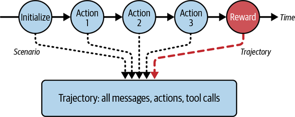
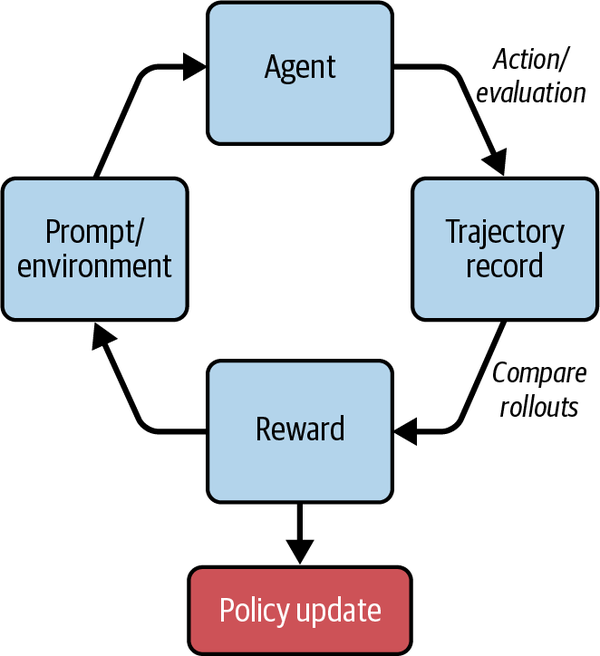
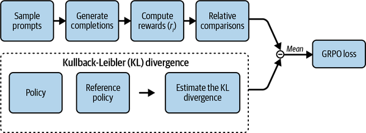
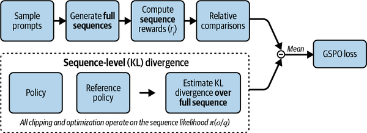
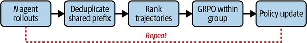
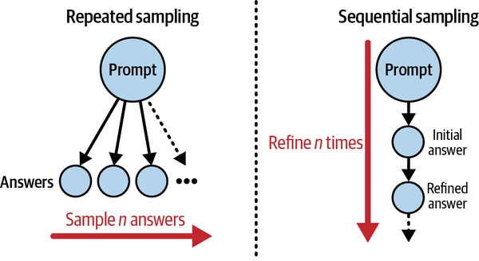
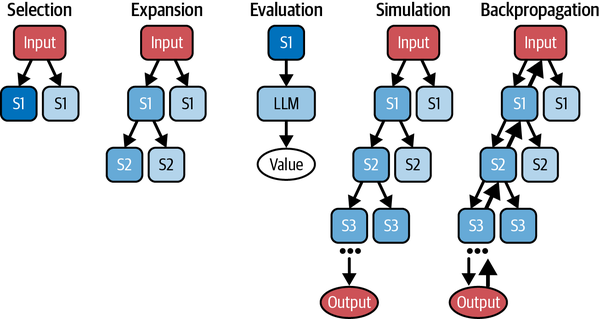
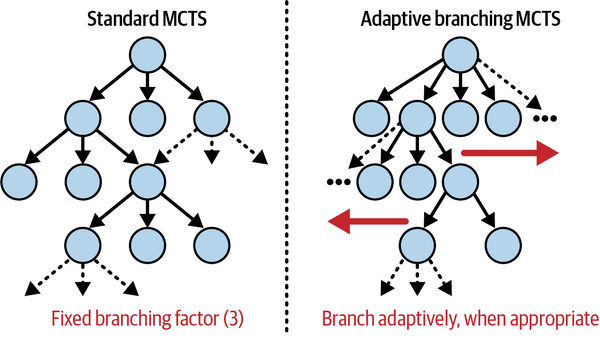
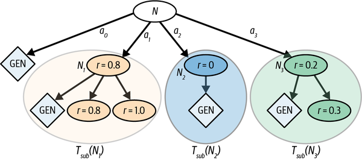
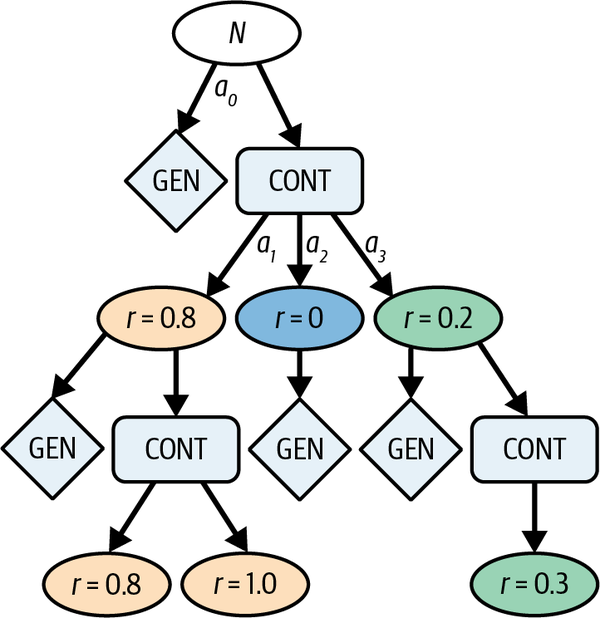

# 第 3 章　智能体中的高级规划、推理与可扩展执行

> 原书：*AI Agents: The Definitive Guide — Design, Deployment, and Evaluation for Production*，Nicole Koenigstein 著。译文依据用户提供的 PDF，第 101–146 页。沿用前两章术语与排版：原图保留，图注和图中文字对照译为中文；代码保留标识符、字符串、提示词、注释和输出，仅恢复 PDF 的折行、分页及缩进。公式采用 LaTeX 数学语法。原书论断按原意翻译，不代表已按最新论文或库版本重新验证。页码均指 PDF 文件页序。

<!-- source: PDF 101–102 -->

在第 1、2 章中，你已经看到，AI 智能体不是魔法，而是工程系统。不过，本章将要学习的技术，也许会开始让你觉得它们接近魔法。正如阿瑟·C. 克拉克曾说：

> 任何足够先进的技术，都与魔法无异。[^ch3-1]

这种魔法般的感觉，来自智能体不再只是作出反应，而开始从自身经验中学习，或在测试时作出更明智的选择。至少在比喻意义上，它们不再是非玩家角色（NPC），因为它们不再只遵循固定脚本。当你把强化学习（reinforcement learning，RL）的原理应用于 LLM 时，它们便开始自主学习和适应。这正是克拉克那句话在 AI 智能体世界中获得的新含义。

不过，起初看起来不可思议的能力，实际来自一组明确的机制。本章会深入解释这些机制：你将学习 RL 如何在推理和结果之间建立反馈循环，以及基于树的搜索和自适应规划如何让智能体在行动之前模拟多种未来，并决定究竟应该探索更多解法，还是进一步改进某个候选解。

这些机制共同营造出自我改进的观感；其背后当然是智能体随时间变得更好的优化过程。智能体收集反馈、反思选择并改进行为，表现得仿佛具有生命。奖励、反馈循环和动态重新规划，与 [Agent Reinforcement Trainer（ART，智能体强化训练器）](https://oreil.ly/8ciV2)、[relative universal LLM-elicited rewards（RULER，由 LLM 诱导的相对通用奖励）](https://oreil.ly/juSTk)及 [reinforcement learning for language models（rLLM，面向语言模型的强化学习）](https://oreil.ly/Ok3JZ)等 RL 框架结合，构成跨越训练和部署的持续改进循环。

在本章中，你将跨过设计与自主性之间的门槛。AI 智能体不再照着脚本行事，而开始自行解决问题。当前瞻规划、强化学习和可扩展执行结合在一起时，你会在这一关键时刻感觉到，智能体不再完全依靠编排。在这里，你通过 RL 赋予智能体选择与改进的能力，构建能够学习、推理和进步的系统。也就是说，本章将帮助你通过设计，让智能体的能动性涌现出来。

## 超越零和博弈：从奖励到推理

<!-- source: PDF 102–107 -->

如果你曾好奇，RL 中的学习究竟发生在哪里，本节将带你找到起点。一切始于奖励，也就是告诉智能体“做得好不好”的信号。不过，单有奖励并不能造就智能系统；奖励只是提供推动系统改进的反馈。

RL 的核心其实很简单，我是认真的。稍微仔细想一想：智能体采取一个动作，观察发生了什么，再利用结果让下一次选择更好。随着这个循环重复，模式开始形成。智能体逐渐识别出什么有效、什么无效。就在这一刻，感知与调整之间的循环闭合了，行为开始显得有明确意图。你在现实生活中早就在这样做：无论是从自身经历中学习，还是教育孩子、训练宠物，你每天都在不知不觉中运用 RL。表 3-1 比较了常见 RL 术语。本章使用的是在线、同策略、无模型强化学习。

**表 3-1　RL 学习模式速览**

| 术语 | 含义 |
| --- | --- |
| 在线强化学习（Online RL） | 智能体在学习过程中收集新经验。本章中，这意味着用当前策略生成新的采样运行（rollout），为其评分，再根据新收集的轨迹进行更新。 |
| 离线强化学习（Offline RL） | 使用此前收集的固定轨迹数据集训练策略。训练期间不收集新的交互数据。 |
| 同策略（On-policy） | 用于更新的轨迹，来自正在被改进的同一个策略。 |
| 异策略（Off-policy） | 用于更新的轨迹来自其他策略、旧模型版本、已记录的行为、人类示范或另一个智能体。 |
| 无模型强化学习（Model-free RL） | 智能体通过交互和奖励反馈学习哪些动作能带来更好结果，而不显式学习环境状态转移动力学模型。 |
| 基于模型的强化学习（Model-based RL） | 智能体学习或使用一个描述动作如何改变环境的模型，再利用该模型在行动前进行规划或模拟。 |

唯一的区别是，对于 LLM 智能体，这个循环发生在另一个空间，而非物理空间。它发生在语言、思维和推理之中。每条消息、每次工具调用、每段中间输出，都成为轨迹的一部分。**轨迹（trajectory）**完整记录了智能体如何从最初的提示一步步走到最终结果、得出答案。图 3-1 展示采样运行的时间线和轨迹记录；图 3-2 则让你一眼看到 RL 学习循环的基础：行动如何转化为反馈，反馈又如何转化为改进。



*图 3-1　采样运行时间线，展示初始化、顺序动作、奖励分配和轨迹记录。*

> 图中文字对照：Initialize＝初始化；Scenario＝场景；Action 1／2／3＝动作 1／2／3；Reward＝奖励；Time＝时间；Trajectory＝轨迹；Trajectory: all messages, actions, tool calls＝轨迹：所有消息、动作和工具调用。



*图 3-2　智能体学习循环：从行动到反馈，再到改进。*

> 图中文字对照：Prompt/environment＝提示／环境；Agent＝智能体；Action/evaluation＝行动／评估；Trajectory record＝轨迹记录；Compare rollouts＝比较采样运行；Reward＝奖励；Policy update＝策略更新。

收集多条轨迹，就得到采样运行（rollout）。每次采样运行都是一个完整的推理故事。有的达成目标，有的失败，但它们都能让智能体了解：自己的决策如何导致不同结果。RL 将原始文本序列转化为可衡量的因果关系，从而把这些经验组织起来。在讨论如何应用之前，表 3-2 先为这些概念提供一份指引。

**表 3-2　RL 概念**

| 概念 | 含义 | 对智能体的重要性 |
| --- | --- | --- |
| 奖励（Reward） | 告诉智能体某个结果好或坏的信号。 | 奖励闭合行动与后果之间的循环。没有奖励，智能体就无从判断是否取得进展。 |
| 轨迹（Trajectory） | 导向某个结果的完整推理步骤、动作和工具调用序列。 | 轨迹记录智能体如何作出决策，而不仅是作出了什么决策。 |
| 采样运行（Rollout） | 针对一项任务，由一条或多条轨迹构成的一次完整运行。 | 记录智能体经验，以便比较、评分并用于学习。 |
| 策略（Policy） | 模型内部将上下文映射为下一动作的决策规则。 | RL 更新策略，让智能体随时间作出更好的选择。 |
| 奖励模型或评判模型（Reward or judge model） | 评估轨迹，并根据质量或正确性分配奖励的模型。 | 将原始结果转化为推动改进的学习信号。 |
| 相对评估（Relative evaluation） | 比较多次采样运行，判断哪一次表现最好。 | 消除手工设计奖励的需求，让系统能够通过比较实现自我改进。 |

智能体不需要老师为每一步打标签，只需要一种比较自身轨迹、判断哪些轨迹带来更好推理的方法。在实践中，这种比较来自奖励信号，例如奖励模型、LLM 评判者、程序化验证器或人工反馈。奖励模型由此发挥作用。早期系统使用简单的手工规则，但这种方法不太适合开放式的 LLM 智能体。现代智能体采用相对评估，直接从比较中学习：针对同一任务生成多次采样运行，再进行排序，判断哪条推理路径表现最好。

> **智能体可以在不同层面上改进**
>
> 如果可以访问模型权重，反馈就能通过后训练或 RL 更新模型策略。使用封闭 API 模型时，模型本身通常保持不变，但同样的轨迹仍能用于改进外围智能体系统，例如提示、工具描述、路由逻辑、评估集、记忆策略或工作流设计。在这两种情况下，轨迹都让智能体行为可以检查、可以改进。

一旦智能体开始这样做，它就超越了零和博弈。它不再只是试图赢下某一轮，而是在学习如何改善整个过程。目标从答对问题，转向更有效地推理。

这就是 RL 为智能体带来的第一个真正的“魔术”：模型开始从自身轨迹中学习，开始把采样运行当作记忆，把反馈当作指引。过去的试错，变成了系统中有目的的改进。

### 成组更好：为什么相对排序很重要

<!-- source: PDF 107–108 -->

一条轨迹告诉你发生了什么，一组轨迹则展示原本可能发生什么。真正的学习从比较它们开始。

在传统 RL 中，模型从描述每次尝试表现的数值奖励中学习。但对基于语言的智能体而言，这些数值很难定义。你很难用单一指标给创造力、连贯性或思考深度打分。

相对排序解决了这个问题。你不必赋予绝对分数，而是让模型比较同一任务的多次采样运行，判断哪一次最好。反馈不必完美，只需在组内保持一致。如果一条轨迹比另一条稍好，这个差异就已经包含足够的信息，可以指导改进。

> **给学习拴上缰绳：KL 散度**
>
> 当你教智能体从自身经验中学习时，总有一种风险：它学得太快，或者学错了方向。在 RL 中，这不是哲学问题，而是数学问题。如果新策略偏离模型原有知识太远，它就会开始遗忘有用的行为。
>
> Kullback–Leibler 散度，即 KL 散度，是方程中防止这种情况发生的部分。它衡量更新后策略的新概率分布 $Q$ 与参考分布 $P$ 之间的差异。换句话说，它告诉你新的“思考方式”离旧方式有多远。
>
> 如果距离太大，模型就会开始过拟合近期反馈，失去平衡。给学习目标添加 KL 惩罚，可以让改进保持在控制范围内。智能体依然可以探索和适应，但不会因此破坏此前的理解。
>
> 可以把它看成给好奇心拴上的缰绳。智能体可以四处探索，却不能跑得太远。每次更新都是两种本能之间的协商：改进的驱动力，以及保持稳定的需要。

这一思想构成了**组相对策略优化（Group Relative Policy Optimization，GRPO）**[^ch3-2]和**组序列策略优化（Group Sequence Policy Optimization，GSPO）**[^ch3-3]的基础。两种方法都让智能体从相对反馈而非固定目标中学习。GRPO 聚焦 token 层面，GSPO 则在序列层面改进这一过程，帮助智能体更高效地逐步推理。

### 从基于 token 的奖励到基于序列的学习

<!-- source: PDF 108–109 -->

使用 GRPO 和 GSPO 后，学习在某种意义上变成了社会性的过程。每条轨迹都能通过其他轨迹教会智能体一些东西。成功和失败不再是孤立事件，而成为参照。智能体不再问“我对了吗？”，而是问“这次推理比之前更好吗？”

这种转变改变了一切。它让 RL 从评分游戏变成反思过程。智能体不仅纠正错误，还学习如何在下一次更好地思考和行动。

#### GRPO

GRPO 建立在一个简单想法之上：模型能够比较自己的答案时，学得更好。它不以绝对奖励为每个响应单独评分，而是收集同一查询的多个响应，对它们排序，并从相对排序中学习。图 3-3 展示了这一过程的概况。



*图 3-3　GRPO 整体机制：将组内归一化奖励与相对于参考策略的 KL 项结合起来。*

> 图中文字对照：Sample prompts＝采样提示；Generate completions＝生成补全文本；Compute rewards ($r_i$)＝计算奖励；Relative comparisons＝相对比较；Mean＝均值；GRPO loss＝GRPO 损失；Policy＝策略；Reference policy＝参考策略；Estimate the KL divergence＝估计 KL 散度；Kullback-Leibler (KL) divergence＝KL 散度。

过程首先采样提示，并使用当前策略生成多个补全文本。随后，奖励函数或评判模型评估每个补全文本，赋予其独立分数 $r_i$。这些分数在各组内部进行归一化，通过中心化和缩放，形成一组相对比较结果，作为策略更新的信号。

<!-- source: PDF 110–114 -->

> **谁在教什么、如何教：PPO、DPO、GRPO 与 GSPO**
>
> 如果你想知道哪些常见 RL 方法实际需要额外的奖励模型或评判模型，表 3-3 会解释这一点。在基于人类反馈的强化学习（RLHF）中使用的近端策略优化（proximal policy optimization，PPO），将学得的奖励模型与评论家模型（critic）结合，以提高稳定性、降低方差。直接偏好优化（direct preference optimization，DPO）去掉了这两者，直接基于成对偏好优化，并显式约束相对于参考策略的 KL。GRPO 沿用 PPO 的思想，但用组内相对排序取代绝对奖励，去掉评论家模型，同时保留概率比裁剪和 KL 正则化。GSPO 将 GRPO 扩展到序列级优化，提高长输出或复杂输出上的稳定性。

**表 3-3　各方法分别在做什么？**

| 方法 | 参考策略 | 奖励或评判者 | 评论家模型 | 最右列：优化单位〔原列裁切〕 |
| --- | --- | --- | --- | --- |
| PPO（RLHF） | 通常是冻结的监督学习模型 | 从偏好中学得的奖励模型 $R_\phi$ | 有，采用价值头或独立评论家 | 可见原文：`Token-l…`／`with`／`advanta…` |
| DPO | 冻结的参考策略 $\pi_{\mathrm{ref}}$ | 训练时不学习奖励模型，使用成对的人类偏好（选中与拒绝） | 无评论家 | 可见原文：`Sequenc…`／`level, pa…`／`preferen…` |
| GRPO | 通常为 $\pi_{\mathrm{ref}}=\pi_{\mathrm{old}}$，或冻结的参考策略 | 评判者或奖励函数，通常是 LLM 评判者或逐样本的程序化评分 | 不学习评论家模型 | 可见原文：`Token-l…`／`but adva…`／`are grou…`／`normali…`／`across`／`multiple…`／`candida…` |
| GSPO | 通常为 $\pi_{\mathrm{old}}$，或冻结的参考策略 | 评判者或奖励函数，思路与 GRPO 相同 | 无评论家 | 可见原文：`Sequenc…`／`level`／`importa…`／`ratio, gr…`／`normali…` |

> **译校说明**：用户提供的 PDF 第 111 页将此表放在一个带横向滚动条的区域中，最右列已经被裁切；页面渲染、文本层和字形记录均无法提供完整文字。上表完整翻译可读列；最右列保留可见英文残片，省略号表示原文被裁切，并非译者省略。该列表头“优化单位”是依据残片 `Optimi… / unit` 及上下文作出的译法。这里没有根据外部资料猜补整列内容。[查看原表所在页面截图](assets/table-3-3-source.png)。

每一组响应都形成一个小型经验生态。模型审视自己的工作，比较结果并更新策略，使排名更高的推理路径在下一次更可能出现。这消除了对独立价值模型的需要，并通过共享上下文稳定训练。

接着，估计当前策略与参考策略之间的 KL 散度项。在此之前，先定义模型如何为每个序列赋予概率。对于查询 $q$ 和响应 $o$，序列似然定义为：

$$
\pi_\theta(o\mid q)=\prod_{t=1}^{\lvert o\rvert}\pi_\theta(o_t\mid q,o_{<t})
$$

其中，$\lvert o\rvert$ 是响应中的 token 数。这种分解反映了自回归模型如何以前面所有 token 为条件，预测下一个 token。

KL 散度随后衡量更新后的策略偏离参考策略的程度：

$$
D_{\mathrm{KL}}(\pi_\theta\parallel\pi_{\mathrm{ref}})
=\mathbb{E}_{q,\,o\sim\pi_\theta(\cdot\mid q)}
\left[\log\frac{\pi_\theta(o\mid q)}{\pi_{\mathrm{ref}}(o\mid q)}\right]
$$

实际使用中，KL 项作为正则项，惩罚模型过度偏离参考策略，同时仍允许有意义的改进。可以把它看作让策略在训练中保持稳定的缰绳。接下来，将组内奖励与 KL 惩罚结合成 GRPO 目标。对每个查询 $q$，模型从旧策略 $\pi_{\theta_{\mathrm{old}}}$ 中采样一组响应 $\{o_i\}_{i=1}^{G}$。每个响应提供 token 级重要性比率 $w_{i,t}(\theta)$，衡量新策略相较于旧策略生成同一 token 的可能性增加或减少了多少：

$$
w_{i,t}(\theta)=\frac{\pi_\theta(o_{i,t}\mid q,o_{i,<t})}
{\pi_{\theta_{\mathrm{old}}}(o_{i,t}\mid q,o_{i,<t})}
$$

每个响应的奖励在组内归一化，得到相对优势 $A_i$：

$$
A_i=\frac{r_i-\operatorname{mean}(r_1,r_2,\ldots,r_G)}
{\operatorname{std}(r_1,r_2,\ldots,r_G)}
$$

有了这些要素，GRPO 目标写成：

$$
\mathcal{L}_{\mathrm{GRPO}}(\theta)
=\mathbb{E}_{q,\{o_i\}}\left[
\frac{1}{G}\sum_{i=1}^{G}\frac{1}{\lvert o_i\rvert}
\sum_{t=1}^{\lvert o_i\rvert}\ell_{i,t}(\theta)
\right]-\beta D_{\mathrm{KL}}(\pi_\theta\parallel\pi_{\mathrm{ref}}),
$$

$$
\ell_{i,t}(\theta)=\min\left(
w_{i,t}A_i,\operatorname{clip}(w_{i,t},1-\varepsilon,1+\varepsilon)A_i
\right)
$$

这个方程用数学表达了 GRPO 的核心直觉。表 3-4 给出其概念概览。

**表 3-4　GRPO 目标：各部分的作用**

| 项 | 含义 | 对智能体的重要性 |
| --- | --- | --- |
| $w_{i,t}(\theta)A_i$ | 鼓励模型提高排名更高的响应的生成概率 | 引导模型学习各组内更好的推理路径 |
| 裁剪：$\operatorname{clip}(w_{i,t}(\theta),1-\varepsilon,1+\varepsilon)$ | 当新策略偏离旧策略太远时，防止过大的更新 | 限制可能导致崩溃的异策略跳变，使学习保持稳定 |
| $-\beta D_{\mathrm{KL}}(\pi_\theta\parallel\pi_{\mathrm{ref}})$ | 惩罚模型过度偏离参考策略 | 为探索加上约束，在改进与稳定性之间保持平衡 |

这种组内归一化把每次更新锚定在局部上下文中，从而稳定学习。正如“给学习拴上缰绳：KL 散度”中所述，KL 散度约束策略，防止改进因为过度偏离参考策略而导致不稳定。

实践中，GRPO 在 token 层面运行。随着模型生成每个 token，逐步施加裁剪和 KL 惩罚，使训练信号既能适应变化，又保持高效。

GRPO 的优势在于简单：没有评论家模型，没有手工设计的奖励缩放，只有各组内部的相对比较。这种设计使 GRPO 成为最早能够可靠扩展语言模型规模的 RL 方法之一，随后 GSPO 又进一步改进了它。

#### GSPO

<!-- source: PDF 114–118 -->

GSPO 通过改进模型理解和优化自身经验的方式，进一步发展了 GRPO 的原理。GRPO 在 token 层面评估推理，GSPO 则上移一层，将完整序列作为优化单位。图 3-4 展示了 GSPO 机制的概况。



*图 3-4　与在 token 层面评估的 GRPO 不同，GSPO 在完整序列上计算奖励和 KL 散度。*

> 图中文字对照：Generate full sequences＝生成完整序列；Compute sequence rewards＝计算序列奖励；Sequence-level (KL) divergence＝序列级 KL 散度；Estimate KL divergence over full sequence＝估计完整序列上的 KL 散度；GSPO loss＝GSPO 损失；All clipping and optimization operate on the sequence likelihood $\pi(o\mid q)$＝所有裁剪和优化都作用于序列似然。其余标签与图 3-3 相同。

GSPO 的动机很直接：奖励属于整个序列，而不是单个 token。如果模型收到的是针对整个响应的反馈，那么优化也应在这个尺度上进行。通过把学习信号从 token 移到序列，GSPO 让优化单位与奖励单位保持一致。

和之前一样，模型从查询 $q$，以及从旧策略 $\pi_{\theta_{\mathrm{old}}}$ 采样得到的一组响应 $\{o_i\}_{i=1}^{G}$ 开始。但现在，GSPO 不再使用 token 级似然比，而是衡量新策略在整个响应上偏离旧策略的程度。序列级重要性比率定义为：

$$
s_i(\theta)
=\left(\frac{\pi_\theta(o_i\mid q)}{\pi_{\theta_{\mathrm{old}}}(o_i\mid q)}\right)^{1/\lvert o_i\rvert}
=\exp\left[
\frac{1}{\lvert o_i\rvert}\sum_{t=1}^{\lvert o_i\rvert}
\log\frac{\pi_\theta(o_{i,t}\mid q,o_{i,<t})}
{\pi_{\theta_{\mathrm{old}}}(o_{i,t}\mid q,o_{i,<t})}
\right]
$$

其中，$\lvert o_i\rvert$ 表示响应的 token 数。长度归一化使比率在数值上保持稳定，防止更长输出产生不成比例的过大更新。

组内优势 $A_i$ 与 GRPO 相同，计算为：

$$
A_i=\frac{r_i-\operatorname{mean}(r_1,r_2,\ldots,r_G)}
{\operatorname{std}(r_1,r_2,\ldots,r_G)}
$$

据此，GSPO 目标写成：

$$
\mathcal{J}_{\mathrm{GSPO}}(\theta)
=\mathbb{E}_{q,\{o_i\}}\left[
\frac{1}{G}\sum_{i=1}^{G}\min\left(
s_i(\theta)A_i,\operatorname{clip}(s_i(\theta),1-\varepsilon,1+\varepsilon)A_i
\right)\right]
$$

这一目标遵循与 GRPO 相同的逻辑，但在序列级而非逐 token 施加更新。这样就消除了长响应中 token 级重要性权重独立波动时可能积累的方差。

实现中通常还会像 GRPO 一样加入序列级 KL 惩罚；即使省略，提前停止和组内归一化仍能稳定训练。表 3-5 展示 GSPO 的核心组成部分。

**表 3-5　GSPO 目标：各部分的作用**

| 项 | 含义 | 对智能体的重要性 |
| --- | --- | --- |
| $s_i(\theta)A_i$ | 鼓励模型偏向相对奖励更高的完整响应 | 让学习与完整序列的表现对齐，而非逐 token 纠正 |
| 裁剪：$\operatorname{clip}(s_i(\theta),1-\varepsilon,1+\varepsilon)$ | 当新策略与旧策略差异过大时，限制过大的更新 | 降低不稳定性，防止长输出上的梯度爆炸 |
| 长度归一化 $o_i^{-1}$〔原表写法〕 | 根据响应长度缩放更新 | 使短补全文本与长补全文本上的学习保持一致 |

> 译校说明：此表第三行的原式写作 $o_i^{-1}$；上文公式的长度归一化因子则为 $1/\lvert o_i\rvert$。这里保留原表写法并标注差异。

从 token 级到序列级优化的转变影响深远。它消除了 token 级纠正引入噪声时可能出现的不稳定性，尤其是在长响应或超大模型中。GSPO 裁剪并奖励整个响应，而非单个 token，使学习更平滑、更可靠，也更符合实践中奖励的分配方式。

它还简化了强化学习基础设施。由于 GSPO 作用于序列似然，通常可以复用推理过程中已计算的概率，而无需在训练时重新计算 token 级似然。这使其在大规模系统中兼具计算效率和稳定性。表 3-6 比较了两种方法。

**表 3-6　GRPO 与 GSPO 的比较**

| 方面 | GRPO | GSPO |
| --- | --- | --- |
| 学习信号 | 从同一查询的多个响应之间的相对排序中学习 | 从序列级比较中学习，根据整体似然为每个完整响应加权 |
| 优化层级 | 在每个响应内部进行 token 级更新 | 针对完整响应进行序列级更新 |
| 奖励粒度 | token 共享同一个优势值，但逐 token 计算重要性比率 | 按序列计算优势，重要性比率统一应用于所有 token |
| 稳定性 | 对长输出中的噪声积累敏感，在超大模型或混合专家（MoE）模型中可能不稳定 | 显著更稳定，避免 token 级方差并防止模型崩溃 |
| 裁剪机制 | 逐 token 裁剪重要性比率，防止过大的异策略偏移 | 对整个序列裁剪，使奖励与优化尺度一致 |
| 效率 | 训练中需要更频繁地重新计算 token 似然 | 可以复用推理中的序列级似然，提高计算效率 |
| 基础设施复杂度 | 为保证 MoE 稳定性，需要价值模型替代机制或路由重放 | 无需额外稳定策略，简化大规模 RL 训练 |
| 实际效果 | 支持反思和从比较中学习，但扩展规模可能困难 | 能可靠扩展到超大模型，并支持 Qwen3 和 MoE 系统等现代架构 |

GRPO 和 GSPO 共同展示了智能体如何从自己的判断中，而非从显式答案中学习。GRPO 教智能体比较结果，在 token 层面从相对成功中学习；GSPO 则通过在序列层面优化分组策略序列，改进 GRPO。这样，评估从判断输出的局部，转向评估策略下的完整序列。到这里，智能体已经拥有自我改进的基本组成部分：评估、比较和改进。下一项挑战是让它系统地运用这些原理，将零散经验转化为可以重复利用、支持持续成长的结构化轨迹。

## 卸下辅助轮：教智能体如何学习

<!-- source: PDF 118–119 -->

到这里，你的智能体已经见识了很多。根据所用底层语言模型的不同，它也许已经积累经验、比较自身推理路径，并学会区分好的决策与差的决策。但仅有一般经验，并不能让系统可靠地完成你的特定任务。真正重要的是，如何教智能体掌握新技能，或进一步提高已学会的技能。这正是本节的主题。

如果把智能体看成学习者，用 RL 教它新技能，就像卸下自行车辅助轮的那一刻。每次摇晃、纠正和向前推进，都会成为不断演化的策略的一部分。是的，智能体可能摇晃、跌倒，再纠正自己，但学习正是这样开始的。

通过 ART 和 RULER 等框架，智能体学会借助结构化反馈循环改进自身。ART 是一个开源框架，通过以工具使用和决策为中心的结构化采样运行，训练具备智能体能力的 LLM。它以 GRPO 为基础，从经验中学习，提高智能体表现和可靠性。RULER 则作为通用奖励函数补充这种方法：使用 LLM 评判者按质量为智能体轨迹排序，无需手工设计指标，就能提供一致反馈。

ART 与 RULER 结合，让你仅凭任务描述，就能引导智能体理解什么是好的输出，而不需要预期输出。最终得到的不只是一个会执行任务的智能体；它还能更深入地理解，如何在当前上下文中，以及与其他智能体协作时改进自身。

### 超越孤立评估：为什么绝对评分更容易

<!-- source: PDF 119–123 -->

> 译校说明：此标题忠实保留原文 *Beyond Isolation: Why Absolute Scoring Is Easier*。但本节正文强调的是相对比较比孤立的绝对评分更容易，标题与正文存在不一致。

奖励设计曾是 RL 中最难的部分之一。任务发生变化或规模扩大时，自定义奖励函数往往失效。LLM 评判系统原本旨在解决这一问题，但早期尝试受到分数不一致和校准噪声的困扰。RULER 通过从绝对评分转向相对比较来缓解这一问题。此外，你已经知道，GRPO 和 GSPO 会在组内归一化分数，因此重要的是相对排序，而非绝对值。

RULER 为同一任务生成多条轨迹。每条轨迹记录智能体的推理、工具调用和最终结果。去掉共享前缀后，只将独有部分连同简单评分准则发送给 LLM 评判者。评判者根据每条轨迹满足任务目标的程度，给出 0 到 1 之间的分数。这些分数在组内归一化后，直接用作 GRPO 更新的奖励。评判者还可以解释决策，帮助追踪错误，并对低表现运行进行聚类。图 3-5 展示了各环节如何衔接。



*图 3-5　RULER 训练循环：由 LLM 评判者为轨迹排序，使用 GRPO 归一化，再迭代更新策略。*

> 图中文字对照：N agent rollouts＝N 次智能体采样运行；Deduplicate shared prefix＝去除重复的共享前缀；Rank trajectories＝为轨迹排序；GRPO within group＝组内 GRPO；Policy update＝策略更新；Repeat＝重复。

下面用一个具体代码示例说明 RULER 有多简单。假设你想评估以猫为主题的短诗。首先像示例 3-1 一样，准备发给 LLM 的消息。

**示例 3-1　设置共享消息**

```python
initial_messages = [
    {"role": "system", "content": """You are a poetic writer. Write short
                                      cat-themed poems that evoke emotion."""},
    {"role": "user", "content": """Write a poem about cats observing the
                                    sky."""}
]
```

> 提示译文：你是一位诗歌作者，请写能唤起情感的猫主题短诗。用户要求：写一首关于猫观察天空的诗。

下一步是创建几个质量不同的样本轨迹。示例 3-2 定义了一组模拟轨迹，从写得很好的诗，到偏离主题的响应，质量各不相同。在真实 RULER 运行中，这些输出由智能体自行生成；这里预先定义，便于清楚展示评分过程。

**示例 3-2　创建不同质量的轨迹**

```python
good_trajectory = art.Trajectory(
    messages_and_choices=[
        *initial_messages,
        Choice(
            finish_reason="stop",
            index=0,
            message=ChatCompletionMessage(
                role="assistant",
                content=(
                    "Upon the roof, their eyes like stars,\n"
                    "They watch the sky from silver jars.\n"
                    "Each whisker twitches, soft delight,\n"
                    "As moons reflect their borrowed light."
                )
            )
        )
    ],
    reward=0.0
)

mediocre_trajectory = art.Trajectory(
    messages_and_choices=[
        *initial_messages,
        Choice(
            finish_reason="stop",
            index=0,
            message=ChatCompletionMessage(
                role="assistant",
                content=(
                    "Cats sit and look at stars at night,\n"
                    "They think the stars are shiny and bright."
                )
            )
        )
    ],
    reward=0.0
)

off_topic_trajectory = art.Trajectory(
    messages_and_choices=[
        *initial_messages,
        Choice(
            finish_reason="stop",
            index=0,
            message=ChatCompletionMessage(
                role="assistant",
                content=(
                    "Dogs are great companions under the moon. "
                    "They bark at stars and wag their tails happily."
                )
            )
        )
    ],
    reward=0.0
)
```

> 三段输出译文：
>
> 好的轨迹：“屋顶之上，双眼如星，／它们从银罐里凝望天空。／胡须轻颤，喜悦温柔，／月亮映出那借来的光明。”
>
> 一般的轨迹：“猫儿夜里坐着看星星，／觉得星星闪闪又明亮。”
>
> 离题的轨迹：“月光下，狗是很棒的伙伴。它们对着星星吠叫，开心地摇着尾巴。”

生成轨迹之后，示例 3-3 使用 RULER 将其作为一组进行评估。RULER 充当评分函数，评判模型比较候选轨迹并赋分。返回的分数和解释随后可用于轨迹排序。

**示例 3-3　使用 RULER 评分**

```python
group = art.TrajectoryGroup([good_trajectory, mediocre_trajectory,
                            off_topic_trajectory])
judged_group = await ruler_score_group(group, "openai/o3", debug=True)
```

完成组内评判后，示例 3-4 取出 RULER 返回的奖励，打印排序后的排行榜，便于比较评判模型如何给每首诗打分。

**示例 3-4　显示轨迹排名**

```python
if judged_group:
    sorted_trajectories = sorted(judged_group.trajectories,
                                key=lambda t: t.reward, reverse=True)
    for rank, traj in enumerate(sorted_trajectories, 1):
        messages = traj.messages()
        print(f"Rank {rank}: Score {traj.reward:.3f}")
        print(f"  Response: {messages[-1]['content'][:80]}...\n")
```

典型输出如下：

```text
[RULER] Pretty-printed LLM choice JSON:
{
    'scores': [
        {
            'trajectory_id': '1',
            'explanation': 'Poetic, cat-focused, night-sky theme fulfilled with
                            vivid imagery; brief and compliant.',
            'score': 0.9
        },
        {
            'trajectory_id': '2',
            'explanation': 'Meets topic but very simplistic and minimally
                            evocative; partial fulfillment.',
            'score': 0.6
        },
        {
            'trajectory_id': '3',
            'explanation': 'Ignores cat theme, focuses on dogs; fails the
                            main instruction.',
            'score': 0.05
        }
    ]
}
```

> 评分解释译文：轨迹 1 富有诗意，围绕猫展开，以生动意象呈现夜空主题，简短且符合要求，得分 0.9；轨迹 2 符合主题，但过于简单，感染力很弱，只部分满足要求，得分 0.6；轨迹 3 忽略猫的主题，转而写狗，未遵循主要指令，得分 0.05。原输出虽然标为 JSON，却使用单引号；此处按文本输出保留。

它之所以有效，原因如下：

- 对语言模型来说，比较多个候选项，比单独给一个候选项打分更容易。并排查看备选项时，差异会更加清楚。
- GRPO 只要求奖励在组内保持一致，不需要全局校准，因此学习能够保持稳定并支持扩展。

实践中，这种配置消除了对标注数据或手工规则的需要。由于部分改进也能获得相应认可，它还加快了收敛。最终得到的是一种可以自我纠正、可解释且高效的奖励信号。

从这个示例中可以清楚看到，RULER 如何帮助评估文本或其他开放式任务，例如解释、推理链、摘要、文章、客户交互和科学分析。这些任务的质量取决于清晰度、完整性、推理深度、语气和创造力，无法简化为一个公式。RULER 对多条轨迹进行基于模型的相对比较，让 LLM 评判者能够辨别细微差别，例如更连贯的推理过程、更少的幻觉和更清晰的逻辑。

对于 [Countdown 数字运算任务](https://oreil.ly/dKAKU)这类确定性问题，目标是使用给定数字和算术运算得到指定目标值，可以通过程序定义奖励。基于规则的奖励在这里很有效，因为正确性是二元的，而且可以自动验证。

然而，如果扩展系统，加入解释性或反思性推理，要求智能体描述如何得到合法表达式，或说明每个运算的依据，评估标准就会更细致。这时可以引入**混合奖励（hybrid reward）**，结合确定性正确性检查的精确性与 RULER 的定性判断。这样，只有合法的数学解会得到评分，而推理质量、结构和清晰度仍会影响最终奖励。

这个概念不只适用于数值推理。同样的混合奖励也能用于编码智能体：功能正确性可通过程序检查，但风格、可读性或文档质量可能需要语言模型评估。还可以将事实准确性或约束满足程度等客观指标映射为正确性标量，再与 RULER 风格的评估结合，扩展到文本生成任务。

本质上，混合奖励提供了一种简单方法，把符号验证与基于语言的评估结合起来，构建兼顾精确性和可解释性的奖励函数。“从经验中学习的 ART”一节将演示如何在实践中使用 ART 和 GRPO，训练智能体解决 Countdown 任务。

### 从经验中学习的 ART

<!-- source: PDF 123–126 -->

现在你已了解 RULER 如何工作，可以带智能体进入下一步：使用 ART 为实际任务生成轨迹，帮助它进步。在接下来的示例中，你会通过混合奖励，教智能体解决 Countdown 数学任务。这套配置将数值正确性的确定性奖励与基于 RULER 的推理质量评分结合，让智能体同时学会精确和清晰。

> **说明**
>
> 这里重点展示关键代码片段，省略辅助函数或次要部分，以突出核心逻辑。完整可运行代码见[本书仓库](https://oreil.ly/github-ai-agents)。

首先准备数据集（此处省略），并设置可训练模型（示例 3-5）及本地后端（示例 3-6）。

**示例 3-5　设置模型及模型配置**

```python
model = art.TrainableModel(
    name="countdown-agent-001",
    project="countdown-agent",
    base_model="Qwen/Qwen2.5-7B-Instruct",
)
```

**示例 3-6　设置并注册后端**

```python
backend = LocalBackend(in_process=True, path="./.art")
await model.register(backend)
```

接下来定义任务接口：用于读取当前上下文、搜索合法表达式和返回最终答案的简单工具，让 ART 可以为轨迹评分。这部分也省略了，但可以在[配套 notebook](https://oreil.ly/kkiQs)的“Exact Search Tool with Fractions”（使用分数进行精确搜索的工具）一节找到。

在执行采样运行之前，应先添加一个判定二元正确性的程序化评判器。这提供了要求精确解的硬奖励。示例 3-7 展示了这样的奖励。

**示例 3-7　添加确定性正确性评判器**

```python
def judge_countdown_expression(
    target: int,
    allowed_nums: List[int],
    expr: str,
    enforce_integer_intermediates: bool = False,
) -> Tuple[float, Optional[float], Optional[str]]:

    expr = expr.strip()
    if not expr:
        return 0.0, None, "empty expression"
    if re.search(r"[^0-9\+\-\*\/\(\)\.\s]", expr):
        return 0.0, None, "invalid characters"

    used = numbers_used_in_expr(expr)

    def counts(xs):
        d = {}
        for v in xs:
            d[v] = d.get(v, 0) + 1
        return d

    allowed_counts = counts([int(x) for x in allowed_nums])
    used_counts    = counts(used)

    for v, c in used_counts.items():
        if v not in allowed_counts or c > allowed_counts[v]:
            return 0.0, None, f"illegal number usage: {v}"
    try:
        if enforce_integer_intermediates:
            val_frac = _eval_ast_fraction(ast.parse(expr, mode="eval"))
            if val_frac == Fraction(target, 1):
                return 1.0, float(val_frac), None
            return 0.0, float(val_frac), "wrong value"
        else:
            val = safe_eval_expr(expr)
            if abs(val - target) < 1e-9:
                return 1.0, val, None
            return 0.0, val, "wrong value"
    except ZeroDivisionError:
        return 0.0, None, "division by zero"
    except Exception as e:
        return 0.0, None, f"eval error: {e}"
```

1. 验证字符，确保安全。
2. 检查数字的使用情况。

示例 3-8 从数据集创建场景，让每次采样运行都有明确的提示和标识符。

**示例 3-8　构建场景**

```python
class Scenario(BaseModel):
    id: str
    target: int
    nums: List[int]
    question: str

def mk_scenario(row, idx: int) -> Scenario:
    tgt  = int(row["target"])
    nums = [int(x) for x in row["nums"]]
    q = """Using only the numbers each at most once, write a valid
            arithmetic expression with +, -, *, or / that evaluates
            exactly to the target. Return only the expression string."""

    return Scenario(id=f"cd_{idx}", target=tgt, nums=nums, question=q)

train_scenarios = [mk_scenario(train_ds[i], i) for i in range(len(train_ds))]
test_scenarios  = [mk_scenario(test_ds[i], i)  for i in range(len(test_ds))]
```

<!-- source: PDF 126–131 -->

数据、工具和评判器就绪后，就可以定义采样运行。示例 3-9 端到端运行一项任务，允许使用工具，记录最终答案，并把奖励和指标写入轨迹，供 ART 使用。

**示例 3-9　创建采样运行以记录轨迹**

```python
class ProjectTrajectory(art.Trajectory):
    final_answer: Optional[FinalAnswer] = None

class CountdownScenario(BaseModel):
    step: int
    scenario: Scenario

@weave.op
async def rollout(model: art.Model, cd: CountdownScenario) -> ProjectTrajectory:
    scn = cd.scenario

    _nonlocal_final["value"] = None
    _current_scenario["target"] = scn.target
    _current_scenario["nums"]   = scn.nums
    _current_scenario["id"]     = scn.id

    nums_str = ",".join(map(str, scn.nums))
    traj = ProjectTrajectory(
        reward=0.0,
        messages_and_choices=[],
        metadata={"scenario_id": scn.id,
                 "target": float(scn.target), "nums": nums_str},
    )
    if traj.metrics is None:
        traj.metrics = {}

    system_prompt = dedent(f"""
        You are a math agent for countdown tasks.

        Goal: produce one expression that evaluates exactly to {scn.target}
        using only the numbers {scn.nums} each at most once.
        Operators: +, -, *, /. Parentheses are allowed.

        Tools:
        - read_countdown_context()
        - countdown_search_tool(nums=[...], target=...,
          require_integer_intermediates=True)
        - return_final_answer_tool(answer=EXPR, reference_ids=[...])

        Process:
        1) Call read_countdown_context to confirm inputs.
        2) Call countdown_search_tool. If it returns a nonempty expression,
           pass it verbatim to return_final_answer_tool.
        3) If it returns empty, reason and still obey number usage.
        The final tool must receive ONLY the expression string.
    """)

    tools = [read_countdown_context, countdown_search_tool, return_final_answer_tool]
    chat  = init_chat_model(model.name, temperature=0.6, top_p=0.9, max_tokens=256)
    agent = create_react_agent(chat, tools)

    try:
        config = {"configurable": {"thread_id": str(uuid.uuid4()),
                                   "seed": random.randint(0, 1_000_000)},
                                    "recursion_limit": MAX_TURNS}
        await agent.ainvoke(
            {"messages": [SystemMessage(content=system_prompt),
            HumanMessage(content=scn.question)]},
            config=config,
        )

        if _nonlocal_final["value"]:
            traj.final_answer = _nonlocal_final["value"]
            reward, val, reason = judge_countdown_expression(
                scn.target, scn.nums, traj.final_answer.answer,
                enforce_integer_intermediates=True
            )
            traj.reward = float(reward)
            traj.metrics["correct"] = float(reward)
            traj.metrics["value"] = float(val) if isinstance(val,
                                    (int, float)) else float("nan")
            traj.metadata["last_reason"] = str(reason) if reason else ""

            traj.metadata["rubric"] = (
                "Score higher if the expression (1) hits the target, "
                "(2) uses each provided number at most once, "
                "(3) uses fewer operations, "
                "(4) avoids redundant parentheses and trivial +/-0 or *1 tricks, "
                "(5) avoids division when +, -, * suffice."
            )
    return traj
```

1. 扩展轨迹，为智能体最终工具输出添加一个带类型的字段。
2. 工具读写的共享暂存区对象。
3. 接入三个工具的 ReAct 风格智能体。
4. 每次采样运行使用唯一线程和随机种子，以支持可复现性与隔离。
5. 防止无限工具循环。
6. 将工具返回的答案保存到轨迹中。
7. 来自确定性评判器的硬奖励。
8. RULER 的 LLM 评判者所使用的评分准则。

> 译校说明：原书展示的 `try:` 后没有 `except` 或 `finally`，因此此片段本身无法通过 Python 语法检查。这里不补写异常处理；另外，所展示代码创建了空的 `messages_and_choices`，但没有展示将执行消息填入该列表的步骤。原书已说明省略部分实现，应结合配套完整代码理解。

示例 3-10 展示如何在每个组内应用 RULER。

**示例 3-10　使用 RULER 为每组评分**

```python
ruler_model_id = "openai/gpt-4.1"
ruler_groups = []
for group in judged:
    try:
        rg = await ruler_score_group(group, ruler_model_id, debug=True)
    except Exception:
        rg = None
    ruler_groups.append(rg if rg is not None else group)
```

1. 要求评判者在组内评分／排序。
2. 评判失败时，回退到未经评判的组。

示例 3-11 将两种信号结合，使学习不止关注正确性。只有正确解才能获得奖励，然后由 RULER 排序，进一步细化奖励。

**示例 3-11　通过混合奖励结合正确性与 RULER**

```python
alpha, beta = 0.7, 0.3

def _combine(groups, alpha: float = 1.0, beta: float = 1.0):
    for g in groups:
        raw = []
        for t in g.trajectories:
            try:
                raw.append(float(t.reward))
            except Exception:
                raw.append(0.0)

        rmin = min(raw) if raw else 0.0
        rmax = max(raw) if raw else 0.0
        span = (rmax - rmin) if (rmax > rmin) else 1.0

        for t in g.trajectories:
            if t.metrics is None:
                t.metrics = {}
            if t.metadata is None:
                t.metadata = {}

            gate = float(t.metrics.get("correct", 0.0) or 0.0)
            gate = 1.0 if gate >= 0.5 else 0.0

            try:
                ruler_raw = float(t.reward)
            except Exception:
                ruler_raw = 0.0
            ruler_norm = (ruler_raw - rmin) / span
            ruler_norm = max(0.0, min(1.0,
                         ruler_norm)) if ruler_norm == ruler_norm else 0.0

            final_reward = gate * (alpha + beta * ruler_norm)
            final_reward = max(0.0, min(1.0, final_reward))

            t.metadata["ruler_score_raw"] = float(ruler_raw)
            t.metrics["ruler_norm"] = float(ruler_norm)
            t.metrics["final_reward"] = float(final_reward)
            t.reward = float(final_reward)
    return groups

hybrid_groups = _combine(ruler_groups, alpha=alpha, beta=beta)
```

1. 正确性与质量的权重，可按任务调整。
2. 用评判后的奖励作为质量信号。
3. 稳健的组内归一化，避免除以零。
4. 确定性评判器的二元门控，确保精确性优先。
5. 裁剪并防护 NaN。
6. 简单、可解释的奖励塑形公式。
7. 同时保留原始分数和归一化分数。
8. 用训练所需的混合奖励覆盖轨迹奖励。

示例 3-12 设置并运行训练循环。ART 遍历场景，收集轨迹组，应用混合奖励并更新策略。

**示例 3-12　运行训练循环**

```python
training_config = {
    "groups_per_step": 4,
    "num_epochs": 1,
    "rollouts_per_group": 2,
    "learning_rate": 1e-5,
    "max_steps": 3,
}

train_slice = train_scenarios[:64]

training_iterator = iterate_dataset(
    train_slice,
    groups_per_step=training_config["groups_per_step"],
    num_epochs=training_config["num_epochs"],
    initial_step=await model.get_step(),
)

for batch in training_iterator:
    print(f"Training step {batch.step}, epoch {batch.epoch}")
    groups = []
    for scn in batch.items:
        group = art.TrajectoryGroup(
            [wrap_rollout(model, rollout)(model,
            CountdownScenario(step=batch.step, scenario=scn))
              for _ in range(training_config["rollouts_per_group"]) ]
        )
        groups.append(group)

    finished = await art.gather_trajectory_groups(
        groups, pbar_desc="gather",
        max_exceptions=training_config["rollouts_per_group"] * len(batch.items),
    )

await model.train(
        hybrid_groups,
        config=art.TrainConfig(learning_rate=training_config["learning_rate"]),
        _config={"logprob_calculation_chunk_size": 8},
    )
```

1. 每个优化器步骤使用多少个场景。
2. 每个场景进行多少次采样运行，即比较集合的大小。
3. 调试时保持较小规模，避免训练失控。
4. 选取较小数据切片，快速完成首轮尝试。
5. 读取当前全局步数，支持安全恢复。
6. 异步收集让较慢的采样运行完成，而不阻塞循环。
7. 使用混合奖励应用 GRPO 更新。

> 译校说明：按原页缩进，`await model.train(...)` 位于外层循环之外；该片段也没有展示 `finished` 到 `judged`／`hybrid_groups` 的连接，或 `max_steps` 的止损判断。这里忠实保留，不把省略的训练衔接补写为译文代码。

要测试训练后的智能体，可以在少量留出样本上运行示例 3-13。

**示例 3-13　测试训练后的智能体**

```python
for scn in test_scenarios[:10]:
    res = await wrap_rollout(model, rollout)(model,
                CountdownScenario(step=0, scenario=scn))
    expr = res.final_answer.answer if res.final_answer else None
    reward, val, reason = judge_countdown_expression(scn.target, scn.nums,
                          expr or "", enforce_integer_intermediates=True)

    status = "CORRECT" if reward == 1.0 else f"WRONG ({reason})"
    print(f"nums={scn.nums} target={scn.target} -> {expr} => {status}")
```

1. 评估时复用训练后的策略和相同的工具循环。
2. 如果存在最终工具答案，就取出它。
3. 与训练使用相同的硬性评判器，确保同口径比较。

得到如下输出：

```text
nums=[22, 89, 16] target=51 -> None => WRONG (empty expression)
nums=[85, 45, 75, 10] target=25 -> ((75-10)-(85-45)) => CORRECT
nums=[68, 96, 50, 3] target=75 -> ((50-3)-(68-96)) => CORRECT
nums=[49, 94, 73, 40] target=12 -> ((40-73)-(49-94)) => CORRECT
nums=[40, 79, 73] target=34 -> (73+(40-79)) => CORRECT
nums=[21, 1, 33, 2] target=40 -> (33+(21/(1+2))) => CORRECT
nums=[29, 1, 4, 46] target=66 -> ((4*(29-1))-46) => CORRECT
nums=[19, 97, 98] target=18 -> ((19+97)-98) => CORRECT
nums=[55, 76, 1] target=22 -> (1-(55-76)) => CORRECT
nums=[31, 4, 16, 36] target=20 -> None => WRONG (empty expression)
```

其中，`CORRECT` 表示正确，`WRONG (empty expression)` 表示错误，原因是表达式为空。

这清楚地表明，即使只使用数据集中的一个小切分，智能体也成功学会了解决 Countdown 任务。

## 测试时计算：在模型规模与思考之间取得平衡

<!-- source: PDF 132–133 -->

仅靠扩大模型规模，能力提升终究有边界。训练越来越大的语言模型需要海量资源，很快就会变得不可持续。然而，推理能力并不完全来自规模。近期研究表明，只要在测试时给较小模型更多思考时间，它们也能表现出色。

与其增加参数，不如增加推理时的计算。可以让模型推理得更久，探索多个想法，并在确定最终答案之前改进回答。这改变了理解规模的方式：不再是更多神经元，而是更审慎的推理。也就是说，到目前为止你教会了智能体学习，现在要教它思考。学习系统在这里转变为思考系统。

这可以意味着采样多条推理路径、反思中间步骤，或者根据反馈修订答案。最终得到的智能体，学会把计算资源花在重要之处。它可以模拟不同结果、评估这些结果，并动态改进推理。扩展思考时间而非模型规模，是通向更强、更高效智能体的最有前景的路径之一。

为支持这种转变，偏好模型与奖励模型承担了新角色。它们不再只服务于训练，而成为推理过程本身的一部分。它们不只是给单个最终答案评分，而是在推理展开时提供引导。推理过程中的每一步或每个分支都可以被评估和比较，就像人检查一条论证思路或调试代码。这种反馈循环使较小模型能够在复杂推理任务上追平甚至超过较大模型，尤其是在资源有限，或模型必须在本地设备上高效运行时。

为了扩展测试时计算，可以使用树搜索算法，帮助智能体自适应地分配推理投入。其中，**蒙特卡洛树搜索（Monte Carlo Tree Search，MCTS）**是最强大的方法之一。MCTS 让 LLM 探索结构化的候选答案空间，并逐步收敛到最佳答案。它在好奇心与专注之间取得平衡，搜索得足够广，以发现新想法；也足够深，以改进这些想法。

### 从采样到搜索：平衡探索与利用

<!-- source: PDF 133–135 -->

在深入自适应算法之前，先看两种更简单的策略会有帮助。重复采样与顺序采样，恰好为理解“探索更多答案”与“深入某个答案”之间的权衡作好铺垫。如图 3-6 所示，在重复采样中，模型为同一提示独立生成多个答案。这种方法只探索广度，产生多样性，却不改进现有答案。相反，顺序改进专注深度：从一个初始答案出发，反复改善它。两种方法都很有用，但各自只覆盖真正推理所需能力的一半。



*图 3-6　平面采样策略：重复采样与顺序改进。*

> 图中文字对照：Repeated sampling＝重复采样；Sequential sampling＝顺序采样；Prompt＝提示；Answers＝答案；Sample n answers＝采样 n 个答案；Initial answer＝初始答案；Refined answer＝改进后的答案；Refine n times＝改进 n 次。

MCTS 在此基础上，通过四个反复执行的步骤构建搜索树。首先是**选择（selection）**：算法从根节点遍历树，依据树的置信上界（Upper Confidence Bound for Trees，UCT）等评分规则，选择兼顾探索与利用的分支。这种在 RL 中称为“探索—利用权衡”的平衡，体现了两种需求之间的张力：一方面收集新信息，以发现可能更好的解（探索）；另一方面使用已经收集的信息，尽可能提高表现（利用）。UCT 将节点的估计价值与探索奖励相结合，选择下一步扩展的节点。探索奖励随父节点访问次数增加而增大，随子节点被更频繁访问而减小。对子状态 $s$，一种常见的 UCT 评分规则为：

$$
\operatorname{UCT}(s)=V(s)+c\sqrt{\frac{\ln N(p)}{N(s)}}
$$

这里，$V(s)$ 是节点 $s$ 的价值估计，$N(s)$ 是节点 $s$ 的访问次数，$N(p)$ 是父节点的访问次数，$c$ 是可以设置的探索权重。示例 3-14 展示如何用 Python 实现。

**示例 3-14　UCT 实现**

```python
def upper_confidence_bound(self, exploration_weight=1.0):
    if self.parent is None:
        raise ValueError("Cannot obtain UCT from root node")
    if self.visits == 0:
        return float("inf")
    parent_visits = max(1, self.parent.visits)
    average_reward = self.value / self.visits
    exploration_term = math.sqrt(math.log(parent_visits) / self.visits)
    return average_reward + exploration_weight * exploration_term
```

找到有希望的分支后，进入**扩展（expansion）**，创建代表新候选解的子节点。接着进行**模拟（simulation）**，也称为 rollout：从该节点生成并评估一个完整解。最后，通过**反向传播（backpropagation）**将结果更新到所有父节点，让系统更准确地理解哪些方向最有希望。图 3-7 展示了这个规划、评估和反思的循环。



*图 3-7　应用于 LLM 推理的蒙特卡洛树搜索。*

> 图中文字对照：Selection＝选择；Expansion＝扩展；Evaluation＝评估；Simulation＝模拟；Backpropagation＝反向传播；Input＝输入；Value＝价值；Output＝输出；S1／S2／S3 表示不同阶段的状态。

测试时，模型的推理预算用于运行这一循环：选择、扩展、模拟、反向传播。LLM 生成候选答案、评估答案，再用评估结果引导下一步。这一过程使模型能探索比单次解码更多的可能性，产生质量更高、也更容易解释的解。

### 自适应分支蒙特卡洛树搜索（AB-MCTS）

<!-- source: PDF 135–141 -->

**自适应分支蒙特卡洛树搜索（Adaptive Branching Monte Carlo Tree Search，AB-MCTS）**[^ch3-4]扩展了标准 MCTS，动态决定是探索新分支，还是改进已有分支。这个自适应决策过程体现了 RL 中经典的探索—利用权衡。

这种灵活性对智能体至关重要，因为即使是单个提示，也可能生成无穷多种响应。标准 MCTS 采用的固定分支因子限制了这种潜力。AB-MCTS 允许树按需生长，从而克服这一限制。图 3-8 展示它与传统 MCTS 的差异。



*图 3-8　MCTS 与 AB-MCTS 的比较。*

> 图中文字对照：Standard MCTS＝标准 MCTS；Adaptive branching MCTS＝自适应分支 MCTS；Fixed branching factor (3)＝固定分支因子（3）；Branch adaptively, when appropriate＝在合适时自适应地扩展分支。

AB-MCTS 在每个树节点下引入 `GEN` 节点。选中它时，表示模型应生成一个新的候选响应，也就是创建一个新分支。到底生成新路径还是改进已有路径，由汤普森采样（Thompson sampling）引导；这是一种基于不确定性平衡探索与利用的贝叶斯策略。

主要有两种变体。**AB-MCTS-M（mixed model，混合模型）**使用节点专属的贝叶斯模型，估计 `GEN` 和现有节点的分数。它利用子树中已观察到的分数，构建后验预测分布，指导搜索决策。这样，即使某条路径还没有被探索，模型也能推断其可能的奖励，在数据有限时仍作出有理论依据的决策。图 3-9 展示这一机制。



*图 3-9　AB-MCTS-M 的树结构与后验预测分布。图片改编自 Yuichi Inoue 等人（2025）。*

> 图中符号对照：GEN＝生成新候选；N／N₁／N₂／N₃＝节点；a₀…a₃＝可选动作；r＝奖励；T_sub(Nᵢ)＝以对应节点为根的子树。各节点及子树的颜色、连接和奖励值均按原图保留。

第二种变体 **AB-MCTS-A（node aggregation，节点聚合）**更简单，也更接近标准 MCTS。它在每个答案节点下引入 `CONT` 节点，代表继续改进。每个节点都可以通过 `GEN` 生成新候选，也可以通过 `CONT` 继续改善已有候选。这种配置在保持搜索灵活性的同时限制了计算成本。根据奖励分布，AB-MCTS-A 可以使用高斯先验或贝塔先验，将分数归一化到 0 到 1 之间。图 3-10 展示了这样的树如何演化。



*图 3-10　带有 CONT 和 GEN 节点的 AB-MCTS-A 树结构。图片改编自 Yuichi Inoue 等人（2025）。*

> 图中文字对照：GEN＝生成；CONT＝继续改进；N＝节点；a₀…a₃＝可选动作；r＝奖励。

两种 AB-MCTS 变体都依赖贝叶斯更新指导搜索。LLM 迭代生成、评估并改进响应，将计算投入分配到收益最大的地方。这让模型可以自适应推理：不确定时探索，有信心时利用。

下面的示例使用开源 [TreeQuest 库](https://oreil.ly/36El8)，改进生成斐波那契数列的 Python 代码，展示树搜索如何平衡广度与深度，逐步改善 LLM 智能体的答案。

示例 3-15 创建第一个候选并评分。它从零起草解法，调用评判器，并返回一个 `State`，供 MCTS 将其视为根节点的子节点。

**示例 3-15　生成初始答案**

```python
def initial_generation() -> State:
    prompt = "Q: Write code in Python for the Fibonacci sequence. \nA:"
    response = client.chat.completions.create(
        model="gpt-4o",
        messages=[{"role": "user", "content": prompt}],
        temperature=0.7,
    )
    answer = response.choices[0].message.content.strip()
    score = evaluate_answer(answer)
    return State(llm_answer=answer, score=score)
```

1. 使用支持 JSON 风格响应格式的模型，便于后续评判。
2. 适度的温度为后续分支提供多样性。
3. 自行评估答案，为根节点的子节点赋予初始分数。

接着，示例 3-16 针对现有答案进行一轮定向改进，再重新评分。

**示例 3-16　改进答案**

```python
def refine_answer(llm_answer: str, score: float) -> State:
    prompt = f"""The current answer is:\n\n{llm_answer}\n\nPlease improve this
            answer to be more informative, accurate, and clear."""
    response = client.chat.completions.create(
        model="gpt-4o",
        messages=[{"role": "user", "content": prompt}],
        temperature=0.7,
    )
    refined = response.choices[0].message.content.strip()
    score = evaluate_answer(refined)
    return State(llm_answer=refined, score=score)
```

1. 同样，使用支持 JSON 风格响应的模型。
2. 始终重新评估改进后的答案，以更新搜索树。

示例 3-17 要求 LLM 评判者返回仅含一个 `score` 键的 JSON 对象。它使用 OpenAI 客户端，将输出结构化解析为 `ScoreResponse`。发生任何错误时，都回退到中性分数，使搜索继续推进。

**示例 3-17　使用结构化解析的 LLM 评判器**

```python
def evaluate_answer(answer: str) -> float:
    prompt = (
        f"Evaluate the quality of this answer on a scale from 0 to 1.\n"
        f"Return a JSON object like {{\"score\": 0.92}}.\n\n"
        f"Answer:\n{answer}"
    )

    try:
        completion = client.chat.completions.parse(
            model="gpt-4o",
            messages=[{"role": "user", "content": prompt}],
            response_format=ScoreResponse,
        )
        return completion.choices[0].message.parsed.score
    except Exception as e:
        print(f"[Evaluation error] {e}")
        return 0.5
```

1. 结构化解析为 `ScoreResponse`，避免脆弱的字符串解析。
2. 评判失败时使用中性后备值，让搜索继续。

如果没有 `parent_state`，示例 3-18 创建初始候选；否则改进父节点答案。

**示例 3-18　TreeQuest 的生成入口**

```python
def generate(parent_state: State | None) -> tuple[State, float]:
    if parent_state is None:
        return initial_generation(), initial_generation().score
    return refine_answer(parent_state.llm_answer,
                        parent_state.score), parent_state.score
```

1. 第一次调用生成初始根子节点，供 AB-MCTS 扩展。
2. 改进对应 AB-MCTS-A 的 `CONT` 选择，或 AB-MCTS-M 中选中的现有节点。库可以利用第二个返回值计算增量或边的效用。

> 译校说明：初始分支中原代码调用了两次 `initial_generation()`，因此返回状态与返回分数来自两次不同的生成；改进分支的第二个返回值则是父节点分数。译文保留原代码，没有替换其逻辑。

示例 3-19 实现并运行 AB-MCTS 循环。

**示例 3-19　TreeQuest 循环**

```python
algo = tq.ABMCTSA()
search_tree = algo.init_tree()

for i in range(5):
    search_tree = algo.step(search_tree, {'LLM-Refine': generate})
    if (i + 1) % 5 == 0:
        best, _ = tq.top_k(search_tree, algo, k=1)[0]
        print(f"[Step {i+1}] Best so far: {best.llm_answer} (score={best.score:.2f})")

best_state, _ = tq.top_k(search_tree, algo, k=1)[0]
print(f"\n Final Best Answer: {best_state.llm_answer} (score={best_state.score:.2f})")
```

1. 先运行较少步骤，这里为 5 步；实际使用中逐步增加。
2. 定期检查目前最佳结果。
3. 最终选择。

我的部分输出如下：

````text
[Step 5] Best so far: Certainly! Let's refine the explanation and the code
to make it more informative, accurate, and clear.

### Improved Code
Here's the revised version of the code with additional comments for clarity:

```python
def fibonacci(n):
    """
    Generate the first n terms of the Fibonacci sequence.

    Parameters:
    n (int): The number of terms to generate.

    Returns:
    list: A list containing the first n terms of the Fibonacci sequence.
    """
    # Initialize the sequence list and the first two Fibonacci numbers
    sequence = []
    a, b = 0, 1

    # Generate Fibonacci numbers up to n terms
    while len(sequence) < n:
        sequence.append(a)  # Append the current number to the sequence
        a, b = b, a + b # Update a + b to the next two numbers in the sequence
    return sequence
````

> 输出文字译文：“第 5 步，目前最佳答案：当然！让我们改进解释和代码，使其信息更充分、更准确、更清楚。改进后的代码：下面是修订版本，增加了注释以提高清晰度。”代码生成斐波那契数列的前 n 项并返回列表。原书仅展示部分输出，内部代码围栏未闭合，此处以外层文本块完整保留该片段。

<!-- source: PDF 142–144 -->

正如你所见，我选择了 5 个改进步骤，这里呈现的正是这一过程。树搜索展示了扩展推理而非扩展模型规模意味着什么。让智能体探索、评估和改进，就能用结构化且受引导的思考，替代单纯增加原始容量。借助 AB-MCTS 等算法，测试时计算推理变成了主动过程，而不是一次性处理。

## 通过后训练与基于搜索的智能体，实现通用智能体程序

正如你已看到的，RL 让智能体具备超越静态提示的改进能力，闭合推理、行动和反馈之间的循环。ART 和 RULER 等框架让这个过程切实可行：智能体可以从结构化轨迹和相对反馈中学习，而非依赖固定标签或手工奖励。但是，随着智能体越来越复杂，结合多个推理角色、分支工作流或基于搜索的策略，训练这些系统就成为下一项挑战。此时，rLLM 就成为智能体改进工具箱中的有用工具。在这一节中，训练变成了编排：你教多个基于 LLM 的智能体分工、评判结果、进行条件分支与并行执行，并作为团队协调树搜索，让它们共同改进。

rLLM 是一个通过 RL 对语言智能体进行后训练的开源框架。它让你设计自定义智能体和环境，使用 GRPO 等 RL 算法训练，并部署以承担生产规模的工作负载。在概念上，它建立在你通过 RULER 和 ART 已学到的相同原理之上，但将这些原理扩展到更高抽象层次。rLLM 不只是训练单个策略，而是让整个智能体工作流共同学习。

rLLM 的核心是工作流引擎和训练器，两者共同推广了 RL 过程。工作流引擎执行复杂推理或多智能体程序，例如求解者—评判者系统、规划者—执行者循环。它还支持使用 MCTS 的树搜索智能体，同时从每个组件收集轨迹。训练器汇总这些轨迹、计算相对优势，并施加带 KL 正则化的更新，确保系统稳定。rLLM 帮助你把独立智能体转变为可训练、可协作的系统。表 3-7 比较这三个框架，说明它们在智能体系统 RL 技术栈中各不相同、又相互补充的角色。这是按层次而非竞争关系进行的比较：RULER 帮助定义奖励信号，ART 利用带奖励的轨迹优化工具使用智能体，rLLM 则把同样的思想扩展到更大的智能体工作流。

**表 3-7　基于 RL 的智能体训练框架**

| 框架 | 核心关注点 | 学习机制 | 范围 |
| --- | --- | --- | --- |
| RULER | 通过 LLM 评判者进行相对评估 | 将定性推理转化为归一化的定量反馈 | 奖励建模与评判 |
| ART | 面向工具使用智能体的强化学习 | 结构化采样运行和基于 GRPO 的策略更新 | 行为优化与可靠性 |
| rLLM | 面向智能体工作流的强化学习 | 对推理、评判和搜索过程进行统一训练 | 系统级学习与协调 |

rLLM 整合并扩展了 GRPO 中的机制，也能与 MCTS 等方法顺畅协作。搜索树中的每个节点都成为一个可通过强化学习优化的推理步骤。选择、扩展、模拟和反向传播阶段（图 3-7）都会生成具有可衡量结果的轨迹。在 rLLM 中，可以把这些轨迹分组、排序和改进，让智能体逐步学会更有效地搜索，而非依赖固定启发式规则。

rLLM 帮助你从理论性的强化学习配置走向实用的推理系统。用于推理的同一套控制流，不论是规划者与执行者协作、求解者与评判者比较结果，还是搜索树探索不同解法，现在都可以充当训练循环。这弥合了设计与部署之间的差距，因为学习过程会自然适应智能体现有的推理方式。

rLLM 允许训练多种智能体系统，包括包含多个推理角色、评判者、条件分支和搜索组件的复杂工作流。你通过继承 `Workflow` 基类，在 `run()` 方法中实现逻辑，并返回记录轨迹和奖励的 `Episode` 对象来定义工作流。随后，框架负责编排执行、重试逻辑、轨迹收集以及 PPO／GRPO 优化，让你专注于智能体的推理结构，而不必自行搭建所有外围训练基础设施。

为说明这一点，[本书仓库](https://oreil.ly/github-ai-agents)提供了一个展示求解者—评判者工作流的 notebook：求解智能体提出答案，评判智能体进行评估并选出最佳答案。每个求解者的奖励取决于解的正确性，评判者的奖励则取决于是否选中了正确解。将全部轨迹打包进单个 `Episode` 后，就可以联合训练求解者和评判者，让系统作为一个协调的推理过程演化；这一过程也可用于改善 MAS 之间的协调。

示例 notebook 将这种结构应用于经典数学推理挑战“24 点游戏”。任务给出 4 个数，例如 3、3、4、5，要求智能体用算术运算（＋、－、×、÷）将其组合，精确得到 24。求解智能体尝试不同表达式，评判者进行评估。随着时间推移，RL 帮助两个组件改进推理策略，展示 rLLM 的工作流设计如何支持跨越推理、评判和评估的端到端训练。

这种训练方式标志着明确的进步。你不必孤立地微调模型再将它们组合，而可以让整个推理架构作为单一系统成长。反馈流经每个部分，将评判、推理和搜索连接成不断演化的系统。RULER 和 ART 帮助智能体评估并改进行为，而 rLLM 赋予整个系统作为统一、自适应智能进行学习和推理的能力。

## 结论

<!-- source: PDF 145–146 -->

本章的核心认识是，智能体的能力来自学习动态和推理策略，而非模型规模。奖励把动作与后果连接起来，轨迹保存推理，采样运行将经验组织成结构。以 KL 为安全绳，GRPO 和 GSPO 将相对比较转化为稳定的策略更新，让智能体改善整个过程，而不仅是答案。

随后，你学习了如何高效地教智能体。RULER 无需手工设计指标，就能提供一致、由评分准则驱动的评判；ART 则将经过评判的轨迹转化为更新，让工具使用更可靠。混合奖励将严格的程序化检查与推理的定性评估相结合，构建可解释、数据高效、并与智能体实际运作方式一致的训练循环。

推理并不止于训练阶段。测试时计算改变了局面：在推理时分配更多思考，较小模型就能通过探索和改进备选解来提高表现。MCTS 组织这种思考，AB-MCTS 则通过贝叶斯更新自适应地调整广度与深度，让智能体不确定时探索，有信心时改进。搜索成为推理的一等组成部分，而不是事后附加项。

最后，你从单智能体走向系统级学习。rLLM 将工作流本身视为可训练程序，推广了这一模式。规划者与执行者、求解者与评判者，以及树搜索，都可以生成轨迹、接收奖励，并作为协调的系统共同进步。这缩小了设计与部署之间的差距：在生产中运行智能体的同一套控制流，也成为让智能体变得更好的循环。

这些组件共同揭开了能动性背后的“魔法”：相对评估提供信号，KL 提供稳定性，ART 提供以轨迹为中心的训练，AB-MCTS 提供自适应推理，rLLM 让整个工作流学习。第 4 章将介绍如何选择 LLM，以及影响智能体表现的各种权衡。

[^ch3-1]: 此引语是这位英国科幻作家提出的三条定律之一。
[^ch3-2]: Zhihong Shao 等，[“DeepSeekMath: Pushing the Limits of Mathematical Reasoning in Open Language Models”](https://arxiv.org/abs/2402.03300)（《DeepSeekMath：推进开放语言模型数学推理的极限》），2024 年。
[^ch3-3]: Chujie Zheng 等，[“Group Sequence Policy Optimization”](https://arxiv.org/abs/2507.18071)（《组序列策略优化》），2025 年。
[^ch3-4]: Yuichi Inoue 等，[“Wider or Deeper? Scaling LLM Inference-Time Compute with Adaptive Branching Tree Search”](https://arxiv.org/abs/2503.04412)（《更宽还是更深？利用自适应分支树搜索扩展 LLM 推理时计算》），2025 年。
