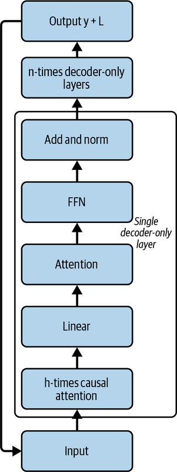
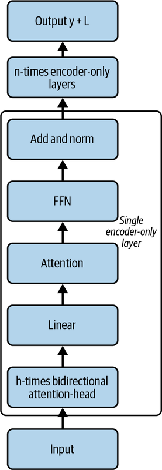
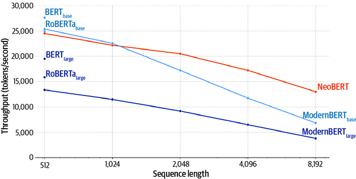
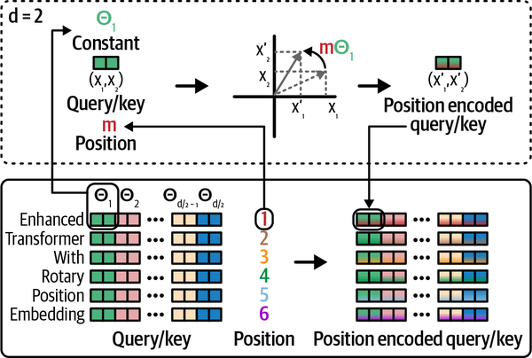
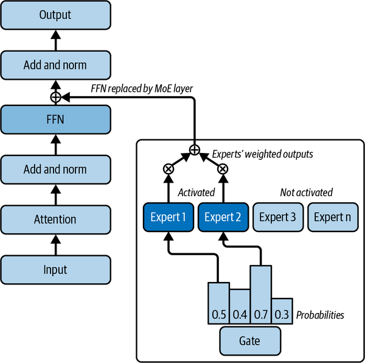
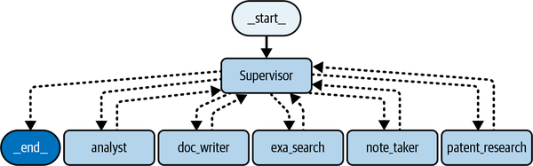

# 第 4 章　智能体背后的模型：能力与优化

> 原书：*AI Agents: The Definitive Guide — Design, Deployment, and Evaluation for Production*，Nicole Koenigstein 著。译文依据用户提供的 PDF，第 147–184 页。术语及排版沿用前两章，代码和示例输出按原文保留。正文的技术论断、模型配置和性能数字忠实于原书，不代表已按当前版本重新验证。

<!-- source: PDF 147–148 -->

到现在，你已经完成了理解如何设计 AI 智能体、如何让它们变得更好的艰难工作。此刻正适合退后一步，看看幕后，更深入地思考赋予它们智能的模型。你可能会问，为什么我没有在开头介绍模型？这是有原因的，让我解释一下。

对本章而言，理解 AI 智能体能做什么至关重要，因为这补全了我希望你理解智能体的整条叙事线。我希望你像招聘团队成员一样思考智能体。要做好这件事，就需要全局视角：团队如何互动、如何组织，以及如何辅导它们进步和协作。这些内容都已在前面几章介绍。

这是我设计 AI 智能体时采用的心智模型：把它们看成动态、协作的系统，而不是孤立组件。每种模型规模、每个模型家族都有不同的技能特征。如果据此构建多智能体系统，不仅结果更好，还能节省成本。换个说法：你已经学会管理团队，现在该学会招聘团队成员了。本章会介绍如何决定招谁加入、他们具备什么技能，以及这为什么会影响表现、改进和成本。

就像人类团队，每个成员都有不同的长处、短处和工作方式，技能相互补充。AI 智能体同样如此：经过深思熟虑地组合后，它们共同完成的事情会远超任何单一模型。一旦理解它们的优势和协作方式，就能合理分配任务，释放系统的全部潜力。

不过需要说明，本章不是 Transformer 架构或参数高效微调（parameter-efficient fine-tuning，PEFT）方法的入门。我假定你已经接触过这些内容。这里要做的是唤醒这些知识，并让它们与智能体思维方式对接，使你清楚看到：在编排多个智能体时，为什么模型选择、上下文策略，以及低秩适配（Low-Rank Adaptation，LoRA）、适配器和量化基座等轻量专业化手段如此重要。

为了更好地理解这一点，你将从这个角度考察不同架构，并比较开放权重模型与封闭 API 模型。此外，还会将上下文窗口的权衡对应到部署策略，并理解何时值得通过微调或适配器实现专业化。学完之后，你将知道如何为团队配备成员、分派合适任务，并同时优化表现和支出。现在就来认识候选者，理解它们的优势，作出好的招聘决定。

## 全局视角：选择合适的架构

<!-- source: PDF 148–150 -->

现代 Transformer 变体针对特定工作负载和部署需求而设计。正确选择取决于目标、信息如何在系统中流动，以及模型服务或扩展时面临的约束。每种架构，无论仅编码器、仅解码器、编码器—解码器，还是混合专家（MoE），都有独特作用。选择合适组合，就是让每种模型的优势与目标、计算预算和服务约束匹配，在能力与效率之间取得最佳平衡。表 4-1 概述了各类架构及其能力。

**表 4-1　Transformer 架构类型**

| 类型 | 主要能力 | 典型用途 |
| --- | --- | --- |
| 仅编码器（Encoder-only） | 表征学习；为输入 token 生成上下文嵌入 | 文本分类、语义搜索、命名实体识别（NER） |
| 仅解码器（Decoder-only） | 自回归生成；学习在给定前文时预测下一个 token | 文本生成、代码合成、对话智能体与聊天系统 |
| 编码器—解码器（Encoder–decoder） | 在输入和输出表征之间进行序列到序列映射 | 翻译、摘要、基于给定上下文的问答 |
| 嵌入模型（Embedding models） | 生成稠密或稀疏向量表征，支持高效检索和相似度比较 | 检索增强生成（RAG）、语义相似度搜索、聚类 |
| 混合专家（Mixture of experts，MoE） | 通过稀疏专家路由实现可扩展计算和跨任务专业化 | 高效的大规模生成、多任务学习、自适应模型扩展 |

下面深入讨论仅解码器、仅编码器和 MoE 模型，因为它们构成了现代 AI 系统的骨干。

### 仅解码器模型

<!-- source: PDF 150–154 -->

听到“LLM”时，你通常想到的就是仅解码器模型。它们构成 GPT、Claude 等系统的基础，遵循一个简单但强大的思想：每次生成一个 token，并把此前所有内容作为上下文。

你已经知道其结构：没有编码器，没有交叉注意力，只有一叠 Transformer 块，不断预测下一个 token。这种自回归设置（auto＝自身，regressive＝基于先前数值），意味着模型学习只向序列前方已出现的部分回看。每个新 token 都依赖自身之前的输出，形成反馈循环，每一步生成都建立在此前内容之上。图 4-1 给出仅解码器架构的概览。



*图 4-1　仅解码器架构概览。其中 y + L 表示最终输出变换，即将解码器隐藏状态 y 送入学得的输出层 L，生成下一个 token 的 logits。*

> 图中文字对照：Input＝输入；h-times causal attention＝h 个因果注意力头；Linear＝线性层；Attention＝注意力；FFN＝前馈网络；Add and norm＝相加与归一化；Single decoder-only layer＝单个仅解码器层；n-times decoder-only layers＝n 个仅解码器层；Output y + L＝输出 y + L。符号与连线均按原图保留。

自回归生成让这类模型非常擅长文本和代码生成、推理与对话。也就是说，仅解码器模型是生成者、编码者、交谈者和规划者。它们逐步思考，始终建立在已有思路之上。不过，要让它们更快、更高效，关键是理解它们如何在实现与概念层面管理这种记忆。用数学来看原因。为了实现因果（自回归）注意力，自注意力掩码强制执行因果约束：

$$
A=\operatorname{softmax}\left(\frac{QK^\top}{\sqrt{d}}+M_{\mathrm{causal}}\right)V
$$

这意味着，每生成一个新 token，模型原本都需要重新计算此前全部注意力状态，因为在第 $t$ 步只能关注位置不超过 $t$ 的 token。但已经计算的 $K_{1:t-1}$ 和 $V_{1:t-1}$ 不会改变，因此可以安全地在第 $t+1$ 步复用。键值缓存（key-value caching，KV 缓存）就在这里发挥作用。

#### KV 缓存：为什么重要

键值缓存是一种巧妙的优化：保存注意力层中此前算出的键和值，供模型复用，而不必从头重新计算。KV 缓存大幅加快推理，但也有代价。序列变长时，缓存会逐层增长，直到显存消耗成为主导因素。关键在于平衡速度和显存，这在大规模部署模型或跨多个智能体部署时至关重要。经验上，KV 缓存内存占用随以下乘积增长：

**序列长度 × 层数 × KV 头数 × 头维度 × 2 × 每个数值的精度字节数。**

因子 2 来自同时保存键和值。使用分组查询注意力（grouped-query attention，GQA）时，KV 头少于查询头，因此解码期间缓存可以显著缩小。总体而言，你以更大的内存占用换取吞吐量提升。还需要理解，目前最先进（state-of-the-art，SOTA）的模型已不再采用原始注意力机制，而通常使用 GQA：不再让每个查询头都有独立的 K、V 投影，而是将多个查询头分组，共享键和值，从而大幅减小 KV 缓存。

在 Hugging Face 中，可以通过模型配置检查架构。用 `AutoModelForCausalLM.from_pretrained(model_name)` 加载模型，再调用 `model.config`。对 `Qwen2.5-7B-Instruct-1M`，显示的 GQA 配置为：

```text
"num_attention_heads": 28,
"num_key_value_heads": 4,
```

这个 Qwen 2.5 配置中，28 个查询头只共享 4 个键值头，是现代 GQA 实践的典型例子。表 4-2 详细说明其对内存的影响。

**表 4-2　分组查询注意力配置（以 Qwen 2.5 为例）**

| 组件 | 数值 | 含义 |
| --- | --- | --- |
| Q 头 | 28 | 独立查询投影，以保留表达能力。 |
| KV 头 | 4 | 共享键和值投影，尽量减小缓存和内存带宽需求。 |
| 分组比例 | 28 ÷ 4 = 7 | 每对 KV 服务 7 个查询头。解码时 KV 缓存内存和带宽需求约降低 7 倍。 |

高效的 KV 缓存管理对扩展仅解码器模型至关重要，因为它直接影响内存占用与响应速度。管理是否得当，决定系统能否平稳扩展，还是在高负载下变成瓶颈。

> **现代化的编码器—解码器架构：Flash Attention T5**
>
> 编码器—解码器架构在某些情况下可以胜过纯粹的仅解码器模型，尤其在多任务或零样本设置中。[Flash Attention T5（FAT5）](https://oreil.ly/rNnrS)是一种现代化编码器—解码器模型，按照今天的效率标准更新了原始 T5[^ch4-1] 设计。通过把 Flash Attention 融入 T5 架构，它消除了主要的注意力瓶颈，实现近线性的内存行为，并支持显著更长的上下文窗口。模型保留强大的生成能力，同时支持针对分类任务高效地仅微调编码器，在不损失准确性的情况下缩短训练时间。

一种做法是在束搜索解码时，跨不同搜索束复用共享前缀的 KV 缓存，避免冗余的注意力计算。这可以显著降低内存使用并加快推理，尤其适合束宽较大的设置。当上下文增长、序列接近模型最大上下文长度时，应引入前缀裁剪或滑动窗口机制。不再对输出作出有意义贡献的旧 token 可以安全移除，以降低内存占用。除了优化内存，这也是缓解“大海捞针问题”（haystack problem）的实用办法：过多历史上下文会遮蔽相关信息。

> **Softmax 与大海捞针问题**
>
> Transformer 使用 softmax 计算注意力权重。随着上下文变长，softmax 分母对所有 token 分数求和，变得很大，而单个分数大致不变。这会让分布变平，降低重要 token 与无关 token 之间的对比，使模型更难识别关键信息。这一挑战称为大海捞针问题。

<!-- source: PDF 154–158 -->

部署时，应持续监控缓存命中率和内存压力。低命中率往往说明调度低效，或发生了不必要的缓存失效；高内存压力则意味着需要分页或裁剪策略。vLLM 等框架已经支持层次式分页和分段缓存复用，以维持高并发时的稳定性。表 4-3 概述了有助于高效管理 KV 缓存的重要 vLLM 功能。

**表 4-3　vLLM 缓存管理功能**

| 机制 | 描述 | 好处 |
| --- | --- | --- |
| 分页注意力（Paged attention） | 将 KV 缓存拆成固定大小的内存块，由 `free_block_queue` 管理；调度器动态分配和回收这些块 | 支持高效复用、防止碎片化，并支持长时间运行的会话 |
| 前缀缓存（Prefix caching） | 对重复 token 前缀求哈希，在新请求具有相同前缀时复用缓存的 KV 对 | 消除共享提示或模板带来的重复预填充计算 |
| 分块预填充（Chunked prefill） | 将长提示的预填充分成更小的块，逐步处理 | 防止单个长提示独占缓存块，提高并发能力 |
| 连续批处理（Continuous batching） | 根据实时缓存可用情况，联合调度预填充与解码 | 在保持缓存状态一致的同时提高吞吐量 |
| 基于哈希的验证（Hash-based verification） | 复用缓存条目前，比较已存 token 块哈希与新输入的哈希 | 上下文变化后保障缓存完整性，避免在前缀被裁剪或重排时复用过期或不匹配的 KV 块 |
| 动态缓存回收（Dynamic cache reclamation） | 请求完成或被抢占后，立即将 KV 块归还池中 | 使 GPU 显存利用率保持较高且稳定 |
| 解耦式 KV 传输（Disaggregated KV transfer） | 在预填充与解码工作进程之间共享 KV，例如通过共享存储连接器 | 支持分布式配置，使延迟敏感的解码与繁重的预填充隔离 |

还需要考虑的是，上下文工程，也就是有意识地修改、插入或删减模型输入上下文中的 token，会直接影响 KV 缓存完整性。由于缓存保存的是已处理 token 的键和值投影，任何改变 token 顺序或身份的修改，都可能使部分缓存失效。

注入新文档、裁剪旧前缀或重排消息后，缓存条目就不再与模型的位置编码对应。复用这些条目会导致不连贯或产生幻觉的输出。因此，每次结构性的上下文变化都必须触发选择性缓存失效。分层策略，即组合窗口化、分段和哈希验证，有助于在保持效率的同时保证正确性。合理的上下文设计，例如预先安排静态系统提示，能让动态 RAG 或多轮交互场景中仍有部分缓存持续有效。现代推理框架通过以下方式处理这些问题：

- 滑动窗口缓存：对于有界注意力，只保留最近 N 个 token。
- 分块或分段缓存：隔离系统提示、检索上下文和用户轮次，以支持部分失效。
- 过期键淘汰：超时后丢弃不活跃缓存。
- 上下文哈希：复用前比较 token 校验和，以保证正确性。

读到这里，你应该已经清楚：部署仅解码器模型，或让它更快，不只是重新训练、量化或拥有多少 GPU 的问题。关键是设计推理运行时，并有效管理其缓存。虽然这起初听起来可能令人望而生畏，但 vLLM 等框架通过分页内存、前缀复用和分布式 KV 共享，简化了这一过程。实践中，往往只需通过框架配置项启用这些机制，就能以很少的运维开销高效管理 KV 缓存。有些功能，例如前缀缓存，甚至默认启用。

### 仅编码器模型

<!-- source: PDF 158–160 -->

本节把视角转向常被低估的仅编码器模型。仅解码器模型专注生成，一个 token 接着一个 token 地输出；仅编码器模型则专注理解。它们不生成文本，而是分析文本。全部任务就是从各个方向观察输入，对其含义形成深入的上下文理解。

你已经接触过 BERT[^ch4-2] 和 RoBERTa[^ch4-3] 等模型。它们以双向方式阅读文本，捕捉整个序列中词与词之间的关系。它们不预测下一个 token，而是通过重建输入中被遮蔽的部分，学习缺失了什么。这种称为掩码语言建模（masked language modeling）的方法，教模型理解语言结构和细微差别，而非生成文本。

仅编码器架构完全去掉了解码器堆栈，依赖双向注意力，也就是说，每个 token 都可以关注序列中的其他每个 token。图 4-2 展示了抽象的仅编码器架构。



*图 4-2　抽象的仅编码器架构。*

> 图中文字对照：Input＝输入；h-times bidirectional attention-head＝h 个双向注意力头；Linear＝线性层；Attention＝注意力；FFN＝前馈网络；Add and norm＝相加与归一化；Single encoder-only layer＝单个仅编码器层；n-times encoder-only layers＝n 个仅编码器层；Output y + L＝输出 y + L。

<!-- source: PDF 161–166 -->

由于没有自回归循环，这类模型并行处理整个输入，因此服务速度更快、负担更轻、成本更低。它们不需要 KV 缓存，也不需要逐 token 生成，非常适合分类、检索和嵌入工作负载。

即使大型生成模型占据新闻头条，仅编码器 Transformer 仍在真实系统中扮演重要角色。例如，在 RAG 流水线中，它们充当检索器：像敏捷而敏锐的分析师，在生成模型接手之前，找出最相关的上下文。大规模部署中，它们常常是保障效率和精确性的主力。好消息是，虽然许多旧架构仍然工作良好，著名的 BERT 也已有现代化改造版本。表 4-4 展示较新的模型架构，以及它们相较于原始 BERT，在位置编码、序列长度和支持 FlashAttention 以加快训练及推理方面的改进。

**表 4-4　编码器模型架构比较〔原表右侧裁切，以下为可见部分〕**

| 组件 | BERT（base） | BERT（large） | NomicBERT（base） | 原列名残片：`Mod… (bas…` |
| --- | --- | --- | --- | --- |
| 层数 | 12 | 24 | 12 | 22 |
| 隐藏层大小 | 768 | 1,024 | 768 | 768 |
| 注意力头数 | 12 | 16 | 12 | 12 |
| 参数量 | 120M | 350M | 137M | 可见：149M |
| 位置编码 | 位置嵌入 | 位置嵌入 | RoPE | 可见：RoPE |
| 序列长度 | 512 | 512 | 2,048 | 可见：1,024 |
| 支持 FlashAttention | ✗ | ✗ | ✓ | ✓ |

> **译校说明**：原 PDF 第 162 页包含横向滚动区域，仅保留了表格左侧及下一列的部分内容。最后一列的完整模型名、超出右侧边界的内容及后续列均无法从该页恢复；上表只录入可见文字，不推断被截掉的数据。下文提及的 NeoBERT 数据也未出现在该页可见表格中。[查看原表所在页面截图](assets/table-4-4-source.png)。M 表示百万参数。

NeoBERT[^ch4-4] 是经典 BERT 架构近期的现代化版本，在较长序列上表现良好，支持最多 4,096 个 token，如表 4-4 所示。图 4-3 比较了模型吞吐量随序列长度的变化，单位为 token／秒，越高越好。



*图 4-3　两种最新现代化 BERT 架构 ModernBERT 与 NeoBERT 的吞吐量比较。图片取自 Lola Le Breton 等人的 NeoBERT（2025）。*

> 图中文字对照：Throughput (tokens/second)＝吞吐量（token／秒）；Sequence length＝序列长度。曲线及标记包括 BERT_base、BERT_large、RoBERTa_base、RoBERTa_large、ModernBERT_base、ModernBERT_large 和 NeoBERT，原始坐标、数值及图例均保留。

因此，虽然仅编码器模型曾似乎被仅解码器架构的崛起掩盖，它们的演进一直在悄然继续。[NomicBERT](https://oreil.ly/NaAGS)、ModernBERT[^ch4-5] 和 NeoBERT 等现代变体，整合了旋转位置编码以扩展上下文窗口，以及 FlashAttention 内核以加快训练和推理等先进技术。

#### 旋转位置嵌入

传统位置编码，无论固定正弦式还是学习得到，都能帮助模型理解 token 顺序，却难以很好地泛化到训练上下文之外，例如从 2K token 扩展到 32K。**旋转位置嵌入（rotary positional embeddings，RoPE）**[^ch4-6]通过旋转而非相加来编码相对位置，解决这一限制。

RoPE 不给每个 token 加上位置向量，而是在注意力机制中，根据随 token 位置递增的角度旋转查询向量和键向量。两个旋转后向量的点积自然反映它们的相对距离，使模型可以外推到更长的序列。

可以把 RoPE 想象为将 token 排列在圆周上：每个词占据独特角度，角度差表示相对距离。邻近 token 的方向更接近，较远 token 则由更大的旋转角度分隔。图 4-4 展示了这一点。



*图 4-4　旋转位置嵌入（RoPE）示意图。图片改编自 Jianlin Su 等人（2021）。*

> 图中文字对照：Constant＝常量；Query/key＝查询／键；Position＝位置；Position encoded query/key＝经过位置编码的查询／键；Enhanced Transformer With Rotary Position Embedding＝采用旋转位置嵌入增强的 Transformer。角度、维度及向量符号按原图保留。

扩展基于 RoPE 的模型很直接。不过，简单的 RoPE 缩放可能改变模型行为，并损害某些任务的质量，因此扩展后的上下文窗口仍需针对实际工作负载评估。vLLM 或 Transformers 等现代库允许在加载时重新缩放 RoPE 频率，扩展上下文窗口：

```python
from vllm import LLM, SamplingParams

llm = LLM(
    model="answerdotai/ModernBERT-base",
    trust_remote_code=True,
    rope_scaling={"type": "linear", "factor": 4.0}
)

output = llm.generate("Summarize this 64k-token document...",
                      SamplingParams(max_tokens=512))
print(output[0].outputs[0].text)
```

这里，`rope_scaling` 将模型的有效上下文长度扩大 4 倍，从 32K 增至 128K token，无需重新训练即可实现高效的长序列推理。

> 译校说明：上述模型名、生成调用及“32K 到 128K”的说明均按原书保留。本章前文将此类模型定位为不生成文本的编码器，而该示例使用生成接口；片段也未展示原始 32K 配置，不能仅凭这段代码确认其可运行性或上下文长度。

这些创新使仅编码器模型在效率和推理深度上接近其解码器同类，同时保留了使其在检索、分类和嵌入任务中不可或缺的精确性与双向性。因此，仅编码器 Transformer 仍然处于现代 AI 系统的核心，默默支撑着当今最先进智能体系统底层的理解能力。

这就是为什么在 AI 智能体团队中，仅编码器模型是分析师和调查员。它们不发言，而是倾听、解释，在传递信息之前先理解一切。它们的长处是深入且高效地理解上下文，因此是结构良好的智能体生态中不可缺少的一部分。

### 混合专家模型

<!-- source: PDF 166–168 -->

现在来看一种改变我们理解规模方式的架构。MoE 模型从现实团队的工作方式中获得启发。并非每个人都需要做每项任务，有些人有所专长，关键是知道该向谁求助。MoE 将同样的逻辑应用于 Transformer。

稠密模型让每层处理每个 token，而 MoE 模型则把工作分配给多个称为“专家”的专业网络。这些专家取代稠密 Transformer 块中的标准前馈网络（FFN）。一个轻量门控网络充当路由器，决定针对给定输入激活哪些专家。在稠密 Transformer 中，每个 token 都流过同一个 FFN；在 MoE 中，路由器只选择少量专业 FFN。每次只使用少数专家，其余保持空闲。这意味着模型可以拥有数十亿参数，但每次前向传播只使用一小部分。图 4-5 展示了这一流程。

结果是，模型扩大容量，却不相应扩大成本。一个万亿参数的 MoE 模型，其运行时成本可以接近小得多的稠密模型，因为它只激活相关专家。这个概念称为**条件计算（conditional computation）**：只在需要的地方投入计算。



*图 4-5　混合专家架构概览。*

> 图中文字对照：Input／Output＝输入／输出；Attention＝注意力；Add and norm＝相加与归一化；FFN＝前馈网络；FFN replaced by MoE layer＝由 MoE 层替换 FFN；Gate＝门控；Probabilities＝概率；Expert 1／2／3／n＝专家 1／2／3／n；Activated／Not activated＝已激活／未激活；Experts’ weighted outputs＝专家输出的加权结果。

门控机制本身也有不同形式。常见方法包括：top-k 路由，激活最相关的 k 个专家；噪声门控，通过加入随机性提高专家利用率；以及专家选择路由，由专家竞争 token，而非由路由器分配。这些差异主要在训练而不是推理中发挥作用，但会显著影响负载均衡、稳定性和整体模型质量。

再次用团队成员作比喻，MoE 模型就是专业人士。它们不求样样精通，但只要把合适的问题路由给合适的专家，系统就既强大又高效。这使 MoE 成为大规模语言建模中最重要的架构进步之一，让模型团队像人类专家一样协作，在合适时机贡献独特优势。

### 推理模型

<!-- source: PDF 168–172 -->

如果仅解码器模型是生成者，仅编码器模型是分析师，混合专家是专业人士，那么推理模型就是思考者。它们先停下来，再行动；将问题拆成步骤，并反思自己的结论。

推理模型不只由架构定义，更由行为优化定义。底层通常仍基于解码器，但经过训练或提示，使用结构化推理链、规划轨迹或工具增强的反思。它们不只是直接预测下一个 token，而是学习生成引导更好答案的中间思维。

DeepSeek-R1、Qwen3 和 OpenAI GPT 的“推理”变体等模型，还通过推理时优化进一步扩展这一能力：鼓励模型在运行时搜索自身的推理空间，有时先生成多条并行解题路径，再选出最一致的一条。这一转变标志着一个新类别的出现：模型不仅响应，还会动态推理。

从架构上看，它们仍接近仅解码器 Transformer，但真正的创新在于推理循环，而非网络层。它们将符号信息的持续保留（通过推理 token 或隐藏状态复用），与概率式探索（通过多样本解码或内部一致性检查）结合起来。结果是生成更慢，但决策更深入、更可靠。

用团队成员作比喻，这些同事不急于开口。给出答案之前，他们会思考、反思，有时甚至自我争辩。他们更慢，却常常能让整个团队避免本可预防的错误。在一个偏重即时反应的系统里，他们承担反思者的角色。

#### 思考模式

现代推理模型提供控制其推理方式的接口。可以通过部署环境特定的开关，在思考模式与快速响应模式之间切换。使用 Transformers 库时，可以直接在聊天模板中启用或禁用内部推理轨迹（示例 4-1）。

**示例 4-1　使用 Transformers 在思考与非思考模式之间切换**

```python
text = tokenizer.apply_chat_template(
    messages,
    tokenize=False,
    add_generation_prompt=True,
    enable_thinking=True
)
```

1. 启用思考，这是默认模式。

使用 vLLM 等兼容 OpenAI 的服务器时，可以通过客户端调用传递模式开关，见示例 4-2。

**示例 4-2　使用 vLLM 在思考与非思考模式之间切换**

```python
chat_response = client.chat.completions.create(
    model="Qwen/Qwen3-8B",
    messages=[
        {"role": "user", "content":
        "What are reasoning models, in terms of large language models?"},
    ],
    max_tokens=8192,
    temperature=0.7,
    top_p=0.8,
    presence_penalty=1.5,
    extra_body={
        "top_k": 20,
        "chat_template_kwargs": {"enable_thinking": False},
    },
)
```

1. 用 `{"enable_thinking": False}` 禁用思考模式。

不过，也可以在提示中“直接告诉”模型不要使用思考。即使禁用思考，许多模型仍保留隐藏轨迹的内部结构，以保持格式一致，让你切换思考模式时无需改变下游代码。

用这些开关让延迟和质量匹配任务。规划、任务拆解、工具选择和验证时启用思考；对于简短、低风险的轮次，或计划已经验证过的步骤，可以禁用。

#### 思考预算

推理 token 不是免费的。许多模型提供思考预算，限制分配给内部轨迹的 token 数。如果推理过程中预算耗尽，模型可以截断思考，并平稳继续生成响应。这可能包含一句简短的衔接语，表明已到达预算边界，如示例 4-3 所示。这里，`thinking_budget` 控制工作流在引导模型转向答案之前，允许推理阶段生成多少 token；`max_new_tokens` 是整体生成上限。推理 token 可能不出现在最终答案里，但仍然是已生成的 token，因此会占用可用预算，并影响延迟和成本。

**示例 4-3　设置思考预算**

```python
thinking_budget = 1024
max_new_tokens = 32768

# Rest of code is omitted for brevity

if 151645 not in output_ids:

    if 151668 not in output_ids:
        print("thinking budget is reached")
        early_stopping_text = "\n\nConsidering the limited time by the user, I have to give the solution based on the thinking directly now.\n</think>\n"
        early_stopping_ids = tokenizer([early_stopping_text], return_tensors="pt",
        return_attention_mask=False).input_ids.to(model.device)
        input_ids = torch.cat([generated_ids, early_stopping_ids], dim=-1)
    else:
        input_ids = generated_ids
    attention_mask = torch.ones_like(input_ids, dtype=torch.int64)

    generated_ids = model.generate(
        input_ids=input_ids,
        attention_mask=attention_mask,
        max_new_tokens=input_length + max_new_tokens - input_ids.size(-1)
    )
    output_ids = generated_ids[0][input_length:].tolist()
```

1. 检查 tokenizer 特定的特殊 token ID。在此 tokenizer 中，`151668` 对应 `</think>`。
2. 第二次生成。
3. 如果 `max_new_tokens` 太小，计算结果可能为负，因为提前停止文本包含 24 个 token。

> **每个 token 都算数**
>
> 无论自行托管模型，还是使用托管 API，都要记住每个 token 都会产生影响。每个推理步骤、工具调用和中间生成，都计入最终账单。

根据可接受延迟和任务复杂度选择预算。预算太小可能限制多步骤改进，降低一致性。实践中，对于非简单推理，1,000 token 或以上的预算通常表现不错；数学、代码生成和多工具计划等能从深入探索中受益的任务，可以提高预算。

### 融会贯通：设计专家团队

<!-- source: PDF 172–174 -->

现在你已看到，不同模型架构如何为智能体系统带来独特优势。本节将依据这些知识构建 MAS。下面配置中的每个智能体都代表一种独特能力，为整个系统的推理、检索和综合整理过程作出贡献。表 4-5 展示了实现中的角色与模型。

**表 4-5　智能体团队概览**

| 角色 | 架构 | 具体模型 | 主要任务 | 工具（原 PDF 可见片段） |
| --- | --- | --- | --- | --- |
| 语义研究 | 仅解码器，快速模式 | Qwen3 32B | 神经搜索，并提取重点内容 | `Exter…` / `ch_an…` |
| 专利研究 | 仅解码器，快速模式 | Qwen3 32B | 检索过去一年的专利 | `Goog…` |
| 分析师 | 混合控制器加编码器 | 推理控制器：Qwen3 235B Thinking；编码器：ModernBERT base | 语义过滤与抽取式摘要；先分层推理，再由编码器评分 | `seman…` |
| 笔记员 | 仅解码器，快速模式 | Qwen3 32B | 创建提纲 | `creat…` / `ument…` |
| 撰稿人 | 仅解码器，快速模式 | Qwen3 32B | 起草和编辑 | `write…` / `cumen…` |
| 监督者 | 审慎推理的 LLM | GPT 4.1 | 路由与结束任务 | `Agen…` |

> 来源缺损：原 PDF 的表 4-5 右侧同样被裁切，工具列无法完整读取。上表保留可见片段，省略号表示裁切，不据后续代码猜补。可核对[原表页面截图](assets/table-4-5-source.png)；示例 4-7 则另行保留原书明确给出的工具配置。

这些专门化智能体共同形成一条协调运作的研究与写作流水线。监督者管理整个过程，在智能体之间路由任务，并决定系统何时达到最终结果。图 4-6 展示这些组件如何连接，突出多智能体系统内部的信息流与推理流。



*图 4-6　使用 LangGraph 实现的研究团队示意图。*

> 图中文字对照：`__start__`／`__end__`＝开始／结束；Supervisor＝监督者；exa_search＝Exa 搜索；patent_research＝专利研究；analyst＝分析师；note_taker＝笔记员；doc_writer＝文档撰稿人。节点标识保持与代码一致。

本节代码聚焦每个智能体的定义。工具、图的连接和路由等完整代码有意省略，以便把注意力放在角色分工，以及这些分工背后的架构选择上。

示例 4-4 定义团队中每个智能体的具体技能。

<!-- source: PDF 174–177 -->

**示例 4-4　简单文本生成**

```python
EXA_PROMPT = """Role: Research assistant. You can search for all recent info
on Exa Search. Your response should clearly articulate the key points you found."""

PATENT_PROMPT = """Role: Market researcher with 20 years of experience.
You are very knowledgeable in patent research and in finding up-to-date info
about patents using the Google Patents API."""

NOTE_PROMPT = """You can read documents and create outlines for the document
writer. Don't ask follow-up questions."""

WRITER_PROMPT = """You can read, write, and edit documents based on note-taker's
outlines. Don't ask follow-up questions."""

ANALYST_PROMPT = """
You are the Analyst. You must call the `semantic_filter_tool` exactly once.
Inputs:
- query: the current task topic or question
- documents: a list of raw strings gathered by teammates

Rules:
- don't answer the user
- don't do free-form writing
- Only return the tool result to the supervisor
""".strip()
```

对于开源模型，我使用 [Nebius](https://nebius.com/)，但你也可以使用任何兼容 OpenAI 的云提供商，例如 [Novita](https://novita.ai/) 或 [Together AI](https://together.ai/)。示例 4-5 展示我的模型配置。你会看到，我关闭了 Qwen3-32B 的思考模式，并为 Qwen3-235B-A22B 分配了思考预算。常见云提供商通常采用相同的配置形式，这里根据 [Qwen 文档](https://oreil.ly/Ef0_K)中通过 [vLLM](https://oreil.ly/gY522) 部署模型的说明进行了改编。

**示例 4-5　设置模型**

```python
fast_llm = ChatOpenAI(
    model="Qwen/Qwen3-32B-fast",
    temperature=0,
    api_key=NEBIUS_API_KEY,
    base_url="https://api.studio.nebius.ai/v1/",
    extra_body={
        "top_k": 20,
        "chat_template_kwargs": {"enable_thinking": False},
    },
)

thinker_llm = ChatOpenAI(
    model="Qwen/Qwen3-235B-A22B-Thinking-2507",
    temperature=0,
    api_key=NEBIUS_API_KEY,
    base_url="https://api.studio.nebius.ai/v1/",
    extra_body={
        "chat_template_kwargs": {"enable_thinking": True},
        "thinking": {"type": "token", "budget": 1536}
    },
)
supervisor_llm = ChatOpenAI(
    model="gpt-4.1",
    temperature=0
)
```

示例 4-6 展示如何实现一个辅助函数，加快智能体的创建。

**示例 4-6　创建 ReAct 工作节点**

```python
def make_react_worker_node(
    *,
    llm: ChatOpenAI,
    name: str,
    tools: list,
    prompt: str | None = None,
    goto: str = "supervisor",
):
    agent = create_react_agent(llm, tools=tools, prompt=prompt)

    def node(state: State) -> Command[Literal["supervisor"]]:
        result: Dict[str, Any] = agent.invoke(state)
        msgs: Sequence[BaseMessage] = result.get("messages", [])
        content = getattr(msgs[-1], "content", "") if msgs else ""
        return Command(
            update={"messages": [HumanMessage(content=content, name=name)]},
            goto=goto,
        )

    return node
```

有了这个辅助函数，就可以按照示例 4-7 创建各个智能体。

**示例 4-7　创建智能体**

```python
specs = [
    dict(
        name="search", tools=[tavily_search, tavily_extract],
        prompt=SEARCH_PROMPT, llm=fast_llm
    ),
    dict(
        name="exa_search", tools=[exa_search_tool],
        prompt=EXA_PROMPT, llm=fast_llm
    ),
    dict(
        name="patent_research", tools=[patent_search],
        prompt=PATENT_PROMPT, llm=fast_llm
    ),
    dict(
        name="analyst", tools=[semantic_filter_tool],
        prompt=ANALYST_PROMPT,llm=thinker_llm
    ),
    dict(
        name="note_taker", tools=[create_outline, read_document],
        prompt=NOTE_PROMPT, llm=fast_llm
    ),
    dict(
        name="doc_writer", tools=[write_document, edit_document, read_document],
        prompt=WRITER_PROMPT, llm=fast_llm
    ),
]

nodes = {
    s["name"]: make_react_worker_node(llm=s["llm"], name=s["name"],
    tools=s["tools"], prompt=s["prompt"])
    for s in specs
}
```

运行代码并查看分析师智能体的输出时，会看到类似下面的内容：

```text
Analyst (ModernBERT) processing 2 docs...
'analyst': {'messages': [HumanMessage(content='\n\n[\n {\n
""text": "### Latest
Developments in AI Agents: A Focus on Coding Agents\\n\\nAI agents, particularly
those focused on coding, are rapidly evolving and transforming the landscape of
software development.",\n "source": "Source Doc [1]",\n "score":
0.956\n  },
# Rest of output omitted
```

倒数第二行的分数 `0.956`，就是 ModernBERT 为这段内容给出的相关性排序分数。

这种配置满足了我们的目标：由一个审慎的分析师仔细推理证据，再由现代编码器模型交叉检查，同时让其他成员保持快速且低成本。除了提示模型提供资源链接之外，再检查相关性和潜在幻觉，这就是设计自我审查系统的一个例子。

## 开放模型与封闭模型：为什么选择很重要

<!-- source: PDF 178–180 -->

关于应该使用开源还是闭源模型，争论由来已久。但开放与封闭的选择不仅是一项技术决策，它还定义了公司使用 AI 智能体构建产品的战略走向。仔细来看，这个选择影响着成本结构、合规、创新速度、供应商依赖，以及长期数据主权等方方面面。本节将通过以下因素，帮助你从分析的角度思考这个问题。

**创新与部署速度**

全球研究社区的贡献推动着新架构与优化技术的发展，Hugging Face、vLLM 或 Ollama 等生态则让这些创新更容易使用。相比之下，闭源模型按内部研发周期和预定发布计划推进。但问题不只有这种创新速度，你还应考虑自身的创新速度，也就是说，部署速度让这一讨论更加复杂。闭源模型可以通过 API 立即使用。大多数开放模型也可以通过 Together.ai 等提供商的托管云部署访问，让团队先快速试验，再为了控制成本和定制而转向自行托管。

**可访问性**

开源模型可以自由获取，用于试验、检查和基准测试。它们通常提供对训练数据、架构与权重的可见性，这对审计与合规可能至关重要。闭源 API 则限制了可见性与控制权，并在速率、费用档位和地域访问方面设有限制。可访问性还包括运维上的便利。封闭模型免除了基础设施的复杂性，提供直接访问；开放模型则可能需要管理基础设施。

**模型优化与定制**

开放模型仍提供最全面的控制权。你可以通过 DPO 或 RL 微调或定制 GPT-4.1 这样的闭源模型，但模型仍只存在于供应商环境中。你无法控制模型权重、部署或运行时。换句话说，可以定制，但仍受制于供应商锁定。开源模型让你能够带走自己的改进；封闭系统让你借用灵活性，却不能拥有它。

**性能**

凭借专有计算资源预算与训练数据的优势，闭源模型往往领先于基准排行榜。然而，性能差距已经显著缩小。Qwen3 或 Kimi K2 等现代开放架构，在性能上接近专有模型。而且，借助第 3 章介绍的优化技术，参见“从经验中学习的 ART”和“通过后训练与搜索型智能体实现通用智能体程序”，你甚至可以训练模型，使其更好地使用工具，或以团队形式更好地协作。

**成本**

按照 2026 年初的定价，闭源模型每百万 token 的输入费用最高可达 150 美元，输出费用最高可达 600 美元（o1-pro）；通过低成本云提供商使用开放模型时，即使是超过 200B 参数的模型，每百万 token 的输入费用也约为 0.3 美元，输出约为 3 美元。此外，如果自行托管，权衡就转向了运维。开源部署需要 GPU、弹性扩展基础设施和持续维护。短期内，托管 API 由于不需要专业人员，看起来可能更便宜；但长期来看，一旦实现高效扩展，自行托管的开放模型通常有更低的总体拥有成本。

**数据安全与合规**

在自行托管或部署于私有云基础设施时，开放模型能够确保完整的数据所有权与合规控制，这对金融、医疗等受监管行业很重要。组织可以实施细粒度访问控制、审计机制和本地部署的加密层。使用托管模型时，无论模型开放还是封闭，你都依赖供应商管理的安全措施与合规认证，例如 SOC-2、ISO-27001 等。这可以简化采购，但代价是可见性降低，并且需要依赖供应商尽责。

综合这些因素，混合策略通常最合理。刚开始构建智能体系统时，托管闭源 API 或托管开源模型提供商，可以帮助你快速推进，把注意力放在应用而非基础设施上。在工作流和职责尚未定型时，这能保持事情简单。不过，在受监管环境中，选择托管仍需谨慎采购与治理，包括数据处理协议、安全审查、保留政策、推理地域控制和审计要求。

随着时间推移，团队扩大，用例开始需要更多控制、定制或数据隔离时，将开源部署纳入内部就会更加实际。这样可以更好地控制模型版本、部署边界和数据处理，但也将更多运维责任转交给团队。当职责归属更加清晰后，把基础设施与模型管理收回内部，往往成为更有效的路径。

> 译校说明：本节中的日期、价格、模型可定制能力及部署判断均忠实保留原书表述，并非本译文对当前服务或价格的独立核验。

## 优化开源模型

<!-- source: PDF 180–181 -->

决定走开源路线后，有多种方法可以同时优化性能与成本。传统上，微调大型模型意味着延续原始训练过程，更新模型全部参数。对于拥有数十亿参数的模型，这会变得十分昂贵，因为在优化过程中，每个可训练参数会带来大约四倍的内存开销，而每个检查点都可能占用数十 GB 的存储空间。

因此，现代流水线依赖**参数高效微调（parameter-efficient fine-tuning，PEFT）**。这是一类只更新少量权重、就能适配大模型的技术。最常见的形式是 LoRA 与适配器模块，它们让基础模型适应新任务，无需从头训练；还有量化，通过降低权重精度来减少内存与推理成本。

接下来的小节将逐一介绍这些方法，作为构建和部署智能体系统时选择优化策略的实用指南。

### LoRA 与适配器

<!-- source: PDF 181–182 -->

**低秩适配（Low-Rank Adaptation，LoRA）**[^ch4-7] 与适配器模块，是提高微调效率最流行的方法之一。LoRA 向现有权重层注入低秩矩阵，在不改动原始模型权重的情况下，学习小幅修正。虽然只更新一小部分参数，LoRA 也能取得与全量微调相当的性能。推理时，根据部署配置，可以把适配器权重合并到基础模型参数中，也可以在基础模型之上动态应用。

适配器遵循相似原则，在 Transformer 块之间插入小型可训练层。这样，只需一小部分计算和内存成本，就能取得接近全量微调的性能。你无需重新训练整个模型，而是插入额外的轻量模块，在保持基础模型冻结的同时，学习特定任务的表示。这种隔离有助于避免**灾难性遗忘（catastrophic forgetting）**，即模型在新数据上微调后，丢失先前学会的能力。通过保留原始权重、只训练少量新增参数，适配器在学习新任务时保留已有知识。两种方法都便于按需加载或卸载适配器权重，从而切换不同任务的配置。当一个模型骨干必须支持多个领域或语言时，这种模块化在生产环境中尤其有用。

让这些思想易于实现的一项近期创新是 [LoRA Exchange（LoRAX）](https://oreil.ly/rzGed)，它重新定义了生产环境中微调模型的服务方式。LoRAX 不再为每个 LoRA 适配器分配独立 GPU 资源，而是允许在共享 GPU 上动态加载和批处理多个微调模型。通过动态适配器加载、分层权重缓存、连续多适配器批处理等机制，LoRAX 可以帮助你把一百多个专门化 LoRA 模型放进同一个部署中。

动态适配器加载允许在运行时按需及时获取适配器权重，在尽量降低延迟的同时，免去预先加载所有微调变体的需要。分层权重缓存管理 GPU、CPU 和磁盘内存，以避免内存耗尽错误；连续多适配器批处理则确保不同适配器的请求能够并发、公平地得到处理。这些策略共同使一个基础模型能够在单个 GPU 上服务多个专门化适配器，帮助你降低推理成本。例如，团队可以为客户支持、法律分析或代码生成微调不同的领域模型，并将它们全部部署在共享 GPU 池上；否则，这可能花费数万美元的云资源费用。

### 量化

<!-- source: PDF 182–183 -->

量化以更少位数表示权重，例如使用 8 位甚至 4 位精度，从而缩小模型并加速推理。这会压缩模型内存占用，降低 GPU 要求，并实现更快的推理。[bitsandbytes](https://oreil.ly/WRNZ4) 和 [unsloth](https://unsloth.ai/) 等框架简化了这一过程，提供可靠的量化例程和优化后的训练内核。此外，Meta、Google 或阿里云等开发者近期发布的许多模型，默认就包含量化变体，让部署更加简单、成本更低。

通常，经过良好优化的开源流水线会结合这些技术：使用量化权重提高推理效率，使用 LoRA 或适配器实现任务专门化，并使用 PEFT 进行适配。它们让你以更小预算、更短迭代周期取得高质量结果。

## 小结

<!-- source: PDF 183–184 -->

本章最核心的认识是：智能体系统的能力来自任务、模型与推理策略之间的匹配。模型是各有所长、技能不同的团队成员。仅解码器模型是生成者和规划者；仅编码器模型是分析师和调查员；混合专家模型是专业人士，可以增加容量，却不必为每个 token 支付全部计算成本；推理模型是审慎的思考者，会在行动前停下来、反思并改进。以这种思路为系统配置成员，就能以更低成本取得更高质量。

你已经看到，架构选择既是建模问题，也是推理问题。KV 缓存通过复用先前的键和值，将顺序生成转化为吞吐量优势，但会增加内存压力。使用推理模型时，还需要决定何时启用思考模式，以及如何设置思考预算，将计算资源投入真正重要的地方，在不重要的地方保留快速路径。

你将这些部分组合成了一个协同工作的智能体组织：审慎的控制器负责推理，编码器验证相关性，快速解码器负责起草和编辑，由监督者统一编排，执行路由并决定何时结束任务。

你了解到，开放与封闭模型的选择并非纯技术问题。它们决定成本、合规和数据主权的发展路径。混合路线往往最务实：先使用托管 API 快速迭代，随着团队和工作流成熟，再转向开源模型自行托管。

参数高效微调让你无需改动每个权重，就能适配模型。LoRA 和适配器提供模块化的专门能力，可按任务或领域加载与卸载。量化减少内存并加速推理。结合 bitsandbytes 和 unsloth 等框架，这些技术让高级优化成为日常构建流程的一部分。

综合起来，这些思想连接了架构、推理与运维。选择正确的角色，将思考资源分配到能产生回报的地方，优化自己掌控的部分，并采用与当前阶段相匹配的部署策略。

第 5 章将把重点从模型架构转向系统集成与执行。你将学习如何通过结构化工具调用、安全执行环境和定义清晰的接口契约，将智能体连接到外部世界。

## 注释

[^ch4-1]: Colin Raffel 等，[“Exploring the Limits of Transfer Learning with a Unified Text-to-Text Transformer”](https://arxiv.org/abs/1910.10683)，2019 年。
[^ch4-2]: Jacob Devlin 等，[“BERT: Pre-training of Deep Bidirectional Transformers for Language Understanding”](https://arxiv.org/abs/1810.04805)，2019 年。
[^ch4-3]: Yinhan Liu 等，[“RoBERTa: A Robustly Optimized BERT Pretraining Approach”](https://arxiv.org/abs/1907.11692)，2019 年。
[^ch4-4]: Lola Le Breton 等，[“NeoBERT: A Next-Generation BERT”](https://arxiv.org/abs/2502.19587v1)，2025 年。
[^ch4-5]: Benjamin Warner 等，[“Smarter, Better, Faster, Longer: A Modern Bidirectional Encoder for Fast, Memory Efficient, and Long Context Finetuning and Inference”](https://arxiv.org/abs/2412.13663)，2024 年。
[^ch4-6]: Jianlin Su 等，[“RoFormer: Enhanced Transformer with Rotary Position Embedding”](https://arxiv.org/abs/2104.09864)，2021 年。
[^ch4-7]: Edward J. Hu 等，[“LoRA: Low-Rank Adaptation of Large Language Models”](https://arxiv.org/abs/2106.09685)，2021 年。
